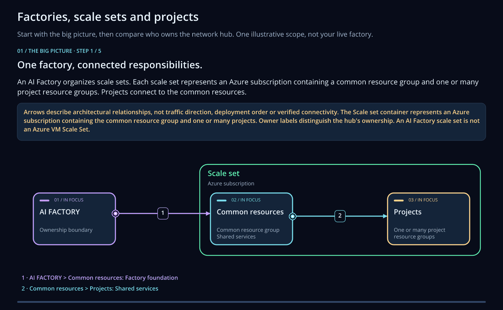
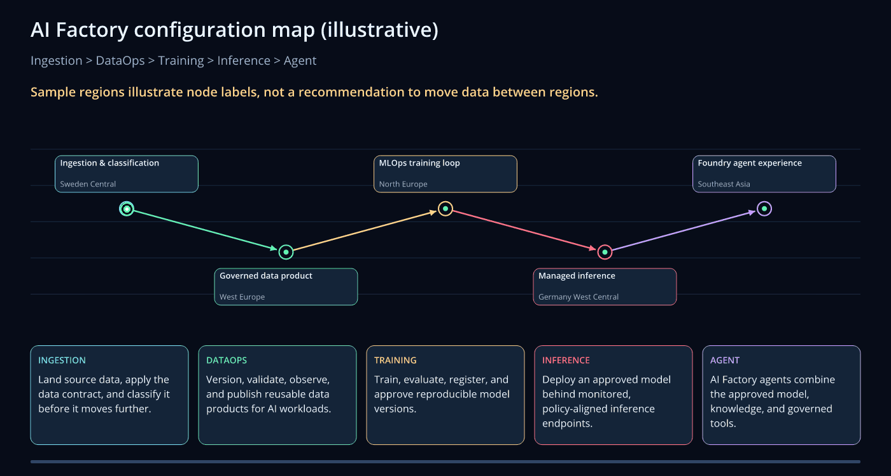

# AI Factory concepts

An AI Factory keeps the shared platform services apart from the projects that use them. The platform team
owns the Factory and its scale sets. Each project team owns its project.

## Factory, scale set and project

| Term | Meaning |
| --- | --- |
| **Factory** | One governed AI platform: its name, its region and its settings. |
| **Scale set** | A group of projects that share one network, in one environment and subscription. It has nothing to do with Azure Virtual Machine Scale Sets. |
| **Project** | One team's workload, with a three-digit number such as `001`, its own resource group and its own settings. |
| **Environment** | Dev, Stage or Prod. A project is deployed to each environment that you ask for. |
| **Common services** | The network, data lake, Key Vault and monitoring that the projects of a scale set share. |

You name a Factory, a scale set and a project by their key or number in every call, for example
`esaf.upsert_project("002", "dev", scale_set="001")`. See [scale and environment choices](enterprise-scale.md)
and [the six scenarios](../reference/scenarios.md).

## Watch the concepts

These animations are the lessons under **View > Concept animations** in the configuration wizard. They show
an example setup. If your device asks for reduced motion, you get a still image. Use the links below each
animation to open it at full size.

The animations carry their own font:
[Open Sans font notices and license](../assets/animations/font-license.txt).

### Factories, scale sets and projects

<picture>
  <source media="(prefers-reduced-motion: reduce)" srcset="../assets/animations/factory-relationships.png">
  
</picture>

[Animated SVG](../assets/animations/factory-relationships.svg) |
[GIF](../assets/animations/factory-relationships.gif) |
[Still image](../assets/animations/factory-relationships.png)

### Configuration map

Follow ingestion, DataOps, training, inference and an agent in a small example. The region labels are
examples.

<picture>
  <source media="(prefers-reduced-motion: reduce)" srcset="../assets/animations/map.png">
  
</picture>

[Animated SVG](../assets/animations/map.svg) |
[GIF](../assets/animations/map.gif) |
[Still image](../assets/animations/map.png)

## Choose the layer you need

| Goal | Guidance |
| --- | --- |
| Configure or operate the factory | [Factory tools](../factory-tools/18-cli-and-api-and-usage.md) |
| Understand planning and dependency checks | [Platform automation](intelligence.md) |
| Build infrastructure | [IaC templates](templates/iac.md) |
| Prepare and move data | [DataOps](templates/dataops.md) |
| Train and evaluate models | [MLOps](templates/mlops.md) |
| Build agents and RAG applications | [GenAIOps](templates/genaiops.md) |
| Follow usage, cost and health | [Monitor and operate](../intelligence.md) |

## Three rules to keep in mind

1. **A call does the whole scenario.** `esaf.init_factory()` or `esaf.upsert_project(...)` saves the settings
   and runs the pipeline that deploys them. Follow the run it returns until it ends.
2. **Switching a service off deletes it only when you ask for that.** A switched-off service that already
   exists stays in Azure unless `enableDeleteForDisabledResources` is `"true"`. See
   [what happens when you switch a service off](../index.md#what-happens-when-you-switch-a-service-off).
3. **Azure is the truth.** A template or a diagram shows what a deployment creates. The run status and the
   Azure portal show what exists.

You choose GitHub Actions or Azure DevOps as the pipeline provider when you create the Factory. Both run the
same Bicep templates. See [GitHub Actions](../orchestrators/gh.md) and [Azure DevOps](../orchestrators/ado.md).

## Where your Factory is stored

The Factory API keeps your factories in a folder named `azurefactory`, with `register.json` as its index and
one `variables.json` for each project. See [Folder structure](../reference/folder-structure.md). Change the
settings with a tool rather than by editing the files, so that the API checks them.
