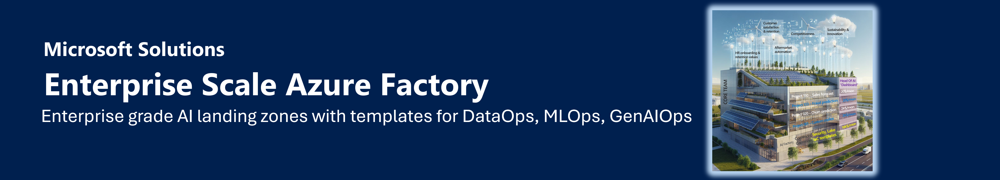

# Enterprise Scale Azure Factory (ESAF)

Go from an empty Azure subscription to a governed AI Factory, then build agents and ML models in it.

An **AI Factory** is a production line for AI projects. The platform team builds the line once. Each project
team then gets the same secure project: private networking, identities, Microsoft Foundry, Azure AI Search
and Azure Machine Learning.

## Start with what you want to do

| Your task | Start here |
| --- | --- |
| Platform team: set up an AI Factory, step by step | [Setup docs](setup/index.md): install the tools, create the Factory, add projects, enable Agent Chat |
| Project team: build agents, apps and ML in your project | [Usage docs](usage/index.md): first agent, first model, project dashboards |
| Project team: start from working code | [Code templates library](code-templates/index.md): search and filter the templates by factory, service and tag |
| Choose the Azure services of a project | [Azure resource library](resources/index.md): search every service a project can switch on, by category |
| See how ESAF connects to Microsoft 365, Power Platform, Fabric and your hub | [Architecture](architectures.md): one image per hub mode, with the code template for each connection |
| Look up any variable in `variables.json` | [Every variable in variables.json](parameters/variables.md): default value and what it does |
| Core team: configure and administer | [Get started - CLI, SDK, API: Core team](factory-tools/18-cli-and-api-and-usage.md): one tab per tool for the whole tutorial |
| Project team: build workload code | [Get started - Agent & ML Factory SDK: Project team](project-team/index.md): Python and CLI examples that run offline first |
| Change a Factory or a project | [Add and update](factory-tools/19-cli-and-api-and-usage.md) |
| Delete a project, a scale set or a Factory | [Clean up](setup/05-clean-up.md), then [Remove and recover](factory-tools/20-cli-and-api-and-usage.md) for the details |
| Choose a hub mode and a networking mode | [Hub and network modes](reference/hub-and-network-modes.md) |
| Understand factories, scale sets and projects | [Core concepts](concepts/index.md) |
| Monitor usage, cost and health | [Monitor and operate](intelligence.md) |
| See what is new | [News and releases](news.md) |

## What you get

| Part | What it gives you |
| --- | --- |
| Common part of the Factory | One network, the private DNS zones, a data lake, a Key Vault and monitoring, shared by all projects of a scale set. |
| Projects | One resource group for each team and environment, with the Azure services that team switches on. |
| Tools | The app, the `azurefactory` CLI, the Python SDK and REST. All four call the same Factory API, so the result is the same. |
| Pipelines | Azure DevOps or GitHub Actions run the [Bicep](iac/bicep.md) templates. You choose one of them when you create the Factory. |
| Code templates | Agents, RAG, voice, MCP, machine learning and data examples that run inside a project. See the [library](code-templates/index.md). |
| Operations | Dashboards, usage and cost reports, and the status of every run. See [Monitor and operate](intelligence.md). |

## One project, the services you choose

Every project starts from the same template. Each Azure service has its own `enable...` setting in
`variables.json`, and you switch on what the team needs. The [Azure resource library](resources/index.md) lists
them by category, and [Every variable in variables.json](parameters/variables.md) explains each setting.

| Area | Services you can switch on |
| --- | --- |
| AI and agents | Microsoft Foundry with its agent service, model deployments, Azure AI Search, Speech, Bot Service |
| Machine learning | Azure Machine Learning, Databricks, AKS for online endpoints |
| Full stack | Web Apps, Functions, Container Apps, AKS, SQL, PostgreSQL, Cosmos DB, Redis, API Management |
| Data and integration | Data Factory, Event Hubs, Logic Apps, the common data lake |
| Private access | Private endpoints, private DNS, and a hub with VPN and Bastion. See [Hub and network modes](reference/hub-and-network-modes.md). |

## What happens when you switch a service off

Setting a service to `"false"` stops the pipeline from deploying it. What happens to a resource that
already exists depends on one more setting, `enableDeleteForDisabledResources`.

| `enableDeleteForDisabledResources` | A service that is switched off but exists in Azure |
| --- | --- |
| `"false"` (the default) | Stays as it is. The pipeline leaves every existing resource alone. |
| `"true"` | The next run of the project pipeline deletes it, before it deploys the rest. |

With `"true"` the pipeline deletes only resources in the project resource group that have the AI Factory name
of a service you switched off. It keeps Key Vault, storage accounts, Application Insights, dashboards and
managed identities, and it never touches the common resource group. Databases are deleted with their data.
Deleted Foundry, AI Services, Azure OpenAI and Azure Machine Learning resources are also purged, so you can't
restore them. Read the list of switched-off services before you set it to `"true"`.

To delete a whole project, a scale set or a Factory, use [Clean up](setup/05-clean-up.md) instead.

## Safe changes

- Name the Factory, the scale set, the project and the environment in every call.
- Follow the run that a call returns until it ends. If you are unsure whether a deployment or a deletion
  worked, read its status before you start it again.
- Deleting a project never removes the common part that other projects use.

A **scale set** in ESAF is a group of projects that share one network in one environment and subscription. It
has nothing to do with Azure Virtual Machine Scale Sets. See [Core concepts](concepts/index.md).

## Versions

This site describes the `main` branch, where development happens. A release branch, such as `release/v1.25`, is
a stable version that you choose when you create a Factory. [News and releases](news.md) lists what changed.

ESAF follows the Microsoft
[Cloud Adoption Framework for AI](https://learn.microsoft.com/en-us/azure/cloud-adoption-framework/ready/azure-best-practices/ai-machine-learning-mlops#ai-factory)
and the [Well-Architected guidance for AI workloads](https://learn.microsoft.com/en-us/azure/well-architected/ai/personas).
