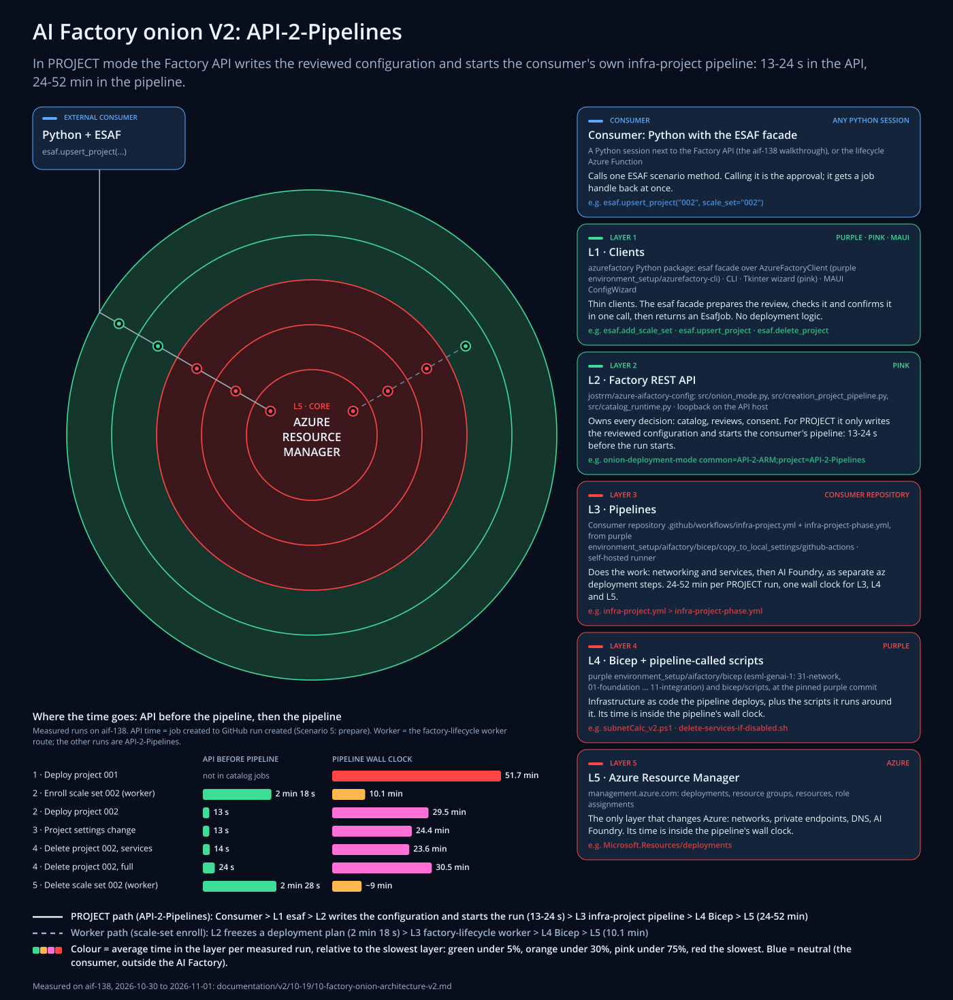
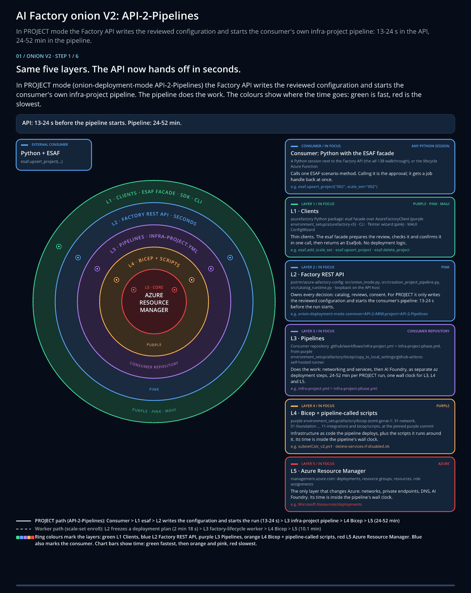

# 10) AI Factory onion V2: API-2-Pipelines (CoreTeam)

The onion has the same five layers as in [the onion architecture](./10-factory-onion-architecture.md). What changed is
who does the work for a project. In PROJECT mode (`onion-deployment-mode` `project=API-2-Pipelines`, the default for
PROJECT) the Factory API no longer freezes and deploys an ARM plan itself. It writes the reviewed configuration and
starts the consumer's own `infra-project` pipeline, and the pipeline does the work.

That is why an ESAF call such as `esaf.upsert_project("002")` now gets an answer in seconds: on aif-138 the API needed
**13-24 s** from the job's creation to the start of the GitHub run, and the pipeline then needed **24-52 min**.



<!-- onion:colors:start -->
Colour = average time in the layer per measured run, relative to the slowest layer: green under 5%, orange under 30%, pink under 75%, red the slowest. Blue = neutral (the consumer, outside the AI Factory). Purple is the AI Factory color, which always means the best, so the onion does not use it.
<!-- onion:colors:end -->

Also as [PNG](./images/10-factory-onion-architecture-v2.png), as an
[animated GIF](./images/10-factory-onion-architecture-v2.gif) and as an
[animated SVG](./images/10-factory-onion-architecture-v2-animated.svg) (open it on its own to play).
The pictures and the tables on this page are generated from one data file,
[onion-layers-v2.json](./images/onion/onion-layers-v2.json): see [Update the picture and the numbers](#update-the-picture-and-the-numbers).

## What changed in one minute

| | Before: the API deploys (API-2-ARM, worker route) | Now: API-2-Pipelines (PROJECT) |
|---|---|---|
| What the API does | Reads the live inventory, freezes a deployment plan, starts the factory-lifecycle worker that deploys the plan | Writes the reviewed configuration and starts the consumer's `infra-project.yml` |
| API time before the pipeline | 2 min 18 s (scale-set enroll, 2026-10-31) | 13-24 s (four PROJECT runs, 2026-10-31) |
| Who runs the Bicep | The worker, from the frozen plan | The consumer's pipeline, as separate `az deployment` steps on the factory's runner |
| Where it still applies | COMMON (`common=API-2-ARM`), scale-set enroll and deletion (Scenario 5: 148 s prepare, then the deletion worker) | Every PROJECT deploy, settings change and project deletion |

Two paths go through the onion:

- **PROJECT path** (solid line): Consumer > L1 `esaf` > L2 writes the configuration and starts the run > L3
  `infra-project` pipeline > L4 Bicep > L5. `esaf.upsert_project` and `esaf.delete_project` take this path, and so
  does the project deploy at the end of `esaf.add_scale_set`.
- **Worker path** (dashed line): L2 freezes a deployment plan > L3 factory-lifecycle worker > L4 > L5. Scale-set
  enroll takes it today, and so do scale-set and factory deletion.



## Why the API now answers in seconds

In API-2-Pipelines the API's part of a project deploy is short and fixed (pink `src/creation_project_pipeline.py`):

1. Install `infra-project.yml` and `infra-project-phase.yml` from the pinned accelerator into the consumer
   repository's `.github/workflows` on `main`, only when they are missing or differ (only those two files are committed).
2. Hand the project's `variables.json` to the run as its own GitHub environment secret, through the reviewed
   deployment contract of `infra-project.yml`. It is never committed, and it is deleted when the run completes.
3. Start the run, and follow it as a catalog job.

Everything that takes minutes now runs in the pipeline: networking and services through `infra-project-phase.yml`,
then AI Foundry, each as its own `az deployment` on the factory's runner. Because the API no longer sends one combined
ARM plan, there is no 4 MiB request limit either. The API still owns the review: the ESAF call prepares it, checks it
and confirms it before the job is created.

The worker route is still used where the API must prove ownership or freeze an exact plan (COMMON, scale sets,
deletions). There the API needs minutes before the pipeline starts: 2 min 18 s for the scale-set enroll below.

## The layers in PROJECT mode

<!-- onion:layers:start -->
| Layer | What it is | Repository and paths | Called by | Calls |
|---|---|---|---|---|
| **Consumer** | Calls one ESAF scenario method. Calling it is the approval; it gets a job handle back at once. | A Python session next to the Factory API (the aif-138 walkthrough), or the lifecycle Azure Function | A developer, a notebook or an automation. | L1: the esaf facade in the azurefactory Python package. |
| **L1 Clients** | Thin clients. The esaf facade prepares the review, checks it and confirms it in one call, then returns an EsafJob. No deployment logic. | azurefactory Python package: esaf facade over AzureFactoryClient (purple environment_setup/azurefactory-cli) · CLI · Tkinter wizard (pink) · MAUI ConfigWizard | The consumer: a Python session, a notebook or the lifecycle Function. | L2 over HTTP on loopback with the API key in X-API-Key. |
| **L2 Factory REST API** | Owns every decision: catalog, reviews, consent. For PROJECT it only writes the reviewed configuration and starts the consumer's pipeline: 13-24 s before the run starts. | jostrm/azure-aifactory-config: src/onion_mode.py, src/creation_project_pipeline.py, src/catalog_runtime.py · loopback on the API host | L1 clients on the same host (catalog and deployment routes accept loopback clients only). | L3: installs infra-project.yml and infra-project-phase.yml in the consumer repository when they are missing or differ, hands the project's variables.json to the run as an environment secret (never committed, deleted after the run), then starts the run. |
| **L3 Pipelines** | Does the work: networking and services, then AI Foundry, as separate az deployment steps. 24-52 min per PROJECT run, one wall clock for L3, L4 and L5. | Consumer repository .github/workflows/infra-project.yml + infra-project-phase.yml, from purple environment_setup/aifactory/bicep/copy_to_local_settings/github-actions · self-hosted runner | L2 starts the run (GitHub Actions; the Azure DevOps route is not available yet in this mode). | L4: az deployment of the project Bicep and the pipeline-called scripts. |
| **L4 Bicep + pipeline-called scripts** | Infrastructure as code the pipeline deploys, plus the scripts it runs around it. Its time is inside the pipeline's wall clock. | purple environment_setup/aifactory/bicep (esml-genai-1: 31-network, 01-foundation ... 11-integration) and bicep/scripts, at the pinned purple commit | L3 pipelines on the self-hosted runner. | L5: resource-group deployments and az CLI calls. |
| **L5 Azure Resource Manager** | The only layer that changes Azure: networks, private endpoints, DNS, AI Foundry. Its time is inside the pipeline's wall clock. | management.azure.com: deployments, resource groups, resources, role assignments | L4 deployments from the runner. | Nothing in AI Factory: Azure resource providers. |
<!-- onion:layers:end -->

## Measured: API time and pipeline time (aif-138)

Each row is one catalog job of the aif-138 end-to-end run through the ESAF facade. **API time** is the job's creation
to the creation of the GitHub run; **pipeline** is the run's wall clock (L3, L4 and L5 together; for Scenario 5 the API time is its prepare and the
work is the deletion worker); **job total** is the
job's creation to its last update. Evidence: [R1-R3](#evidence).

<!-- onion:runs:start -->
| Scenario / step | ESAF call | Route | API time before pipeline | Pipeline (wall clock) | Job total |
|---|---|---|---|---|---|
| 1. PROJECT 001 deploy, first success (2026-10-30 22:50-23:42Z) | `esaf.init_factory(...)` | API-2-Pipelines | not in catalog jobs | run 41140735956: 51.7 min | - |
| 2. enroll scale set 002, job bb9086fc (2026-10-31 05:14Z) | `esaf.add_scale_set("002", ...)` | worker | 2 min 18 s, frozen plan, then dispatch | run 41171926400: 10.1 min | 13.9 min |
| 2. deploy project 002, job c03b0eb4 (2026-10-31 07:09Z) | `esaf.add_scale_set("002", ...)` | API-2-Pipelines | 13 s | run 41179463357: 29.5 min | 30.1 min |
| 3. project settings change, job ea99c79c (2026-10-31 07:40Z) | `esaf.upsert_project("002", settings=...)` | API-2-Pipelines | 13 s | run 41181519894: 24.4 min | 25.0 min |
| 4. delete project002, services only, job a8aaf31e (2026-10-31 11:17Z) | `esaf.delete_project("002", include_keyvault_and_resource_group=False)` | API-2-Pipelines | 14 s | run 41196230976: 23.6 min | 25.0 min |
| 4. delete project002, full, job f16ed1fb (2026-10-31 15:41Z) | `esaf.delete_project("002")` | API-2-Pipelines | 24 s, facade: started after 25 s | run 41216080228: 30.5 min | 31.3 min (facade 32.5 min) |
| 5. delete scale set 002, attempt m, job db2fa13d (2026-11-01 15:13-15:24Z) | `esaf.delete_scale_set("002")` | worker | 2 min 28 s, prepare, then the deletion worker | ~9 min, deletion worker on the API host, no GitHub run | 11.5 min |
<!-- onion:runs:end -->

What the numbers say:

- **The API hands off in 13-24 s** in PROJECT mode, roughly 6 to 11 times faster than the 2 min 18 s of the worker
  route, which reads the live inventory and freezes a plan first.
- **The pipeline does the work: 24-52 min** per PROJECT run (51.7 min for the first deploy of project 001, 23.6-30.5
  min for later runs). Bicep and ARM time are inside that wall clock; the split per layer is not measured.
- **The job total is the pipeline plus 0.6-1.4 min** in PROJECT mode (25.0 min for a 24.4 min run), so the consumer
  waits for Azure, not for the API. The worker route adds 3.8 min (13.9 min for a 10.1 min run).
- **Scenario 5 takes the worker route**: deleting scale set 002 spent 148 s preparing (live inventory and ownership
  proof), then about 9 min in the deletion worker on the API host, without a GitHub run: 11.5 min in total
  (2026-11-01, after the ownership fixes; the 2026-10-31 attempts were refused at prepare).
- **Not yet measured**: Scenario 6 (`esaf.delete_factory`) has not finished yet. Row 1's API time is not in the
  catalog jobs.

## Evidence

<!-- onion:evidence:start -->
- **R1**: Verified 2026-10-31 23:45 CET for the aif-138 end-to-end run through the ESAF facade (consumer repository jostrm/azure-enterprise-scale-byor-138): catalog jobs in the Factory API's catalog-operations.sqlite and gh run list. API time = the catalog job's created_at to the GitHub run's createdAt. Job total = the job's created_at to updated_at. The jobs' pipeline_runs confirm which run belongs to which job.
- **R2**: Not in the table: two failed attempts with the same 13 s API time, project 002 deploy 6a380c35 (run 41172892614 failed after 59.6 min) and delete 3bd1d25d (run 41194343416 failed after 24.9 min).
- **R3**: Scenario 5 (esaf.delete_scale_set, worker route) was blocked when the 2026-10-31 table was verified: four attempts were refused at prepare after about 5 min. After the ownership fixes, attempt m succeeded (update 2026-11-01 16:00 CET): job db2fa13d 15:13-15:24Z, prepare 148 s, then the deletion worker on the API host for about 9 min (no GitHub run), 11.5 min in total. Attempt i (2026-11-01, 91 min, stopped after deleting common-002) is not in the table.
<!-- onion:evidence:end -->

## Update the picture and the numbers

All numbers, texts and colors live in [images/onion/onion-layers-v2.json](./images/onion/onion-layers-v2.json): the
`runs` hold the measured rows, and the layer colors and the ranges in the texts (13-24 s, 24-52 min) are derived from
them. After a new measured run, add or change its row and its evidence, then:

```bash
cd documentation/v2/10-19/images/onion
python make_onion_svg.py --data onion-layers-v2.json --update-doc   # standard library only: SVGs + the tables on this page
npm ci --ignore-scripts --no-audit --no-fund
python make_onion_raster.py --data onion-layers-v2.json --font-dir <folder with OpenSans-Regular.ttf and OpenSans-Semibold.ttf>
python -m unittest test_onion.py
```

The generator is the same one as for the first onion page and follows the concept animation exports of the MAUI
ConfigWizard (the `ConceptAnimationExport` tool in maui-apps): the same palette and step layout, 3x
playback with a 1 second end hold, the pinned `@resvg/resvg-js` 2.6.2 rasterizer and global-palette delta frames.
[manifest-v2.json](./images/onion/manifest-v2.json) records the result.

Related: [10) AI Factory onion architecture](./10-factory-onion-architecture.md),
[22) Lifecycle Azure Function](./22-lifecycle-azure-function.md),
[Factory API and SDK contract](../../architecture/contracts/Factory-API-and-SDK.md).
