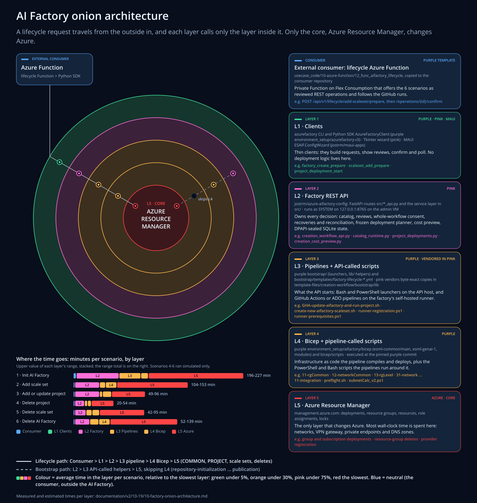
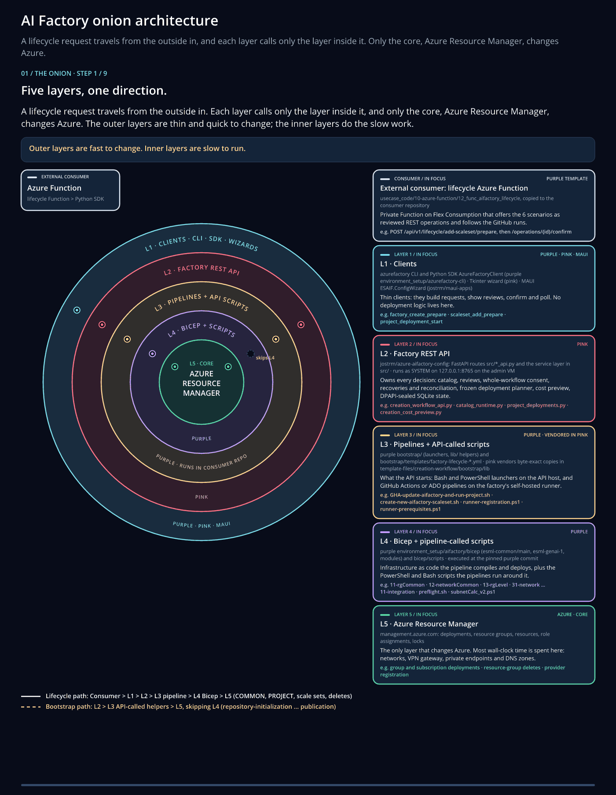

# 10) AI Factory onion architecture (CoreTeam)

The AI Factory is built like an onion. A lifecycle request, such as "add a scale set", enters at the outside and
travels inward. Each layer calls only the layer inside it, and only the core, Azure Resource Manager, changes Azure.
The outer layers are thin and quick to change. The inner layers do the slow work: that is where a scenario spends its
time, and where a bug costs the most to fix.



Also as [PNG](./images/10-factory-onion-architecture.png), as an
[animated GIF](./images/10-factory-onion-architecture.gif) and as an
[animated SVG](./images/10-factory-onion-architecture-animated.svg) (open it on its own to play).
The picture, the animation and every table on this page are generated from one data file,
[onion-layers.json](./images/onion/onion-layers.json): see [Update the picture and the numbers](#update-the-picture-and-the-numbers).

## The onion in one minute

| Ring | Name | Lives in |
|---|---|---|
| outside | **External consumer**: the lifecycle Azure Function, using the L1 Python SDK | purple template, copied to the consumer repository |
| L1 | **Clients**: `azurefactory` CLI, Python SDK, Tkinter wizard, MAUI ConfigWizard | purple, pink, `jostrm/maui-apps` |
| L2 | **Factory REST API** and the code behind it | pink |
| L3 | **Pipelines + API-called scripts**: GitHub Actions / ADO pipelines and the Bash/PowerShell the API runs | purple (pink carries hash-pinned copies; the pipelines run in the consumer repository) |
| L4 | **Bicep + pipeline-called scripts** | purple |
| L5 | **Azure Resource Manager** (core) | Azure |

Two paths go through the onion:

- **Lifecycle path** (solid line): Consumer > L1 > L2 > L3 pipeline > L4 Bicep > L5. COMMON, PROJECT, scale-set and
  delete operations take this path.
- **Bootstrap path** (dashed line): L2 > L3 > L5, skipping L4. The bootstrap stages of scenario 1
  (repository-initialization, minimum-foundation, prerequisites, network-foundation, runner, publication) run on the
  API host: pink's service layer and the vendored purple helpers call `az`, `gh` and `git` straight to ARM. Only
  COMMON, PROJECT and later operations go through the consumer pipelines and Bicep.



## The layers

<!-- onion:layers:start -->
| Layer | What it is | Repository and paths | Called by | Calls |
|---|---|---|---|---|
| **Consumer** | Private Function on Flex Consumption that offers the 6 scenarios as reviewed REST operations and follows the GitHub runs. | usecase_code/10-azure-function/12_func_aifactory_lifecycle, copied to the consumer repository | A portal, agent, pipeline or person with an Entra app role (function keys only for mock passes). | L1: dispatches aif-ops.yml to the management runner, which calls the SDK (AzureFactoryClient) or REST next to the API. |
| **L1 Clients** | Thin clients: they build requests, show reviews, confirm and poll. No deployment logic lives here. | azurefactory CLI and Python SDK AzureFactoryClient (purple environment_setup/azurefactory-cli) · Tkinter wizard (pink) · MAUI ESAIF.ConfigWizard (jostrm/maui-apps) | The external consumer, or a person at the CLI or a wizard. | L2 over HTTP on loopback (127.0.0.1:8765) with the API key in X-API-Key; plaintext HTTP is allowed only on loopback. |
| **L2 Factory REST API** | Owns every decision: catalog, reviews, whole-workflow consent, recoveries and reconciliation, frozen deployment planner, cost preview, DPAPI-sealed SQLite state. | jostrm/azure-aifactory-config: FastAPI routes src/*_api.py and the service layer in src/ · runs as SYSTEM on 127.0.0.1:8765 on the admin VM | L1 clients on the same host (catalog and deployment routes accept loopback clients only). | L3: runs purple Bash/PowerShell launchers and helpers, and dispatches the factory-lifecycle pipeline. Pins a purple commit. |
| **L3 Pipelines + API-called scripts** | What the API starts: Bash and PowerShell launchers on the API host, and GitHub Actions or ADO pipelines on the factory's self-hosted runner. | purple bootstrap/ (launchers, lib/ helpers) and bootstrap/templates/factory-lifecycle-*.yml · pink vendors byte-exact copies in template-files/creation-workflow/bootstrap/lib | L2. Pink's publication stage first commits the generated catalog, enrollment and settings to the consumer repository. | L4: the pipeline worker bootstrap/lib/factory_lifecycle.py compiles and deploys purple Bicep. Bootstrap helpers call ARM directly (L5). |
| **L4 Bicep + pipeline-called scripts** | Infrastructure as code the pipeline compiles and deploys, plus the PowerShell and Bash scripts the pipelines run around it. | purple environment_setup/aifactory/bicep (esml-common/main, esml-genai-1, modules) and bicep/scripts · executed at the pinned purple commit | L3 pipelines on the self-hosted runner. | L5: resource-group and subscription-scope ARM deployments, az CLI calls. |
| **L5 Azure Resource Manager** | The only layer that changes Azure. Most wall-clock time is spent here: networks, VPN gateway, private endpoints and DNS zones. | management.azure.com: deployments, resource groups, resources, role assignments, locks | L4 deployments from the runner; L3 bootstrap helpers from the API host (az, with the VM's managed identity). | Nothing in AI Factory: Azure resource providers. |
<!-- onion:layers:end -->

Between L2 and L3 sits the consumer repository's configuration: pink's publication stage commits the generated
catalog, enrollment and settings files to the consumer repository's `main` (the ADO "orange" spider repository, or a
`byor-12x` GitHub test factory). The pipelines then execute the purple source at the commit pink pinned.

### L3 examples: Bash and PowerShell the API calls

The originals live in purple `bootstrap/`. Pink vendors byte-exact copies in
`template-files/creation-workflow/bootstrap/lib` and pins their sha256 (`src/creation_workflow_source.py`).

<!-- onion:scripts-l3:start -->
| Script | Language | Called by | Does |
|---|---|---|---|
| `bootstrap/GHA-update-aifactory-and-run-project.sh` | bash | pink src/project_deployments.py | Add or update a project: refresh templates (patch) or run project-only, then start the project pipeline. |
| `bootstrap/ADO-update-aifactory-and-run-project.sh` | bash | pink src/project_deployments.py | Same for Azure DevOps. |
| `bootstrap/GHA-create-new-aifactory-scaleset.sh -> bootstrap/lib/create-new-aifactory-scaleset.sh` | bash | pink src/creation.py, src/simple_mode.py | Create a factory or scale set repository and start its workflow (gh workflow run). |
| `bootstrap/lib/runner-registration.ps1 / .sh` | powershell / bash | pink bootstrap runner stage (vendored copy, sha256-pinned) | Register the factory's self-hosted runner. |
| `bootstrap/lib/runner-prerequisites.ps1 / .sh` | powershell / bash | pink bootstrap runner stage (vendored copy, sha256-pinned) | Install the runner's tools (az, bicep, gh, git, Python). |
| `bootstrap/lib/release_version.sh` | bash | pink src/project_deployments.py, src/project_update.py | Version-aware launcher contract. |
| `bootstrap/lib/factory_lifecycle.py` | python | pink src/catalog_runtime.py (plan) and the factory-lifecycle pipeline (worker) | Freezes the plan, dispatches .github/workflows/factory-lifecycle.yml or aifactory/pipelines/factory-lifecycle.yml, runs the worker on the runner. |
<!-- onion:scripts-l3:end -->

### L4 examples: Bash and PowerShell the pipelines call

Pipeline templates: `environment_setup/aifactory/bicep/copy_to_local_settings/github-actions/*.yml` and
`.../azure-devops/esml-yaml-pipelines/`, plus `bootstrap/templates/factory-lifecycle-*.yml`. The Bicep the worker
deploys: `esml-common/main/11-rgCommon`, `12-networkCommon`, `13-rgLevel` (COMMON) and `esml-genai-1/31-network`,
`01-foundation` ... `11-integration` (PROJECT).

<!-- onion:scripts-l4:start -->
| Script | Language | Called by | Does |
|---|---|---|---|
| `environment_setup/aifactory/bicep/scripts/preflight.sh` | bash | infra-common.yml | Pre-deployment checks. |
| `environment_setup/aifactory/bicep/scripts/ensure-encryption-at-host.sh` | bash | infra-common.yml | Register EncryptionAtHost when it is enabled. |
| `environment_setup/aifactory/bicep/scripts/admin-vm-exists.sh` | bash | infra-common.yml | Detect an existing admin VM before COMMON. |
| `environment_setup/aifactory/bicep/scripts/subnetCalc_v2.ps1` | powershell | infra-project-phase.yml, ADO job-1-genai-networking.yaml | Calculate the project subnets. |
| `environment_setup/aifactory/bicep/scripts/genDynamicNetworkParamFile.ps1, getProjectSubnetState.ps1` | powershell | project networking jobs | Generate network parameters, read existing subnets. |
| `environment_setup/aifactory/bicep/scripts/prepareSeedingKeyVaultPrivateDns.ps1` | powershell | COMMON / project pipelines | Prepare private DNS for the seeding Key Vault. |
| `environment_setup/aifactory/bicep/scripts/delete-services-if-disabled.sh, delete-subnets-for-projects.sh, delete-caphost-and-foundry-and-its-subnet.sh` | bash | project pipelines and deletes | Remove disabled services, project subnets, Foundry capability hosts. |
| `environment_setup/aifactory/bicep/scripts/write-pipeline-region-report.sh` | bash | infra-common.yml, infra-project.yml | Write the region report. |
<!-- onion:scripts-l4:end -->

## Execution time: the 6 scenarios through the onion

Each cell is the time spent **in that layer itself** (not waiting for the layers inside it), in minutes, for one
consumer call such as the Azure Function. The layers run one after the other, so the total is the sum.
**M** = measured, **E** = estimated, **M+E** = partly measured; the evidence keys are listed under
[Measured vs estimated](#measured-vs-estimated-evidence).

<!-- onion:scenario-times:start -->
| Scenario | SDK call | Consumer | L1 Clients | L2 Factory REST API | L3 Pipelines + API-called scripts | L4 Bicep + pipeline-called scripts | L5 Azure Resource Manager | Total |
|---|---|---|---|---|---|---|---|---|
| 1. Init AI Factory | `factory_create_prepare / bootstrap_*` | 1-4 M | seconds E | 55-57 M | 28-29 M+E | 5-10 E | 107-127 M+E | **196-227** (3.3-3.8 h) |
| 2. Add scale set | `scaleset_add_prepare` | 1-2 E | seconds E | 32-33 M+E | 6-8 E | 10-15 E | 55-95 E | **104-153** (1.7-2.5 h) |
| 3. Add or update project | `project_add_prepare + project_deployment_*` | 1-2 E | seconds E | 32-33 M+E | 3-4 E | 8-12 E | 5-45 E | **49-96** (0.8-1.6 h) |
| 4. Delete project | `project_delete_prepare` | 1-2 E | seconds E | 3-13 E | 3-4 E | 3-5 E | 10-30 E | **20-54** |
| 5. Delete scale set | `scaleset_delete_prepare` | 1-2 E | seconds E | 5-15 E | 6-8 E | 5-10 E | 25-60 E | **42-95** (0.7-1.6 h) |
| 6. Delete AI Factory | `delete_aifactory_prepare / _confirm` | 1-2 E | seconds E | 10-20 E | 6-12 E | 5-15 E | 30-90 E | **52-139** (0.9-2.3 h) |
<!-- onion:scenario-times:end -->

| Scenario | SDK call | Outcome |
|---|---|---|
| 1. Init AI Factory | `factory_create_prepare` / `bootstrap_*` | Starting from an empty subscription, creates the common part of the AI Factory, such as connectivity and private DNS zones. |
| 2. Add scale set | `scaleset_add_prepare` | Prepares a new, empty Azure subscription by enabling resource providers, and creates a new project with Azure resources, some of which are in a common resource group. |
| 3. Add or update project | `project_add_prepare` + `project_deployment_*` | Creates the project-specific resource group and assigns team access. Adds or removes resources, changes settings (SKU, performance, etc.), or creates a new project if none exists. |
| 4. Delete project | `project_delete_prepare` | The project resource group is deleted. |
| 5. Delete scale set | `scaleset_delete_prepare` | The project and common resource groups are deleted, leaving an empty Azure subscription. |
| 6. Delete AI Factory | `delete_aifactory_prepare` / `_confirm` | All project and common resource groups in every environment are deleted, and the factory's local configuration is removed. Connectivity hub resource groups, Entra groups and Git repositories are kept. |

What the numbers say:

- **L5 (ARM) dominates** every scenario that creates something: networking, the VPN gateway, private endpoints and
  private DNS zones.
- **L2 is the second biggest share**: the reviews are real work (live inventory, Bicep compile, cost preview,
  frozen plan), measured at 12-18 minutes each.
- **The consumer and L1 cost seconds to a few minutes.** The lifecycle Function's hand-offs take 12-30 seconds each.
- **Not measured yet**: a COMMON or PROJECT deployment through the new path (both aif-125 COMMON attempts stopped
  before any Azure write), and any real delete: scenarios 4-6 ran with `AIF_DELETES=simulate`, so the Factory API never
  saw a delete. Scenario 1 for aif-126 was running when this page was written (first prepare 13:22 UTC, 2026-10-24),
  which gives the next measurement.

<details>
<summary>Basis of every number</summary>

<!-- onion:scenario-notes:start -->
| Scenario | Layer | Minutes | Basis |
|---|---|---|---|
| 1 | Consumer | 1-4 M | intake 1 min (aif-125), prepare to repository commit 4 min (aif-126), evidence M1 M3 |
| 1 | L1 Clients | seconds E | seconds |
| 1 | L2 Factory REST API | 55-57 M | 26 min before minimum-foundation + COMMON review 12 + COMMON start to run 17-19, evidence M3 |
| 1 | L3 Pipelines + API-called scripts | 28-29 M+E | bootstrap helpers ~25 (est., share of 112 measured) + COMMON pipeline start 3-4 (measured), evidence M3 M4 E |
| 1 | L4 Bicep + pipeline-called scripts | 5-10 E | COMMON Bicep build, preflight, what-if |
| 1 | L5 Azure Resource Manager | 107-127 M+E | bootstrap ARM ~87 incl. VPN gateway (est., share of 112 measured) + COMMON deployment 20-40 (est., not measured yet), evidence M3 E |
| 2 | Consumer | 1-2 E | 4-6 hand-offs of 12-30 s, evidence M1 |
| 2 | L1 Clients | seconds E | seconds |
| 2 | L2 Factory REST API | 32-33 M+E | catalog prepare/confirm 1-2 (est.) + runtime review 13 + confirmation 18 (measured), evidence M5 E |
| 2 | L3 Pipelines + API-called scripts | 6-8 E | two pipeline starts (COMMON, PROJECT) of 3-4 min, evidence M4 |
| 2 | L4 Bicep + pipeline-called scripts | 10-15 E | 3 COMMON + 13 project templates, preflight, subnet scripts |
| 2 | L5 Azure Resource Manager | 55-95 E | resource providers 5-10, COMMON 20-40, PROJECT 30-45 |
| 3 | Consumer | 1-2 E | 4-6 hand-offs of 12-30 s, evidence M1 |
| 3 | L1 Clients | seconds E | seconds |
| 3 | L2 Factory REST API | 32-33 M+E | catalog prepare/confirm 1-2 (est.) + runtime review 13 + confirmation 18 (measured), evidence M5 E |
| 3 | L3 Pipelines + API-called scripts | 3-4 E | one pipeline start, evidence M4 |
| 3 | L4 Bicep + pipeline-called scripts | 8-12 E | 13 project templates, subnetCalc_v2.ps1, getProjectSubnetState.ps1, delete-services-if-disabled.sh |
| 3 | L5 Azure Resource Manager | 5-45 E | settings update 5-20, new project 30-45 |
| 4 | Consumer | 1-2 E | evidence M1 |
| 4 | L1 Clients | seconds E | seconds |
| 4 | L2 Factory REST API | 3-13 E | named deletion review with retention evidence, confirmation phrase |
| 4 | L3 Pipelines + API-called scripts | 3-4 E | one pipeline start, evidence M4 |
| 4 | L4 Bicep + pipeline-called scripts | 3-5 E | project-deletion.py, delete-subnets-for-projects.sh, delete-caphost-and-foundry-and-its-subnet.sh |
| 4 | L5 Azure Resource Manager | 10-30 E | resource-group delete: private endpoints, Foundry capability host, subnets |
| 5 | Consumer | 1-2 E | evidence M1 |
| 5 | L1 Clients | seconds E | seconds |
| 5 | L2 Factory REST API | 5-15 E | deletion review over every project of the scale set |
| 5 | L3 Pipelines + API-called scripts | 6-8 E | project pipelines, then COMMON, evidence M4 |
| 5 | L5 Azure Resource Manager | 25-60 E | project and common resource groups: VNet, private endpoints, DNS zones, Key Vault |
| 6 | Consumer | 1-2 E | evidence M1 |
| 6 | L1 Clients | seconds E | seconds |
| 6 | L2 Factory REST API | 10-20 E | ordered-project-pipelines-v1 plan, retention policy, local configuration removal |
| 6 | L3 Pipelines + API-called scripts | 6-12 E | ordered project pipelines, then COMMON, per scale set, evidence M4 |
| 6 | L5 Azure Resource Manager | 30-90 E | every project and common resource group, including a factory-owned access hub |
<!-- onion:scenario-notes:end -->

</details>

## Time for a code change, per layer

How long it takes from "we found the bug in this layer" until the fixed code runs where it matters.

<!-- onion:change-times:start -->
| Layer | Time for a code change (min) | What the loop contains |
|---|---|---|
| **Consumer** | 15-30 E | Edit, run the Function tests (tests/, 13 files), redeploy with deploy.ps1 (remote build on Flex Consumption). |
| **L1 Clients** | 15-60 E | SDK/CLI: stdlib-only, edit + tests + push, 15-25 min. MAUI: Windows build and installer, 30-60 min. The Tkinter wizard ships with the pink release (see L2). |
| **L2 Factory REST API** | 135 M | One fix iteration now: run, diagnose, fix, tests, release, install, recovery, fresh review (see Code change - options). Estimated 70 min with the future options. |
| **L3 Pipelines + API-called scripts** | 150-240 E | Change purple, re-vendor byte-exact into pink and update the sha256 pins (src/creation_workflow_source.py), then the full pink release loop (L2), plus source handoff and re-audit when a factory is running. The most expensive loop: keep such changes for the next factory. |
| **L4 Bicep + pipeline-called scripts** | 60-240 E | Next run: purple change + bicep build and unit tests + pin bump + fresh review (prepare-next, 12 min measured) + rerun, 60-120 min. During a running factory with a frozen plan add source handoff and freeze, up to 240 min. |
| **L5 Azure Resource Manager** | n/a | No AI Factory code. Platform conditions (quota, policy, provider registration, RBAC propagation) are fixed by configuration or with Azure support; the code change then lands in L4 (Bicep) or L2 (a pre-check). |
<!-- onion:change-times:end -->

The inner the layer, the longer the loop: an L3 or L4 change has to travel outward again through every layer that
pins or vendors it.

## Code change - options

### One fix iteration now

Measured on 2026-10-24 (composite of pink v0.47.38 and v0.47.39), with the estimated future time for a bug that still
slips through:

<!-- onion:fix-iteration:start -->
| # | Step | Now (min) | % | Future (min, estimated) | How |
|---|---|---|---|---|---|
| 1 | Real stage runs until it fails (COMMON: ~17 min before the GitHub run starts + 4 min) | 22 | 16% | 22 | Unchanged; the host doctor prevents most of these runs |
| 2 | Diagnose (VM run commands 1-3 min each, logs, reading pink code) | 20 | 15% | 5 | Explainer route + host doctor |
| 3 | Fix with failing tests first | 8 | 6% | 8 | Unchanged |
| 4 | Related test files on the laptop (13 files) | 32 | 24% | 3 | Only the changed file locally; the whole suite in CI on every push (sharded, parallel) |
| 5 | Commit, architecture index, push, tag | 3 | 2% | 3 | Unchanged |
| 6 | Release CI (Windows only; ~4 min of it is the gate tests) | 9 | 7% | 3 | Dev-mode deploy of the pushed commit to the test-factory API host replaces steps 6-7; one release at the end |
| 7 | Install on the admin VM | 4 | 3% | 0 | Included in the dev-mode deploy |
| 8 | Recovery ceremony for the failed stage (evidence, prepare, confirm) | 20 | 15% | 14 | One guarded recovery script |
| 9 | Fresh review (prepare-next: live inventory, Bicep compile, cost) | 12 | 9% | 12 | Unchanged: it is the safety check |
| 10 | Hand-offs between steps | 4 | 3% | 0 | Chained by the deploy and recovery scripts |
| | **Total** | **134** | 100% | **70** (-48%) | |
<!-- onion:fix-iteration:end -->

Future options (estimates), together about 70 minutes, -48%:

- **Explainer route + host doctor**: diagnosis from one call instead of VM run commands and logs (20 > 5 min).
- **Only the changed test file locally**, with the whole suite in CI on every push, sharded and in parallel (32 > 3 min).
- **Dev-mode deploy** of the pushed commit to the test-factory API host (about 3 min) replaces release CI and the VM
  install; one release at the end. It needs a decision on release provenance for test factories.
- **One guarded recovery script** for the failed stage (20 > 14 min).
- The **fresh review stays** (12 min): it is the safety check.

### The bigger lever: prevention

The loops of one night cost:

<!-- onion:loops:start -->
29 az logout + 48 keyVaultSecretExpiry + 93 Bicep mismatch + 88 consent bug = **258 min**
<!-- onion:loops:end -->

All of these bugs passed the unit tests: they were differences in the environment or in real state. That is why
preventing them beats a faster loop or more unit tests:

1. **Host doctor** before each run: SYSTEM `az login`, Bicep version parity between the API host and the runner,
   Key Vault access and secret expiry, `gh` login, runner online, API version, and git line-ending parity (see below).
2. **Cross-repo contract job in pink CI** against purple `main`. Today the native-source tests skip or error locally
   (183 skipped, 53 setup errors) and CI never runs them.
3. **Every test file in CI, with real-state fixtures.** The release gate runs a fixed list of about 23 files
   (4 minutes); the recovery test files (reconciliation, DNS SOA, source handoff, ...) never run in CI.

Purple bootstrap changes during a running factory are the most expensive loop (re-vendor, re-audit, source handoff,
freeze): keep them for the next factory.

#### Example: the fifth bug, line endings

<!-- onion:fifth-bug:start -->
2026-10-24 ~10:00, COMMON attempt 2 (run 40075915367): the worker refused with runtime-network-preservation-source-changed before any Azure write. The admin VM's Git for Windows has core.autocrlf=true (system), so the purple submodule and every catalog-run copy hold 12-networkCommon.bicep with CRLF (11,057 bytes, 255 CR) while git stores it LF (10,802 bytes, 0 CR) and the Linux runner checks out LF. The network-preservation proof hashes raw bytes, and its CRLF digest is frozen in the verified network-foundation profile.
<!-- onion:fifth-bug:end -->

The host doctor's line-ending check would have caught it before the run: an environment-parity bug, like the other four.

### Idea: test the code behind the API directly, skip rebuilding pink

The first half is already how pink is tested: its tests call the service classes directly, without HTTP. But the code
behind the API *is* pink, and the fixed code has to run on the admin VM, where the DPAPI-sealed state, the identity,
the VPN and the runner are. Skipping the rebuild therefore means a dev-mode deploy for test factories (see the future
options above), which needs a decision on release provenance.

## Measured vs estimated: evidence

<!-- onion:evidence:start -->
- **M1**: Measured 2026-10-24: aif-ops and aif-event-relay runs of the lifecycle Function in jostrm/azure-enterprise-scale-byor-121 take 12-30 s each; scenario 1 for aif-126 went from the first prepare (13:22 UTC) to the repository-initialization commit (13:26 UTC) in 4 min.
- **M2**: Measured from commit times in the jostrm/azure-enterprise-scale-byor-12x factory repositories, from 'Initialize reviewed AI Factory source pin' to 'Configure generated deployment connection': aif-124 103 min (2026-10-23), aif-125 131 min (2026-10-24), aif-123 236 min (2026-10-22, the day the Lifecycle-Function contract records an ARM 403 stop and a recovery).
- **M3**: Measured 2026-10-24, aif-125 (aif-lifecycle-phase4-5-log.md): Function intake about 1 min, repository-initialization about 1 min, a 26 min gap before minimum-foundation, minimum-foundation to publication 02:33-04:25 CEST (network-foundation with VPN gateway done 04:12, runner 04:17), each COMMON review (prepare-next) about 12 min, COMMON start to GitHub run 17-19 min.
- **M4**: Measured 2026-10-24: factory-lifecycle COMMON runs 40064071277 (4.0 min) and 40075915367 (3.3 min) in jostrm/azure-enterprise-scale-byor-125; both stopped before any Azure write, so COMMON and PROJECT deployment times are not measured yet.
- **M5**: Measured 2026-10-22 on the real Factory API (Lifecycle-Function contract): a runtime review took 13 min and its confirmation held the catalog lock for 18 min.
- **M6**: Measured 2026-10-24: one fix iteration, composite of pink v0.47.38 and v0.47.39 (aif-125).
- **E**: Estimated from the code path and earlier factories; replace with measured values after real runs. Scenarios 4-6 ran simulated only (AIF_DELETES=simulate): the Factory API never saw a delete.
<!-- onion:evidence:end -->

## Update the picture and the numbers

All numbers, texts and colors live in [images/onion/onion-layers.json](./images/onion/onion-layers.json).
After a real run, change the value and its `kind` (`measured` / `estimated` / `mixed`) and its evidence, then:

```bash
cd documentation/v2/10-19/images/onion
python make_onion_svg.py --update-doc      # standard library only: SVGs + the tables on this page
npm ci --ignore-scripts --no-audit --no-fund
python make_onion_raster.py --font-dir <folder with OpenSans-Regular.ttf and OpenSans-Semibold.ttf>   # PNG + GIF (Pillow)
```

`make_onion_raster.py` follows the VisualLearner concept exports (maui-apps
`ESAIF.ConfigWizard/tools/ConceptAnimationExport`): the same palette and step layout, 3x playback with a 1 second end
hold, the pinned `@resvg/resvg-js` 2.6.2 rasterizer, and global-palette delta frames. It re-measures every text line
with the real font and checks sampled GIF frames pixel by pixel; [manifest.json](./images/onion/manifest.json) records
the result. The Open Sans files are in maui-apps `ESAIF.ConfigWizard/src/ESAIF.ConfigWizard/Resources/Fonts`.

Related: [22) Lifecycle Azure Function](./22-lifecycle-azure-function.md),
[17) CLI, API and usage](./17-cli-and-api-and-usage.md),
[Lifecycle Function contract](../../architecture/contracts/Lifecycle-Function.md),
[Factory API and SDK contract](../../architecture/contracts/Factory-API-and-SDK.md).
