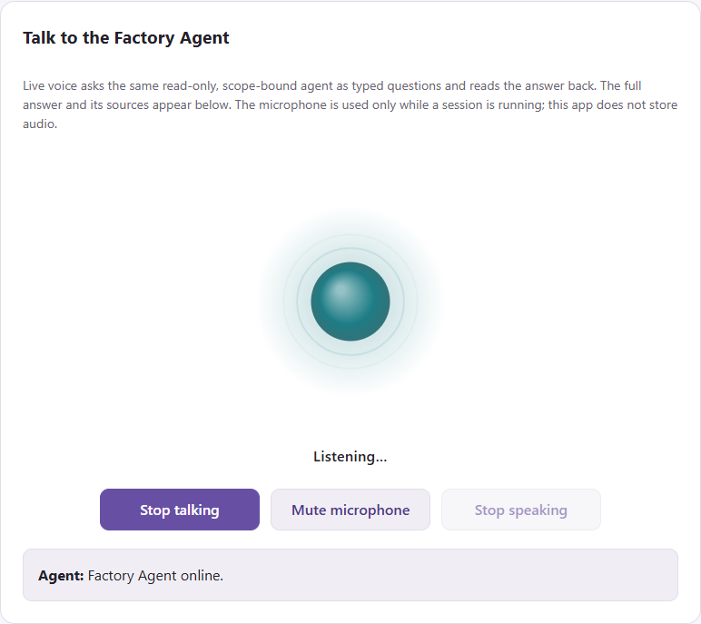
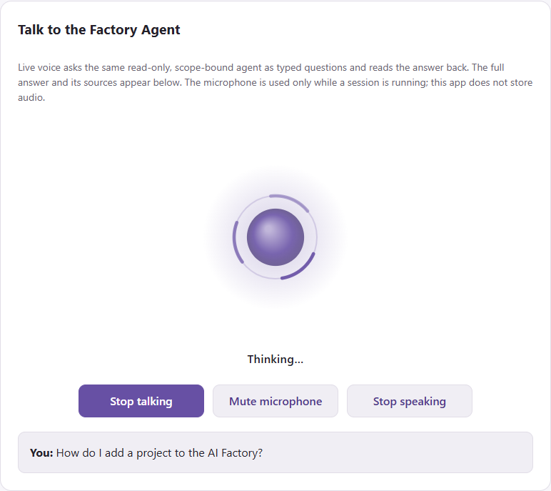
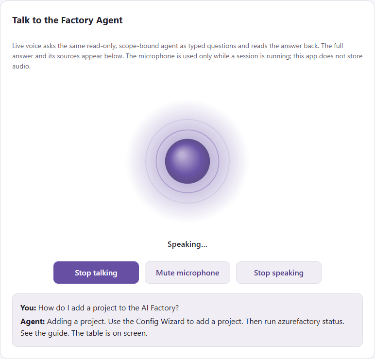
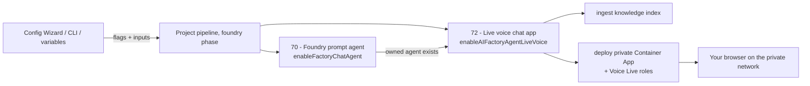

# 21. Agent Factory chat and live voice

The **Factory Agent chat** is a private web application where authorized people ask the AI Factory
questions and get **evidence-backed answers with citations**, scoped to one factory, project and
environment. With **live voice** you can also *talk* to it: the page shows a pulsing orb that
listens, thinks and speaks, the way a voice assistant would.





Voice is **optional and off by default**. It never gives the agent more power: a spoken question
goes through exactly the same sign-in, scope, permissions, retrieval, tools and citations as a typed
one. Typing keeps working when voice is off, unavailable or blocked.

For low-latency **native speech-to-speech**, an operator selects `voice.mode: "realtime"`
and a supported native model. The compatibility default is still a speech shell; merely
enabling voice does not change that mode. Native live audio/transcripts are provisional
until final source checks. A voice-only failure never signs you out of text chat.

!!! note "What this chapter covers"

    How the pieces fit, the switches that turn them on, the two ways to deploy (pipeline or operator),
    how to use it, the security model, operating limits, and troubleshooting. Details for developers live
    in the [application guide](https://github.com/jostrm/azure-enterprise-scale-ml/blob/main/usecase_code/40-agent-factory/40-aifactory-agent/readme.md)
    and the [live voice step](https://github.com/jostrm/azure-enterprise-scale-ml/blob/main/usecase_code/40-agent-factory/47-aifactory-agent-live-voice/readme.md).

> Where this fits: [29. ESAIF Chat Agent](../20-29/29-ESAIF-Chat-Agent.md) (the flow from Bicep to agents), [29. AI Factory MCP](../20-29/29-factory-MCP.md), [29. AI Gateways](../20-29/29-factory-AI-Gateways.md), [29. Dual knowledge graphs](../20-29/29-dual-knowledge-graphs.md).

## At a glance

| You want | Turn on | What happens |
|---|---|---|
| The agent to exist in your project Foundry | `enableFactoryChatAgent` | The late project-pipeline step `70-factory-chat-agent` creates or updates the owned prompt agent `enterprise-scale-ai-factory`. It never deletes an agent and refuses one it does not own. |
| A web chat with **live voice** (project001 Dev) | `enableFactoryChatAgent` **and** `enableAIFactoryAgentLiveVoice` | Step `72-aifactory-agent-live-voice` verifies that agent, builds the knowledge index and deploys the private chat application with Azure Voice Live. Voice without the chat flag **fails loudly** instead of being ignored. |
| Voice on an app you already deployed by hand | `voice.enabled` in your own agent configuration | Redeploy with `40-aifactory-agent/deploy.py`. Your grants and all other settings stay as you configured them (see [operator flow](#b-operator-flow-existing-or-customized-app)). |

Saving a flag only records intent. **Nothing deploys until an approved pipeline run (or an operator
command) executes it.** A flag set to `false` skips its step; it never deletes anything.



## Connected to the Factory MCP

The chat and the **AI Factory MCP** are two front doors to the same governed core, not two separate systems.

| | Factory Agent chat | AI Factory MCP |
|---|---|---|
| Used by | People, in a browser (text or voice) | Agents and MCP clients, for example through the AI Gateway or a classic APIM |
| Sign-in | Entra user sign-in with exact-scope grants | Entra app role `AiFactory.Mcp.Read`, verified on every request |
| Switched on by | `enableFactoryChatAgent` (voice: `enableAIFactoryAgentLiveVoice`) | `enableAIFactoryMCP` (gateway: `enableAIGatewaySKU`, `addAIFactoryMCP2AIGatewaySKU`; classic APIM: `addAIFactoryMCP2APIM`) |

- **Shared core.** Both run the same factory tools, skills and operation store, and the same dual knowledge graph
  query core (next section), so a typed question, a spoken question and an MCP tool call see the same facts and obey
  the same rules.
- **Prepare, never approve.** A state-changing tool only prepares a bounded plan. Approving and executing it happen
  outside the model, in chat and in the MCP alike.
- **No network hop between them.** The chat does not call the MCP; it runs the same governed tools inside its own
  app with its own sign-in. Deploy the MCP when other agents or tools (for example a Foundry agent behind the AI
  Gateway) should reach the same tools. The chat works without it.

## Connected to the dual knowledge graphs

Before the model answers a substantive question about code, architecture, pipelines or dependencies, the chat can
look it up in two local, read-only evidence sources:

- a **structural graph** of the repository (what calls, configures and deploys what), extracted locally with Graphify;
- an **architecture vault** of reviewed notes, contracts and decisions.

That is how the agent can explain the **Factory IaC (Bicep), AI Factories, usecase code, the CLI, SDK and API, and
ESML** with sources instead of from memory.

- **Separate citations.** Search documents keep `[S1]` ids, structural graph results use `[G1]` and architecture
  notes `[A1]`. The page shows which snapshot they came from and warns when context is missing, stale or unverified.
- **Opt in and pinned.** Off by default. Add a `dual_graph` block with the reviewed snapshot id to the app
  configuration and grant `graph.read` to the people who may use it (`knowledge.read` and `factory.read` do not imply
  it). The pipeline step does not configure it; use the [operator flow](#b-operator-flow-existing-or-customized-app).
- **One snapshot per app.** The app answers from the snapshot it was packaged with. UX apps such as the Config
  Wizards live in their own repositories with their own graphs; they are not part of this repository's snapshot.
- **Evidence, not proof.** Graph results help you navigate and explain intent; what is actually deployed comes from
  live, authenticated factory calls. A spoken question gets the same graph context as a typed one.

## What you need first

- An **AI Factory project001 Dev** with Foundry (`enableAIFoundry`), AI Search (`enableAISearch`) and an
  **internal** Container Apps environment (`enableContainerApps`), plus a succeeded chat model deployment
  (`modelGPTXName`) and a text-embedding deployment.
- An **Entra registration** for web sign-in, created once by an Entra admin. Pipelines never write
  Microsoft Graph. The operator tool does it for you:

  ```powershell
  python -m aifactory_agent.browser_auth --config <agent config> `
    --redirect-uri "https://<private-agent-host>/" --user-object-id "<your Entra object id>" --apply
  ```

  It creates a dedicated single-page-app registration with the delegated scope `access_as_user`, v2 tokens
  and the exact redirect URI. The backend `auth.audience` is the registration's client ID.
- The **object IDs of the people** who may use the chat (read-only access: `knowledge.read`,
  `factory.read`).
- Network access to the app: it lives on your private network, so connect the approved VPN or use a machine
  inside it. For voice, the app must also reach your Foundry resource over its **private endpoint**
  (`<foundry>.services.ai.azure.com`).

## Turn it on

### A. Pipeline (new app, project001 Dev)

Set these in `variables.json` / ADO `variables.yaml` / GitHub variables (or in the Config Wizard, Simple Mode
card, or the CLI), then run the project pipeline.

| Setting (default) | GitHub variable | Purpose |
|---|---|---|
| `enableFactoryChatAgent` (`false`) | `ENABLE_FACTORY_CHAT_AGENT` | Creates the owned Foundry prompt agent. Requires `enableAIFoundry` and a succeeded `modelGPTXName`. |
| `enableAIFactoryAgentLiveVoice` (`false`) | `ENABLE_AI_FACTORY_AGENT_LIVE_VOICE` | Deploys the chat app with voice. Requires `enableFactoryChatAgent`, `enableContainerApps`, `enableAIFoundry`, `enableAISearch`. |
| `aifactoryAgentEntraAppId` | `AIFACTORY_AGENT_ENTRA_APP_ID` | Client ID (GUID) of the Entra registration. **Needed** for voice. |
| `aifactoryAgentReaderObjectIds` | `AIFACTORY_AGENT_READER_OBJECT_IDS` | Comma-separated object IDs (1 to 20) with read-only access. **Needed** for voice. |
| `aifactoryAgentContainerAppsEnvironment` | `AIFACTORY_AGENT_CONTAINER_APPS_ENVIRONMENT` | Internal environment name; empty picks the single one in the project resource group. |
| `aifactoryAgentVoiceName` | `AIFACTORY_AGENT_VOICE_NAME` | Speech voice; empty uses `en-US-Ava:DragonHDLatestNeural`. |
| `aifactoryAgentVoiceLanguages` | `AIFACTORY_AGENT_VOICE_LANGUAGES` | Comma-separated input languages; empty uses `en-US`. Swedish needs `sv-SE,en-US`. |

Command line:

```powershell
azurefactory config review --folder C:\factory --project-number 001 `
  --enable-factory-chat-agent true --enable-aifactory-agent-live-voice true `
  --aifactory-agent-entra-app-id <client-id> --aifactory-agent-reader-object-ids <object-id>
```

Where the settings live in the wizards (Simple Mode and the exported `variables.json`, `variables.yaml` and `.env`
carry the same seven settings side by side):

- **ESAIF ConfigWizard (MAUI app):** step 6, **AI Factory Agent chat & live voice**, right after *MCP & AI Gateway*,
  and the same section in the Simple Mode card. A flag without its prerequisites stops the review with a plain reason;
  a malformed voice input stops it only while voice is on.
- **AIFactory Config Wizard (Tkinter, v0.47.24):** the section **AI Factory Agent chat & live voice** on the
  *ON/OFF: App & Integration* page, above *MCP & AI Gateway*. Dependency and project001-scope problems block the
  draft; input problems show as warnings because the project pipeline checks them again before any Azure call.

!!! warning "The step never replaces an app you deployed by hand"

    The pipeline step generates a **read-only baseline** configuration. It only creates or updates an app that
    it created itself (tag `aifactory-integration: live-voice`). If `aifactory-agent-project001-dev` already
    exists without that tag, the step stops with guidance. Use the operator flow below instead.

Rules that always apply: project001 Dev only (other projects fail, Stage and Prod skip); the model deployment,
the Foundry agent and the Entra registration are prerequisites, never created by the live voice step; delete-all
runs skip it; the run reports every step and never prints secrets.

### B. Operator flow (existing or customized app)

Approve the model's processing scope before deploying this example. In Sweden Central,
Microsoft lists `gpt-realtime-mini` and `gpt-realtime` as **Global** inference;
`gpt-realtime-datazone` is **Data zone**, not Sweden-only. Transcription and synthesis
have separate processing scopes. Check [regional processing](https://learn.microsoft.com/en-us/azure/ai-services/speech-service/regions?tabs=voice-live#llm-availability-and-processing-scope)
and [model-specific input languages](https://learn.microsoft.com/en-us/azure/ai-services/speech-service/voice-live-language-support?tabs=speechinput#gpt-realtime-and-gpt-realtime-mini-supported-languages);
Azure TTS's 150+ locales are not the native model's input-language guarantee.

If you already run the chat app (or need more than read-only grants, extra clients or a different agent
invocation), keep using your own `config.local.json` and add the voice block:

```json
"voice": {
  "enabled": true,
  "mode": "realtime",
  "model": "gpt-realtime-mini",
  "voice_type": "openai",
  "voice_name": "coral",
  "input_languages": ["en-US"],
  "default_language": "en-US",
  "language_profiles": {
    "en-US": {"voice_type": "openai", "voice_name": "coral", "greeting": "How can I help?"},
    "sv-SE": {"voice_type": "openai", "voice_name": "coral", "greeting": "Hej! Hur kan jag hjälpa dig?"}
  },
  "turn_detection": "server_vad",
  "silence_duration_ms": 350,
  "answer_timeout_seconds": 60
}
```

Then, from `usecase_code/40-agent-factory/40-aifactory-agent` with Python 3.12 and the locked requirements:

```powershell
python -m pip download --dest .build\wheels --platform manylinux2014_x86_64 --platform manylinux_2_28_x86_64 `
  --python-version 312 --implementation cp --abi cp312 --only-binary ":all:" -r requirements.lock.txt pip==25.3
python deploy.py --config config.local.json --environment <internal-environment-name>            # read-only plan
python deploy.py --config config.local.json --environment <internal-environment-name> --apply    # after review
```

The deployment adds one **revision** of the same app. With voice enabled it also assigns the Voice Live roles
(see below) from a separate, opt-in template; turning voice off later does not remove them.

## Use it

1. Open the app's private address in **Edge, Chrome, Safari or Firefox** (the page needs HTTPS and a microphone)
   and sign in with Microsoft. Choose the factory/project/environment you are authorized for.
2. Choose a language from the operator-configured profiles (for example English, Swedish, French or Japanese). Changing language
   restarts voice only; your Chat sign-in and typed-chat form remain usable. Select **Start talking**
   and allow the microphone for the site. The orb shows what the agent is doing:

   | State | Meaning |
   |---|---|
   | Connecting | Opening the secure voice connection. |
   | Listening | Your microphone is live; the orb reacts to your voice. |
   | Thinking | Your question was understood; the governed backend is answering. |
   | Speaking | A spoken version of the answer is playing. |
   | Voice unavailable | The session ended or could not start; typing still works. |

3. Ask your question. In native mode the model streams audio directly through Voice Live
   (no external full-text answer request followed by TTS). Live audio/transcripts are **provisional**;
   only a completed, source-checked answer appears in the answer card. A failed source check is
   shown explicitly; already heard audio cannot be recalled. In compatibility shell mode the full
   answer appears first and a shorter rendition is spoken.
4. **Interrupt any time** by speaking over the agent or selecting *Stop speaking*. *Mute microphone* keeps the
   session but sends no audio. *Stop talking* ends the session.
5. If voice fails, select **Use typed chat**. It releases the microphone and focuses the existing
   text form; it never submits automatically or changes your sign-in. **Check voice again** and
   **Start talking** allow a voice-only retry.

!!! note "Embedded ESAIF Agent Chat"

    Older desktop builds remain text-only; their explicit browser voice button is a workaround.
    A compatible desktop build can open `host=esaif-maui&voice=on` after independently confirming
    the pinned backend's authenticated native-voice capability (`embedded_voice_version: 1`,
    `mode: realtime`, `protocol: 1`). Microphone access is confined to that origin and document
    and starts only on **Start talking**. Speech-shell/incompatible deployments, the default embedded
    page and `voice=off` stay text-only. This source contract does not establish what is installed.

## Security and privacy

- **One governed core.** The compatibility shell speaks the typed backend's answer. Native Voice Live
  generates and streams the reply itself using the same shared preparation, exact-scope permissions,
  readiness, evidence, read-tool policy, audit and final citation checks. The native model cannot
  approve or execute writes. It cannot bypass grounding readiness.
- **No credentials in the browser.** The browser talks to your app's WebSocket (`/api/voice/ws`), which connects to
  Azure Voice Live with the app's managed identity. Your sign-in token is sent in the **first frame**, never in a URL,
  and a voice session **ends no later than the token expires**.
- **The browser cannot choose** the model, voice, instructions or tools. Origin, size, rate and concurrency limits
  apply, and errors shown to you never include internal detail. Language is only a server-approved profile;
  English-only semantic VAD is not used for Swedish.
- **Audio and tokens are not stored or logged.** The microphone is used only while a session is running, and the
  page's `Permissions-Policy` allows it for the app itself only. If voice is disabled the voice routes do not exist.
- **Roles.** With voice enabled, the app identity gets **Cognitive Services User** and **Foundry User** (formerly
  *Azure AI User*) on the project Foundry account, as Microsoft documents for keyless Voice Live. They are broader
  than the project-scoped role the text chat uses, so they live in their own template and are only applied when voice
  is on. Prefer keeping local authentication disabled on the Foundry account.

## Operate it

| Topic | Details |
|---|---|
| Limits (defaults) | 15 minutes per session, idle end after 2 minutes, 4 concurrent sessions per app replica, one session per user (a newer one replaces the older). |
| Spoken length | Shell: `voice.max_spoken_characters` defaults to `1200`. Native: brief responses capped at 1024 output tokens; long code/operations belong in typed chat. |
| Cost | Shell uses a Voice Live model tier plus external answer inference. Native uses `gpt-realtime-mini`/`gpt-realtime` directly, removing that external answer request; Search/embedding/tool costs remain. Check your agreement's current rates. |
| Languages | Operator-configured locale profiles, not an English/Swedish-only list. Add languages supported by the selected model and voice. OpenAI voices give model-native audio; `sv-SE-SofieNeural` with `voice_type: azure-standard` gives Azure synthesis inside Voice Live. Switching safely restarts voice only. |
| Latency | Measure warmed English/Swedish end-of-speech to first audible reply after approved deployment. Server `aifactory.voice.first_audio.duration` measures first relayed frame, not speaker playback; readiness/Search/network/tool latency remains. Offline tests cannot promise sub-second replies. |
| Knowledge | Refresh stages a complete isolated generation before atomic promotion. Each text/native turn pins a complete committed snapshot; failed, blocked or stale refreshes can use the last success with a dated freshness warning. No unverified or partially written fallback is served. |
| Turn voice off | Set `voice.enabled` to `false` (operator flow) or the flag to `false`; the app keeps running as a text chat. Nothing is deleted. |
| Roll back | Retain earlier revisions and serving state. A revision using a legacy manifest/index contract may be incompatible with a newly promoted generation; review code, configuration and saved state together rather than blindly switching traffic or overwriting the manifest. |

## Troubleshooting

| You see | Likely cause and fix |
|---|---|
| No voice card | Voice is disabled in the app configuration, or the page is not signed in yet. |
| "Sign in to use live voice." | The Entra session is missing or about to expire. Sign in again. |
| "Microphone access was blocked." | Allow the microphone for the site in the browser, or the host window blocks permission prompts. |
| "Live voice needs HTTPS (or localhost)" | Open the app through its `https://` address. |
| "Live voice is unavailable right now. Typing still works." | The app could not reach Azure Voice Live: check the Foundry private endpoint and DNS for `services.ai.azure.com`, the two Voice Live roles, and the Foundry account's region support. |
| "Too many live voice sessions are active." | The per-replica limit was reached. Try again shortly or raise `max_concurrent_sessions`. |
| "Live voice was started in another tab or window." | A newer session replaced this one. |
| "The voice session reached its time limit." | Start again; sessions never outlive the sign-in token. |
| The step stops with "already exists and was not created by this pipeline step" | An app deployed by hand exists. Use the operator flow, or remove the app and let the pipeline create it. |
| `AuthorizationFailure` when the deployment uploads the bundle (operator flow) | With storage public access disabled, check private DNS, effective VPN routes and upload permissions. An overlapping VPN route such as `172.16.0.0/12` can divert private-endpoint traffic to the wrong network. Deploy from the approved factory network; keep public access disabled. |

## Evidence and limits

- The voice relay, the orb UI and the pipeline step are covered by offline tests with fake backends and by real
  browser runs. A live Azure Voice Live session depends on your tenant: its region, private networking and
  role assignments. Treat the first session in each environment as the live validation.
- The operator flow was validated live on a private test factory (project001 Dev) over its VPN: the new revision
  became healthy with all traffic, the served page files matched the repository, and a scripted session with
  synthesized speech passed end to end. The sign-in token was accepted, Voice Live opened through the private
  endpoint, the greeting was spoken, the question was transcribed correctly, the governed answer returned
  with citations in about 18 seconds, and the reply was spoken. The session ended cleanly in the app log. That run
  did not exercise a real microphone or the orb in a browser.
- Voice Live is a Microsoft preview-era service surface: model and region availability, pricing and the exact
  role requirements can change. Check the
  [Voice Live documentation](https://learn.microsoft.com/azure/ai-services/speech-service/voice-live) before production use.
- Each spoken question is answered on its own (like typed chat); the agent does not speak filler words while it
  thinks. Session limits apply per app replica.
- Saving configuration, running `plan`, or seeing a green pipeline step is not proof that the app is reachable or
  that speech works on your network. Open the page and run a short session.

??? info "More info: verified deployment on 9 October 2026"

    A project001 Dev app was updated through the operator flow. The pipeline switches
    `enableFactoryChatAgent` and `enableAIFactoryAgentLiveVoice` still default to `false`.

    - Deployment succeeded. Revision suffix `--0000008` was Healthy and Running with **100% traffic**;
      `--0000007` was retained for rollback.
    - The app identity held **Foundry User** and **Cognitive Services User** on the project Foundry account.
    - Bundle upload succeeded after the private-storage network path was restored, with public access still disabled.
    - An end-to-end browser voice session worked. A long spoken reply was shortened at
      `max_spoken_characters = 1200`: a spoken-length setting to tune, not a failed voice session.

    This is a dated result from one environment, not proof that voice works in every tenant or network.

See also: [Agent Factory chat application guide](https://github.com/jostrm/azure-enterprise-scale-ml/blob/main/usecase_code/40-agent-factory/40-aifactory-agent/readme.md),
[live voice pipeline step](https://github.com/jostrm/azure-enterprise-scale-ml/blob/main/usecase_code/40-agent-factory/47-aifactory-agent-live-voice/readme.md),
[CLI options](https://github.com/jostrm/azure-enterprise-scale-ml/blob/main/environment_setup/azurefactory-cli/readme.md#ai-factory-agent-live-voice-options-project001-dev),
[all parameters](https://jostrm.github.io/azure-enterprise-scale-ml/parameters/advanced/).
