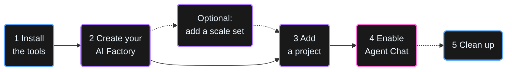

# Set up ESAF: from an empty subscription to your first agent

<table>
<tr>
<td width="50%" valign="top">
 
<a href="../quickstarts/README.md"><b>Setup docs - platform team: How to set up the Factory</b></a> 
Install the tools, create the Factory, add projects and switch on Agent Chat.
</td>
<td width="50%" valign="top">
 
<a href="../usage/README.md"><b>Usage docs - project team: How to build agents, apps and ML</b></a> 
Build on a project your platform team already set up.
</td>
</tr>
</table>

You set up Enterprise Scale Azure Factory (ESAF) in five steps. Each step is one quickstart, and each
scenario is one call.

| Step | Quickstart | The one call | Time |
|---|---|---|---|
| 1 | [Install the ESAF tools](../quickstarts/01-install-esaf.md) | `azurefactory health` | 15 minutes |
| 2 | [Create your AI Factory](../quickstarts/02-create-factory.md) | `esaf.init_factory()` | 1 to 1.5 hours |
| Optional | [Add a scale set](../quickstarts/add-scale-set.md) | `esaf.add_scale_set("002", "dev", cidr="10.141.0.0/16")` | 15 to 30 minutes |
| 3 | [Add a project for your team](../quickstarts/03-add-project.md) | `esaf.upsert_project("002", "dev", scale_set="001")` | About 1 hour |
| 4 | [Create your first agent by enabling ESAF Agent Chat](../quickstarts/04-first-agent-chat.md) | `esaf.upsert_project("001", "dev", scale_set="001", settings=...)` | About 1 hour |
| 5 | [Clean up](../quickstarts/05-clean-up.md) | `esaf.delete_factory()` | About 1 hour |

## Choose your tool

Every tool is a client of the same Factory API, so the result is the same whichever you pick. See the
[onion architecture](../10-19/10-factory-onion-architecture-v2.md).

| Tool | Choose it when |
|---|---|
| App | You want forms and one button per scenario. It runs on Windows 11. |
| CLI | You work in PowerShell or Bash, on Windows, Linux or macOS: `azurefactory esaf init-factory`. |
| Python SDK | You script the setup: `from azurefactory import esaf`. |
| REST | You call from another system: `POST /api/v1/esaf/init-factory`. |

The [six scenarios](../reference/scenarios.md) lists every call. Before you create a Factory, pick a
[hub mode and a networking mode](../concepts/hub-and-network-modes.md).

## Try it first with Deploy to Azure (preview)

The button deploys a test Factory from the Azure portal: private networking, a dedicated hub, Dev and
project 001. Read the
[portal guide](https://github.com/jostrm/azure-enterprise-scale-ml/blob/portal-125/portal/README.md) before
you select it. It lists the permissions, the regions and the checklist for afterwards.

> [!NOTE]
> Deploy to Azure is meant for a quick test, not for a governed Factory. It doesn't create a repository or
> pipelines, and it doesn't register the Factory with the Factory API. It doesn't create dashboards, and it
> leaves out some of the roughly 35 Azure services and SKU settings you can choose from. It's a preview: it
> stays proposed until one deployment is confirmed.

**Next:** [Quickstart: Install the ESAF tools](../quickstarts/01-install-esaf.md)

Related: [Docs hub](../README.md) ·
[Guide 17: the six scenarios, tool by tool](../10-19/17-cli-and-api-and-usage.md) · [Folder structure](../reference/folder-structure.md) ·
[Settings](../reference/settings.md) ·
[ESAF Tutorial Guide](../../../environment_setup/install_tutorial_guide/README.md), the guided lab app (private preview: ask
[Joakim Åström on LinkedIn](https://www.linkedin.com/in/joakimastrom/) for a preview code) ·
[For maintainers: automation and review flow](../reference/maintainers/automation-and-review-flow.md)
