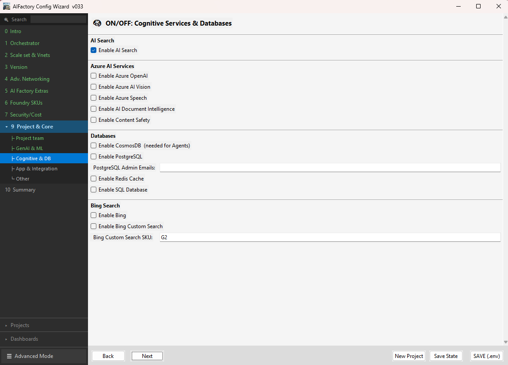
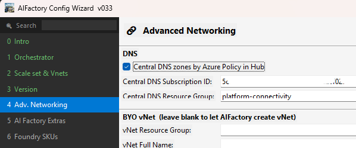

# Legacy setup: v1.24 and the single `aifactory` folder

This page keeps the setup instructions for **existing single-factory repositories** rooted at `aifactory`,
including `release/v1.24`, `variables.yaml`, `.env` and the manual Azure DevOps and GitHub Actions run forms.
New factories use the registered `azurefactory` folder: start at the [docs hub](../README.md).

Moved here unchanged from [End-to-end setup](24-end-2-end-setup.md) when that page became the short overview.

## Version and folder compatibility

| AI Factory source | Folder support | Default use |
|---|---|---|
| `release/v1.24` (`124`, LTS) | Legacy `aifactory` only | New legacy bootstrap default |
| `release/v1.25` (`125`) | Legacy `aifactory` and registered `azurefactory` | Stable registered-layout release |
| `main` | Legacy `aifactory` and registered `azurefactory` | Unstable development |

Selecting another submodule branch changes the shared code/templates; it does **not**
rename, migrate or replace configuration storage. A repository originally created
with `aifactory\variables.json` therefore remains a supported legacy repository
when its submodule moves to `release/v1.25` or `main`. Existing repositories can
therefore update the shared source while retaining the single `aifactory` folder.
Migration is a separate catalog operation with its own preview and confirmation.

## Manual Azure DevOps Run pipeline: variables.yaml

For a manual run of the copied `infra-project-genai.yaml` in a legacy `aifactory`
consumer, choose your **consumer branch** (for example `prj001`) and use:

| Run pipeline field | Value for a normal YAML-based run |
|---|---|
| Deployment mode (`deploymentTarget`) | Keep `manual` |
| `deploymentProjectNumber` | Keep `XXX` (the format is 3 digits, e.g. `001`; only reviewed runs use it) |
| `deploymentConfigHash` | Keep `not-applicable` |
| `deploymentSettings` | Keep the default object `{}` |
| Build agent selection | Keep `from-config` (your self-hosted runner); `microsoft-hosted` cannot resolve private endpoints such as the seeding Key Vault |
| Override variables.yaml with variables.json | **Unchecked** |
| `configFile` | Leave its default; ignored while the override is unchecked |

The actual project number, such as `"001"`, comes from `project_number_000` in
`aifactory\esml-infra\azure-devops\bicep\yaml\variables\variables.yaml`.
Do not put it in the reviewed project-number field for this manual flow.

**For Dev only, open Stages to run and select only Dev GenAI Project. Deselect
Stage and Prod.** `manual` preserves the normal promotion flow; it does not mean
Dev-only. Stage/Prod can run after successful predecessors if left selected.
Microsoft-hosted agents do not grant private-network access or an agent's managed
identity; choose a compatible existing runner.

ADO's Run UI treats empty string parameters as required, even with `default: ''`.
The nonempty `manual` / `XXX` / `not-applicable` defaults avoid that UI problem. If the
old labels still ask for blank reviewed fields, refresh and publish the consumer's
copied pipeline from the fixed source before starting a new run.
`manual` is normalized to the original empty target internally; old API callers
that explicitly send an empty target remain compatible.

The JSON override checkbox selects configuration input; it does **not** select
reviewed-deployment mode. Explicit `dev`, `stage` or `prod` reviewed targets still
require the protected per-run JSON, exact project, configuration hash and scheduling
settings supplied together by the reviewed launcher/API. Unchecking the override
does not bypass those checks. Never invent a hash or set only the reviewed target.

See [manual update settings](26-update-AIFactory.md#manual-azure-devops-run-pipeline)
when rerunning an existing project deployment.

## Manual GitHub Actions project run

For the legacy `infra-project.yml` workflow, select the consumer branch and one
`environment` (`dev`, `stage` or `prod`). Unlike the ADO Run UI, GitHub accepts
empty optional inputs: leave `deployment_id`, `project_number` and `config_hash`
empty for a normal manual run; do not enter ADO's `manual` / `not-applicable`
values. The actual project comes from the selected configuration.

`config_file` defaults to `aifactory/variables.json`. Clear it to use existing
GitHub Environment variables/secrets without a JSON override; GitHub does not
read the ADO `variables.yaml`. Keep `json_identity_auth: false` for that route.
Custom runner labels can remain empty. Select `github-hosted` only when its
network and identity are compatible with the target.

Reviewed launches still require their protected configuration secret, exact
target/project and matching hash. Partial reviewed metadata is an error, not an
optional manual override; JSON identity selection does not replace that contract.
The subnet task already uses the CLI session from `azure/login`, not Az.Network
imports. After upgrading the submodule, re-copy **both** `infra-project.yml` and
`infra-project-phase.yml` into the consumer's `.github/workflows` directory.
See the [GitHub workflow guide](../../../environment_setup/aifactory/bicep/copy_to_local_settings/github-actions/readme.md#manual-inputs-and-subnet-authentication).

## How the scripted Azure DevOps setup automates prerequisites

The legacy single-factory Azure DevOps setup uses a **scripted privileged
bootstrap**. Its entrypoint is
[`ADO-create-new-aifactory-scaleset.sh`](../../../bootstrap/ADO-create-new-aifactory-scaleset.sh);
the GitHub counterpart is
[`GHA-create-new-aifactory-scaleset.sh`](../../../bootstrap/GHA-create-new-aifactory-scaleset.sh).
Both share
[`bootstrap/lib/create-new-aifactory-scaleset.sh`](../../../bootstrap/lib/create-new-aifactory-scaleset.sh).
The shared `aif_scaleset_main` invokes the following helpers:

| Helper | Automated responsibility |
|---|---|
| `aif_ensure_first_party_enterprise_apps` | Find/create the required tenant service principals and resolve the AML/Databricks object IDs |
| `aif_ensure_bootstrap_identity` | Create/reuse the selected deployment identity and grants |
| `aif_ensure_seeding_keyvault` / `aif_seed_optional_project_sp` | Create/reuse the seed vault and seed applicable credentials without entering secret values into configuration |
| `aif_ensure_team_group` | Resolve/create the Entra security group and selected membership |
| `aif_prepare_external_access_hub` / `aif_ensure_vpn_access_hub` | Prepare the external hub and create a missing VPN gateway or reuse an existing one |
| `aif_configure_ado` / `aif_configure_github_identity` | Configure provider-specific authentication and automation |

These helpers resolve `azure_machinelearning_sp_oid`, create or reuse the team
group, and prepare the seed vault. Provide authenticated administrative access
and the intended tenant, subscriptions, repository and hub details before running
the script.

For an existing registered `azurefactory` draft, continue through the registered
workflow rather than running a legacy full-bootstrap script over it. This
preserves saved configuration and keeps configuration approval separate from
cloud/provider execution.

## Legacy launchers at a registered root, and migration

The legacy-named v1.25/main create/update launchers accept those same
`inspect|execute` arguments at a registered root and delegate to the scoped
entrypoint. Conversely, the scoped provider wrappers expose explicit
`legacy-create` and `legacy-update` compatibility commands for an existing
single-factory repository:

```bash
bash ./ADO-azurefactory.sh legacy-update --aifactory-version 125
bash ./GHA-azurefactory.sh legacy-update --aifactory-version main
```

The unified `ALL-create-new-aifactory-scaleset.sh` forwards registered
`inspect|execute` calls after orchestrator selection. The control launcher bundle
is preserved while switching template versions, so selecting `124` cannot replace
the modern dual-layout router with an older script.

GitHub Actions and Azure DevOps may use separate repositories. Runtime adapters
can generate an isolated `aifactory` execution folder for existing pipelines;
that does not replace the new register layout.

Existing installations are never migrated automatically. Preview migration into
a separate empty `azurefactory` folder and confirm it explicitly; the source
configuration remains unchanged. Before migrating, install compatible published
app, API and provider versions.

New registered Full bootstrap saves directly into `azurefactory`; it does not
require a subsequent migration. Only a separately created legacy `aifactory`
result uses the explicit migration path. Registration alone does not establish
Azure ownership or authorize deployment.

## Legacy folder structure

The instructions below describe existing single-factory repositories rooted at
`aifactory`. They remain supported; do not rename that folder in place.

```text
repository\
  aifactory\
    variables.json
    config-wizard\
      project-001\
        project_state.json
```

## Existing single-factory setup

> [!IMPORTANT]
> For an automated starting point, use the
> [AI Factory template repository](https://github.com/jostrm/azure-enterprise-scale-ml-usage),
> which includes the shared AI Factory source as a submodule. The instructions
> below remain applicable to existing single-factory repositories.

## Prerequisites

Review the [Azure and Azure DevOps/GitHub prerequisites](../10-19/12-prerequisites-setup.md)
before starting.

### Local tools for Azure DevOps and GitHub Actions

Install [Git Bash](https://git-scm.com/downloads) on Windows, using GNU Bash
5.2.37 or later. The setup scripts run in Bash. On macOS or Linux, use a
compatible Bash installation and install the required dependencies.

```bash
bash --version
```

### Additional tool for GitHub Actions

Install [GitHub CLI](https://cli.github.com/) 2.71.0 or later. The setup scripts
use it to publish applicable `.env` values as GitHub secrets and variables and
create the Dev, Stage and Production environments.

```bash
gh --version
```

### Optional: AI Factory Configuration Wizard

Download the [**AI Factory Configuration Wizard and quick start**](../../../environment_setup/install_config_wizard/readme.md)
for Windows, macOS or Linux. It bundles its Python runtime and the local API; a separate Python installation is not needed.

## Setup options

For restricted teams with administrator-provided prerequisites, use the
[**AI Factory Configuration Wizard**](../../../environment_setup/install_config_wizard/readme.md).
For privileged create-or-reuse provisioning, use Full bootstrap instead.
An external hub alone does not make the Wizard mandatory.

For a DEV-first automated setup from an existing subscription, use one of the
new launchers from the parent repository:

```bash
bash ./ADO-create-new-aifactory-scaleset.sh
# or
bash ./GHA-create-new-aifactory-scaleset.sh
```

Select templates with `--aifactory-version 125` or `AIFACTORY_VERSION=125`.
The numeric format is one major digit plus two minor digits: `124` means
`release/v1.24`, `125` means `release/v1.25`. Use explicit dotted values for
future versions such as `1.100` or `10.2`; `main` is also an explicit choice.
New legacy factories default to `124`. Existing factories and new scale sets inherit
their saved version; an unknown existing version blocks rather than downgrades.
Without an explicit choice, an interactive terminal asks you to accept or change
the effective default. `--non-interactive` and API execution never prompt for it.

Preview resolves the published branch to an exact commit; execution uses that
commit, not a newer branch head. Missing branches or incompatible contracts fail
without fallback. `AIF_SUBMODULE_BRANCH` and `AIF_SUBMODULE_REF` remain supported,
but conflicting explicit selectors are rejected. The chosen version is saved in
`aifactory/config-wizard/aifactory-version.json`; consumer/development `main`
remains separate from the selected template release.

Registered `azurefactory` runs do not read that legacy version file. Their
protected manifest freezes the selected published source branch and exact commit.
`release/v1.25` and `main` support the register layout; `release/v1.24` does not.

### Frozen lifecycle creation

Use the selected published `bootstrap/AIFactory-lifecycle.sh execute` entrypoint
with `--stdin-manifest`, `--source-root`, `--execution-root`, and `--receipt` for
scoped/common-only creation. A trusted backend supplies the complete frozen
manifest through a protected child stdin pipe; do not put configuration or
credentials in shell arguments or environment variables.

This is a separate scoped provider path, not a flag that bypasses only the final
project dispatch in the legacy bootstrap. Empty project lists must remain empty.
See `bootstrap/lib/factory_lifecycle_contract.txt` for complete configuration,
publication, authentication, coordination and scope prerequisites. Unsupported
configuration blocks rather than falling back to project001. The legacy
creation wrappers reject `AIF_CREATE_PROJECTS` and `AIF_PROJECT_MODE` settings;
a version-contract marker alone does not advertise scoped creation support.

**Manual provider installation prerequisite:** legacy creation and project-update
scripts do not install or register the separate lifecycle provider. Before
preparing a scoped operation, copy the appropriate file byte-for-byte from the
isolated checkout of the **selected published source commit**, not mutable
development `main`, into the consumer repository:

| Provider | Selected source file | Consumer destination |
| --- | --- | --- |
| GitHub Actions | `bootstrap/templates/factory-lifecycle-gha.yml` | `.github/workflows/factory-lifecycle.yml` |
| Azure DevOps | `bootstrap/templates/factory-lifecycle-ado.yml` | `aifactory/pipelines/factory-lifecycle.yml` |

The repository owner must review and publish that consumer change separately;
the lifecycle runtime never copies files into, commits, or pushes the consumer
repository. Register the ADO YAML pipeline at its destination and select its
pipeline identity in the reviewed route. For GHA, the dispatchable workflow must
be available on the repository's default branch. Keep the templates manual-only:
GHA uses `workflow_dispatch`; ADO has `trigger: none` and `pr: none`.

The frozen route identifies the independently reviewed consumer commit. Its
provider file and the isolated lifecycle helper must match the selected source
version. A release without these files is unsupported until published; do not
copy newer development templates over an older selected release or substitute a
different consumer commit after confirmation.

The legacy DEV-first flow registers resource providers, creates or reuses a
federated deployment identity, creates or validates the required seeding Key
Vault, creates the initial Entra team group, configures and commits automation,
deploys the common environment, and then deploys project 001.

Private-only standalone deployments can use an integrated access hub in the
DEV common network or an external `aifactory-connectivity` subscription. The
external option creates central private DNS zones, assigns the DNS initiative
to the spoke, deploys an Entra-authenticated Point-to-Site VPN gateway and DNS
Private Resolver, and peers each AI Factory environment VNet to the access hub.



> **Two common workflows**
>
> - **ITSM-integrated:** Teams request projects through a self-service ticket.
>   An authenticated integration prepares the configuration and triggers the
>   pipeline according to the organization's approval policy.
> - **Core-team managed:** The AI Factory core team uses the
>   [Configuration Wizard](../../../environment_setup/install_config_wizard/readme.md)
>   to prepare configuration from the ticket and review the pipeline execution.

### Naming constraints

Azure deployment names are limited to 64 characters. When configuring prefixes in your `.env` file, keep this in mind:
- Keep `AIFACTORY_PREFIX` and `PROJECT_PREFIX` short (6 characters or fewer recommended)
- Environment-specific prefixes (`DEV_NETWORK_ENV`, `STAGE_NETWORK_ENV`, `PROD_NETWORK_ENV`) add to the total length
- Longer prefixes can cause deployment names to exceed the 64-character limit

The Configuration Wizard validates prefix lengths and warns if deployment names would be truncated. If you configure prefixes manually, use shorter values to ensure all resource names deploy correctly.

### Option A — Azure DevOps

[Setup AIFactory — Infra Automation (Azure DevOps YAML + Bicep)](../../../environment_setup/aifactory/bicep/copy_to_local_settings/azure-devops/esml-yaml-pipelines/readme.md)

### Option B — GitHub Actions

[Setup AIFactory — Infra Automation (GitHub Actions + Bicep)](../../../environment_setup/aifactory/bicep/copy_to_local_settings/github-actions/readme.md)

## Result

After deployment, use these references to understand the factory's resources and
architecture:

[AIFactory overview](../10-19/15-aifactory-overview.md)

[AIFactory architecture diagrams](../10-19/11-architecture-diagrams.md) 

## Advanced configuration: standalone or hub-connected private DNS

### Choose a network topology

For production, combine `BYOvNet` with **hub-connected networking and centralized
private DNS zones**. This separates shared connectivity from the AI Factory
common resources and supports peering, VPN, Bastion and approved client-IP access.

Use **standalone mode** for an isolated factory that does not connect to your
central hub, such as an evaluation or temporary workshop. Standalone mode still
uses private networking; configure VPN, Bastion or approved client-IP access as
appropriate to reach Azure AI Foundry and Azure Machine Learning.

### Standalone

In standalone mode, the **AI Factory common resource group** contains the virtual
network, network security groups and private DNS zones. Set
`CENTRAL_DNS_ZONE_BY_POLICY_IN_HUB="false"`. The hub DNS subscription and resource
group values are required only when centralized hub DNS is enabled.

```bash
  # HUB vs STANDALONE
  
  CENTRAL_DNS_ZONE_BY_POLICY_IN_HUB="false" # <optional>Centralized DNS via Hub policy<default>false<keep-as-is> <otherwise> true, uses central private DNS zones in HUB resource group managed by Azure Policy.
  PRIV_DNS_SUBSCRIPTION_PARAM="<todo>" # <optional>Hub DNS subscription ID<default><todo>_SubscriptionID<mandatory> if CENTRAL_DNS_ZONE_BY_POLICY_IN_HUB:'true' <ensure> Hub connectivity subscription ID.
  PRIV_DNS_RESOURCE_GROUP_PARAM="<todo>" # <optional>Hub DNS resource group<default><todo>_ResourceGroup_name<mandatory> if CENTRAL_DNS_ZONE_BY_POLICY_IN_HUB:'true' <ensure> Hub connectivity resource group.
```

### Hub-connected networking and centralized private DNS zones

Set `CENTRAL_DNS_ZONE_BY_POLICY_IN_HUB="true"` and provide the subscription ID
and resource group containing your centralized private DNS zones. These are
typically in the hub subscription's platform-connectivity resource group.



## Config: Microsoft Entra groups and personas

See [Microsoft Entra groups and personas](../10-19/16-ad-groups-personas.md) for
instructions on creating groups, mapping them to personas and adding the required
information to the seeding Key Vault.

## Config: WebApp (post deployment of WebApp)

### Authentication (WebApp)

| Setting | Value |
|---|---|
| Identity provider | Microsoft Entra ID |
| Client secret | Use the project-specific service principal; see the project Key Vault entry, for example `esml-project-sp-003`. |
| Issuer URL | `https://sts.windows.net/<your-tenant-id>/v2.0`, using the tenant ID from the project Key Vault. |
| Tenant requirement | Allow requests only from the issuer tenant. |

### Authentication (Microsoft Entra ID): API permissions

Configure the project app registration with the following delegated Microsoft
Graph permissions:

- **User.Read:** Sign in and read the user profile.
- **offline_access:** Maintain access to data the user has authorized.

### Authentication (Microsoft Entra ID): redirect URL

On the app registration's **Authentication** page, configure a Web redirect URI
using your deployed WebApp hostname:

```text
https://<your-web-app-name>.azurewebsites.net/.auth/login/aad/callback
```

### Networking (WebApp)

You can configure the WebApp to use the `snet-esml-cmn-001-scoring` subnet.

## Deprecated setup

The [Azure DevOps Classic setup](../10-19/_13-setup-aifactory.md) was deprecated in
March 2025 and receives no new features. Use the YAML pipeline setup for new
deployments. The Classic guide remains available as a reference for existing
installations.

## Configure AIFactory common (ESML, notebook-based)

This is done by ESML Core team, before creating 1st AIFactory project.

1) Copy all configuration files, by running [this Notebook](../../../copy_my_subfolders_to_my_grandparent/01_init_templates_ALL.ipynb)
    - This will copy folders and settings from ESML AIFactory GITHUB repo, to your local root path. 
        - `aifactory` folder - local configuration for IaC
        - `mlops` folder - mlops templates
        - `settings` folder - project specific temaplates
2) Configure all files in your own `aifactory\parameters\` folder
3) Import the Azure Devops / GHA pipelines
    - [Azure Devops - YAML](../../../environment_setup/aifactory/bicep/copy_to_local_settings/azure-devops/esml-yaml-pipelines/readme.md)
    - [Azure Devops - Classic](../10-19/_13-setup-aifactory.md)
    - [Github Actions](../../../environment_setup/aifactory/bicep/copy_to_local_settings/github-actions/readme.md)
4) Configure the pipelines
5) Run the pipelines

## Configure AIFactory project (ESML, notebook-based)

This is ususally done by ESML Core team, before onboarding project team

1) Copy all configuration files, by running [this Notebook](../../../copy_my_subfolders_to_my_grandparent/02_update_templates_QUICK.ipynb)
2) Configure enteprise scale settings
    - settings\enterprise_specific\dev_test_prod_settings.json
3) Configure security_config
    - settings\project_specific\security_config.json
4) Configure lake_settings
    - settings\project_specific\model\lake_settings.json
