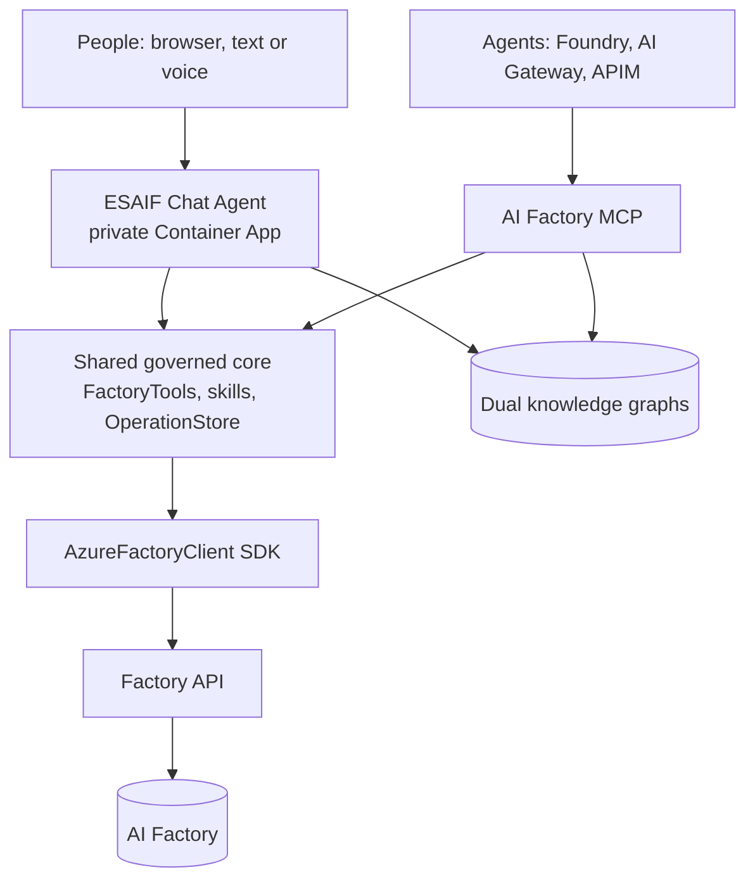

# 29. ESAIF Chat Agent

The **Enterprise Scale AI Factory (ESAIF) Chat Agent** is the factory's front door for people: a private chat (text
and live voice) where authorized users ask about their AI Factory and prepare governed actions. It is the top of
the documentation flow:

**Bicep -> ADO/GHA pipelines -> Factory API -> CLI / Python SDK -> AI Factory MCP -> ESAIF Chat Agent**,
with the [dual knowledge graphs](./29-dual-knowledge-graphs.md) as its evidence.

| Layer | Its role for the agent | Docs |
|---|---|---|
| Bicep + pipelines | Build the factory, and run the late steps that create the agent and the MCP | [Setup](../10-19/13-setup-aifactory.md) |
| Factory API | The one implementation of factory reads and reviewed operations | [CLI, API and usage](../10-19/17-cli-and-api-and-usage.md) |
| CLI / Python SDK | `azurefactory` and `AzureFactoryClient`, used by the agent's tools to call the API | [CLI readme](../../../environment_setup/azurefactory-cli/readme.md) |
| AI Factory MCP | The same tools for **agents** (Foundry, AI Gateway, APIM) | [29. AI Factory MCP](./29-factory-MCP.md) |
| Dual knowledge graphs | Cited evidence about code `[G]` and architecture `[A]` | [29. Dual knowledge graphs](./29-dual-knowledge-graphs.md) |

## How the pieces relate

- **Same core, two doors.** The chat agent and the MCP run the same factory tools, skills and operation store, and
  the same dual-graph query core. A typed question, a spoken question and an MCP tool call see the same facts and
  obey the same rules.
- **The chat does not call the MCP.** It runs the governed tools inside its own app with its own Entra sign-in.
  Deploy the MCP when *other agents* need the tools; the chat works without it.
- **Both use the API through the SDK.** Neither has its own provisioning code.
- **Prepare, never approve.** A state-changing request only prepares a reviewable plan. Approval is human-only and
  outside the model; executing an approved plan is bound to its exact hash.

## Turn it on

| Variable | Effect |
|---|---|
| `enableFactoryChatAgent` | Step `70-factory-chat-agent` creates or updates the owned Foundry prompt agent `enterprise-scale-ai-factory`. |
| `enableAIFactoryAgentLiveVoice` | Step `72-aifactory-agent-live-voice` deploys the private chat app with Azure Voice Live (project001 Dev). Requires `enableFactoryChatAgent`. |
| `aifactoryAgentEntraAppId`, `aifactoryAgentReaderObjectIds` | The web sign-in app registration and the people who may use the chat. |
| `enableAIFactoryMCP` (optional) | The MCP for agents; see [29. AI Factory MCP](./29-factory-MCP.md). |

Full guide (prerequisites, operator flow, security, troubleshooting):
[21. Agent Factory chat and live voice](../10-19/21-agent-factory-chat.md).

## Example questions

- "What is the health of the Contoso AI Factory, and which skills can I use?" (factory tools)
- "Which pipeline step deploys the AI Factory MCP, and which Bicep does it depend on?" (structural graph `[G]`)
- "Why are pipelines not allowed to write Microsoft Graph?" (architecture vault `[A]`)
- "Prepare adding project002 to the Contoso AI Factory." (a reviewable plan; a person approves it)
