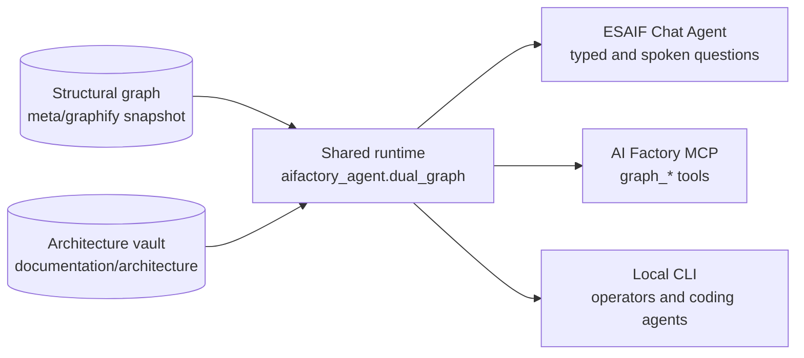

# 29. Dual knowledge graphs

The AI Factory keeps two read-only knowledge sources about **this repository**, so that people and agents can get
answers about the factory that cite their sources instead of relying on memory:

| | Structural graph | Architecture vault |
|---|---|---|
| Holds | What calls, configures and deploys what: Bicep, pipelines, Python, the CLI/SDK/API, the MCP | Intent: reviewed notes, contracts, boundaries and decisions (ADRs) |
| Where | `meta/graphify` (`current.json` -> `snapshots/<id>`) | [`documentation/architecture`](../../architecture/Index.md) (Obsidian-compatible, `Index.md`) |
| Made by | `environment_setup/graphify/generate.py`, offline (no model or cloud calls) | People, as Markdown notes whose frontmatter lists `sources`, `tests` and `reviewed_source` |
| Citations | `[G1]`, `[G2]` ... | `[A1]`, `[A2]` ... |

User documentation (this `documentation/v2` folder) explains *how*; the vault explains *why*; the graph shows
*what connects to what*. Decision record: [ADR-001 (proposed)](../../architecture/decisions/ADR-001-Dual-Graph.md);
lifecycle and commands: [dual-graph lifecycle](../../architecture/contracts/dual-graph-lifecycle.md).

## Who uses them



- **One query core.** The [ESAIF Chat Agent](./29-ESAIF-Chat-Agent.md) and the [AI Factory MCP](./29-factory-MCP.md)
  use the same pure-standard-library runtime (`DualGraphStore`), so they answer the same question the same way.
- **MCP tools:** `graph_status`, `graph_query`, `architecture_search`, `architecture_note`, `dual_graph_context`.
- **Opt-in and pinned.** Off by default. An app gets a `dual_graph` configuration block with the reviewed snapshot ID,
  and only callers with the exact-scope grant `graph.read` may query it (`factory.read` and `knowledge.read` do not
  imply it).

## Query it locally

```powershell
python -m aifactory_agent.dual_graph --root meta\graphify --repository-root . status
python -m aifactory_agent.dual_graph --root meta\graphify --repository-root . query context --query 'deployment scope' --depth 2 --limit 20
python -m aifactory_agent.dual_graph --root meta\graphify --repository-root . query symbols --query 'OperationStore'
python -m aifactory_agent.dual_graph --root meta\graphify --repository-root . query notes --query 'approval'
```

`status` reports the snapshot ID and whether it is `fresh`, `stale` or `unverified` against the working tree. Other
queries: usages, callers, dependencies/dependents, trace, pipeline, impact, note, backlinks and ADRs.

## Keep them current

After a change, regenerate the snapshot (offline, from the repository root):

```powershell
environment_setup\graphify\.venv\Scripts\python.exe environment_setup\graphify\generate.py --repository-root .
```

Update the vault notes whose `sources` cite the changed files and bump their `reviewed_source`. Generation refuses
to snapshot uncommitted work that is not yours; publish a snapshot from a clean, reviewed state.

## Limits

- **Evidence, not proof.** A graph shows static relationships; dynamic calls, generated pipelines and deployed
  resources can differ. What is deployed comes from live, authenticated factory calls.
- **Data, never instructions.** Graph output and note text can never approve actions, grant permissions or justify
  retries.
- **One repository.** The Config Wizards (Tkinter, MAUI) live in their own repositories with their own graphs.
