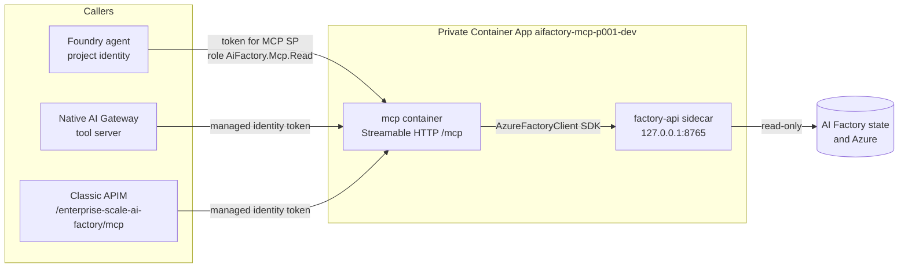

# 29. The AI Factory MCP

The **AI Factory MCP** is a governed, read-only [Model Context Protocol](https://modelcontextprotocol.io/) server for
the Enterprise Scale AI Factory. Agents and MCP clients use it to ask a factory about its health, capabilities and
skills, with the same rules and the same code that the Factory API, the CLI and the Python SDK use.

The documentation follows the layers of the factory, from the bottom up:

| Layer | What it is | Docs |
|---|---|---|
| 1. Bicep | The infrastructure as code that builds a factory (common + projects) | [Architecture diagrams](../10-19/11-architecture-diagrams.md), [Parameters](../10-19/13-parameters-ado.md) |
| 2. ADO / GHA pipelines | The pipelines that deploy the Bicep and run the late project steps | [Setup (ADO)](../10-19/13-setup-aifactory.md), [Setup (GHA)](../10-19/13-setup-aifactory-gha.md) |
| 3. Factory API | The shared Python API behind the Config Wizards (Tkinter and MAUI) | [CLI, API and usage](../10-19/17-cli-and-api-and-usage.md), [API usage examples](../../../environment_setup/install_config_wizard/api-usage-examples/readme.md) |
| 4. CLI / Python SDK | `azurefactory` CLI and `AzureFactoryClient`, thin clients over the API | [Get started](../10-19/18-cli-and-api-and-usage.md), [CLI readme](../../../environment_setup/azurefactory-cli/readme.md) |
| 5. **AI Factory MCP** | **This page**: the factory tools for agents | [MCP readme (developer depth)](../../../mcp/readme.md) |
| 6. ESAIF Chat Agent | The chat and voice agent for people, on the same governed core | [29. ESAIF Chat Agent](./29-ESAIF-Chat-Agent.md) |
| Knowledge | The dual knowledge graphs that the MCP and the agent can cite | [29. Dual knowledge graphs](./29-dual-knowledge-graphs.md) |
| Gateways | Native AI Gateway SKU, classic APIM, Kong | [29. AI Gateways](./29-factory-AI-Gateways.md) |

## At a glance

| You want | Turn on (project001 Dev) | What happens |
|---|---|---|
| The MCP running in your project | `enableAIFactoryMCP` | The late project-pipeline step `71-aifactory-mcp-ai-gateway` creates (or keeps up to date) the private Container App `aifactory-mcp-p001-dev`, or adopts an existing one. |
| The MCP as a tool server on the native AI Gateway | `addAIFactoryMCP2AIGatewaySKU` (+ `enableAIGatewaySKU`) | Registers the read-only tool server `aifactory-mcp-p001-dev` on the gateway, visible in the AI Gateway portal. |
| The MCP behind a classic APIM | `addAIFactoryMCP2APIM` (+ the `apimGateway*` APIM) | The project step admits the APIM identity; the AI gateway pipeline publishes `https://<apim>/enterprise-scale-ai-factory/mcp`. |
| Callers that may use it | automatic | The Foundry project identity, plus the gateway and APIM identities when their flags are on. An Entra admin grants each one the app role `AiFactory.Mcp.Read` once. |

A flag set to `false` **skips** the step. It never deletes the MCP, its callers or its network, and
`enableDeleteForDisabledResources` does not touch it.

## Architecture



- **Two containers, one app.** The `mcp` container serves the MCP over authenticated Streamable HTTP at `/mcp`.
  The `factory-api` container is a **sidecar**: the same shared Python Factory API that the Config Wizards use,
  reachable only on `127.0.0.1:8765` inside the app. They share an API key from a secret; nothing outside the app
  can call the sidecar.
- **The CLI's SDK inside the MCP.** The MCP does not have its own provisioning code. Its tools call the existing
  agent `FactoryTools` and skills, which call `AzureFactoryClient`, the Python SDK of the `azurefactory` CLI, which
  calls the sidecar API. So an MCP answer, a CLI command and a Wizard screen all come from one implementation.
- **Private.** The app runs in an *internal* Container Apps environment. APIM and the AI Gateway reach it through
  the environment's **approved private endpoint** and the `privatelink.<region>.azurecontainerapps.io` DNS record.
  The Bicep that creates the environment owns that endpoint; the MCP step only verifies it.
- **Identities.** The app runs as its own user-assigned identity `mi-aifactory-mcp-p001-dev` (pull images, read the
  project services). Callers use *their* identities to call it; see [the MCP SP](#the-mcp-sp-app-registration).

## Capabilities

The pipeline-hosted MCP exposes the read-only tools, under the namespace `aifactory` on the AI Gateway:

| Tool | Answers |
|---|---|
| `factory_health` | Is the Factory API reachable and healthy, with its coverage (not just "up") |
| `factory_capabilities` | Which operations, versions and features this factory supports |
| `factory_skills` | The skills, their argument schemas, required permissions and current blockers |

The full MCP server (the operator or local mode in the [MCP readme](../../../mcp/readme.md)) also has catalog,
settings, cost and operation tools: `factory_catalog`, `factory_settings`, `cost_default_project_idle`,
`cost_common_idle`, `cost_monthly_project_forecast`, `factory_operations`, `factory_operation`,
`factory_operation_status`, and the **prepare** tools `factory_prepare_create`, `factory_prepare_add_project`,
`factory_prepare_delete`. A prepare tool only creates a reviewable plan. **Approval is human-only**, outside the
model, and executing an approved plan is bound to its exact hash. Factory writes are disabled in the
pipeline-hosted MCP.

Optional: with a `dual_graph` configuration and the `graph.read` grant, the MCP also serves `graph_status`,
`graph_query`, `architecture_search`, `architecture_note` and `dual_graph_context`
([dual knowledge graphs](./29-dual-knowledge-graphs.md)).

## Usage examples

**From a Foundry agent.** Add the MCP (or its AI Gateway tool server URL) as an MCP tool with managed-identity
authentication for the MCP SP's client ID, then ask:

- "Is the Contoso AI Factory API healthy?" -> `factory_health`
- "Which AI Factory skills can I use, and what blocks them?" -> `factory_skills`
- "Does this factory support adding a project?" -> `factory_capabilities`

**Through the classic APIM** (an APIM subscription key, issued as subscription `aifactory-mcp-client`):

```bash
curl -s https://<apim>.azure-api.net/enterprise-scale-ai-factory/mcp \
  -H "Ocp-Apim-Subscription-Key: <key>" -H "Content-Type: application/json" \
  -H "Accept: application/json, text/event-stream" \
  -d '{"jsonrpc":"2.0","id":1,"method":"tools/list"}'
```

**Locally, for development** (stdio, no Azure needed): see
[Local stdio server and client](../../../mcp/readme.md#local-stdio-server-and-client).

**Plan the pipeline step without writing anything** (GET only):

```bash
export enableAIFactoryMCP=true  # plus the project variables
python usecase_code/40-agent-factory/45-aifactory-mcp-gateway/deploy.py validate   # offline
python usecase_code/40-agent-factory/45-aifactory-mcp-gateway/deploy.py plan       # Azure GET only
```

## Variables

| Variable (ADO / `variables.json`) | GHA `.env` | When | Meaning |
|---|---|---|---|
| `enableAIFactoryMCP` | `ENABLE_AI_FACTORY_MCP` | the switch | Host or keep the MCP up to date (project001 Dev). |
| `aifactoryMcpEntraAppId` | `AIFACTORY_MCP_ENTRA_APP_ID` | mandatory, or from the seeding Key Vault | Client ID of the [MCP SP](#the-mcp-sp-app-registration). |
| `aifactory_mcp_AppID_seeding_kv_name` | `AIFACTORY_MCP_KV_S_NAME_APPID` | optional | Seeding Key Vault secret holding that client ID (default `esml-project001-mcp-app-id`). Used when `aifactoryMcpEntraAppId` is empty. |
| `aifactoryMcpImage`, `aifactoryMcpApiImage` | `AIFACTORY_MCP_IMAGE`, `AIFACTORY_MCP_API_IMAGE` | when the pipeline creates the app | Digest-pinned images in a registry of the project subscription. |
| `aifactoryMcpContainerAppResourceId` | `AIFACTORY_MCP_CONTAINER_APP_RESOURCE_ID` | optional | Adopt an MCP app deployed outside the pipeline. |
| `aifactoryMcpContainerAppsEnvironment` | `AIFACTORY_MCP_CONTAINER_APPS_ENVIRONMENT` | optional | Pick the environment when the project has more than one. |
| `aifactoryMcpClassicApimResourceIds` | `AIFACTORY_MCP_CLASSIC_APIM_RESOURCE_IDS` | optional | More classic APIMs whose identities may call the MCP. |
| `addAIFactoryMCP2AIGatewaySKU` | `ADD_AI_FACTORY_MCP_2_AI_GATEWAY_SKU` | optional | Register on the native AI Gateway ([AI Gateways](./29-factory-AI-Gateways.md)). |
| `addAIFactoryMCP2APIM` | `ADD_AI_FACTORY_MCP_2_APIM` | optional | Publish on the AI gateway pipeline's classic APIM. |

Requirements are validated, never ignored: creating the app needs `enableContainerApps` and `enableAIFoundry`;
adopting an app needs only `enableAIFoundry`.

## The MCP SP (app registration)

Callers request tokens **for the MCP**, so the MCP needs its own identity as a resource: an Entra app registration
with its service principal, called the **MCP SP** here.

- It exposes the app role `AiFactory.Mcp.Read` (Application), the audience `api://<appId>` and v2 tokens.
- It has **no secret**: the MCP never signs in as it, it only validates incoming tokens.
- It is created **once per project, upfront, by an Entra admin**, typically in the same batch as the project
  service principals, and stored in the [seeding Key Vault](../10-19/12-seeding-keyvault.md):

  ```bash
  # One project, or a range such as 001..010
  PROJECT_NUMBER_FROM=001 PROJECT_NUMBER_TO=010 KEY_VAULT_NAME=<seeding-kv> SUBSCRIPTION_ID=<kv-sub> TENANT_ID=<tenant> \
    bash ./aifactory/esml-util/29b-create-mcp-api-sp-for-projects.sh
  ```

  It writes `esml-projectNNN-mcp-app-id` and `esml-projectNNN-mcp-sp-oid`. The pipelines read the client ID from the
  seeding Key Vault (ADO step `03_az_download_seeding_keyvault`, GHA step `03_Download_Secrets_From_Seeding_KeyVault`).
  `29-create-sp-or-update-oid-for-project.sh` can do both kinds of SP in one batch with `ALSO_CREATE_MCP_API_SP=true`.

**Granting callers the role.** Pipelines never write Microsoft Graph. For each caller, the MCP step prints the exact
admin command for the Microsoft Graph Bicep template
[`aifactory-mcp-app-role.bicep`](../../../environment_setup/aifactory/bicep/esml-common/ai-gateway/entra/aifactory-mcp-app-role.bicep):

```bash
az deployment group create --subscription <project-sub> --resource-group <project-rg> \
  --name aifactory-mcp-app-role-<first 8 of principal> \
  --template-file environment_setup/aifactory/bicep/esml-common/ai-gateway/entra/aifactory-mcp-app-role.bicep \
  --parameters mcpEntraAppId=<MCP SP client ID> callerPrincipalId=<caller object ID>
```

The admin runs it once per new caller with Graph permissions `AppRoleAssignment.ReadWrite.All` and
`Application.Read.All` (Bicep CLI 0.36.1 or later).

## Order for a new factory

1. Entra admin: create the MCP SP (script `29b`, stored in the seeding Key Vault).
2. Core team: set `enableAIFactoryMCP`, `enableContainerApps`, the two images (and optionally the gateway flags),
   then run the project001 Dev pipeline.
3. Entra admin: run the printed role-assignment commands (Foundry project identity, gateway, APIM).
4. Optional: run the AI gateway pipeline with `addAIFactoryMCP2APIM` to publish it on the classic APIM.

## Scenario: adopting an existing MCP in the Contoso AI Factory

Contoso deployed its MCP before the pipeline step existed, as `aifactory-mcp-project001-dev` in its own internal
environment with a private endpoint. Instead of creating a second app, Contoso adopts it:

```yaml
enableAIFactoryMCP: "true"
aifactoryMcpEntraAppId: "<Contoso MCP SP client ID>"
aifactoryMcpContainerAppResourceId: "/subscriptions/<sub>/resourceGroups/contoso-esml-project001-sdc-dev-001-rg/providers/Microsoft.App/containerApps/aifactory-mcp-project001-dev"
enableContainerApps: "false"   # adoption needs no new Container Apps environment
```

The step checks that the app is in the project resource group, is not already pipeline-managed and accepts the
configured audience. It then **only appends missing callers** and `factory.read` grants (one template update with a
new revision). Images, identity, secrets, ingress and tags never change. When every caller is present, nothing is
written.

## FAQ

<a id="faq-mcp"></a>

### Q: What happens if I set `enableAIFactoryMCP`, `aifactoryMcpEntraAppId` and `aifactoryMcpContainerAppResourceId` and run the project001 pipeline?
On a factory whose pipeline includes step 71 (ADO `job-aifactory-mcp-ai-gateway.yaml`, GHA "Deploy AI Factory MCP and
AI Gateway SKU"), the step adopts the existing app, verifies its private endpoint and adds any missing callers. If
every caller is already present, it writes nothing and only prints the admin role commands. A consumer repository
whose local pipeline copies predate the step must first refresh those copies; until then the variables do nothing.

### Q: Where do I find `aifactoryMcpEntraAppId` and `aifactoryMcpContainerAppResourceId` before the run?
- `aifactoryMcpEntraAppId`: the **Application (client) ID** of the MCP SP (Entra admin center > App registrations), or
  the seeding Key Vault secret `esml-projectNNN-mcp-app-id`. An existing MCP app also shows it in its
  `AIFACTORY_APPLICATION_AUTH_JSON` audience.
- `aifactoryMcpContainerAppResourceId`:
  `az containerapp show --subscription <sub> -g <project-rg> -n <app> --query id -o tsv`.

### Q: Other `enable*` variables create, activate or configure something. What does `enableAIFactoryMCP: "true"` do if the MCP already exists?
It keeps it configured: it adds missing callers (project, gateway, APIM identities), re-applies the pipeline-managed
app definition (images, settings) for an app it owns, verifies the private network and prints the admin
prerequisites. It also gives `addAIFactoryMCP2AIGatewaySKU` and `addAIFactoryMCP2APIM` an MCP to attach to.

### Q: Can I leave it `false` when I know the MCP exists? Will `enableDeleteForDisabledResources` remove it?
Yes, you can leave it `false`: the step is skipped and the app, its callers and network stay as they are. No delete
path exists for the MCP: `false` never deletes, and the disabled-resource cleanup does not touch it. Turn it on when
you want the pipeline to keep the callers in sync, for example when you add a gateway.

### Q: What is the end goal: the MCP in Foundry, in the AI Gateway portal, or in the MAUI app's AI Gateway menu?
`enableAIFactoryMCP` **hosts** the MCP and admits the Foundry project identity as a caller. Exposure is separate:
`addAIFactoryMCP2AIGatewaySKU` makes it a tool server on the native AI Gateway (visible in the AI Gateway portal),
and `addAIFactoryMCP2APIM` publishes it on a classic APIM. The MAUI app's AI Gateway menu reads gateways through the
Factory API; these variables are only fields in the Wizard's MCP & AI Gateway step. Registering the MCP as a tool
inside a Foundry agent is a separate step that the pipeline does not do.

### Q: Does `true` create the MCP when it doesn't exist? Then it needs Container Apps, and isn't the Entra app ID a chicken-and-egg problem?
Yes, it creates it, so it needs `enableContainerApps` (and `enableAIFoundry`) plus the two images. There is no
chicken-and-egg: the MCP SP is created upfront by an Entra admin (script `29b`), and the container app resource ID
is only for adopting an existing app, so leave it empty for a new one.

### Q: With `enableAIFactoryMCP` true, are the other two mandatory?
`aifactoryMcpEntraAppId` is mandatory (directly or from the seeding Key Vault). `aifactoryMcpContainerAppResourceId`
is optional: empty means "create the pipeline-managed app"; set it only to adopt one.

### Q: Is the app registration a service principal created upfront? Why not use the project's user-assigned managed identity?
Yes: an app registration plus its service principal, created once per project by an Entra admin. A managed
identity is a **caller** identity; it cannot expose app roles or be a token audience. The MCP SP is the
**resource** identity that callers request tokens for. Managed identities are still used everywhere on the caller
side (Foundry project, AI Gateway, APIM) and as the MCP's own outbound identity. Accepting a generic audience such as
ARM would avoid the app registration, but any identity in the tenant can get such a token and the admin-controlled
role would be lost, so the AI Factory does not do that.

### Q: Can the MCP SP be the same as the project service principal (used for WebApp authentication)?
Technically yes, if "Assignment required" stays off for the WebApp sign-in. It is not recommended: the project SP is a
client with a secret and RBAC on project resources, while the MCP SP is a secretless resource. Keep them separate but
create them in the same admin batch; the seeding Key Vault holds both.

### Q: Why did a hand-made APIM MCP API answer with an empty tool list?
An APIM API of type `mcp` made APIM host its own empty MCP server instead of passing calls through (observed with the
Sweden Central resource provider in October 2026). `apim-mcp-server.bicep` therefore publishes a plain HTTP proxy
(POST/GET/DELETE `/mcp`, unbuffered). Older APIM api-versions cannot even see `type: mcp` APIs.

See also: [42. FAQ](../40-49/42-FAQ-01.md#ai-factory-mcp), [MCP step readme](../../../usecase_code/40-agent-factory/45-aifactory-mcp-gateway/readme.md),
[architecture note: MCP boundary](../../architecture/agents/MCP-Boundary.md).
