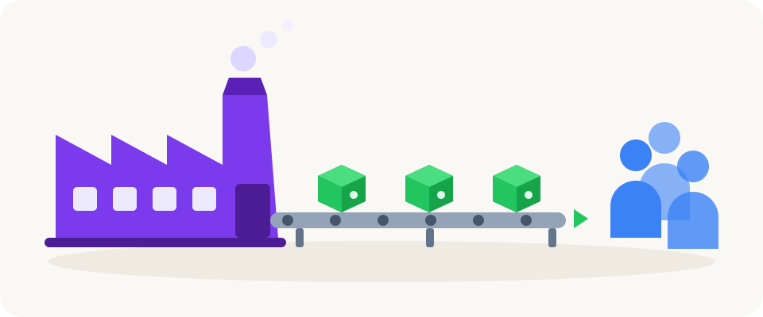

# Enterprise Scale Azure Factory (ESAF) documentation

Go from an empty Azure subscription to a governed AI Factory, then build agents and ML models in it.

<table>
<tr>
<td width="50%" valign="top">
 
<a href="quickstarts/README.md"><b>Setup docs - platform team: How to set up the Factory</b></a> 
Install the tools, create the Factory, add projects and switch on Agent Chat.
</td>
<td width="50%" valign="top">
 
<a href="usage/README.md"><b>Usage docs - project team: How to build agents, apps and ML</b></a> 
Build on a project your platform team already set up.
</td>
</tr>
</table>

*AI-generated illustration.*

An **AI Factory** is a production line for AI projects. The platform team builds the line once. Each project
team then gets the same secure project: private networking, identities, Microsoft Foundry, Azure AI Search and
Azure Machine Learning.

## Learn by watching

The **ESAF Tutorials** lab guide is a desktop app that walks you through each scenario. It plays a narrated
video for every lab and checks your steps.

| Video in the lab guide | Hub mode | Networking |
|---|---|---|
| Scenarios 1-4 with the Python SDK | External hub | Private |
| Scenarios 1-3 with the REST API | Standalone, no hub | Public |
| Scenarios 1-3 with the Config Wizard app | Standalone, no hub | Public |
| Scenarios 1-3 with the REST API | Own hub | Private |

[Download the ESAF Tutorials lab guide](https://github.com/jostrm/azure-enterprise-scale-ml/tree/main/environment_setup/install_tutorial_guide)
(watch the videos inside it).

## Understand ESAF

| Page | What it explains |
|---|---|
| [The six scenarios](reference/scenarios.md) | Lists the one call per scenario, for every tool. |
| [Hub and network modes](concepts/hub-and-network-modes.md) | Compares the three hub modes and the three networking modes. |
| [Folder structure](reference/folder-structure.md) | Shows the `azurefactory` folder that holds your factories. |
| [Settings](reference/settings.md) | Explains the connection settings and the naming limits. |
| [Onion architecture](10-19/10-factory-onion-architecture-v2.md) | Shows the five layers from your tool down to Azure Resource Manager. |
| [Architecture diagrams](10-19/11-architecture-diagrams.md) | Shows the Azure services in the common part and in a project. |
| [Factory overview](10-19/15-aifactory-overview.md) | Lists the services and their naming convention. |

## Go deeper by tool

| Guide | What you do |
|---|---|
| [18. Get started with Factory tools](10-19/18-cli-and-api-and-usage.md) | Try the CLI, the Python SDK or REST against a local demo service. |
| [19. Add and update an AI factory](10-19/19-cli-and-api-and-usage.md) | Review each change yourself before the API applies it. |
| [20. Remove, observe and recover](10-19/20-cli-and-api-and-usage.md) | Delete with a review, follow jobs and recover from a stopped run. |
| [21. Agent Factory chat and live voice](10-19/21-agent-factory-chat.md) | Operate, secure and troubleshoot Agent Chat. |
| [22. Lifecycle Azure Function](10-19/22-lifecycle-azure-function.md) | Call the six scenarios from a hosted function. |
| [Tutorial: configure, review and verify](20-29/28-tutorial-walkthrough.md) | Walk through the app and the read-only API. |
| [Tutorial: FinOps monitoring](20-29/tutorial-fiops.md) | Turn usage and cost evidence into FinOps reports. |
| [ITSM integration](20-29/29-ITSM-integrated.md) | Order projects from ServiceNow, Jira or your own portal. |

**Next:** [Setup docs - platform team](quickstarts/README.md)

---

Using v1.24? See the [release/v1.24 docs](https://github.com/jostrm/azure-enterprise-scale-ml/tree/release/v1.24/documentation).
