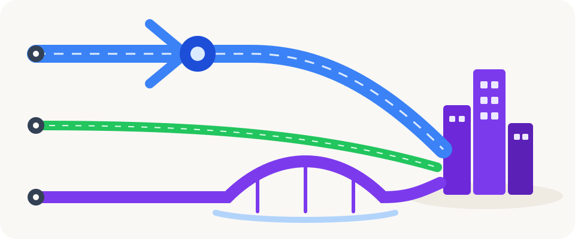
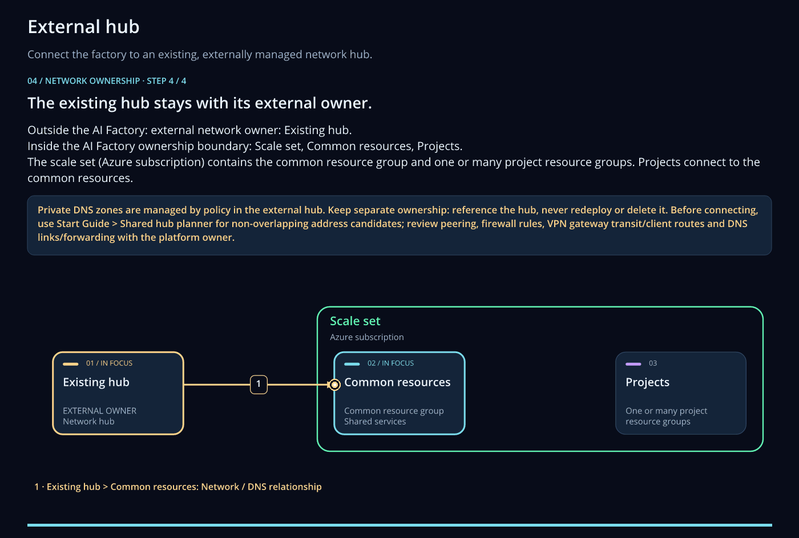
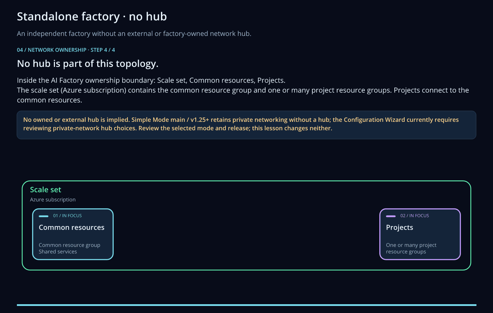
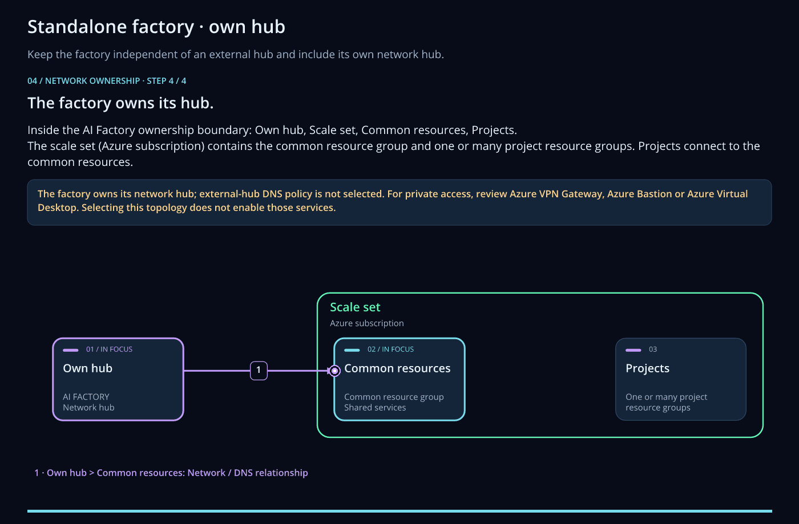
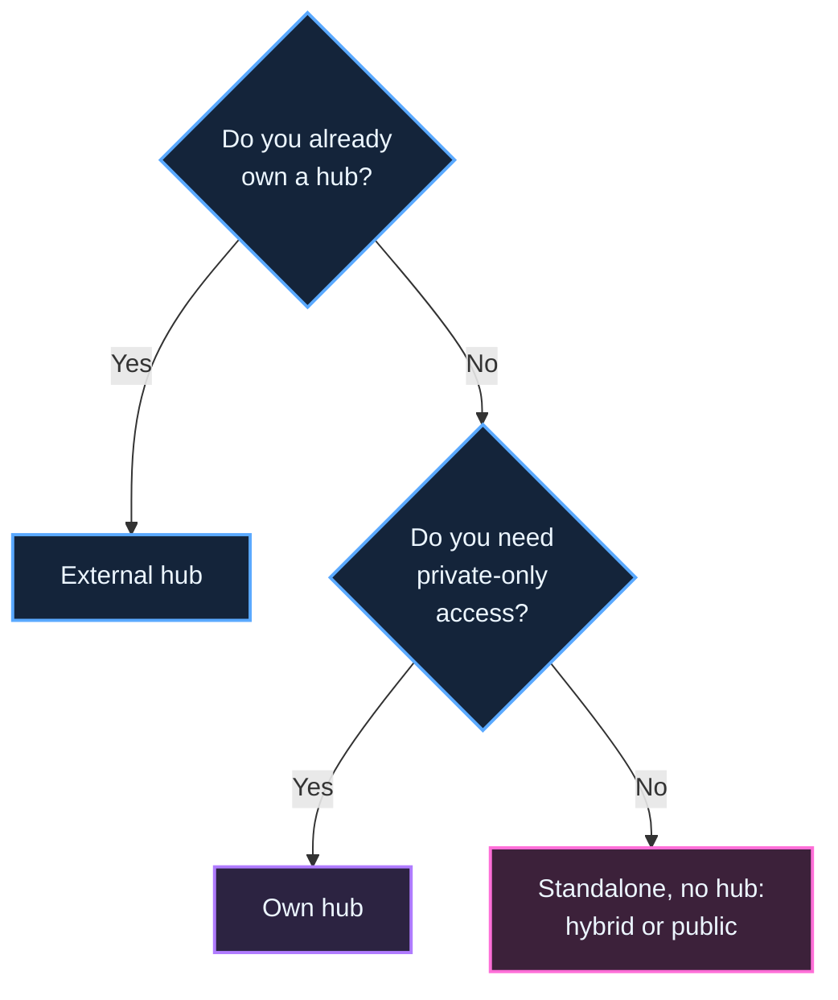

[Docs](../README.md) › Concepts

# Hub and network modes

You make two network choices when you create an AI Factory. The **hub mode** decides how the Factory connects
to the rest of your network. The **networking mode** decides how people reach the services inside it. Every
tool and all six scenarios support the same combinations.

*AI-generated illustration.*

## Hub modes

A **hub** is the shared network that gives people a private way in: a VPN gateway, a DNS resolver and the
private DNS zones.

| Hub mode | What you get | Choose it when |
|---|---|---|
| External hub | The Factory connects to a hub that you already own, in its own subscription or resource group. | You have a landing zone, or several Factories share one hub. |
| Standalone, no hub | The Factory keeps its network and private DNS zones in its own common resource group. | You evaluate ESAF, run a workshop or want an isolated Factory. |
| Own hub | The Factory creates its own hub in its Dev network, with a VPN gateway and Bastion. | You need private access and have no central hub. |

| External hub | Standalone, no hub | Own hub |
|---|---|---|
|  |  |  |

Select a diagram to open its animation.

## Networking modes

| Networking mode | How people reach the services |
|---|---|
| Private | Only over the private network. Public access is off, so you need a VPN, Bastion or a machine inside the network. |
| Hybrid | Over the private network, and over the internet for the AI services that allow it. |
| Public | Over the internet. The project also gets a public perimeter. |

## Which combinations work

Private networking needs a hub, because someone has to get in. A standalone Factory without a hub uses hybrid
or public networking.

| Hub mode | Private | Hybrid | Public |
|---|---|---|---|
| External hub | Yes | Yes | Yes |
| Standalone, no hub | No: add a hub | Yes | Yes |
| Own hub | Yes | Yes | Yes |

## Settings behind the choices

The app sets these for you. You only need the names when you automate the setup.

| Setting | External hub | Standalone, no hub | Own hub |
|---|---|---|---|
| `access_hub_mode` | `external` | `integrated` | `integrated` |
| `setup_hub_access` | Your choice | `false` | `true` |
| `network_mode` | `private`, `hybrid` or `public` | `hybrid` or `public` | `private`, `hybrid` or `public` |

An external hub also needs four values that locate it: `access_hub_subscription_id`,
`access_hub_resource_group`, `access_hub_vnet_name` and `access_hub_vnet_cidr`. An own hub also needs
`vpn_client_cidr`, the address pool of its VPN clients. It must not overlap the Factory's VNet range.

These settings go in the `config` part of the creation request. See
[Quickstart: Create your AI Factory](../quickstarts/02-create-factory.md#describe-your-factory).

## Trade-offs

- **External hub** gives you one VPN and one set of DNS zones for all Factories. It needs a team that owns
  the hub.
- **Standalone, no hub** is the fastest to create and the easiest to delete. It can't be private-only, and
  with public networking it can't run [Agent Chat](../quickstarts/04-first-agent-chat.md).
- **Own hub** is self-contained and private. Each Factory then pays for its own VPN gateway.

A Factory delete keeps hub resource groups in every mode. See [Quickstart: Clean up](../quickstarts/05-clean-up.md).

**Next:** [Quickstart: Create your AI Factory](../quickstarts/02-create-factory.md)

Related: [Networking and private DNS](../10-19/14-networking-privateDNS.md) ·
[Architecture diagrams](../10-19/11-architecture-diagrams.md) ·
[Maintainers: shared-hub coordination](../reference/maintainers/automation-and-review-flow.md#shared-hub-coordination-guards)
