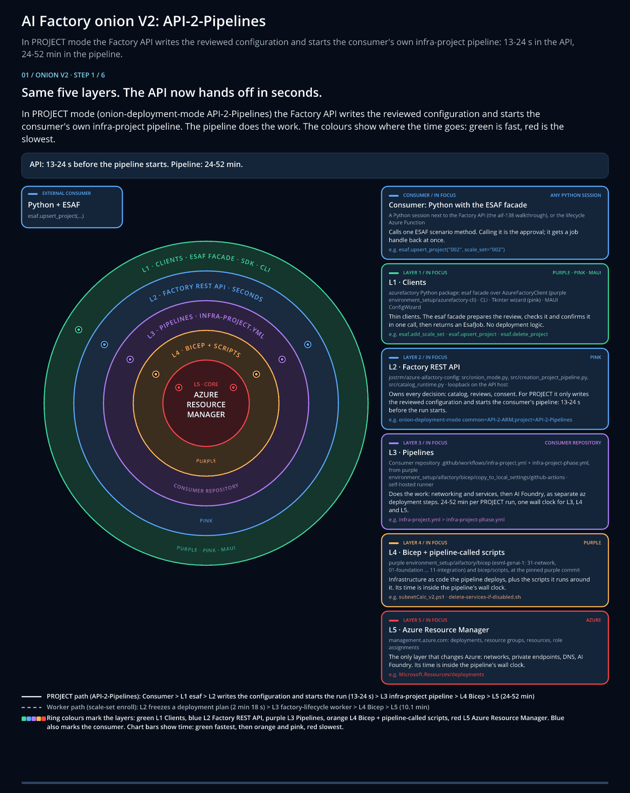

[Docs](../README.md) › [Quickstarts](README.md)

# Quickstart: Install the ESAF tools

In this quickstart, you install one ESAF tool, start the Factory API and check that they connect. The
**Factory API** is the one service that every tool calls. It ships inside the app, so you don't install it
separately.

> [!TIP]
> Prefer to watch first? The **ESAF Tutorials** lab guide plays a narrated video for each lab and checks your
> steps. [Download the ESAF Tutorials lab guide](https://github.com/jostrm/azure-enterprise-scale-ml/tree/main/environment_setup/install_tutorial_guide)
> (watch the videos inside it).

<a href="../10-19/10-factory-onion-architecture-v2.md">
<picture>
  <source media="(prefers-reduced-motion: reduce)" srcset="../10-19/images/10-factory-onion-architecture-v2.png">
  
</picture>
</a>

Every tool is an L1 client of the same Factory API, so the result is the same whichever you pick. See the
[onion architecture](../10-19/10-factory-onion-architecture-v2.md).

## Prerequisites

- **Windows x64.** The one-call scenarios need the Windows package of the app, v0.47.100 or later. The Linux
  and macOS packages are older and don't have them yet.
- [Git for Windows](https://git-scm.com/downloads/win) with Git Bash, and
  [Azure CLI](https://learn.microsoft.com/cli/azure/install-azure-cli-windows).
- [Python](https://www.python.org/downloads/) 3.10 or later.
- [PowerShell](https://learn.microsoft.com/powershell/scripting/install/installing-powershell-on-windows) 7.3
  or later, for the CLI.
- A Git repository for your Factory's configuration, in GitHub or Azure DevOps. This is your **consumer
  repository**.

## Start the Factory API

1. Download the [ESAF Config Wizard for Windows](../../../environment_setup/install_config_wizard/readme.md#download).
2. Extract the archive. Keep the `_internal` folder beside `aifactory-config.exe`.
3. Open `aifactory-config.exe`.
4. On **Quick setup**, select **Start API host**.
5. Enter a private API key. You choose it; remember it for the next steps.
6. Copy the API address from the success dialog. The default is `http://127.0.0.1:8765`.

Keep the app open. The API stops when you close it.

## Create your Factory folder

Your Factory's configuration lives in an `azurefactory` folder in your consumer repository.

1. Open Git Bash in the root of your consumer repository.
2. Add this repository as a submodule and create the folder:

   ```bash
   git submodule add -b release/v1.25 https://github.com/jostrm/azure-enterprise-scale-ml
   bash ./azure-enterprise-scale-ml/01-start-v125-and-above.sh
   ```

Expected output, among other lines:

```text
Initialized empty register: C:\work\team-factory\azurefactory\register.json
```

The script creates `azurefactory\register.json` with no factories in it. It changes nothing in Azure. See
[folder structure](../reference/folder-structure.md).

## Connect your tool

Choose one tool. You can add the others later; they all use the same API address, key and folder.

<details markdown="1" data-factory-tool="App" open>
<summary>App</summary>

You already have the app open. Point it at your folder:

1. In the app, open your consumer repository's `azurefactory` folder.
2. Check that the status bar shows the API address you copied.

</details>
<!-- /factory-tool -->

<details markdown="1" data-factory-tool="CLI (PowerShell)">
<summary>CLI (PowerShell)</summary>

Open PowerShell in the root of your consumer repository:

```powershell
python -m pip install .\azure-enterprise-scale-ml\environment_setup\azurefactory-cli
$env:AIFACTORY_API_URL = 'http://127.0.0.1:8765'
$env:AIFACTORY_API_KEY = Read-Host 'API key you entered in the app'
$env:ESAF_FOLDER = (Resolve-Path .\azurefactory).Path
azurefactory health
```

</details>
<!-- /factory-tool -->

<details markdown="1" data-factory-tool="Python SDK">
<summary>Python SDK</summary>

Install the SDK and set the connection once, in PowerShell:

```powershell
python -m pip install .\azure-enterprise-scale-ml\environment_setup\azurefactory-cli
$env:AIFACTORY_API_KEY = Read-Host 'API key you entered in the app'
$env:ESAF_FOLDER = (Resolve-Path .\azurefactory).Path
```

Then save this as `check_connection.py` and run it:

```python
from azurefactory import esaf

session = esaf.connect()  # reads ESAF_FOLDER, AIFACTORY_API_URL and AIFACTORY_API_KEY
catalog = session.client.catalog_list(session.folder)
print([factory["key"] for factory in catalog["factories"]])
```

</details>
<!-- /factory-tool -->

<details markdown="1" data-factory-tool="REST (curl)">
<summary>REST (curl)</summary>

Open Git Bash. Health needs no key:

```bash
curl --silent --show-error --fail-with-body http://127.0.0.1:8765/health
```

List the scenario routes that the API serves:

```bash
curl --silent --show-error http://127.0.0.1:8765/openapi.json \
  | grep -o '"/api/v1/esaf/[^"]*"' | sort -u
```

Every other request needs your key in the `X-API-Key` header.

</details>
<!-- /factory-tool -->

## Verify the result

Your tool reaches the API, and your folder holds no factory yet.

| Tool | Expected output |
|---|---|
| App | The status bar shows the API address, and the factory list is empty. |
| CLI | `azurefactory health` prints `"status": "ok"`. |
| Python SDK | The script prints `[]`. |
| REST | The second command lists seven routes that start with `/api/v1/esaf/`. |

For example, the CLI prints:

```json
{
  "status": "ok",
  "version": "1.0.0"
}
```

If something goes wrong:

| Message | Fix |
|---|---|
| `AIFACTORY_API_KEY is required`, or HTTP 401 | Set the key again. It must match the key you entered in the app. |
| `The Factory API has no /api/v1/esaf routes` | Your app is older than v0.47.100. Download the current Windows package. |
| `Select an absolute local factory folder without traversal.` | Set `ESAF_FOLDER` with `Resolve-Path`, as shown. |
| `ModuleNotFoundError: azurefactory` | Run the `pip install` line again with the same `python`. |

## Next step

**Next:** [Quickstart: Create your AI Factory](02-create-factory.md)

Related:

- [Settings](../reference/settings.md): the connection settings in one table.
- [The six scenarios](../reference/scenarios.md): what you can run now.
- [Guide 18](../10-19/18-cli-and-api-and-usage.md): try the tools against a local demo service first.
