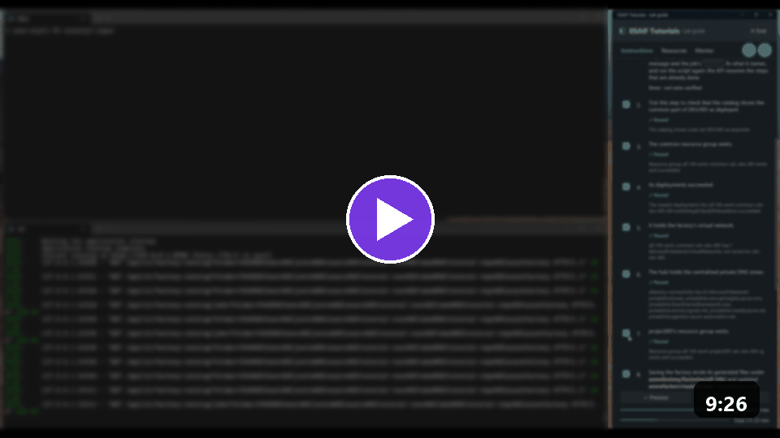
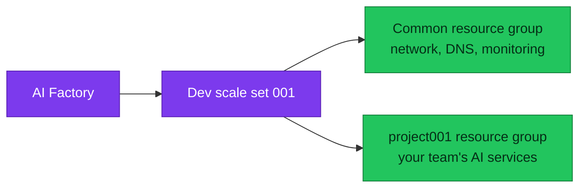

[Docs](../README.md) › [Setup docs](README.md)

# Quickstart: Create your AI Factory

In this quickstart, you create your AI Factory and its first project with one call. An **AI Factory** is the
shared part that every project uses: the network, private DNS, monitoring and the deployment pipelines.

> [!TIP]
> **Run it guided.** The **ESAF Tutorials** app types each command for you and checks every step: open an
> **ESAF** tutorial and the track **Scenarios 1–3**.
> [Download ESAF Tutorials](https://github.com/jostrm/azure-enterprise-scale-ml/tree/main/environment_setup/install_tutorial_guide).
> It's a private preview: ask [Joakim Åström on LinkedIn](https://www.linkedin.com/in/joakimastrom/) for a
> preview code.

<a href="https://github.com/jostrm/azure-enterprise-scale-ml/tree/main/environment_setup/install_tutorial_guide"></a>

*The scenario video, 9 minutes. Watch it in ESAF Tutorials under **Resources** > **Scenario videos**.*

When you finish, you have this in your Dev subscription:



## Prerequisites

- The tools from [Quickstart: Install the ESAF tools](01-install-esaf.md), with the Factory API running.
- An Azure subscription for Dev, where you can create resource groups and assign roles.
- A signed-in Azure CLI: run `az login --tenant <your tenant ID>`.
- For GitHub Actions: [GitHub CLI](https://cli.github.com/), signed in, and access to your consumer repository.
- For Azure DevOps: access to your organization, project and repository.
- A free private address range for the Factory's virtual network, for example `10.140.0.0/16`.

## Choose your topology

Pick one hub mode and one networking mode. Every tool supports the same combinations.

| You want | Hub mode | Networking mode | Keep in mind |
|---|---|---|---|
| The fastest first test | Standalone, no hub | Public | You can't run [Agent Chat](04-first-agent-chat.md) on it. |
| The full path, with Agent Chat | Own hub | Private | The Factory creates a VPN gateway, which takes longer and costs more. |
| To join your landing zone | External hub | Private or hybrid | Your hub must exist first. |

Private networking needs a hub. Agent Chat needs private or hybrid networking and a way in, such as a VPN.
Read [hub and network modes](../concepts/hub-and-network-modes.md) before you choose, because the hub mode is
part of how the Factory is built.

## Describe your Factory

The Factory API needs to know what to build. You can describe it in two ways:

- **In the app:** fill in the form and save it. The saved form is your **draft**.
- **In a file:** write a **creation request** and pass it with the call. Use this for the CLI, the Python SDK
  and REST.

Neither creates anything in Azure. To write the creation request, save this as `creation-request.json` in
the root of your consumer repository. It describes the fastest first test: standalone, public networking
and GitHub Actions. It's the same request that the ESAF Tutorials app writes for you.

```json
{
  "contract_version": 1,
  "mode": "full-bootstrap",
  "action": "create-factory",
  "folder": "<absolute path of your azurefactory folder>",
  "orchestrator": "gha",
  "factory_key": "acme-ai",
  "region_short_name": "sdc",
  "config": {
    "subscription_id": "<your Dev subscription ID>",
    "tenant_id": "<your tenant ID>",
    "location": "swedencentral",
    "factory_prefix": "acme-",
    "aifactory_version": "1.25",
    "scale_set_number": "001",
    "project_number": "001",
    "repo_root": "<absolute path of your consumer repository>",
    "github_repository": "<owner>/<your consumer repository>",
    "github_visibility": "private",
    "dev_vnet_cidr": "10.140.0.0/16",
    "cost_center": "123456",
    "coordination_mode": "single-writer",
    "identity_mode": "create",
    "runner_mode": "self-hosted",
    "team_member_email": "<your sign-in email>",
    "team_group_name": "acme-ai-team",
    "access_hub_mode": "integrated",
    "setup_hub_access": false,
    "network_mode": "public"
  }
}
```

On Windows, write each backslash in a path twice, for example `C:\\work\\team-factory\\azurefactory`.

Change these values before you use it:

| Setting | What it does |
|---|---|
| `folder`, `repo_root` | Point to your `azurefactory` folder and to the repository that holds it, as absolute paths. |
| `subscription_id`, `tenant_id` | Select where the Factory deploys. Nothing is taken from your Azure sign-in. |
| `location`, `region_short_name` | Set the Azure region and its short name, for example `swedencentral` and `sdc`. |
| `factory_key` | Names the Factory in your folder, for example `acme-ai`. It isn't a secret. |
| `factory_prefix` | Starts every resource name. Keep it to six characters or fewer. |
| `dev_vnet_cidr` | Sets the Factory's private address range. It must not overlap your hub or a peered network. |
| `team_member_email`, `team_group_name` | Create or reuse the Microsoft Entra group that gets access to project 001. |
| `github_repository` | Names the consumer repository that runs the pipelines. |
| `access_hub_mode`, `setup_hub_access`, `network_mode` | Set the topology. See [the values for each hub mode](../concepts/hub-and-network-modes.md#settings-behind-the-choices). |

Keep `creation-request.json` out of Git if you treat your subscription IDs as private.

## Create the Factory

> [!WARNING]
> Running a scenario is the approval. It deploys billable resources to Azure, and there is no separate confirm
> step.

<details markdown="1" data-factory-tool="App" open>
<summary>App</summary>

1. On **Start Guide**, select **Use Simple Mode**: GitHub Actions, Dev and private networking. For Azure
   DevOps, an external hub or another networking mode, select **Use Full bootstrap**.
2. Fill in the form, then select **Save local configuration**. That's your draft.
3. To run it, open the menu and select **Configuration wizard** > **Quick setup & tear down**.
4. Select **1. Init AI Factory**.
5. Tick **I approve this scenario: it runs at once and changes Azure.**, then select
   **Run selected scenario**.
6. Follow **Job status** on the same page until it shows that the job succeeded.

</details>
<!-- /factory-tool -->

<details markdown="1" data-factory-tool="CLI (PowerShell)">
<summary>CLI (PowerShell)</summary>

```powershell
azurefactory esaf init-factory --creation-request-json .\creation-request.json --wait
```

`--wait` follows the job to its end. Without it, the command prints a job ID that you follow with
`azurefactory esaf job <job ID> --wait`. Did you save a draft in the app instead? Then leave out
`--creation-request-json`.

</details>
<!-- /factory-tool -->

<details markdown="1" data-factory-tool="CLI (bash)">
<summary>CLI (bash)</summary>

```bash
azurefactory esaf init-factory --creation-request-json ./creation-request.json --wait
```

`--wait` follows the job to its end. Without it, the command prints a job ID that you follow with
`azurefactory esaf job <job ID> --wait`. Did you save a draft in the app instead? Then leave out
`--creation-request-json`.

</details>
<!-- /factory-tool -->

<details markdown="1" data-factory-tool="Python SDK">
<summary>Python SDK</summary>

```python
import json

from azurefactory import esaf

creation = json.load(open("creation-request.json", encoding="utf-8-sig"))
job = esaf.init_factory(creation_request=creation)
print("Job", job.id)
state = job.wait()
print(state["status"], "-", state["message"])
```

Did you save a draft in the app instead? Then call `esaf.init_factory()` with no arguments.

</details>
<!-- /factory-tool -->

<details markdown="1" data-factory-tool="REST (curl)">
<summary>REST (curl)</summary>

In Bash, from the root of your consumer repository. On Windows, that's Git Bash. You need `jq`.

```bash
API_URL='http://127.0.0.1:8765'
read -r -s -p 'API key: ' API_KEY
FOLDER="$(cygpath -w "$PWD/azurefactory")"   # on Linux or macOS: FOLDER="$PWD/azurefactory"

jq -n --arg folder "$FOLDER" --slurpfile request creation-request.json \
  '{folder: $folder, approved: true, creation_request: $request[0]}' |
  curl --silent --show-error --fail-with-body -X POST "$API_URL/api/v1/esaf/init-factory" \
    --header "X-API-Key: $API_KEY" --header 'Content-Type: application/json' --data @-
```

The API answers `202 Accepted` with a `job_id`. Read the job until it ends:

```bash
curl --silent --show-error --get "$API_URL/api/v1/esaf/jobs/<job ID>" \
  --header "X-API-Key: $API_KEY" --data-urlencode "folder=$FOLDER"
```

</details>
<!-- /factory-tool -->

The run takes about one hour, and up to 90 minutes in the recorded runs. You can stop waiting at any time;
the job keeps running while the app stays open.

## Verify the result

The job ends with status `succeeded`:

```json
{
  "status": "succeeded"
}
```

The job also carries a `message` and the run it started.

Then check Azure:

```powershell
az group list --subscription <your Dev subscription ID> --query "[].name" --output table
```

You see the common resource group and the project001 resource group. Their names start with your prefix.
Your folder now holds the Factory under `azurefactory\factories\<factory key>`. Commit and push it.

| Job status | What to do |
|---|---|
| `accepted`, `preparing`, `confirming`, `running`, `retrying` | Wait. The job is still going. |
| `blocked` | Read `blockers` in the job, fix what they name, and run the scenario again. Finished steps are skipped. |
| `failed` | Read `problem` in the job. The API already retried the run twice. |
| `interrupted` | Run the scenario again. The API stopped before the run started. |

## Clean up resources

To remove everything this quickstart created, delete the Factory with one call:

| Tool | Call |
|---|---|
| CLI | `azurefactory esaf delete-factory --wait` |
| Python SDK | `esaf.delete_factory()` |
| REST | `POST /api/v1/esaf/delete-factory` |

See [Quickstart: Clean up](05-clean-up.md) for what stays and what goes.

## Next step

**Next:** [Quickstart: Add a scale set](add-scale-set.md). It's optional: to stay on one scale set, go to
[Quickstart: Add a project for your team](03-add-project.md).

Related:

- [The six scenarios](../reference/scenarios.md): every call and its parameters.
- [Hub and network modes](../concepts/hub-and-network-modes.md): the topology choices in detail.
- [Guide 19](../10-19/19-cli-and-api-and-usage.md): review each change yourself before the API applies it.
