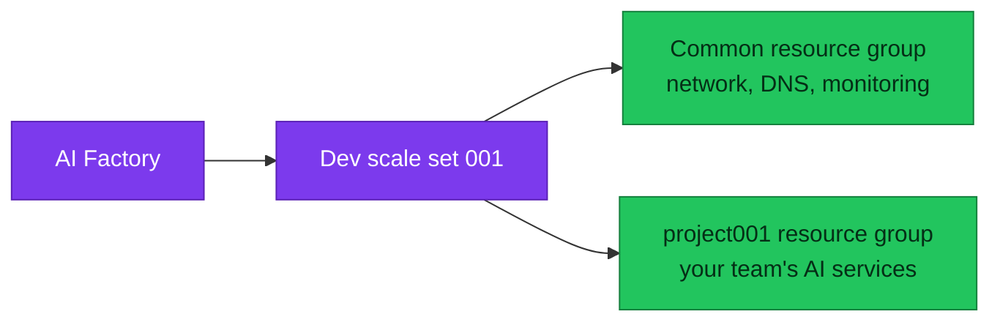

[Docs](../README.md) › [Quickstarts](README.md)

# Quickstart: Create your AI Factory

In this quickstart, you create your AI Factory and its first project with one call. An **AI Factory** is the
shared part that every project uses: the network, private DNS, monitoring and the deployment pipelines.

> [!TIP]
> Prefer to watch first? The **ESAF Tutorials** lab guide plays the narrated video for this scenario and
> checks your steps. [Download the ESAF Tutorials lab guide](https://github.com/jostrm/azure-enterprise-scale-ml/tree/main/environment_setup/install_tutorial_guide)
> (watch the videos inside it).

When you finish, you have this in your Dev subscription:



## Prerequisites

- The tools from [Quickstart: Install the ESAF tools](01-install-esaf.md), with the Factory API running.
- An Azure subscription for Dev, where you can create resource groups and assign roles.
- A signed-in Azure CLI: run `az login --tenant <your tenant ID>`.
- For GitHub Actions: [GitHub CLI](https://cli.github.com/) and access to your consumer repository.
- For Azure DevOps: access to your organization, project and repository.
- A free private address range for the Factory's virtual network, for example `10.140.0.0/16`.

## Choose your topology

Pick one hub mode and one networking mode. Every tool supports the same combinations.

| Choice | Options |
|---|---|
| Hub mode | External hub, standalone without a hub, or the Factory's own hub |
| Networking mode | Private, hybrid or public |

Private networking needs a hub. Not sure what to pick? Read
[hub and network modes](../concepts/hub-and-network-modes.md). For a first test, standalone without a hub and
public networking is the smallest setup.

## Save your Factory draft

A **draft** is your saved configuration. Saving it creates nothing in Azure.

1. In the app, open the **Start Guide**.
2. Select **Simple Mode** for the smallest form: GitHub Actions, Dev, project 001 and private networking
   with the Factory's own hub. Select **Full bootstrap** for Azure DevOps, an external hub or another
   networking mode.
3. Enter the values from the table below.
4. Select **Configure only—do not deploy** to save the draft.

| Setting | What it does |
|---|---|
| Tenant and subscription | Select where the Factory deploys. Nothing is taken from your Azure sign-in. |
| Region | Sets the Azure region, for example `swedencentral`. |
| Prefix | Starts every resource name. Keep it to six characters or fewer. |
| VNet range | Sets the Factory's private address range. |
| Team member email and team group name | Create or reuse the Microsoft Entra group that gets access to project 001. |
| Repository | Names the consumer repository that runs the pipelines. |

## Create the Factory

> [!WARNING]
> Running a scenario is the approval. It deploys billable resources to Azure, and there is no separate confirm
> step.

<details markdown="1" data-factory-tool="App" open>
<summary>App</summary>

1. In the app, select your Factory, the Dev environment and scale set 001.
2. Review the plan, then confirm it.
3. Follow the run in the integrated terminal.

</details>
<!-- /factory-tool -->

<details markdown="1" data-factory-tool="CLI (PowerShell)">
<summary>CLI (PowerShell)</summary>

```powershell
azurefactory esaf init-factory --wait
```

`--wait` follows the job to its end. Without it, the command prints a job ID that you follow with
`azurefactory esaf job <job ID> --wait`.

</details>
<!-- /factory-tool -->

<details markdown="1" data-factory-tool="Python SDK">
<summary>Python SDK</summary>

```python
from azurefactory import esaf

job = esaf.init_factory()
print("Job", job.id)
state = job.wait()
print(state["status"], "-", state["message"])
```

</details>
<!-- /factory-tool -->

<details markdown="1" data-factory-tool="REST (curl)">
<summary>REST (curl)</summary>

In Git Bash, from the root of your consumer repository. You need `jq`.

```bash
API_URL='http://127.0.0.1:8765'
read -r -s -p 'API key: ' API_KEY
FOLDER="$(cygpath -w "$PWD/azurefactory")"

jq -n --arg folder "$FOLDER" '{folder: $folder, approved: true}' |
  curl --silent --show-error --fail-with-body -X POST "$API_URL/api/v1/esaf/init-factory" \
    --header "X-API-Key: $API_KEY" --header 'Content-Type: application/json' --data @-
```

The API answers `202 Accepted` with a `job_id`. Read the job until it ends:

```bash
curl --silent --show-error --get "$API_URL/api/v1/esaf/jobs/<job ID>" \
  --header "X-API-Key: $API_KEY" --data-urlencode "folder=$FOLDER"
```

</details>
<!-- /factory-tool -->

The run takes about one hour. You can stop waiting at any time; the job keeps running while the app stays open.

## Verify the result

The job ends with status `succeeded`:

```json
{
  "status": "succeeded"
}
```

The job also carries a `message` and the run it started.

Then check Azure:

```powershell
az group list --subscription <your Dev subscription ID> --query "[].name" --output table
```

You see the common resource group and the project001 resource group. Their names start with your prefix.

| Job status | What to do |
|---|---|
| `accepted`, `preparing`, `confirming`, `running`, `retrying` | Wait. The job is still going. |
| `blocked` | Read `blockers` in the job, fix what they name, and run the scenario again. Finished steps are skipped. |
| `failed` | Read `problem` in the job. The API already retried the run twice. |
| `interrupted` | Run the scenario again. The API stopped before the run started. |

## Clean up resources

To remove everything this quickstart created, delete the Factory with one call:

| Tool | Call |
|---|---|
| CLI | `azurefactory esaf delete-factory --wait` |
| Python SDK | `esaf.delete_factory()` |
| REST | `POST /api/v1/esaf/delete-factory` |

See [Quickstart: Clean up](05-clean-up.md) for what stays and what goes.

## Next step

**Next:** [Quickstart: Add a project for your team](03-add-project.md)

Related:

- [The six scenarios](../reference/scenarios.md): every call and its parameters.
- [Hub and network modes](../concepts/hub-and-network-modes.md): the topology choices in detail.
- [Guide 19](../10-19/19-cli-and-api-and-usage.md): review each change yourself before the API applies it.
