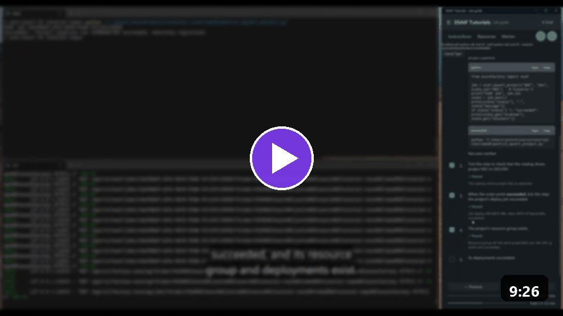

[Docs](../README.md) › [Setup docs](README.md)

# Quickstart: Add a project for your team

In this quickstart, you add a project for a team with one call, then change one of its settings with the same
call. A **project** is one team's own resource group, with its AI services and its access group.

> [!TIP]
> **Run it guided.** The **ESAF Tutorial Guide** types this call for you and checks every step: open an
> **ESAF** tutorial and the track **Scenarios 1-3**.
> [Download the ESAF Tutorial Guide](../../../environment_setup/install_tutorial_guide/README.md).
> It's a private preview: ask [Joakim Åström on LinkedIn](https://www.linkedin.com/in/joakimastrom/) for a
> preview code.

<a href="../../../environment_setup/install_tutorial_guide/README.md"></a>

*The scenario video, 9 minutes. Watch it in the ESAF Tutorial Guide under **Resources** > **Scenario videos**.*

Every project lives on a **scale set**, one floor of the Factory. This quickstart puts project 002 on Dev
scale set 001, and names that scale set in every call. You must name it once Dev has more than one scale
set, as it does after [Quickstart: Add a scale set](add-scale-set.md).

## Prerequisites

- A Factory from [Quickstart: Create your AI Factory](02-create-factory.md).
- The Factory API running, and your tool connected. See [Quickstart: Install the ESAF tools](01-install-esaf.md).
- A free three-digit project number, for example `002`.

## Add the project

"Upsert" means add or update. A new project is registered and deployed. An existing project gets its settings
saved and is deployed again.

<details markdown="1" data-factory-tool="App" open>
<summary>App</summary>

1. In the app, open the menu and select **Configuration wizard** > **Quick setup & tear down**.
2. Select **3. Add or update project**.
3. Set **Environment** to `dev`, **Project number** to `002` and **Project scale set** to `001`.
4. Tick **I approve this scenario: it runs at once and changes Azure.**, then select
   **Run selected scenario**.
5. Follow **Job status** on the same page until it shows that the job succeeded.

</details>
<!-- /factory-tool -->

<details markdown="1" data-factory-tool="CLI (PowerShell)">
<summary>CLI (PowerShell)</summary>

```powershell
azurefactory esaf upsert-project 002 dev --scale-set 001 --wait
```

</details>
<!-- /factory-tool -->

<details markdown="1" data-factory-tool="CLI (bash)">
<summary>CLI (bash)</summary>

```bash
azurefactory esaf upsert-project 002 dev --scale-set 001 --wait
```

</details>
<!-- /factory-tool -->

<details markdown="1" data-factory-tool="Python SDK">
<summary>Python SDK</summary>

```python
from azurefactory import esaf

job = esaf.upsert_project("002", "dev", scale_set="001")
state = job.wait()
print(state["status"], "-", state["message"])
```

</details>
<!-- /factory-tool -->

<details markdown="1" data-factory-tool="REST (curl)">
<summary>REST (curl)</summary>

In Bash, with `API_URL`, `API_KEY` and `FOLDER` set as in
[Quickstart: Create your AI Factory](02-create-factory.md#create-the-factory):

```bash
jq -n --arg folder "$FOLDER" \
  '{folder: $folder, approved: true, project: "002", environment: "dev", scale_set: "001"}' |
  curl --silent --show-error --fail-with-body -X POST "$API_URL/api/v1/esaf/upsert-project" \
    --header "X-API-Key: $API_KEY" --header 'Content-Type: application/json' --data @-
```

</details>
<!-- /factory-tool -->

A new project takes about an hour: the recorded runs took 50 to 65 minutes.

## Change a setting

Send the same call with the settings you want to change. Settings you leave out keep their value.

<details markdown="1" data-factory-tool="App" open>
<summary>App</summary>

1. On the same page, select **3. Add or update project** and enter the same project.
2. In **Optional settings JSON**, enter the settings to change, for example `{"tag_costcenter": "lab"}`.
3. Tick **I approve this scenario: it runs at once and changes Azure.**, then select
   **Run selected scenario**.

</details>
<!-- /factory-tool -->

<details markdown="1" data-factory-tool="CLI (PowerShell)">
<summary>CLI (PowerShell)</summary>

```powershell
'{"tag_costcenter": "lab"}' | Set-Content .\project-settings.json
azurefactory esaf upsert-project 002 dev --scale-set 001 --settings-json .\project-settings.json --wait
```

</details>
<!-- /factory-tool -->

<details markdown="1" data-factory-tool="CLI (bash)">
<summary>CLI (bash)</summary>

```bash
echo '{"tag_costcenter": "lab"}' > project-settings.json
azurefactory esaf upsert-project 002 dev --scale-set 001 --settings-json ./project-settings.json --wait
```

</details>
<!-- /factory-tool -->

<details markdown="1" data-factory-tool="Python SDK">
<summary>Python SDK</summary>

```python
from azurefactory import esaf

job = esaf.upsert_project("002", "dev", scale_set="001", settings={"tag_costcenter": "lab"})
print(job.wait()["status"])
```

</details>
<!-- /factory-tool -->

<details markdown="1" data-factory-tool="REST (curl)">
<summary>REST (curl)</summary>

```bash
jq -n --arg folder "$FOLDER" \
  '{folder: $folder, approved: true, project: "002", environment: "dev", scale_set: "001",
    settings: {tag_costcenter: "lab"}}' |
  curl --silent --show-error --fail-with-body -X POST "$API_URL/api/v1/esaf/upsert-project" \
    --header "X-API-Key: $API_KEY" --header 'Content-Type: application/json' --data @-
```

</details>
<!-- /factory-tool -->

| Parameter | What it does |
|---|---|
| `project` | Sets the project number, three digits as a string: `"002"`. |
| `environment` | Selects `"dev"`, `"stage"` or `"prod"`. It's required. |
| `scale_set` | Selects the scale set. It's required when the environment has more than one. |
| `settings` | Replaces the settings you name. |
| `display_name` | Gives a new project a display name. |

## Verify the result

The job ends with status `succeeded`, and your folder holds the new project:

```text
azurefactory\factories\<your factory>\scalesets\001\projects\project002\variables.json
```

In Azure, you see one more resource group, for project 002. After the settings change, its resources carry
the new cost center tag.

If the call is refused:

| Message | Fix |
|---|---|
| `More than one dev scale set matches; pass scale_set.` | Name the scale set: `--scale-set 001` or `scale_set="001"`. |
| `environment must be dev, stage or prod` | Use one of the three names, in lower case. |
| A job stays `blocked` | Read `blockers` in the job, fix what they name, and run the call again. |

## Clean up resources

Delete the project when the team no longer needs it:

| Tool | Call |
|---|---|
| CLI | `azurefactory esaf delete-project 002 dev --wait` |
| Python SDK | `esaf.delete_project("002", "dev")` |
| REST | `POST /api/v1/esaf/delete-project` |

See [Quickstart: Clean up](05-clean-up.md).

## Next step

**Next:** [Quickstart: Create your first agent by enabling ESAF Agent Chat](04-first-agent-chat.md)

Related:

- [The six scenarios](../reference/scenarios.md): every call and its parameters.
- [Usage docs](../usage/README.md): hand the project over to the team.
- [Microsoft Entra groups and personas](../10-19/16-ad-groups-personas.md): who gets access to a project.
