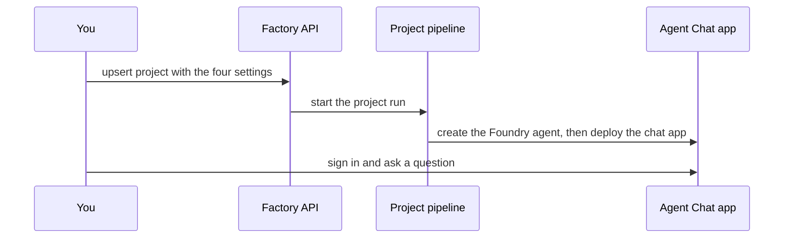
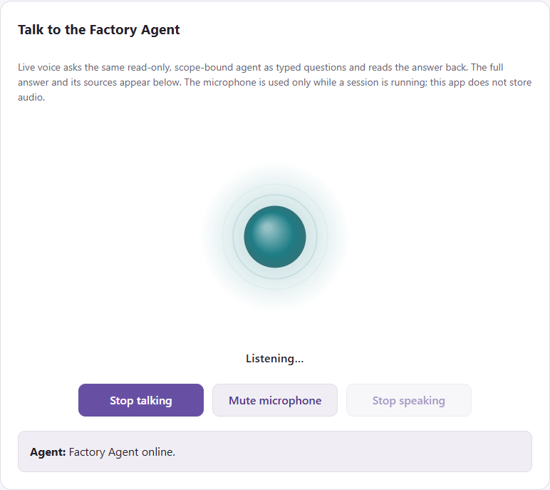
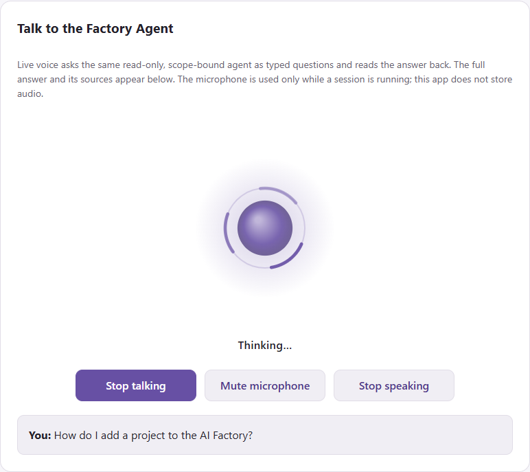
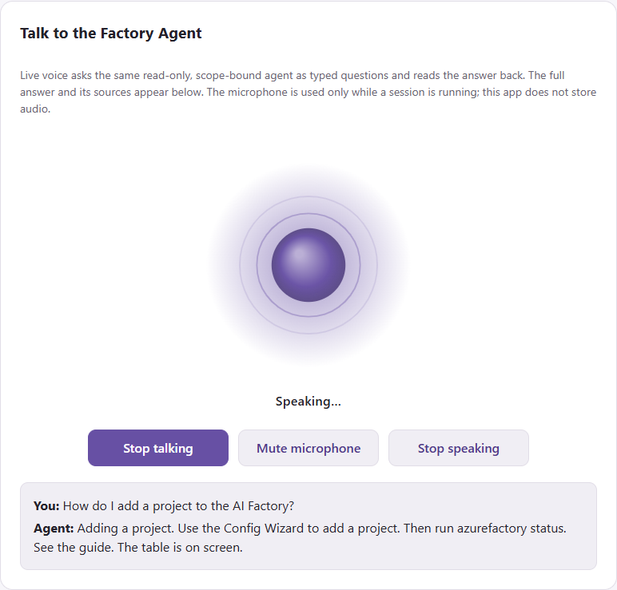

[Docs](../README.md) › [Setup docs](README.md)

# Quickstart: Create your first agent by enabling ESAF Agent Chat

In this quickstart, you switch on ESAF Agent Chat for a project and ask it a first question. **ESAF Agent
Chat** is a Microsoft Foundry agent with a private web chat and live voice. It answers questions about your
Factory from your own documentation and code.

> [!TIP]
> **Run it guided.** The **ESAF Tutorial Guide** types the project calls for you and checks every step: open an
> **ESAF** tutorial and the track **Scenarios 1-3**.
> [Download the ESAF Tutorial Guide](../../../environment_setup/install_tutorial_guide/README.md).
> It's a private preview: ask [Joakim Åström on LinkedIn](https://www.linkedin.com/in/joakimastrom/) for a
> preview code. The guide has no Agent Chat lab yet.



## Prerequisites

- A project in **Dev** from [Quickstart: Add a project for your team](03-add-project.md), or project 001
  from [Quickstart: Create your AI Factory](02-create-factory.md). Any project number works. The examples
  use project 001 on scale set 001.
- On that project: `enableAIFoundry`, `enableAISearch` and `enableContainerApps` set to `"true"`.
- Private or hybrid networking, so that the project's Container Apps environment is internal. A Factory
  with public networking can't run Agent Chat. See
  [hub and network modes](../concepts/hub-and-network-modes.md).
- A chat model deployment that succeeded. The project setting `modelGPTXName` names it.
- A text-embedding deployment that succeeded, for example `text-embedding-3-large`.
- A Microsoft Entra admin who can create an app registration.
- The Entra object IDs of the people who may use the chat. They get read-only access.
- VPN or another route into the project's private network.

> [!IMPORTANT]
> The chat app deploys in Dev only. Runs for Stage and Prod skip it.

## Create the sign-in registration

An Entra admin does this once per project. Pipelines never write to Microsoft Entra. The commands in this
section are PowerShell. In Bash, end a continued line with a backslash instead of a backtick.

1. Find the address your chat app gets. The app name is `aifactory-agent-project<NNN>-dev`:

   ```powershell
   az containerapp env list --resource-group <project resource group> `
     --query "[0].properties.defaultDomain" --output tsv
   ```

2. Copy `config.example.json` in `usecase_code\40-agent-factory\40-aifactory-agent` and put your own object
   ID under `auth.grants`.
3. From that folder, plan the registration. Add `--apply` when the plan looks right:

   ```powershell
   python -m aifactory_agent.browser_auth --config ./my-agent.json `
     --redirect-uri "https://aifactory-agent-project001-dev.<default domain>/" `
     --user-object-id "<your Entra object ID>"
   ```

4. Copy `client_id` from the output. You need it in the next step.

The tool gives sign-in access to you only. Ask your Entra admin to assign the other readers to the
**Enterprise Scale AI Factory Agent** enterprise application. For the details, see
[authentication in the agent guide](../../../usecase_code/40-agent-factory/40-aifactory-agent/readme.md#authentication-tools-and-approvals).

## Turn on the four settings

Agent Chat is an update of your project, so it's scenario 3 with four settings. The call saves the settings
and then deploys them.

| Setting | What it does |
|---|---|
| `enableFactoryChatAgent` | Creates the Foundry prompt agent `enterprise-scale-ai-factory`. |
| `enableAIFactoryAgentLiveVoice` | Deploys the chat web app with live voice. Needs `enableFactoryChatAgent`. |
| `aifactoryAgentEntraAppId` | Sets the client ID of the sign-in registration. |
| `aifactoryAgentReaderObjectIds` | Lists 1 to 20 object IDs, comma-separated, that get read-only access. |

<details>
<summary>More settings</summary>

| Setting | What it does |
|---|---|
| `aifactoryAgentContainerAppsEnvironment` | Names the internal environment. Empty picks the only one in the project resource group. |
| `aifactoryAgentModelDeployment` | Names the agent's own model deployment. Empty uses `modelGPTXName`. |
| `aifactoryAgentVoiceName` | Sets the voice. Empty uses `en-US-Ava:DragonHDLatestNeural`. |
| `aifactoryAgentVoiceLanguages` | Lists the input languages. Empty uses `en-US`; Swedish needs `sv-SE,en-US`. |
| `aifactoryAgentConfigFile` | Points to your own agent configuration file in your repository. It's merged over the generated one. |

</details>

<details markdown="1" data-factory-tool="App" open>
<summary>App</summary>

1. In the app, open the menu and select **Configuration wizard** > **Quick setup & tear down**.
2. Select **3. Add or update project**, and enter your project: **Environment** `dev`, **Project number**
   `001` and **Project scale set** `001`.
3. In **Optional settings JSON**, enter the four settings, as in the `agent-chat.json` file on the CLI tabs.
4. Tick **I approve this scenario: it runs at once and changes Azure.**, then select
   **Run selected scenario**.

The same settings are checkboxes and fields under **AI Factory Agent chat & live voice**, on the **Simple
Mode** page and in the **Configuration wizard**.

</details>
<!-- /factory-tool -->

<details markdown="1" data-factory-tool="CLI (PowerShell)">
<summary>CLI (PowerShell)</summary>

```powershell
@{
  enableFactoryChatAgent        = 'true'
  enableAIFactoryAgentLiveVoice = 'true'
  aifactoryAgentEntraAppId      = '<client ID>'
  aifactoryAgentReaderObjectIds = '<object ID 1>,<object ID 2>'
} | ConvertTo-Json | Set-Content .\agent-chat.json

azurefactory esaf upsert-project 001 dev --scale-set 001 --settings-json .\agent-chat.json --wait
```

</details>
<!-- /factory-tool -->

<details markdown="1" data-factory-tool="CLI (bash)">
<summary>CLI (bash)</summary>

```bash
cat > agent-chat.json <<'JSON'
{
  "enableFactoryChatAgent": "true",
  "enableAIFactoryAgentLiveVoice": "true",
  "aifactoryAgentEntraAppId": "<client ID>",
  "aifactoryAgentReaderObjectIds": "<object ID 1>,<object ID 2>"
}
JSON

azurefactory esaf upsert-project 001 dev --scale-set 001 --settings-json ./agent-chat.json --wait
```

</details>
<!-- /factory-tool -->

<details markdown="1" data-factory-tool="Python SDK">
<summary>Python SDK</summary>

```python
from azurefactory import esaf

job = esaf.upsert_project("001", "dev", scale_set="001", settings={
    "enableFactoryChatAgent": "true",
    "enableAIFactoryAgentLiveVoice": "true",
    "aifactoryAgentEntraAppId": "<client ID>",
    "aifactoryAgentReaderObjectIds": "<object ID 1>,<object ID 2>",
})
print(job.wait()["status"])
```

</details>
<!-- /factory-tool -->

<details markdown="1" data-factory-tool="REST (curl)">
<summary>REST (curl)</summary>

In Bash, with `API_URL`, `API_KEY` and `FOLDER` set as in
[Quickstart: Create your AI Factory](02-create-factory.md#create-the-factory):

```bash
jq -n --arg folder "$FOLDER" '{folder: $folder, approved: true, project: "001", environment: "dev",
  scale_set: "001",
  settings: {enableFactoryChatAgent: "true", enableAIFactoryAgentLiveVoice: "true",
    aifactoryAgentEntraAppId: "<client ID>", aifactoryAgentReaderObjectIds: "<object ID 1>,<object ID 2>"}}' |
  curl --silent --show-error --fail-with-body -X POST "$API_URL/api/v1/esaf/upsert-project" \
    --header "X-API-Key: $API_KEY" --header 'Content-Type: application/json' --data @-
```

</details>
<!-- /factory-tool -->

Allow about an hour for the first run: the project run, plus about 30 minutes to build the knowledge index.
Later runs are faster.

You can also deploy only the agent from a terminal, without a full project run. From your consumer
repository root, `./GHA-azurefactory.sh add-aifactory-agent-chat --to-project 001` shows the plan, and
`--apply` deploys. `ADO-azurefactory.sh` takes the same options.

## Ask your first question

1. Connect your VPN.
2. Get the chat address:

   ```powershell
   az containerapp show --name aifactory-agent-project001-dev --resource-group <project resource group> `
     --query properties.configuration.ingress.fqdn --output tsv
   ```

3. Open `https://<that address>/` in Edge, Chrome, Safari or Firefox, and sign in with Microsoft.
4. Ask: "What is the health of my AI Factory, and which skills can I use?"

You get a written answer with source citations. To talk instead, select **Start talking** and allow the
microphone.

## Verify the result

The job ends with status `succeeded`, and the orb in the chat shows what the agent is doing:

| Listening | Thinking | Speaking |
|---|---|---|
|  |  |  |

If something goes wrong:

| Symptom | Fix |
|---|---|
| The run fails on the live voice step | Check the prerequisites: the agent, both model deployments and an internal Container Apps environment must exist. |
| Voice is on but the chat agent isn't | Set `enableFactoryChatAgent` to `"true"` too. Voice alone fails with a clear message. |
| A reader can't sign in | Assign that person to the enterprise application in Microsoft Entra. |
| Voice is unavailable | Select **Use typed chat**. Typing still works. |

For more, see [troubleshooting in guide 21](../10-19/21-agent-factory-chat.md#troubleshooting).

## Clean up resources

Set both switches to `"false"` and run the same call again. Later runs then skip Agent Chat. This doesn't
delete anything: the app, the index and the role assignments stay.

To remove them, follow
[teardown in the agent guide](../../../usecase_code/40-agent-factory/40-aifactory-agent/readme.md#operations-updates-rollback-and-teardown),
or delete the whole project with [Quickstart: Clean up](05-clean-up.md).

## Next step

**Back:** [Quickstart: Add a project for your team](03-add-project.md)

**Next:** [Quickstart: Clean up](05-clean-up.md)

Related:

- [Guide 21: Agent Factory chat and live voice](../10-19/21-agent-factory-chat.md): security, operations and limits.
- [ESAIF Chat Agent](../20-29/29-ESAIF-Chat-Agent.md): how the agent, the MCP and the knowledge graphs relate.
- [Run your first agent in your ESAF project](../usage/01-first-agent.md): the project team builds its own agent.
