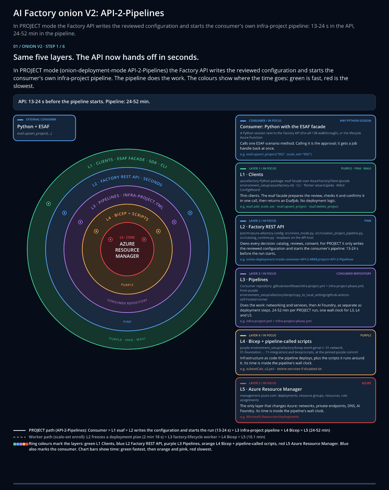

[Docs](../README.md) › Setup docs

# Setup docs: set up your AI Factory

Go from an empty Azure subscription to a working AI Factory with its first project and its first agent.
These pages are for the **platform team** (the core team) that creates and runs the Factory.

## Many tools, one goal

<a href="../10-19/10-factory-onion-architecture-v2.md">
<picture>
  <source media="(prefers-reduced-motion: reduce)" srcset="../10-19/images/10-factory-onion-architecture-v2.png">
  
</picture>
</a>

Every tool is an L1 client of the same Factory API, so the result is the same whichever you pick. The app,
the `azurefactory` CLI (in PowerShell or Bash), the Python SDK and REST all send the same six scenario calls. See the
[onion architecture](../10-19/10-factory-onion-architecture-v2.md) for the layers below your tool.

## Set up

| Quickstart | What you do |
|---|---|
| [Install the ESAF tools](01-install-esaf.md) | Install a tool, start the Factory API and check the connection. |
| [Create your AI Factory](02-create-factory.md) | Create the Factory and its first project with one call. Scenario 1. |
| [Add a scale set](add-scale-set.md) | Add a second network for more projects. Scenario 2, optional. |
| [Add a project for your team](03-add-project.md) | Add or update a project with one call. Scenario 3. |

## Build your first agent

| Quickstart | What you do |
|---|---|
| [Create your first agent by enabling ESAF Agent Chat](04-first-agent-chat.md) | Switch on a chat agent that answers questions about your Factory. |
| [Run your first agent in your ESAF project](../usage/01-first-agent.md) | Hand over to the project team to plan and deploy their own agent. |

## Train a model

| Quickstart | What you do |
|---|---|
| [Train your first model in your ESAF project](../usage/02-first-ml-model.md) | Hand over to the project team to validate a scenario and train a model. |

## Clean up

| Quickstart | What you do |
|---|---|
| [Clean up](05-clean-up.md) | Delete a project, a scale set or the whole Factory. Scenarios 4 to 6. |

## Run it guided

**ESAF Tutorials** is a desktop lab guide that runs the same quickstarts with you. It types each command,
checks every step and plays a video of each scenario. Pick the tutorial for your tool (CLI, Python SDK or
REST), then the track **Scenarios 1–3** to build or **Scenarios 4–6** to clean up. It runs on Windows. On
Linux and macOS, follow the quickstarts with the CLI (bash), Python SDK or REST tab.
[Download ESAF Tutorials](https://github.com/jostrm/azure-enterprise-scale-ml/tree/main/environment_setup/install_tutorial_guide).
It's a private preview: ask [Joakim Åström on LinkedIn](https://www.linkedin.com/in/joakimastrom/) for a preview code.

## Try it first (preview)

| Option | What you do |
|---|---|
| [Deploy to Azure (preview)](../20-29/24-end-2-end-setup.md#try-it-first-with-deploy-to-azure-preview) | Deploy a test Factory with project 001 from the Azure portal. It's a quick test, not a governed Factory. |

## Run it yourself or from your service desk

You can run the scenarios yourself, or let teams order projects from ServiceNow, Jira Service Management or
your own portal. Your automation then calls the same Factory API. See
[ITSM integration](../20-29/29-ITSM-integrated.md).

## Go deeper

| Page | What it gives you |
|---|---|
| [The six scenarios](../reference/scenarios.md) | Lists the one call per scenario, for every tool. |
| [Hub and network modes](../concepts/hub-and-network-modes.md) | Helps you choose a hub mode and a networking mode. |
| [Folder structure](../reference/folder-structure.md) | Shows where the Factory keeps its configuration. |
| [Settings](../reference/settings.md) | Explains the connection settings and the naming limits. |
| [Microsoft Entra groups and personas](../10-19/16-ad-groups-personas.md) | Maps people to roles in the Factory. |
| [Guides 18-20, by tool](../10-19/18-cli-and-api-and-usage.md) | Shows the step-by-step path, where you review each change first. |

**Next:** [Quickstart: Install the ESAF tools](01-install-esaf.md)
