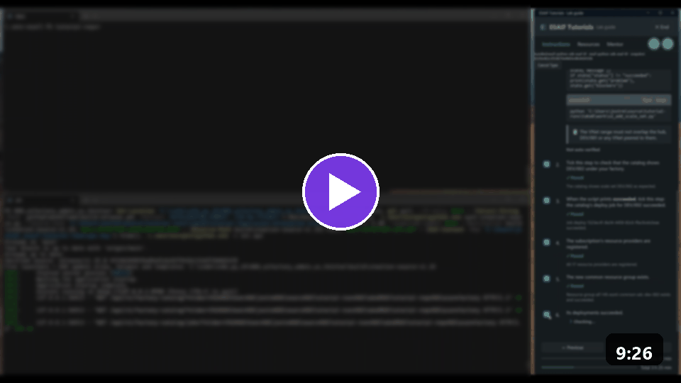
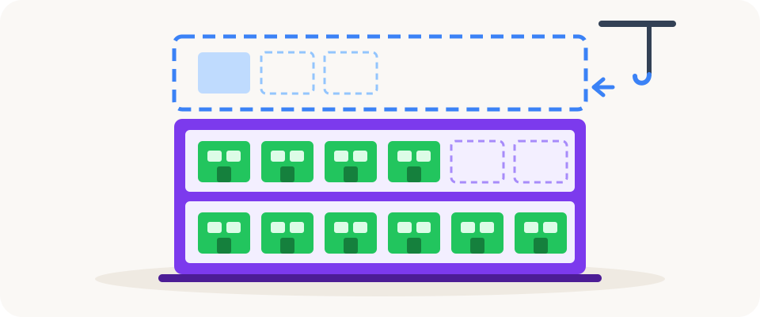

[Docs](../README.md) › [Setup docs](README.md)

# Quickstart: Add a scale set

In this quickstart, you add a second scale set to your AI Factory with one call. A **scale set** is one floor
of the Factory: a virtual network and a common resource group that hold up to seven projects by default.

> [!TIP]
> **Run it guided.** The **ESAF Tutorial Guide** types this call for you and checks every step: open an
> **ESAF** tutorial and the track **Scenarios 1-3**. It runs on Windows.
> [Download the ESAF Tutorial Guide](../../../environment_setup/install_tutorial_guide/README.md).
> It's a private preview: ask [Joakim Åström on LinkedIn](https://www.linkedin.com/in/joakimastrom/) for a
> preview code.

<a href="../../../environment_setup/install_tutorial_guide/README.md"></a>

*The scenario video, 9 minutes. Watch it in the ESAF Tutorial Guide under **Resources** > **Scenario videos**.*



*AI-generated illustration.*

You can skip this quickstart. Scale set 001 from the previous quickstart holds seven projects. Add a scale set
when one of these is true:

| When | Example |
|---|---|
| A floor is full | Dev scale set 001 holds seven projects, and an eighth team asks for one. |
| A group of projects needs its own network or subscription | A business unit pays for its own projects. |

## Prerequisites

- A Factory from [Quickstart: Create your AI Factory](02-create-factory.md).
- The Factory API running, and your tool connected. See [Quickstart: Install the ESAF tools](01-install-esaf.md).
- A free three-digit suffix, for example `002`.
- A free private address range for the new virtual network, for example `10.141.0.0/16`. It must not overlap
  your hub, the first scale set or any network peered to them.

## Add the scale set

> [!WARNING]
> Running a scenario is the approval. It deploys billable resources to Azure, and there is no separate confirm
> step.

You name the suffix, the environment and the VNet range. The pipeline computes the subnets.

<details markdown="1" data-factory-tool="App" open>
<summary>App</summary>

1. In the app, open the menu and select **Configuration wizard** > **Quick setup & tear down**.
2. Select **2. Add scale set**.
3. Set **Environment** to `dev`, **Scale set suffix** to `002` and **VNet range** to `10.141.0.0/16`.
4. Tick **I approve this scenario: it runs at once and changes Azure.**, then select
   **Run selected scenario**.
5. Follow **Job status** on the same page until it shows that the job succeeded.

</details>
<!-- /factory-tool -->

<details markdown="1" data-factory-tool="CLI (PowerShell)">
<summary>CLI (PowerShell)</summary>

```powershell
azurefactory esaf add-scale-set 002 dev --cidr 10.141.0.0/16 --wait
```

</details>
<!-- /factory-tool -->

<details markdown="1" data-factory-tool="CLI (bash)">
<summary>CLI (bash)</summary>

```bash
azurefactory esaf add-scale-set 002 dev --cidr 10.141.0.0/16 --wait
```

</details>
<!-- /factory-tool -->

<details markdown="1" data-factory-tool="Python SDK">
<summary>Python SDK</summary>

```python
from azurefactory import esaf

job = esaf.add_scale_set("002", "dev", cidr="10.141.0.0/16")
state = job.wait()
print(state["status"], "-", state["message"])
```

</details>
<!-- /factory-tool -->

<details markdown="1" data-factory-tool="REST (curl)">
<summary>REST (curl)</summary>

In Bash, with `API_URL`, `API_KEY` and `FOLDER` set as in
[Quickstart: Create your AI Factory](02-create-factory.md#create-the-factory):

```bash
jq -n --arg folder "$FOLDER" \
  '{folder: $folder, approved: true, scale_set: "002", environment: "dev", cidr: "10.141.0.0/16"}' |
  curl --silent --show-error --fail-with-body -X POST "$API_URL/api/v1/esaf/add-scale-set" \
    --header "X-API-Key: $API_KEY" --header 'Content-Type: application/json' --data @-
```

</details>
<!-- /factory-tool -->

The run takes 15 to 30 minutes. If it stops, run the same call again: it resumes, and it doesn't register the
scale set twice.

| Parameter | What it does |
|---|---|
| `scale_set` | Sets the suffix, three digits as a string: `"002"`. |
| `environment` | Selects `"dev"`, `"stage"` or `"prod"`. It's required. |
| `cidr` | Sets the VNet range of the new scale set. It's required for a new scale set. |
| `max_projects` | Sets how many projects the scale set holds. The default is 7. |
| `settings` | Sets scale-set settings, for example your own VNet and subnets. The CLI option is `--settings-json`. |
| `subscription_id`, `tenant_id`, `orchestrator` | Place the scale set in another subscription. Without them, it uses the same ones as the environment's first scale set. The CLI has no option for them: use Python or REST. |

## Verify the result

The job ends with status `succeeded`, and your folder holds the new scale set:

```text
azurefactory\factories\<your factory>\scalesets\002\scaleset_state.json
```

In Azure, you see one more common resource group, and the subscription's resource providers are registered:

```powershell
az group list --subscription <your Dev subscription ID> --query "[?contains(name, 'common')].name" --output table
```

Dev now has two scale sets. From here on, name the scale set in every project call, for example
`--scale-set 001`. Without it, the API can't tell which floor you mean.

If the call is refused:

| Message | Fix |
|---|---|
| The call asks for `cidr` | A new scale set needs its VNet range: add `--cidr` or `cidr=`. |
| The range overlaps another network | Pick a range that your hub, scale set 001 and their peered networks don't use. |
| A job stays `blocked` | Read `blockers` in the job, fix what they name, and run the call again. |

## Clean up resources

Delete the scale set when it holds no project you need:

| Tool | Call |
|---|---|
| CLI | `azurefactory esaf delete-scale-set 002 dev --wait` |
| Python SDK | `esaf.delete_scale_set("002", "dev")` |
| REST | `POST /api/v1/esaf/delete-scale-set` |

See [Quickstart: Clean up](05-clean-up.md).

## Next step

**Next:** [Quickstart: Add a project for your team](03-add-project.md)

Related:

- [The six scenarios](../reference/scenarios.md): every call and its parameters.
- [Hub and network modes](../concepts/hub-and-network-modes.md): how a scale set's network reaches the hub.
- [Folder structure](../reference/folder-structure.md): where a scale set lives in your folder.
