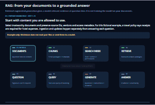
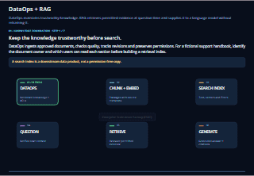
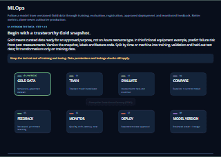
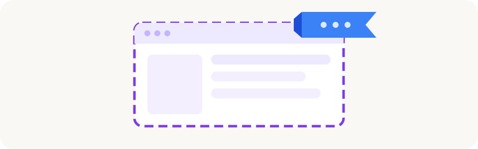

[Docs](../README.md) › Usage docs

# Usage docs: build agents, apps and ML in your ESAF project

Go from a project your platform team set up to a running agent or a trained model. These pages are for
**project teams**: developers, data scientists and data engineers.

Before you start, check the [usage prerequisites](prerequisites.md): an ESAF project, access to it and a few
tools.

<table>
<tr>
<td align="center" valign="top" width="33%">
<a href="../../../usecase_code/40-agent-factory/40-aifactory-agent/readme.md">
<picture>
  <source media="(prefers-reduced-motion: reduce)" srcset="../images/usage/aifactory-agent-thumb.png">
  
</picture>
</a> 
<b>An agent with your knowledge</b>
</td>
<td align="center" valign="top" width="33%">
<a href="../../../usecase_code/40-agent-factory/48-rag-with-splitted-tables-acl-adlsgen2/readme.md">
<picture>
  <source media="(prefers-reduced-motion: reduce)" srcset="../images/usage/rag-split-tables-acl-thumb.png">
  
</picture>
</a> 
<b>Retrieval that respects access</b>
</td>
<td align="center" valign="top" width="33%">
<a href="../../../usecase_code/50-ml-model-factory/usecase-type/readme.md">
<picture>
  <source media="(prefers-reduced-motion: reduce)" srcset="../images/usage/usecase-type-thumb.png">
  
</picture>
</a> 
<b>A model for batch, online or streaming</b>
</td>
</tr>
</table>

> [!NOTE]
> Each template in [`usecase_code`](../../../usecase_code/readme.md) states what it needs and whether it is
> tested in Azure. Read that before you plan a delivery on it.

## Build your first agent

| Start here | What you do |
|---|---|
| [Quickstart: Run your first agent in your ESAF project](01-first-agent.md) | Plan, deploy and ask a prompt agent in Microsoft Foundry. |
| [Agent Factory](../../../usecase_code/40-agent-factory/readme.md) | Browse every agent template and the shared setup. |
| [Single agent](../../../usecase_code/40-agent-factory/41-single-agent/readme.md) | Choose a prompt agent or a hosted agent. |
| [Multi-agent](../../../usecase_code/40-agent-factory/42-multi-agent/readme.md) | Run a helpdesk team of agents. |
| [RAG agent](../../../usecase_code/40-agent-factory/45-rag-agent/readme.md) | Ground an agent in the shared lake or your project storage. |
| [Enterprise Scale AI Factory Agent](../../../usecase_code/40-agent-factory/40-aifactory-agent/readme.md) | Run a full chat app with live voice. |
| [Foundry examples](../../../usecase_code/readme.md#how-to-setup--run-code-samples) | Run two standalone Foundry agent scripts. |

Want the chat agent that answers questions about your Factory? Ask your platform team to enable Agent Chat,
then open the address they give you. They follow
[Quickstart: Create your first agent by enabling ESAF Agent Chat](../quickstarts/04-first-agent-chat.md).

## Train your first ML model

| Start here | What you do |
|---|---|
| [Quickstart: Train your first model in your ESAF project](02-first-ml-model.md) | Validate a scenario and train a model on your machine. |
| [ML Model Factory](../../../usecase_code/50-ml-model-factory/readme.md) | Browse the patterns and their Azure test status. |
| [Your configuration](../../../usecase_code/50-ml-model-factory/user-config/readme.md) | Describe your own scenario, data and model. |
| [Use-case catalog](../../../usecase_code/50-ml-model-factory/usecase-type/readme.md) | Pick batch, online or streaming, then a task and a technology. |

## Automate with a function

| Start here | What you do |
|---|---|
| [Function that reads from storage](../../../usecase_code/10-azure-function/11_func_read_from_storage/README.md) | Run an Azure Function locally that reads from your project's storage. |

## Project dashboards

| Start here | What you do |
|---|---|
| [View your project dashboards](dashboards.md) | Find your project's cost, usage and health. |

## Project MAUI app (to be announced)

*AI-generated illustration.*

A desktop app for project teams is coming. Watch this page.

**Next:** [Usage prerequisites](prerequisites.md)
