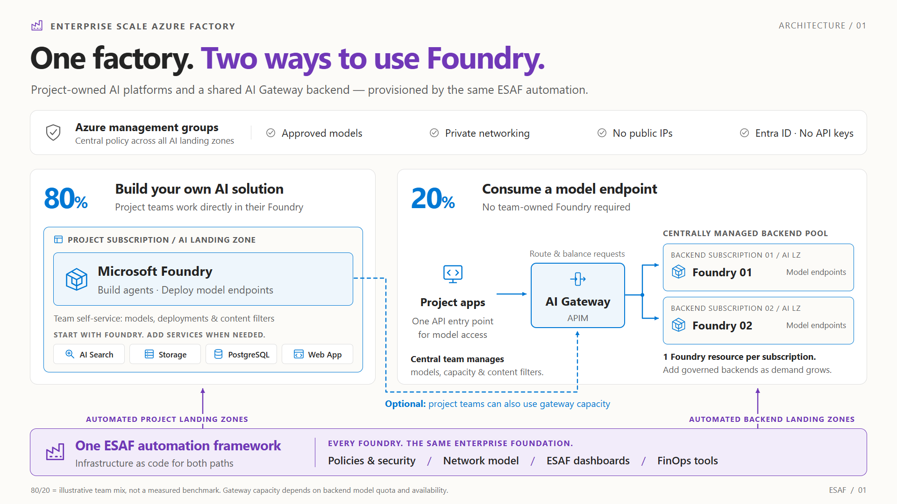

# APIM Azure OpenAI Gateway

The supported APIM implementation is in `../../aifactory/bicep/esml-common/ai-gateway/apim`.

It configures an existing APIM service with an Azure OpenAI weighted backend pool, 429 circuit breakers that accept `Retry-After`, aggregate and per-caller token limits, managed-identity backend authentication, and buffered retries.

For log-based application/user token usage and conservative estimated costs, see
the [AI gateway FinOps workbook](../readme.md#ai-gateway-finops-workbook). It uses
existing Log Analytics workspaces, supports native APIM usage without enrichment,
and optionally adds trusted pseudonymous-user metadata and reviewed text-token
rates. It does not enable diagnostics or modify gateway policies.