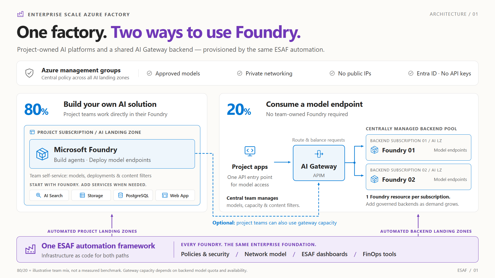

# AI Factory gateways



The [supported APIM gateway](apim/readme.md) and its FinOps workbook are
described first. The existing Kong deployment guide is retained below; **Kong
file logs are not an input to this APIM workbook**.

## AI gateway FinOps workbook

**AI Gateway - Usage and Cost by App and User** is a reusable Azure Monitor
workbook in
[`automation/coreteam/finops`](../aifactory/bicep/copy_to_local_settings/automation/coreteam/finops).
It separates **live Azure Cost Management billed costs** from log-based observed
requests, input/output/total tokens, application/user/pricing coverage, estimated
showback, daily trends and actionable gaps.
Group by **application, APIM subscription, user, team, deployment, model or day**.
The usage/estimated-showback view queries logs, not high-cardinality custom metrics.

### Open or import

- The project dashboard deployment, `infra-project-dashboards.yaml`, publishes the
  shared workbook in the **common resource group** and exposes it from the common
  dashboard. The deployment does not discover telemetry or provision a workspace.
- Standalone: Azure portal → **Monitor → Workbooks → New → Edit → Advanced Editor**,
  select the workbook/Gallery Template JSON editor (not ARM template), replace its
  contents with
  [`ai-gateway-finops.workbook.json`](../aifactory/bicep/copy_to_local_settings/automation/coreteam/finops/ai-gateway-finops.workbook.json),
  apply and save as **AI Gateway - Usage and Cost by App and User** in the common
  resource group. Its resource source is `Azure Monitor`; no resource IDs need
  replacing in the default file.
- For **billed costs**, select a **Billing subscription**, then a **Billed Foundry /
  OpenAI resource**. No Log Analytics workspace or rate configuration is required.
- For **usage and estimated showback**, select the **existing Log Analytics
  workspace(s)** receiving the logs. The
  resource picker lists accessible workspaces in the portal's selected/default
  subscriptions through Resource Graph; this is resource selection, not telemetry
  discovery. Adjust the portal subscription filter if the workspace is absent.
  Start with the default **last 30 days**; narrow for detailed billing queries.

The shipped configuration has **empty rates, mappings and trusted telemetry
sources**. Native token reporting still works; it never invents prices.
Blank cost means *unknown/unpriced*, not free.

### Live billed cost: Foundry resource → deployment → daily meters

The billed-cost view calls the first-party **Azure Resource Manager** workbook
data source (`queryType: 12`, `ARMEndpoint/1.0`) with a synchronous **POST** to
`Microsoft.CostManagement/query?api-version=2025-03-01`. It requests **ActualCost**,
the shared time range as a custom UTC interval, and `Sum(Cost)`. No historical bill
snapshot, retail price list or inferred token price is embedded in the workbook.
The pure-stdlib `foundry_billing.py` builder only generates workbook fragments;
Azure queries execute in the portal under the workbook reader's identity.

1. Select the subscription and an accessible `AIServices`/`OpenAI` account. The
   optional subscription overview shows billed costs by resource ID and currency
   for **all Cognitive Services accounts**, including other kinds and historical
   resources. The current-resource picker is restricted to Foundry/OpenAI.
2. The deployment table filters the selected **ResourceId** and groups by the
   actual billing tag **`deployment`**. Click a nonblank deployment row to see its
   daily **Meter**, **Cost** and **Currency** rows. The selected resource,
   deployment, dates and currency are shown explicitly. Subscription scope for
   each resource drill is derived from that resource's ARM ID.
3. Use the optional daily meter trend for the selected row's currency, or open
   **daily costs for all deployments, including unattributed**. The all-deployment
   table groups by `deployment` and `Meter`, with daily granularity and no more
   than two API grouping expressions. Currency is supplied by billing, never
   defaulted to USD or converted.
4. **Input, output, cache-read and cache-write costs** are separate raw billing-meter rows
   when Azure reports separate meters. Raw Meter names are preserved rather than
   guessed from model/deployment names. Missing cache meters are unavailable/not
   separately reported, not assumed zero. Cache-write meters remain distinct from
   cached-input/cache-read meters; they are not merged or double-counted.
   Combined/unknown meters, audio/image,
   tool, hosting, PTU/reservation and negative adjustment rows remain visible.
   The grid's search can narrow displayed meter names.
5. Blank deployment tags mean **Unattributed**. They remain in all-deployment
   detail; no model name is used to invent a deployment. If the billing scope
   doesn't support the tag, use **daily resource meters — no deployment tag
   required**. Marketplace/SaaS charges assigned to a different resource ID are
   outside the account-filtered view; use resource-group/subscription Cost Analysis
   to include those charges.

**Completeness is explicit:** native workbook POST does **not** paginate Cost
Management's `properties.nextLink`. Every result has a visible response-status
table with **NextPage**, an **INCOMPLETE** warning when populated, and returned
column metadata. A nonempty next link means the amounts shown cover only the
returned page: do not sum or report them as a complete bill. Narrow the date/
resource/deployment selection or use **Cost Analysis / exports** with complete
pagination. Status is a separate live request, not an atomic snapshot of the
displayed rows; a failed/missing status is unverified. Compare returned columns
with the documented expected order before interpreting values. Tag grouping
returns **TagKey and TagValue**; DeploymentTag displays the **TagValue**, never the
constant key. The daily `deployment`-then-`Meter` response order is **Cost,
UsageDate, TagKey, TagValue, Meter, Currency**. Optional views load only when opened
to reduce requests and 429s.

Readers need **Cost Management Reader** or equivalent billing access at the
subscription scope and permission to discover the resource. Workbook deployment
doesn't grant access or change collection. Empty/204, denied/403, throttled/429,
unsupported billing scopes and missing tags are unavailable data, not zero spend;
use the included Cost Analysis link and check the same scope and dates. Wait
before retrying a throttled request.

Billed costs normally arrive **8–24 hours** after usage, at your actual prices,
before invoice credits and taxes. Current-period costs can change before invoice
finalization; **this view is not an invoice**. Any signed adjustments that the API
does return are retained. The API does not identify individual requesting users:
historical per-user costs cannot be reconstructed from billing meters or a
gateway's managed identity. Per-user showback requires the separately described
trusted usage telemetry and remains an estimate, never silently allocated billed
cost.

References: [Workbook ARM data source and POST limitations](https://learn.microsoft.com/azure/azure-monitor/visualize/workbooks-data-sources#azure-resource-manager),
[Cost Management Query API](https://learn.microsoft.com/rest/api/cost-management/query/usage?view=rest-cost-management-2025-03-01),
[Foundry meter/deployment-tag cost analysis](https://learn.microsoft.com/azure/foundry/how-to/analyze-costs-cost-management),
and [cost data timing and invoice limitations](https://learn.microsoft.com/azure/foundry/concepts/manage-costs).

### Requester → Foundry resource → deployment → day: estimated showback

The separate requester view shows **totals, an expandable hierarchy, daily rows
and daily trends**, keeping currencies separate. Requester means the actual
authenticated **user or service principal**, not a resource owner, creator,
deployer, APIM developer account or backend identity. Expand requester → Foundry
resource → deployment → day. Parent rows already aggregate their leaves: never
add parent and child rows together.

Cross-resource/cross-gateway requester totals require the explicitly opted-in,
server-validated **Entra tenant ID + object ID + requester kind** tuple described
below. Default HMAC pseudonyms remain metering-scope-local. Unknown requesters and
unknown Foundry targets stay visible, with `UnpricedRequests` and
`UnknownCategoryRequests` exposing incomplete coverage. Exact target attribution
comes from server-validated routing or the reviewed effective backend mapping,
never a hostname guess.

These are **incomplete observed estimates, not billed user costs**. Ordinary
Function/runtime traces, native billing and resource ownership do not supply the
validated requester identity plus final provider-usage contract. If those are all
the selected workspace contains, requester cost is **unavailable, not zero**.
Historical requester identity cannot be backfilled from them. Direct Foundry calls
appear only when the trusted direct-call contract below was already collected.
This workbook enables no diagnostics or telemetry.

### Existing telemetry prerequisites (operator-controlled)

1. Use supported managed APIM language-model API logging. Send **Logs related to
   generative AI gateway** (`ApiManagementGatewayLlmLog`) and **Gateway logs**
   (`ApiManagementGatewayLogs`, resource-specific tables) to the **same existing
   Log Analytics workspace**. Native LLM logging availability depends on the
   API/operation and APIM support; don't assume an arbitrary HTTP API or every
   Responses operation automatically emits LLM logs.
2. Keep **Log prompts** and **Log completions** off, and do not capture request/
   response bodies, authorization/subscription-key headers or raw user identifiers.
   The queries never read message bodies or headers. Existing production policies,
   diagnostic settings and collection changes require their normal approval.
3. Use a table plan that supports these interactive cross-table joins, normally
   **Analytics**. Basic/Auxiliary plan query restrictions may prevent this report.
   Readers need workbook read access, workspace/table query permissions and any
   required private-network reachability. Workbook deployment grants none.
4. For estimates/per-user attribution, optionally export the metadata event below
   to an existing **workspace-based Application Insights component** linked to
   that workspace (or select both existing workspaces).

Native logs supply observed actual-response token counts, not prompt token
estimates. The native schema has **no cached-input token column**. Accordingly,
native-only rows report usage but remain **unpriced**: completion, text-only
meter eligibility and the cache split are not established. Broken/terminated
streams may omit usage or log inaccurate usage; log-based totals are not billing
evidence. APIM's optional token metrics feature is not required by this workbook.

### Reviewed application mapping and rate card

Copy `ai-gateway-finops.config.json` to your consumer configuration location.
Each mapping keys an **APIM consumer subscription ID**, scoped by gateway resource
ID; this is **not the Azure subscription ID**. Use one subscription per consuming
application for reliable attribution. Shared subscriptions cannot distinguish
apps without the optional validated app identity. An app/team mapping is current
metadata applied to the selected history; preserve stable IDs and archive
reviewed mapping versions if ownership changes.

This complete example is **synthetic test data, not current Azure prices**.
Replace every identifier and all three rates with reviewed contract/pricing
inputs before use:

```json
{
  "applications": [{
    "gatewayResourceId": "/subscriptions/11111111-1111-1111-1111-111111111111/resourceGroups/common/providers/Microsoft.ApiManagement/service/gateway",
    "apimSubscriptionId": "consumer-17",
    "applicationId": "app-17",
    "teamId": "team-3"
  }],
  "trustedTelemetryResourceIds": [
    "/subscriptions/11111111-1111-1111-1111-111111111111/resourceGroups/apps/providers/Microsoft.Insights/components/app"
  ],
  "rates": [{
    "gatewayResourceId": "/subscriptions/11111111-1111-1111-1111-111111111111/resourceGroups/common/providers/Microsoft.ApiManagement/service/gateway",
    "backendHost": "example.openai.azure.com",
    "deployment": "deployment-a",
    "model": "model-version-a",
    "validFrom": "2026-01-01T00:00:00Z",
    "validTo": "2027-01-01T00:00:00Z",
    "currency": "USD",
    "meter": "openai-text-tokens",
    "billingMode": "consumption",
    "inputPerMillion": 2,
    "cachedInputPerMillion": 0.5,
    "outputPerMillion": 6
  }]
}
```

Rates match **metering scope + actual backend DNS host + deployment + returned model**
exactly, within `[validFrom, validTo)`, using the response observation's UTC time.
The metering scope is the gateway ARM ID for APIM calls, or the exact Foundry ARM
ID for direct calls. The root configuration remains exactly `applications`,
`rates` and `trustedTelemetryResourceIds`. A rate may additionally include
**`foundryResourceId`**, a full `Microsoft.CognitiveServices/accounts` ARM ID, to
map that exact effective backend/deployment/model to its target. Omit
`gatewayResourceId` (or set it to `""`) only when `foundryResourceId` is present:
that is a **direct-Foundry rate**, never a wildcard across gateways. Overlapping
rates in the same metering scope remain invalid even if their Foundry target
fields differ. Conflicting observed/mapped targets fail closed as unknown/unpriced.
Backend pool names are not backend hosts. Include every eligible pool backend,
model version, deployment, region/offer-specific rate and effective interval.
No wildcard rates, currency conversion or overlapping intervals are accepted.
Keep different currencies separate. `PTU`/provisioned reservations are **not**
token-consumption invoices and must be reconciled separately.

The supported estimate is narrowly **OpenAI text-only Chat Completions/Responses**:

```text
((input_tokens - cached_input_tokens) * inputPerMillion
 + cached_input_tokens * cachedInputPerMillion
 + output_tokens * outputPerMillion) / 1,000,000
```

Cached input is a **subset** of input, subtracted exactly once. Reasoning is
normally already included in output, never added again. When a completed
text-only event has no cache field, pricing is permitted only if the reviewed
cached and uncached input rates are identical; no zero cache count is invented.
In that case `CombinedInputCost` and the subtotal can be known, but `InputCost`
and `CachedInputCost` remain null because the category split is unknown.
Otherwise `InputCost` excludes cached input and `OutputCost` includes reasoning
tokens already counted by the provider.
Audio, images, tool/search charges, prediction/other token detail meters and
other providers are not priced. The application must enforce text-only eligibility;
token totals alone cannot prove absence of additional meters. Missing rates,
conflicting observations and unsupported meters stay visible and unpriced.

Validate and generate a customized workbook **offline**, from the repository root:

```powershell
$finops = ".\environment_setup\aifactory\bicep\copy_to_local_settings\automation\coreteam\finops"
# Copy/edit the empty configuration first; output may be any approved local file.
Copy-Item "$finops\ai-gateway-finops.config.json" .\finops.local.json
python "$finops\ai_gateway_finops.py" --config .\finops.local.json --output .\finops.local.workbook.json
# Import the resulting JSON, or paste its validated configuration into the workbook parameter.
python "$finops\ai_gateway_finops.py" --check
```

The helper uses only Python's standard library. It makes no Azure calls.
`--check` verifies the shipped workbook matches the canonical KQL/builder.
The configuration parameter uses **base64 JSON substitution** in KQL, not raw
string interpolation. Validate after editing JSON; the report also exposes
configuration shape/mapping/rate conflicts.

For reproducible pipeline-managed rates and mappings, set
`dev.aiGatewayFinopsConfigFile` in `variables.json` to your reviewed
**consumer-repository-relative** configuration JSON (not relative to
`variables.json`). This shared-common setting applies across environment runs;
do not create separate environment-specific copies of the shared workbook. For
example, add `"aiGatewayFinopsConfigFile": "aifactory/config/finops.json"` inside
the existing `dev` object. An explicit file is authoritative, including an intentionally
empty configuration. Without an explicit file, redeployment preserves the
existing workbook's **saved** `Configuration` parameter; transient unsaved portal
edits cannot be recovered. Malformed, missing or ambiguous saved configuration
must fail validation rather than silently erase rates. Preserve rates in the
consumer repository for change review; other manual workbook/query edits are
replaced by the canonical report on deployment. Without an explicit configuration,
saved `Workspaces`, `TimeRange`, `GroupBy`, `BillingSubscription` and `BillingResource` values are also preserved after
validation (workspace ARM IDs, supported grouping, and a positive time range of
at most 366 days). An explicit configuration resets these selectors to canonical
defaults along with replacing the configuration.

The shared dashboard deployer can import the local stdlib helper directly:

```python
config = finops.load_config(reviewed_path) if reviewed_path else None
workbook = finops.render_workbook(
    configuration=config,
    existing_serialized_data=(existing_properties.get("serializedData", "")
                              if existing_properties is not None else None))
# json.dumps(workbook) is the Microsoft.Insights/workbooks serializedData value.
```

`load_config` rejects duplicate JSON keys, invalid maps and overlapping rates.
`render_workbook` performs no network or filesystem writes. A new resource with
no configuration starts empty; an existing resource must pass its saved content
even when that string is empty/invalid so the helper can fail closed. For an
offline update of a workbook exported from the portal, the equivalent is
`python "$finops\ai_gateway_finops.py" --existing-workbook .\saved.workbook.json --output .\updated.workbook.json`.
Adding `--config .\finops.local.json` explicitly replaces its saved configuration.

The existing dashboard-only entry point also refreshes this common workbook.
From the consumer repository, first run a read-only plan:

```powershell
python .\azure-enterprise-scale-ml\environment_setup\aifactory\bicep\scripts\deploy-dashboards-only.py `
  --consumer-root . --repo-root azure-enterprise-scale-ml `
  --variables-json .\aifactory\config\variables.json `
  --environment dev --project 001 --mode plan
# After normal review/approval and existing authentication, use --mode deploy.
```

Replace the example configuration path with your consumer's actual path.
Deployment updates only the workbook/dashboard, not telemetry prerequisites.
The normal shared dashboard runner resolves the consumer repository root from
`DASHBOARD_CONSUMER_ROOT`, then `BUILD_SOURCESDIRECTORY`, `GITHUB_WORKSPACE`, or
the current directory. The dashboard-only command takes explicit `--consumer-root`.
The shared workbook is deterministically named from the common dashboard ID
and saved in the **Dev common resource group**, avoiding a new workbook on every
project/environment deployment. Existing saved content is fetched before
rendering; conditional updates use its ETag rather than blindly overwriting
concurrent portal edits.
Creation rechecks exact-resource absence immediately before the write. The
workbook API does not support `If-None-Match`, so serialize first-time deployments:
there is no atomic create-only guarantee between the final read and write.
The runner stops if the resource has appeared and does not retry uncertain writes.

### Optional trusted requester and pricing producer

`ai_gateway_finops.py` includes `make_usage_event` and `emit_usage_event`.
Use them in the **authenticated server application**, not browser/mobile code:

- Validate JWT signature, issuer, audience and requester-kind claims before
  passing an opaque tenant-scoped subject (for example `tid:oid`). Do not accept
  `x-user` headers or infer a person from APIM/backend managed identity. For
  app-only calls never label a service principal as a human; omit identity unless
  the actual requesting principal is validated. `identity_validated=True` is an explicit assertion
  by your authentication middleware, **not verification performed by this helper**.
- Load a private HMAC key (at least 32 bytes) from the application's approved
  secret facility. The producer emits a SHA-256 pseudonym, not the subject, key,
  UPN or email. Pseudonyms are metering-scope-local: gateway-scoped for APIM,
  Foundry-resource-scoped for direct calls. Existing APIM hashes are unchanged;
  key rotation changes grouping. `requester_kind` defaults to `"user"` for
  pseudonyms; explicitly use `"serviceprincipal"` only for the actual validated
  requesting application identity.
- **Explicit Entra-ID opt-in:** instead of `authenticated_subject`, supply both
  `entra_tenant_id` and `entra_object_id` as GUIDs, plus `requester_kind="user"` or
  `"serviceprincipal"`, after the same application authentication checks and with
  `identity_validated=True`. These IDs are emitted to trusted telemetry and allow
  cross-scope aggregation. They cannot be combined with a pseudonym. Do not emit
  names, UPNs, emails, credentials or identities inferred from deployment ownership.
- For APIM, obtain `correlation_id` from the trusted gateway response's `apim-request-id`,
  verified against the native `CorrelationId`; never manufacture one from an
  untrusted client header. If your route does not expose it, an operator must
  review a correlation mechanism. No policy is changed by this package.
- Optionally provide `foundry_resource_id` as the full accounts ARM ID with
  `target_validated=True` only after the server confirms the actual routed target,
  never from a caller header. For **direct Foundry calls**, omit
  `gateway_resource_id` (or pass `None`/`""`), leave `apim_subscription_id=""`,
  and provide this validated Foundry target; it is required. Supply a stable
  server-controlled correlation ID for the direct request. Native APIM logs do
  not cover direct calls.
- Supply actual final `response.usage` (`model_dump()` for SDK objects). Streaming
  needs final usage (for Chat Completions request `stream_options.include_usage`
  where supported) **and successful terminal completion**. On disconnect/failure,
  emit once with `completed=False`, `usage=None`. Never estimate missing usage.
- Use server-controlled APIM subscription/deployment and actual returned model.
  If the app cannot see which pool backend served the call, pass `backend_host=""`;
  the workbook uses the correlated gateway log's backend host. Without an exact
  backend there is no rate match. Do not supply the pool's logical name.
- Export through the application's **existing approved Azure Monitor logging
  exporter**. The helper supplies `microsoft.custom_event.name` and a JSON `finops`
  property. Depending on exporter support this arrives in `AppEvents` or
  `AppTraces`; both are read. Legacy application-scoped `customEvents` queries are
  not used: select the component's workspace. Disable sampling for this event;
  collected sampled events (`ItemCount > 1`) are unpriced and never extrapolated.
- Add the exact Application Insights **component resource ID** to
  `trustedTelemetryResourceIds` only after verifying protected ingestion and
  trusted server-side writers. A resource-ID allowlist alone does **not**
  authenticate a writer: a public instrumentation key with unauthenticated
  ingestion can be spoofed. Restrict access under your organization's telemetry
  controls before treating enrichment as trusted.

Small runnable **offline** metadata example (no export/SDK setup or model call):

```powershell
Push-Location .\environment_setup\aifactory\bicep\copy_to_local_settings\automation\coreteam\finops
@'
import json
import secrets
from ai_gateway_finops import make_usage_event

event = make_usage_event(
    gateway_resource_id="/subscriptions/11111111-1111-1111-1111-111111111111/resourceGroups/common/providers/Microsoft.ApiManagement/service/gateway",
    correlation_id="synthetic-correlation", apim_subscription_id="consumer-17",
    backend_host="", deployment="deployment-a", model="model-version-a",
    api_kind="chat",
    usage={"prompt_tokens": 1000, "completion_tokens": 100, "total_tokens": 1100,
           "prompt_tokens_details": {"cached_tokens": 400},
           "completion_tokens_details": {"reasoning_tokens": 70}},
    completed=True, text_only=True,
    authenticated_subject="synthetic-tenant:synthetic-object",
    identity_validated=True, pseudonym_key=secrets.token_bytes(32))
print(json.dumps(event, indent=2))
# In the real authenticated app, use its stable secret and actual response:
# emit_usage_event(existing_azure_monitor_logger, event)
'@ | python -
Pop-Location
```

The event name and `aifactory.ai-gateway.usage/v1` schema remain unchanged.
Optional payload fields are `entra_tenant_id`, `entra_object_id`, `requester_kind`,
`identity_validated`, `foundry_resource_id` and `target_validated`; legacy v1
events without them remain supported.

One event per metering-scope correlation is the contract. Persist/retry the **same event**,
not a regenerated event with a different timestamp. Native request/response chunks,
duplicate exports and duplicate events are reduced **before joins**. Conflicting
token tuples, multiple provider request IDs/retries, conflicting gateway metadata,
or conflicting enriched events make usage/cost unknown rather than multiplying
tokens. Native and enriched copies are never summed together. Missing native
LLM logs can be supplemented by a trusted event, including supported Responses
operations; normal gateway-only non-LLM requests are intentionally not counted.
APIM joins use normalized gateway `_ResourceId` plus `CorrelationId`: identical
correlation IDs from different gateways stay separate, while duplicate exports
of the same gateway request to selected workspaces are deduplicated. Direct-call
events use the validated Foundry scope plus correlation ID. Native
`UserId` is an APIM developer identity and is not used as an end-user identity;
`TenantId` is the Log Analytics workspace ID, not an Entra tenant claim. Pricing
uses the actual `BackendUrl` host only (the full URL is neither emitted nor
displayed), rather than assuming a gateway `BackendId` names the physical member
of a weighted pool.

### Interpretation, security and cost boundaries

- Totals cover **observed correlations in the selected workspace/time**, not all
  gateway traffic. Gaps from disabled logging, sampling, retention, boundary-time
  joins or collection delays cannot be reconstructed. Native-only tokens are
  observed telemetry, not a guarantee of complete streamed usage.
- Application mapping takes precedence over validated app fallback. No map and
  no validated app means `Unknown`; APIM subscription grouping still works.
  End-user coverage is separate from application coverage. Shared application
  subscriptions, unknown identities and ambiguous mappings are not silently
  assigned to an individual. Team comes only from the reviewed subscription map.
- Estimated-showback subtotals include **only priced rows**, by currency, with priced-request
  coverage beside them. They exclude unobserved retries, gateway/compute/storage/
  networking, logging overhead, PTU commitments, discounts, taxes and other meters.
  Reconcile separately against Cost Management actual/amortized costs; do not
  add these alternative accounting bases together.
- Resource IDs, model/deployment names, HMAC pseudonyms and opted-in Entra
  tenant/object IDs are still sensitive
  operational metadata. Apply least-privilege workbook/workspace access, approved
  retention, regional/privacy rules and restricted report export. HMAC identifiers
  are pseudonymous, not a promise of anonymity. Avoid prompts, completions, auth
  headers, API keys, raw subjects, UPNs and email in telemetry or configuration.
  Emitting the optional Entra IDs requires the corresponding privacy/retention approval.
- Collection, retention and repeated log queries can incur Azure Monitor charges.
  The default is 30 days; narrow it and use the smallest workspace set when possible.
  This package creates no
  ingestion resource, diagnostic setting, RBAC assignment, schedule or network
  change and performs no billed model calls.

Offline verification:

```powershell
python -m unittest discover -s .\environment_setup\unit-tests\test-bicep -p test_ai_gateway_finops.py
python -m unittest discover -s .\environment_setup\unit-tests\test-bicep -p test_foundry_billing.py
```

Tests cover generated workbook consistency, safe parameter substitution,
metadata privacy, rate boundaries, cache/reasoning arithmetic and conservative
unknowns. They do **not** substitute for operator validation of live KQL,
workspace table plans, exporter delivery, portal rendering and representative
stream/retry behavior before production showback.

References: [APIM LLM logging](https://learn.microsoft.com/azure/api-management/api-management-howto-llm-logs),
[native LLM schema](https://learn.microsoft.com/azure/azure-monitor/reference/tables/apimanagementgatewayllmlog),
[gateway schema](https://learn.microsoft.com/azure/azure-monitor/reference/tables/apimanagementgatewaylogs),
[workbook resource parameters](https://learn.microsoft.com/azure/azure-monitor/visualize/workbooks-resources).

---

# Kong API Gateway for AI Factory

## Overview

This folder contains the Infrastructure as Code (IaC) and configuration for deploying **Kong Gateway OSS** (open-source) on Azure. Kong acts as an API gateway that routes, secures, and rate-limits traffic to **Azure OpenAI** endpoints that are accessible only via private endpoints inside the AI Factory VNet.

### Architecture

```
┌─────────────────────────────────────────────────────────────────────────────┐
│  VNet: vnt-esmlcmn-sdc-dev-001  (172.16.0.0/18)                           │
│  RG:   mrvel-1-esml-common-sdc-dev-007                                     │
│                                                                             │
│  ┌──────────────────────────┐     ┌────────────────────────────────────┐    │
│  │ snet-kong-001            │     │ Private Endpoint                    │    │
│  │ (172.16.50.0/28)         │     │ Azure OpenAI / AI Foundry           │    │
│  │ ┌──────────────────────┐ │     │ aif2x46jfc2e.openai.azure.com      │    │
│  │ │ Kong Gateway (ACI)   │─┼────▶│ (resolved to private IP via DNS)    │    │
│  │ │ - Proxy:  :8000      │ │     └────────────────────────────────────┘    │
│  │ │ - Admin:  :8001      │ │                                               │
│  │ │ - SSL:    :8443      │ │     ┌────────────────────────────────────┐    │
│  │ └──────────────────────┘ │     │ Storage Account (File Share)        │    │
│  └──────────────────────────┘     │ kong.yaml config mounted as volume  │    │
│                                   └────────────────────────────────────┘    │
│  RG: mrvel-1-esml-common-kong-sdc-dev-007                                  │
└─────────────────────────────────────────────────────────────────────────────┘
        ▲
        │ HTTP/HTTPS (VNet internal)
        │ Header: apikey or x-api-key
┌───────┴───────────────┐
│ API Consumers          │
│ (VMs, Apps, Services   │
│  inside VNet or peered)│
└────────────────────────┘
```

### Key Design Decisions

| Decision | Choice | Rationale |
|----------|--------|-----------|
| **Compute** | Azure Container Instances (ACI) | Simple, VNet-injectable, cost-effective for a single gateway instance |
| **Kong Mode** | DB-less (declarative) | Config-as-code, no database dependency, GitOps-friendly |
| **Networking** | VNet injection via delegated subnet | Reaches Azure OpenAI private endpoint directly |
| **Config Storage** | Azure File Share mounted as volume | Persistent, updatable without redeploying ACI |
| **Authentication** | Key-auth plugin (Kong) + API key (Azure OpenAI) | Two-layer auth: clients auth to Kong, Kong auths to OpenAI |

---

## File Structure

```
azure-enterprise-scale-ml/environment_setup/aigateway/
├── main.bicep                          # Subscription-level Bicep orchestrator
├── kong.yaml                           # Kong declarative configuration (DB-less)
├── readme.md                           # This file
├── modules/
│   ├── kong-networking.bicep           # Subnet + NSG for Kong ACI
│   ├── kong-storage.bicep              # Storage account + file share for config
│   └── kong-aci.bicep                  # Container Instance running Kong Gateway
└── scripts/
    ├── upload-kong-config.ps1          # Uploads kong.yaml to Azure File Share
    └── restart-kong.ps1                # Restarts Kong ACI after config update
```

### Pipeline Files (outside this folder)

| File | Location | Purpose |
|------|----------|---------|
| `job-2-gw-kong.yaml` | `aifactory/esml-infra/azure-devops/bicep/yaml/esml-infra-common/jobs/` | Azure DevOps pipeline job steps |
| `variables.yaml` | `aifactory/esml-infra/azure-devops/bicep/yaml/variables/` | Pipeline variables (Kong section) |

---

## Resources Deployed

| Resource | Type | Resource Group | Purpose |
|----------|------|----------------|---------|
| Resource Group | `Microsoft.Resources/resourceGroups` | `mrvel-1-esml-common-kong-sdc-dev-007` | Dedicated RG for Kong resources |
| NSG | `Microsoft.Network/networkSecurityGroups` | `mrvel-1-esml-common-sdc-dev-007` (VNet RG) | Network security for Kong subnet |
| Subnet | `Microsoft.Network/virtualNetworks/subnets` | `mrvel-1-esml-common-sdc-dev-007` (VNet RG) | Delegated subnet for ACI |
| Storage Account | `Microsoft.Storage/storageAccounts` | `mrvel-1-esml-common-kong-sdc-dev-007` | Hosts Kong config file share |
| File Share | `Microsoft.Storage/storageAccounts/fileServices/shares` | `mrvel-1-esml-common-kong-sdc-dev-007` | `kong-config` share |
| Container Group | `Microsoft.ContainerInstance/containerGroups` | `mrvel-1-esml-common-kong-sdc-dev-007` | Kong Gateway container |

---

## Bicep Modules Explained

### `main.bicep` (Subscription Level)

The orchestrator deployment that creates the resource group and calls all child modules.

**Parameters:**

| Parameter | Required | Default | Description |
|-----------|----------|---------|-------------|
| `env` | Yes | - | Environment: `dev`, `test`, `prod` |
| `location` | Yes | - | Azure region |
| `locationSuffix` | Yes | - | Short region suffix (e.g., `sdc`) |
| `aifactorySuffixRG` | Yes | - | AI Factory scale set suffix (e.g., `-007`) |
| `commonRGNamePrefix` | Yes | - | RG name prefix (e.g., `mrvel-1-`) |
| `tags` | Yes | - | Resource tags |
| `vnetResourceGroupName` | Yes | - | Existing VNet resource group |
| `vnetName` | Yes | - | Existing VNet name |
| `kongSubnetCidr` | Yes | - | CIDR for Kong subnet (min `/28`) |
| `azureOpenAIEndpoint` | Yes | - | Azure OpenAI base URL |
| `azureOpenAIApiKey` | Yes | - | Azure OpenAI API key (secure) |
| `kongImage` | No | `kong/kong-gateway:3.9` | Kong container image |
| `kongCpu` | No | `2` | CPU cores |
| `kongMemoryGb` | No | `4` | Memory in GB |
| `userAssignedIdentityId` | No | `""` | User-assigned managed identity resource ID |

### `modules/kong-networking.bicep` (Resource Group Level)

Creates a subnet in the existing VNet, delegated to ACI, with an NSG.

**NSG Rules:**

| Rule | Priority | Direction | Port | Source | Action |
|------|----------|-----------|------|--------|--------|
| Allow-Kong-Proxy-Inbound | 100 | Inbound | 8000 | VNet | Allow |
| Allow-Kong-ProxySSL-Inbound | 110 | Inbound | 8443 | VNet | Allow |
| Allow-Kong-Admin-VNet | 150 | Inbound | 8001 | VNet | Allow |
| Deny-Kong-Admin-External | 200 | Inbound | 8001 | Internet | Deny |
| Allow-HTTPS-Outbound | 100 | Outbound | 443 | Any | Allow (to VNet) |

### `modules/kong-storage.bicep` (Resource Group Level)

Creates a storage account with a file share to hold the Kong declarative config. The storage account:

- Enforces TLS 1.2
- Denies public blob access
- Restricts network access to the Kong subnet only
- Allows Azure services bypass

### `modules/kong-aci.bicep` (Resource Group Level)

Deploys Kong Gateway as an Azure Container Instance:

- **OS**: Linux
- **VNet injection**: Via delegated subnet (private IP only)
- **DB-less mode**: `KONG_DATABASE=off` with declarative config mounted from Azure File Share
- **Health probes**: Liveness and readiness probes on `/status` endpoint
- **Logging**: stdout/stderr for proxy and admin
- **Identity**: Optionally attaches a user-assigned managed identity

---

## Kong Configuration (`kong.yaml`)

Kong runs in **DB-less declarative mode**. The config file defines:

### Services

| Service | URL | Purpose |
|---------|-----|---------|
| `azure-openai-service` | `https://aif2x46jfc2e.openai.azure.com` | General Azure OpenAI API access |
| `azure-openai-chat` | `https://aif2x46jfc2e.openai.azure.com/openai/deployments` | Chat completions shortcut |

### Routes

| Route | Path | Upstream |
|-------|------|----------|
| `azure-openai-route` | `/openai/*` | General OpenAI API (strip path) |
| `azure-openai-chat-route` | `/ai/chat/*` | Chat completions (strip path) |

### Plugins

| Plugin | Scope | Purpose |
|--------|-------|---------|
| `key-auth` | Global | Clients must provide API key (`apikey` or `x-api-key` header) |
| `request-transformer` | Per service | Adds `api-key` header for Azure OpenAI authentication |
| `rate-limiting` | Per service | 60 req/min for general, 30 req/min for chat |
| `request-size-limiting` | Per service | Max 4 MB payload |
| `correlation-id` | Global | Adds `X-Request-ID` for tracing |
| `file-log` | Global | Logs to stdout |

### Request Flow

```
1. Client sends request to Kong (e.g., POST http://<kong-ip>:8000/ai/chat/gpt-4o/chat/completions?api-version=2024-10-21)
   Headers: { "apikey": "<kong-consumer-key>", "Content-Type": "application/json" }

2. Kong key-auth plugin validates the consumer API key

3. Kong request-transformer plugin:
   - Adds "api-key: <azure-openai-key>" header
   - Replaces "Host" header with the Azure OpenAI hostname

4. Kong forwards to: https://aif2x46jfc2e.openai.azure.com/openai/deployments/gpt-4o/chat/completions?api-version=2024-10-21
   (resolved to private IP via private DNS zone in VNet)

5. Response flows back through Kong to the client
```

---

## Pipeline Variables

The following variables are added to `variables.yaml` under the Kong section:

| Variable | Default | Description |
|----------|---------|-------------|
| `ENABLE_KONG` | `false` | Enable/disable Kong deployment |
| `kong_image` | `kong/kong-gateway:3.9` | Kong Docker image |
| `kong_cpu` | `2` | CPU cores for ACI |
| `kong_memory_gb` | `4` | Memory GB for ACI |
| `kong_subnet_name` | `snet-kong-001` | Subnet name in existing VNet |
| `kong_subnet_cidr` | `172.16.50.0/28` | Subnet CIDR (within VNet /18 range) |
| `kong_azure_openai_endpoint` | `https://aif2x46jfc2e.openai.azure.com` | Azure OpenAI base URL |
| `kong_openai_key_secret_name` | `kong-azure-openai-api-key` | Key Vault secret name for OpenAI key |
| `kong_consumer_key_secret_name` | `kong-consumer-api-key` | Key Vault secret name for consumer key |
| `kong_user_assigned_identity_id` | (full resource ID) | Managed identity for Kong |

---

## Azure DevOps Pipeline Job (`job-2-gw-kong.yaml`)

The pipeline job executes these steps:

| Step | Display Name | Description |
|------|-------------|-------------|
| 0 | `00_kong_print_info` | Prints deployment configuration |
| 1 | `01_kong_fetch_secrets_from_kv` | Fetches Azure OpenAI API key from seeding Key Vault |
| 2 | `02_kong_deploy_bicep` | Deploys Bicep template (RG, subnet, storage, ACI) |
| 3 | `03_kong_upload_config` | Uploads `kong.yaml` (with secrets substituted) to Azure File Share |
| 4 | `04_kong_restart_container` | Restarts Kong ACI to pick up new config |
| 5 | `05_kong_verify_health` | Prints Kong IP, status, and usage examples |

### Prerequisites

Before running the pipeline:

1. **Seeding Key Vault** must contain:
   - `kong-azure-openai-api-key`: The Azure OpenAI API key
   - `kong-consumer-api-key` (optional): Pre-set consumer key, or one will be auto-generated

2. **Service Connection** must have permissions to:
   - Create resource groups in the subscription
   - Create subnets in the existing VNet
   - Deploy ACI, storage accounts
   - Read secrets from the seeding Key Vault

3. **VNet** must exist with available address space for the Kong subnet CIDR

### Integration with Existing Pipeline

To add Kong to the existing AI Factory common pipeline (`infra-aifactory-common.yaml`), add:

```yaml
# In the Dev stage job steps:
- template: ./jobs/job-2-gw-kong.yaml
  parameters:
    serviceConnection: ${{ variables.dev_service_connection }}
    seedingKvServiceConnection: ${{ variables.dev_seeding_kv_service_connection }}
```

---

## Networking Details

### Subnet Allocation

The Kong subnet `172.16.50.0/28` provides 16 IP addresses (14 usable), which is sufficient for a single ACI container group. This range falls within the existing VNet CIDR `172.16.0.0/18` (addresses 172.16.0.0 – 172.16.63.255).

### Private Endpoint Connectivity

Kong reaches Azure OpenAI via the **private DNS zone** linked to the VNet:

```
aif2x46jfc2e.openai.azure.com
  └─> Private DNS Zone: privatelink.openai.azure.com
       └─> A record → Private IP of the OpenAI private endpoint
```

Since Kong's ACI is injected into the same VNet, DNS resolution automatically returns the private IP.

### NSG Design

- **Inbound**: Only VNet traffic can reach Kong (proxy on 8000/8443, admin on 8001)
- **Admin port**: Explicitly denied from Internet (defense in depth)
- **Outbound**: HTTPS (443) to VNet for reaching private endpoints

---

## Security Considerations

| Aspect | Implementation |
|--------|---------------|
| **No public IP** | Kong ACI has private IP only (VNet injection) |
| **Admin API protected** | NSG denies Internet access to port 8001; only VNet access allowed |
| **Secrets management** | API keys fetched from Key Vault; never stored in source code |
| **Client authentication** | Kong `key-auth` plugin requires API key for all requests |
| **Upstream authentication** | `request-transformer` plugin injects Azure OpenAI API key |
| **Credentials hidden** | `hide_credentials: true` strips client API key before forwarding upstream |
| **TLS** | Storage account enforces TLS 1.2; Kong supports SSL on port 8443 |
| **Rate limiting** | Per-service rate limits prevent abuse |
| **Network isolation** | Storage account restricted to Kong subnet only |

---

## Usage Examples

After deployment, Kong is accessible from within the VNet (or peered networks):

### Chat Completions

```bash
curl -X POST http://<kong-private-ip>:8000/ai/chat/gpt-4o/chat/completions?api-version=2024-10-21 \
  -H "Content-Type: application/json" \
  -H "apikey: <your-kong-consumer-key>" \
  -d '{
    "messages": [
      {"role": "system", "content": "You are a helpful assistant."},
      {"role": "user", "content": "Hello!"}
    ]
  }'
```

### List Models

```bash
curl http://<kong-private-ip>:8000/openai/openai/models?api-version=2024-10-21 \
  -H "apikey: <your-kong-consumer-key>"
```

### Kong Admin API (from VNet only)

```bash
# Check status
curl http://<kong-private-ip>:8001/status

# List services
curl http://<kong-private-ip>:8001/services

# List routes
curl http://<kong-private-ip>:8001/routes
```

---

## Updating Kong Configuration

To update the Kong routing/plugin configuration:

1. Edit `azure-enterprise-scale-ml/environment_setup/aigateway/kong.yaml`
2. Run the upload script or trigger the pipeline:

```powershell
# Manual upload
.\kong\scripts\upload-kong-config.ps1 `
  -ResourceGroupName "mrvel-1-esml-common-kong-sdc-dev-007" `
  -StorageAccountName "<storage-account-name>" `
  -SubscriptionId "612e830e-b795-424e-ba5d-cd0a5dadecf4" `
  -AzureOpenAIApiKey "<your-openai-key>"

# Restart Kong to pick up changes
.\kong\scripts\restart-kong.ps1 `
  -ResourceGroupName "mrvel-1-esml-common-kong-sdc-dev-007" `
  -SubscriptionId "612e830e-b795-424e-ba5d-cd0a5dadecf4"
```

---

## Troubleshooting

### Kong container not starting

```bash
# Check container logs
az container logs --resource-group mrvel-1-esml-common-kong-sdc-dev-007 --name aci-kong-sdc-dev-001

# Check container status
az container show --resource-group mrvel-1-esml-common-kong-sdc-dev-007 --name aci-kong-sdc-dev-001 --query "instanceView.state"
```

### Kong can't reach Azure OpenAI

1. Verify the private DNS zone `privatelink.openai.azure.com` is linked to the VNet
2. Verify the private endpoint for Azure OpenAI exists and is approved
3. Check NSG outbound rules allow HTTPS (443) to VNet
4. Test DNS resolution from within the VNet

### Config not loaded

1. Verify the file share contains `kong.yaml`
2. Check the storage account network rules allow the Kong subnet
3. Verify the file share is mounted correctly (check container logs)

---

## Cost Estimate (Dev Environment)

| Resource | SKU | Estimated Monthly Cost |
|----------|-----|----------------------|
| ACI (2 vCPU, 4 GB) | Standard Linux | ~$70 |
| Storage Account (1 GB File Share) | Standard LRS | ~$1 |
| NSG | Free | $0 |
| **Total** | | **~$71/month** |

> Costs vary by region. Reduce ACI specs (`kong_cpu`/`kong_memory_gb`) for lighter workloads.
