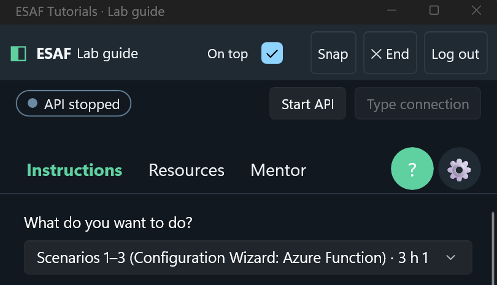
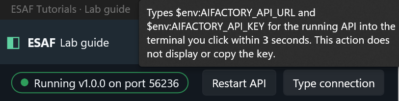
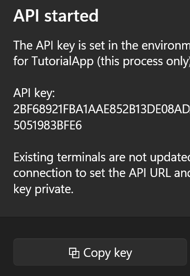

# ESAF Tutorial Guide

Learn Enterprise Scale Azure Factory (ESAF) step by step with a guide that sits beside your terminal.
The **ESAF Tutorial Guide** is a Windows app (installed as **ESAF Tutorials**). It docks at the right edge
of your screen while you work in PowerShell, VS Code or the Azure portal. It shows each step and checks
that you actually did it. It also plays narrated walkthrough videos.

You don't need to install Python or the Factory API to start: the guide includes the same Factory API as the
ESAF ConfigWizard app.

## What you can do with it

### You can Start the ESAF API

From within this app, click "Start API"

<br>

When Started, it will popup a dialog with the auto-generated API key, with a copy button. You can also read it via ENV. <br>
<br>

Then you may copy the key also: <br>


### Get guided how to use the API, SDK, to SETUP an AI Factory | Use Code templates

| Tutorial | You learn to |
|---|---|
| **ESAF Python SDK - scenarios 1-6** | Create, extend and delete an AI Factory with one `esaf.*` call per scenario. Start here. |
| **ESAF CLI - scenarios 1-6** | Run the same six scenarios with `azurefactory esaf` commands. |
| **ESAF REST - scenarios 1-6** | Run the same six scenarios with `POST /api/v1/esaf/...` requests. |
| **Python SDK - setup and scenarios 1-6** | Review and confirm each change yourself with the step-by-step SDK calls. |
| **Azure Function - scenarios 1-6** | Run the scenarios through the AI Factory lifecycle Function's HTTP API. |
| **Sample 48 / S09 - RAG and ACL verification** | Prove that a RAG agent returns only the documents a user is allowed to read. |

The six scenarios are: 1 Init AI Factory, 2 Add scale set, 3 Add or update project, 4 Delete project,
5 Delete scale set and 6 Delete AI Factory. In each tutorial you choose a track at the top: **Scenarios 1-3**
(build a factory and a project), **Scenarios 4-6** (remove them) or **All scenarios 1-6**.

## Before you start

- Windows 10 or 11, 64-bit (x64).
- A **private-preview code**. The guide is in private preview. To get a code, send a message to
  [Joakim Åström on LinkedIn](https://www.linkedin.com/in/joakimastrom/).
- [Azure CLI](https://learn.microsoft.com/cli/azure/install-azure-cli), [Git](https://git-scm.com/downloads)
  and [GitHub CLI](https://cli.github.com/) 2.71.0 or later, each signed in with your own account.
- Python 3.10 or later, for the Python SDK and CLI tutorials.
- An Azure subscription you're allowed to deploy into, and your own copy of the ESAF template repository.
- To watch videos on Windows N editions, the
  [Media Feature Pack](https://support.microsoft.com/windows/media-feature-pack-for-windows-n-8622b390-4ce6-43c9-9b42-549e5328e407).

## Download and verify

This is the **local-preview** installer, version **0.2.3**. Its invitation is
checked locally and its guides are bundled. This convenience gate is not a content
security boundary. The code is requested on every launch; there is no remembered login.

Download the MSI and **all 4 CAB parts** into the same folder. Run only the MSI.

- [ESAF-Tutorials-0.2.3-win-x64-local-preview-unsigned.msi](https://github.com/jostrm/azure-enterprise-scale-ml/raw/refs/heads/main/environment_setup/install_tutorial_guide/ESAF-Tutorials-0.2.3-win-x64-local-preview-unsigned.msi)
- [ESAF-Tutorials-0.2.3-win-x64-local-preview-unsigned-1.cab](https://github.com/jostrm/azure-enterprise-scale-ml/raw/refs/heads/main/environment_setup/install_tutorial_guide/ESAF-Tutorials-0.2.3-win-x64-local-preview-unsigned-1.cab)
- [ESAF-Tutorials-0.2.3-win-x64-local-preview-unsigned-2.cab](https://github.com/jostrm/azure-enterprise-scale-ml/raw/refs/heads/main/environment_setup/install_tutorial_guide/ESAF-Tutorials-0.2.3-win-x64-local-preview-unsigned-2.cab)
- [ESAF-Tutorials-0.2.3-win-x64-local-preview-unsigned-3.cab](https://github.com/jostrm/azure-enterprise-scale-ml/raw/refs/heads/main/environment_setup/install_tutorial_guide/ESAF-Tutorials-0.2.3-win-x64-local-preview-unsigned-3.cab)
- [ESAF-Tutorials-0.2.3-win-x64-local-preview-unsigned-4.cab](https://github.com/jostrm/azure-enterprise-scale-ml/raw/refs/heads/main/environment_setup/install_tutorial_guide/ESAF-Tutorials-0.2.3-win-x64-local-preview-unsigned-4.cab)
- [SHA256SUMS.txt](https://github.com/jostrm/azure-enterprise-scale-ml/raw/refs/heads/main/environment_setup/install_tutorial_guide/SHA256SUMS.txt)
- [Build receipt](ESAF-Tutorials-0.2.3-win-x64-local-preview-unsigned.msi.json)

Paste the **whole block** into PowerShell, then press **Enter** after the final `}`.
The `>>` prompt means PowerShell is still collecting a multiline command; if it remains after the
closing `}`, press Enter on the empty line to submit it. No downloads run inside the block until
it is submitted. The script uses Windows' built-in `curl.exe` to show a live progress bar for each
download, followed by a separate checksum-verification message. It does not install or open the MSI.

```powershell
& {
    $ErrorActionPreference = 'Stop'
    $Base = 'https://raw.githubusercontent.com/jostrm/azure-enterprise-scale-ml/main/environment_setup/install_tutorial_guide'
    $Folder = Join-Path $HOME 'Downloads\ESAF-Tutorials'
    New-Item -ItemType Directory -Force -Path $Folder | Out-Null
    Write-Host "Downloading checksums to $Folder"
    curl.exe --fail --location --progress-bar --output (Join-Path $Folder 'SHA256SUMS.txt') "$Base/SHA256SUMS.txt"
    if ($LASTEXITCODE -ne 0) { throw "Checksum download failed (curl exit code $LASTEXITCODE)." }
    $Entries = @(Get-Content (Join-Path $Folder 'SHA256SUMS.txt') | Where-Object { $_.Trim() })
    if ($Entries.Count -eq 0) { throw 'The checksum file is empty.' }
    $Index = 0
    foreach ($Entry in $Entries) {
        $Expected, $File = $Entry.Trim() -split '\s+', 2
        if ($File -notmatch '^ESAF-Tutorials-[0-9.]+-win-x64-local-preview-(signed|unsigned)(-[0-9]+\.cab|\.msi)$') {
            throw 'Unexpected download filename.'
        }
        $Index++
        $Destination = Join-Path $Folder $File
        Write-Host "[$Index/$($Entries.Count)] Downloading $File"
        curl.exe --fail --location --progress-bar --output $Destination "$Base/$File"
        if ($LASTEXITCODE -ne 0) { throw "Download failed: $File (curl exit code $LASTEXITCODE)." }
        Write-Host "Verifying SHA256: $File"
        if ((Get-FileHash $Destination -Algorithm SHA256).Hash -ne $Expected) {
            throw "Hash mismatch: $File"
        }
        Write-Host "OK  $File"
    }
    Write-Host "Verified downloads are ready in $Folder. Run only the MSI."
}
```

Close the app before upgrading. Same-version reinstallations are supported.
To deliberately install an older version, first uninstall the newer app in
**Windows Settings > Apps > Installed apps**, then run the older MSI. Settings
and progress are retained. The installer never silently removes a newer version.
## Install

1. Open the download folder: `explorer "$HOME\Downloads\ESAF-Tutorials"`.
2. Double-click the `.msi` file. It installs for your Windows account in `%LOCALAPPDATA%\ESAF Tutorials`;
   you normally don't need administrator rights.
3. From **Start**, open **ESAF Tutorials**.

This preview installer isn't code-signed yet, so Windows SmartScreen or your organization's app policy may warn
you or block it. Verify the files, follow your organization's approval process, and don't turn off security
controls to get past the warning.

## Start your first tutorial

1. Enter your private-preview code and select **Unlock private preview**.
2. Open **Settings (⚙)**. Fill in your tenant, subscription, repository, factory prefix, region and networks,
   then select **Save**. Settings are saved only on this computer.
3. Under **Tutorial to open at start**, choose **ESAF Python SDK - scenarios 1-6**, save, and restart the app.
4. In the bar at the top, select **Start API**. Wait until it shows **Running** with a port number.
5. Open PowerShell. In the guide, select **Type connection**, then click the PowerShell window within
   3 seconds. The guide types the `AIFACTORY_API_URL` and `AIFACTORY_API_KEY` lines for you; it never shows
   or saves the key.
6. Under **What do you want to do?**, choose a track, for example **Scenarios 1-3**.
7. Follow the steps. Use **Copy** or **Type** on a code block, run it in your terminal, then tick the step.

> [!IMPORTANT]
> The guide itself never changes Azure, GitHub or the Factory API; it only reads to check your work. The
> commands **you** run do change Azure: they deploy and delete resources. Use your own repository copy,
> subscription and factory prefix.

When you tick a step, the guide checks the real state and shows one of these results:

| Result | What it means | What to do |
|---|---|---|
| ✓ Passed | The work is done. | Select **Next**. |
| ✗ Not done yet | The state doesn't match yet. | Do what the message says, then **Retry**. |
| Sign-in needed | A tool isn't signed in, or the API key isn't set. | Run `az login` or `gh auth login`, or select **Type connection**, then **Retry**. |
| Unavailable | A service didn't answer in time. | Select **Retry**. |
| Done · not auto-verified | This step can't be checked automatically. | Tick it when you've done it. |

Your page and ticks are saved as you go. When you open the guide again, it continues where you stopped and
checks every step again.

## Watch the walkthrough videos

On the **Resources** tab, choose a **Hub mode** and a **Networking mode**, then select **Watch**. The video
opens in its own window, so you can keep following the guide.

| Hub mode | Networking | Videos |
|---|---|---|
| A. Connected to an existing hub | Private | Python SDK, scenarios 1-4 |
| B. Standalone, no hub | Public | Python SDK and ConfigWizard app, scenarios 1-3 |
| C. Standalone with its own hub | Private | Python SDK, scenarios 1-3 |

Options without a recording are turned off. Which videos you see depends on your preview access.

## Update or remove the app

- **Update:** close the app, then install the newer `.msi` with its `.cab` parts. Your settings and progress
  are kept.
- **Remove:** select **Settings** > **Apps** > **Installed apps** > **ESAF Tutorials** > **Uninstall**.
  Your settings and progress stay in `%LOCALAPPDATA%\ESAIF\com.esaif.tutorialapp\Data`; delete that folder too
  if you want a clean removal.

## Troubleshooting

| Problem | Fix |
|---|---|
| PowerShell shows only `>>`, with no download messages | Finish pasting the whole block and press Enter after the final `}`. If it still waits, press Enter on an empty line. To abandon an incomplete paste, press Ctrl+C and paste the whole block again. |
| Edge says the MSI "isn't commonly downloaded" | This is Edge's download-reputation warning, not a prompt the PowerShell downloader waits for. Windows or organizational security controls may still block downloading or running the unsigned MSI. Verify the checksums and follow your organization's approval process; do not disable security controls. |
| The installer says a file is missing | Put all 4 `.cab` parts beside the `.msi`, with their original file names. |
| "Private preview is not configured" | Ask [Joakim Åström on LinkedIn](https://www.linkedin.com/in/joakimastrom/) for a configured installer. |
| "The code or session is invalid, expired or revoked" | Ask [Joakim Åström on LinkedIn](https://www.linkedin.com/in/joakimastrom/) for a new code. |
| **Start API** shows **Failed** | Read the reason on the pill. Check that `az` and `git` are installed and signed in, then select **Restart API**. |
| Video doesn't play | Install the Media Feature Pack on Windows N editions. |

## Related

- [The six scenarios and their SDK, CLI and REST names](../../documentation/v2/10-19/17-cli-and-api-and-usage.md)
- [ESAF Python SDK reference](../azurefactory-cli/docs/esaf/readme.md)
- [ESAF ConfigWizard app](../install_config_wizard/readme.md)
