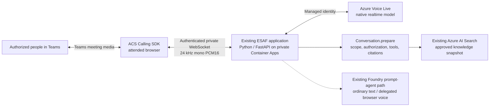

# ESAF Agent Chat in a live Microsoft Teams meeting

How to create the attended solution, what we changed compared with the Microsoft examples, and how to share approved meeting-chat links.

**Document date:** 24 November 2026.

**Audience:** developers, solution architects and operators reproducing the Spider project001 pilot.

**Scope:** a visibly joined, explicitly authorized AI participant that receives Teams meeting audio and speaks grounded answers.

> **Status:** Meeting audio was implemented, deployed and heard in actual Teams clients. The user confirmed the revised conversation worked well on 21 November. **Confirmed source-link posting and automatic visible previews are now implemented and deployed to the pilot, but actual message delivery in Teams remains unproven.** A prepared preview, token or successful deployment is not proof of delivery.

No meeting URL, passcode, participant email address, access token, connection string or tenant-specific configuration is included in this guide.

## Contents

- [1. What we actually built](#1-what-we-actually-built)
- [2. Microsoft examples and the correct comparison](#2-microsoft-examples-and-the-correct-comparison)
- [3. How to create this solution](#3-how-to-create-this-solution)
- [4. What differs, had to be changed/added versus Microsoft docs example](#4-what-differs-had-to-be-changedadded-versus-microsoft-docs-example)
- [5. Posting links into Teams chat](#5-posting-links-into-teams-chat)
- [6. Live use, recording and troubleshooting](#6-live-use-recording-and-troubleshooting)
- [7. Evidence, limitations and acceptance](#7-evidence-limitations-and-acceptance)
- [8. Operations, costs and rollback](#8-operations-costs-and-rollback)
- [9. Source map and references](#9-source-map-and-references)

## 1. What we actually built

The assistant joins a work/school Teams meeting through the **Azure Communication Services Calling SDK in a browser**. It appears as a clearly named external AI participant. An authenticated operator keeps that browser open and attends the test.

The browser receives the meeting's remote audio stream, converts it to the application's PCM format, and forwards it to the **existing private ESAF application**. That application uses Azure Voice Live, Azure AI Search and its existing authorization and grounding services. Returned speech is injected into the ACS participant's outgoing audio stream, so people hear it **inside Teams**.



### Important distinction: Voice Live is not the same resource as a managed Voice Agent

Our current pilot uses **direct Azure Voice Live orchestration**, with the existing ESAF `Conversation.prepare` service supplying governed evidence and tools. It does **not** create a new managed Foundry agent of `kind: voice`, and it does **not** implement the newer hosted conversation-engine protocol.

This was a delivery-priority decision to reuse existing governed orchestration, not a demonstrated platform limitation. A managed `kind: voice` agent owns a named, versioned Foundry definition and does **not** inherently require a hosted conversation engine. A selectable managed route remains planned, not implemented. Model/region availability, private connectivity and the preservation of ESAF's authorization and grounding still need validation for that route.

The three application modes are:

| Mode | Answer generation | Where used in this solution |
|---|---|---|
| `speech_shell` | Complete `Conversation.answer`, followed by speech rendering | Compatibility default in generic configuration |
| `delegated` | Complete authenticated specialist answer, then native spoken presentation; `transcript` avoids a preliminary model-tool turn | Preserved for the existing Spider browser experience |
| `realtime` | Native voice model generates with evidence and tools from `Conversation.prepare`; final result passes shared citation checks | Explicit meeting-only override in the improved pilot |

The meeting setting `voice_mode: "realtime"` does not mutate the ordinary browser's `voice.mode`. The private backend, knowledge scope and permission checks remain authoritative.

### What is and is not delivered

| Capability | Evidence/status |
|---|---|
| Visible Teams participation and real incoming audio | Demonstrated in the approved meeting |
| Answer spoken inside Teams | Explicitly confirmed by the user |
| Delayed copy of the operator's own voice removed | Fix deployed; user confirmed it was gone |
| Continuous input while the assistant speaks | Implemented through explicit `full_duplex`; native interruption exercised with synthetic audio |
| Revised live experience | User reported it worked well on 21 November; detailed per-case recording acceptance was not separately recorded |
| Mute/resume, generation reset, leave and eventual cleanup | Implemented; selected live cases observed, with broader automated coverage |
| Ordinary browser text/delegated voice | Preserved rather than replaced with the meeting profile |
| Post links to Teams meeting chat | Implemented with exact preview and explicit approval; actual Teams delivery remains unproven |
| Managed Voice Agent, hosted conversation engine, avatar, unattended attendance | Not delivered by this implementation |

## 2. Microsoft examples and the correct comparison

### Azure-Samples/voicelive-webapp

The repository root describes a general Voice Live web application. For actual meeting participation, the relevant component is:

[samples/teams-meeting-delegate](https://github.com/Azure-Samples/voicelive-webapp/tree/main/samples/teams-meeting-delegate).

Its documented topology is:

```text
Teams meeting
  <-> ACS Calling SDK in browser
  <-> same-origin Node.js security proxy
  <-> existing managed Foundry Voice-First Agent
  <-> optional avatar WebRTC audio/video path
```

The sample already provides real ACS meeting transport. **We did not invent that transport or discover that browser-only microphone chat equals Teams participation.** We reused the same supported architectural pattern and integrated it with ESAF's existing private backend.

The sample keeps the managed agent's model, instructions, tools, voice, knowledge and storage configuration authoritative. Its backend uses an ACS connection string and `DefaultAzureCredential` for Foundry. Its Azure deployment describes Container Apps built-in authentication with an Entra application secret. Its optional meeting tools add transcript-backed summaries and other actions.

### microsoft/voice-agent

This repository is the Voice Agent community hub and sample index. It distinguishes direct Voice Live from managed Voice Agents, recommends managed Voice Agent for new voice-first applications, and describes:

- Delegation to prompt or hosted subagents.
- Inline subagent handoffs.
- A hosted agent as the conversation engine for managed speech.
- The separate ACS Teams meeting delegate sample.

Those are **orchestration choices**, not automatic Teams media access.

The current [hosted conversation-engine guide][hosted-ce] requires a compatible hosted component declaring `voice_conversation_engine:1.0.0`, serving `/voice_conversation_engine`, and implementing Voice Live Bridge Protocol `1.0`. Regional route availability and the referenced hosted version must be verified. A normal existing HTTP chat endpoint cannot simply be substituted.

We did not complete that managed conversation-engine integration. Our direct native profile solved the immediate meeting experiment while reusing ESAF's existing governance. This is a deliberate architectural difference, not a claim that the Microsoft managed-agent sample required all of our changes.

### Hosting conclusion

For **this attended ACS route**, no Windows media VM, Graph calling application permission or Teams-native app package is required just to join and exchange audio.

The sample's separate **unattended Graph application-hosted media** design has different runtime, hosting, certificate, networking and permission requirements. Do not apply its Windows media-host requirement to this browser-hosted pilot, or describe our attended browser as an unattended bot. See the sample's [unattended extension design][sample-unattended].

## 3. How to create this solution

These instructions reproduce the implemented ESAF path. They do not run `azd up` on the Microsoft sample or create an entire AI Factory from nothing.

Commands use Windows PowerShell paths. Replace placeholders with reviewed configuration. Do not copy production IDs, meeting links or credentials into source control.

### 3.1 Prepare the existing project

Required infrastructure and access:

| Requirement | Purpose |
|---|---|
| Existing Foundry account/project and compatible deployments | Agent inference, embeddings and Voice Live |
| Existing Azure AI Search and approved indexed corpus | Scoped grounding with a committed knowledge snapshot |
| Existing project Blob Storage | Immutable application bundles and owned application state |
| Internal Azure Container Apps environment | Keep the ESAF backend private |
| Runtime managed identity | Access the approved Azure services without keys in the browser |
| Existing Entra browser registration and exact redirect URI | Authenticated operator access using the app's delegated scope |
| Operator's existing `knowledge.read` grant for the selected scope | Authority to query that knowledge |
| Private connectivity from the attended browser and deployment environment | VPN or another approved route, with working private DNS |
| Dedicated Teams work/school test meeting | Explicitly approved participants, disclosure and lobby admission |

Use Python 3.12 for the deployable application environment and Linux CPython 3.12 wheel bundle. The parent Agent Factory operator has a different environment; do not merge their dependency installations.

Choose a source checkout containing the meeting commits listed in section 9:

```powershell
$repo = "C:\path\to\azure-enterprise-scale-ml"
$agent = Join-Path $repo "usecase_code\40-agent-factory\40-aifactory-agent"
Set-Location $agent

# Create this application environment once, or reuse its existing interpreter.
py -3.12 -m venv .venv
.\.venv\Scripts\python.exe -m pip install -r requirements.lock.txt
.\.venv\Scripts\python.exe -m pip install -e ..\..\..\environment_setup\azurefactory-cli

if (-not (Test-Path .\config.local.json)) {
    Copy-Item .\config.example.json .\config.local.json
}
```

Edit `config.local.json` for the real tenant, scope, Foundry project, models, Search/storage, corpus paths and browser registration. The example file is not portable tenant configuration. Preserve an existing deployment's configuration rather than starting over.

For a **new unprepared target only**, separately approve these immediate writes:

```powershell
.\.venv\Scripts\python.exe -m aifactory_agent --config config.local.json deploy-agent
.\.venv\Scripts\python.exe -m aifactory_agent --config config.local.json ingest
```

They create/reconcile the agent and retrieval resources and can incur embedding costs. They do not take `--apply`. Skip them when extending an already prepared deployment, as we did.

Follow the [ESAF application setup][esaf-readme] and [first Agent Chat guide][first-chat] for the full base configuration and browser registration. The already delivered deployment button is not changed by this meeting extension.

### 3.2 Provision or reuse ACS with reviewed identity access

The implemented template is:

```text
usecase_code\40-agent-factory\40-aifactory-agent\infra\teams-meeting-acs.bicep
```

It creates a global ACS resource, defaults data-at-rest geography to Europe, disables local/key authentication, and enables the ACS service's public connectivity. It does not make the private ESAF backend public.

Our pilot explicitly approved **Contributor on the single new ACS resource** for the existing application managed identity. This is broader than a token-only role; it is not Contributor on the project resource group or subscription. The template's grant flag defaults to false.

```powershell
$subscriptionId = "<approved-project-subscription-id>"
$resourceGroup = "<existing-project-resource-group>"
$acsName = "<new-dedicated-acs-resource-name>"
$runtimePrincipalId = "<existing-runtime-managed-identity-object-id>"

az provider show --subscription $subscriptionId `
  --namespace Microsoft.Communication --query registrationState

# Only if missing and explicitly approved:
az provider register --subscription $subscriptionId `
  --namespace Microsoft.Communication --wait

# This true value requires explicit approval of the broad, resource-only role.
$grantTokenBrokerContributor = "true"
$parameters = @(
  "communicationServiceName=$acsName",
  "runtimePrincipalId=$runtimePrincipalId",
  "dataLocation=Europe",
  "grantTokenBrokerContributor=$grantTokenBrokerContributor"
)

az deployment group what-if --subscription $subscriptionId `
  --resource-group $resourceGroup --mode Incremental `
  --template-file .\infra\teams-meeting-acs.bicep --parameters @parameters

# Proceed only after the preview shows the approved resource and its role.
az deployment group create --subscription $subscriptionId `
  --resource-group $resourceGroup --mode Incremental `
  --name esaf-teams-acs-pilot `
  --template-file .\infra\teams-meeting-acs.bicep --parameters @parameters
```

Inspect an existing ACS resource's ownership before reusing it; do not run a creation template over unrelated resources. Supply the managed identity's **principal/object ID**, not its client ID, to the role assignment.

Use the actual deployment output `hostName`. Our resource returned the regional form:

```text
https://<resource>.europe.communication.azure.com
```

The application now accepts both global and single-geography-qualified ACS hostnames. Do not construct the endpoint from the resource name alone.

Verify provisioning state, `disableLocalAuth`, geography and exact role scope. We additionally proved that the **actual running app identity** could create a temporary one-hour VoIP token and delete its identity. Neither the token nor any meeting media was logged. Token issuance is not proof of Teams media.

### 3.3 Configure the approved meeting and native voice profile

Merge the following block into the complete existing application configuration; it is not a complete application configuration on its own:

```json
{
  "teams_meetings": {
    "enabled": true,
    "acs_endpoint": "https://<resource>.europe.communication.azure.com",
    "allowed_host_object_ids": ["<authorized-backend-operator-object-id>"],
    "display_name": "ESAF Agent",
    "voice_mode": "realtime",
    "full_duplex": true,
    "max_session_seconds": 900,
    "lobby_timeout_seconds": 120,
    "max_concurrent_sessions": 1,
    "connect_origins": [
      "https://<reviewed-acs-signaling-host>",
      "wss://<reviewed-acs-signaling-host>"
    ],
    "policies": [{
      "id": "approved-test",
      "scope_key": "project001-dev",
      "meeting_url": "<exact-approved-https-Teams-meeting-link>",
      "meeting_tenant_id": "<verified-meeting-tenant-id>",
      "external_audience_disclosure_approved": true,
      "meeting_safe_knowledge": true,
      "allowed_participant_object_ids": [
        "<verified-meeting-participant-object-id>"
      ]
    }]
  }
}
```

This example shows the **explicit cross-tenant disclosure** case used in our pilot. For a same-tenant meeting, use `meeting_tenant_id: null` or the backend tenant and `external_audience_disclosure_approved: false`; every allowed listener must already have the exact scope's `knowledge.read` grant.

For an external meeting, require separately verified meeting-tenant identities and explicit permission to disclose **all knowledge readable in this scope** to those exact people. This does not create guest accounts, grant general Agent Chat access, or add Azure roles. Do not put foreign object IDs into the backend tenant's ordinary grants.

The operator still signs into the existing backend tenant. Meeting identity and backend identity are different boundaries. Display names, a spoken name and the fact that someone joined are not authorization.

The meeting-only native profile inherits the configured model, voice, endpoint and language settings and revalidates them. The existing voice configuration must already have voice enabled and a supported native model such as `gpt-realtime-mini`. Do not silently replace an incompatible model. Ordinary browser voice can remain:

```json
{
  "voice": {
    "enabled": true,
    "mode": "delegated",
    "delegation_trigger": "transcript",
    "model": "gpt-realtime-mini",
    "turn_detection": "server_vad",
    "silence_duration_ms": 500
  }
}
```

Again, preserve the deployment's remaining voice settings; this is an illustrative fragment, not a replacement for them.

### 3.4 Make private access and browser CSP work

Two network paths are needed at the same time:

```text
Operator browser -> private ESAF HTTPS/WebSocket endpoint
Operator browser -> ACS/Teams public signaling and media endpoints
```

A successful Azure deployment does not give the laptop a VPN route. Test private DNS and HTTPS from the actual attended browser. We initially had a public DNS result and failed private connectivity; later the approved private route worked. We did not resolve that by exposing the backend.

The strict `connect_origins` setting needs **exact reviewed HTTPS/WSS origins**, not `https:` or domain wildcards. The following were observed or validated for this pilot and SDK version; they are evidence, not a universal region-independent list:

```text
https://<actual-acs-resource-host>
https://auth.relay.communication.microsoft.com
https://ecs.communication.microsoft.com
https://go-eu.trouter.communication.microsoft.com
wss://go-eu.trouter.communication.microsoft.com
https://registrar.communication.microsoft.com
https://api.cc.skype.com
https://global.mtgw.prod.communication.microsoft.com
https://calling.teams.microsoft.com
https://api.flightproxy.skype.com
https://api.flightproxy.teams.microsoft.com
https://r3-api.flightproxy.teams.microsoft.com
https://eu-ic3.events.data.microsoft.com
```

Some endpoints are configuration or telemetry rather than media. Inspect browser CSP violations and the pinned SDK before adding an endpoint. A CSP allowlist does not configure network firewalls, and a firewall allowlist does not automatically configure CSP. See [ACS network guidance][acs-network].

### 3.5 Build and deploy without replacing the existing backend

The current frontend pins:

| Dependency | Implementation pin |
|---|---|
| `@azure/communication-calling` | `1.46.1` |
| `@azure/communication-common` | `2.5.0` |
| `azure-communication-identity` | `1.5.0` |
| `azure-communication-chat` | `1.3.0` (server only) |

Use the repository's complete lockfiles. The generated browser SDK and supplier notices are committed, so rebuilding the frontend is unnecessary unless changing that bundle. If required:

```powershell
Push-Location .\aifactory_agent\static\teams-meeting-frontend
npm ci
npm run build
Pop-Location
```

The SDK includes `Features` for recording/transcription checks. Packaging excludes `node_modules` and preserves supplier licenses.

For the documented full application deployment:

```powershell
.\.venv\Scripts\python.exe -m pip download --dest .build\wheels `
  --platform manylinux2014_x86_64 --platform manylinux_2_28_x86_64 `
  --python-version 312 --implementation cp --abi cp312 --only-binary ":all:" `
  -r requirements.lock.txt pip==25.3

$environmentName = "<existing-internal-container-apps-environment>"
$appName = "<owned-agent-container-app>"
$identityName = "<owned-runtime-managed-identity>"

# Read the plan before applying; also supply your existing refresh-job names.
.\.venv\Scripts\python.exe deploy.py --config config.local.json `
  --environment $environmentName --app-name $appName --identity-name $identityName
```

After approving that plan, use the same arguments with `--apply`, supplying the correct `--refresh-job-name` and `--refresh-identity-name` when reusing existing resources. The full deployer also manages its owned identity/refresh-job infrastructure; it is not just a frontend upload.

**What we actually did for the existing Spider deployment:** created a versioned overlay from the existing private runtime bundle, replaced the application source with the reviewed published source, added only the required ACS identity/chat wheels, and changed only the approved meeting configuration. We preserved the current auth grants, voice configuration, Search/corpus data, shared backend dependencies, image, identity and private network. We did not rerun ingestion or redeploy models.

That rollout used a session-local operational builder, not a new public deployment command. Do not expect the scratch script to exist in a fresh clone. For a new operator, use the documented deployer or implement an equivalently reviewed immutable-bundle process.

An overlay process must:

1. Read the current app's bundle reference and preserve it for rollback.
2. Validate archive members and the new configuration; reject unexpected active integrations or dependency changes.
3. Preserve auth, model, scope and corpus settings unless separately approved.
4. Upload a new immutable bundle to the existing private container; never overwrite the old bundle.
5. Update the existing app to that bundle, retaining image, identity, resources and networking.
6. Set one replica and `WEB_CONCURRENCY=1` when meetings are enabled.
7. Wait for the new revision to become the actual ready revision and verify its served behavior.

The pilot uses a single process because tickets, generations and cleanup ownership are process-local. Restarting or redeploying ends active sessions; this is not a highly available distributed meeting service.

## 4. What differs, had to be changed/added versus Microsoft docs example

The comparison below distinguishes adaptations for our enterprise requirements from bugs in our initial integration. It does not imply every Microsoft sample is deficient or every addition is required for every customer.

| Area | Microsoft example/reference | What we changed or added | Why / status |
|---|---|---|---|
| Actual meeting transport | The Teams delegate already uses ACS browser calling | Kept the ACS pattern and wired it into ESAF | Reuse, not a new media protocol |
| Agent runtime | Delegate connects to an existing managed Voice-First Agent's `/endpoint/protocols/voice` endpoint | Existing Python relay connects to direct Voice Live; shared `Conversation.answer/prepare` remains authoritative | Architectural difference; managed Voice Agent/CE remains separate |
| Web backend | Same-origin Node.js proxy and profile configuration | Existing private Python/FastAPI Container App and existing configuration model | Avoided a duplicate privileged backend |
| ACS authentication | Sample backend owns an ACS connection string | Managed-identity-only token broker; ACS local/key auth disabled | No key or connection string in browser or runtime configuration |
| Operator authentication | Sample Azure setup uses built-in auth with an Entra client secret | Reused existing delegated PKCE sign-in, tenant/client validation and Windows Hello | Preserved app auth; Windows Hello is an operator flow, not a Teams requirement |
| Data authorization | Sample isolates profiles and permitted operators | Added exact meeting/scope/audience approval and knowledge-only meeting principals | Operator access does not automatically authorize disclosure to all listeners |
| External meeting tenant | Not the existing ESAF backend's identity model | Explicit meeting tenant plus external-audience disclosure approval, without fake guest mappings | The backend host and Teams audience can belong to different tenants |
| Role assignment | Sample Foundry access and ACS secret configuration | Reviewed Contributor only on the dedicated ACS resource for the token broker | Pilot compromise; broader than a token-only role, never a broad subscription grant |
| Regional ACS URL | A resource endpoint must be configured | Accepted Azure's actual `<name>.europe.communication.azure.com` hostname | Our first validator accepted only the global form and failed on real output |
| Grounding and tools | Managed agent owns its tools and knowledge | Shared Search snapshot, scope grants, canonical tool intersection and citation checks | No second permission model or model-approved writes |
| Initial response latency | Sample connects the chosen voice agent; it does not impose our complete-answer chain | Preserved deployed delegated mode, then added a meeting-only native override | Our inherited mode waited for full backend text before speech |
| Spoken interruption | Voice service supports turn-taking; client must keep input flowing | Explicit `full_duplex` continues participant PCM while speech is returning; stopped clearing partial input on every output chunk | Fixed our half-duplex gate that made spoken interruption impossible |
| Delayed self-voice | Inspected sample call bridge does not explicitly mute local incoming playback | `muteIncomingAudio()` after connection, with failure and teardown handling | Prevented a second delayed speaker path without muting raw input or the reply |
| Manual mute/Stop | A local cancel alone does not drain already submitted provider input | Generation-bound `voice-reset`, fresh one-use ticket and new provider connection | Fixed a demonstrated stale-input race beyond `interrupt`/`pong` |
| Playback evidence | Avatar/native playback is routed through browser streams | No false remote-hearing receipt from the ACS sender; metadata must match PCM | Local rendering cannot prove every Teams participant heard the bytes |
| Roster/lifecycle | Sample joins and obtains a remote stream | Bounded known roster, endpoint/count checks, stream add/remove handling, expiry, duplicate admission and cleanup ownership | Added explicit session safety and failure behavior |
| CSP/private routing | Sample hosting is not our private ESAF topology | Exact same-origin assets and observed Microsoft service origins; kept backend private | Resolved real browser connection blocks without wildcard policy |
| Local assets | Sample builds its web application | Pinned and vendored SDK with licenses, offline runtime wheels | Reproducible startup with no runtime CDN dependency |
| Avatar and extra tools | Delegate supports avatar; optional tools support Work IQ, summaries and actions | Audio-only; no new Work IQ/calendar integration or stored transcript summary | Reduced scope; no blanket claim that all downstream services retain nothing |
| Link posting | The cited voice delegate issues `voip` and provides calling, not our link-sending UI | Server-only Chat SDK/token, exact thread binding and approved-send workflow; automatic visible preview | Implemented; actual Teams delivery still unproven |
| Recording the demo | Not controlled by the voice agent | Distinguished Teams mic, Agent Chat mic and Snipping Tool mic/system audio | User confirmed Snipping's microphone was muted on 23 November |
| Acceptance | A running sample is a starting point | Checked real roster, non-silent audio, scoped answer, human hearing, negative scope and cleanup | A green deployment or generated WAV alone was never sufficient |

### The specific latency change

Original inherited meeting path:

```text
speech -> final transcript -> Search/authorization -> full backend answer model
       -> completed text -> voice model presents it -> Teams speech
```

Improved meeting-only path:

```text
speech -> transcript for scoped retrieval -> Conversation.prepare
       -> native Voice Live response with approved evidence/tools -> Teams speech
       -> final shared citation validation
```

The native reply is streamed and therefore provisional until completion checks pass. Citation validation is not a guarantee that every spoken sentence is entailed, and already played audio cannot be recalled. We did not remove grounding or authorization to achieve lower latency.

### The interruption distinction

- **Natural spoken barge-in:** continuous authorized incoming audio reaches Voice Live; its speech-start event reaches the relay, which cancels generation and tells the browser to flush unsent playback.
- **Mute / Stop speaking:** the explicit control rotates the server generation and replaces the provider session. Old callbacks, tickets and cleanup cannot affect the new generation.
- **Leave:** immediately tears down local media, then completes server/ACS cleanup. A pending cleanup response must remain visible until confirmed; it is not silently treated as success.

## 5. Posting links into Teams chat

### 5.1 Implementation versus actual delivery

**Implemented and deployed by 24 November 2026; actual Teams delivery remains unproven.**

The application:

- Keeps the browser's ACS token VoIP-only and bundles only Calling and Communication Common SDKs.
- Obtains a separate chat token server-side for the same admitted ACS identity only on a confirmed send.
- Builds a server-owned draft from completed, validated citation source URLs.
- Automatically reveals the exact preview in the attended UI; approval remains unchecked and sending disabled until the operator confirms.

Speaking "post that link" does not authorize a send. Earlier attempts produced answers and link offers but no preview/send HTTP requests. That was an incomplete operator flow, not evidence of an ACS rejection. The preview fix opens enclosing companion drawers; it does not bypass confirmation.

### 5.2 Implemented server-side ACS meeting chat

Microsoft documents this separately in [Add Teams meeting chat to your app][acs-meeting-chat]. Joining via Calling SDK makes the ACS identity a meeting-chat participant under the applicable meeting policy. Use that **same identity**, not a second disconnected identity.

Implemented flow:

1. Configure disabled-by-default `chat_enabled`, exact `chat_allowed_link_hosts`, and the meeting policy's independently verified `chat_thread_id` and `chat_disclosure_approved`.
2. Compare the connected call's actual `call.info.threadId` to the configured destination; never derive it from an email or allow model-selected destinations.
3. Accept only completed citation `source_url` values passing the exact HTTPS-host and safe-URL rules, up to five distinct links.
4. Prepare the server-owned draft. The attended UI reveals it automatically with the destination, exact text and persistent-chat warning; a standalone client defaults to manual preview.
5. Require the original authenticated host to check approval and select **Post approved links**. Recheck scope, policy, session, voice generation and destination.
6. Obtain a separate CHAT token server-side for the admitted ACS identity and send the exact draft through Python `azure-communication-chat==1.3.0`.
7. Report the message ID or a bounded denial/uncertain-delivery state. A successful response still needs independent confirmation in Teams.
8. Invalidate unsent previews on later answers, voice reset, expiry and leave. Do not retry uncertain sends automatically or terminate working audio merely because chat failed.

The application routes are:

```text
POST /api/teams-meetings/sessions/{id}/links/preview
POST /api/teams-meetings/sessions/{id}/links/send
```

The policy and SDK adapters live in `teams_meeting_chat.py`; no Chat SDK or chat credential is exposed to the browser. Offers last at most five minutes and never outlive admission. See the [canonical configuration and transport contract](readme.md#source-links-in-teams-meeting-chat-opt-in) rather than duplicating application settings here.

### 5.3 Link safety and persistent-chat audience

Posting is different from ephemeral audio processing: a Teams message persists under Teams retention and may be available to people outside the current live audio roster.

For the first test, use a public, non-sensitive official documentation or repository URL. Validate HTTPS scheme and the approved source/domain; reject script/file URLs, credentials, signed-access-token links, local paths and invented citations. Do not grant access to a private document simply to make its link usable.

Preview only the intended link message, not a private transcript or the full backend answer. Permission to hear a meeting answer does not automatically authorize publishing it permanently. A spoken command is not an approval of arbitrary Factory writes or unrelated outbound content.

### 5.4 Retirement and the longer-term route

The current [ACS retirement guide][acs-retirement] explicitly includes **ACS Chat and ACS Chat for Teams Meeting Interop** in retirement on **30 September 2028**. Calling/Teams interop is a separate category with SDK changes.

Restrictions beginning 23 October 2026 initially targeted retiring telephony onboarding; the guide warns additional retiring-service restrictions may follow. It does **not** establish a blanket current chat ban for this new pilot resource. Actual chat eligibility still needs a resource-specific test or PG confirmation.

Do not respond to a chat restriction by silently reusing an unrelated older resource or requesting broader tenant privileges.

For a durable solution, retain the working ACS audio path and use a **Teams-native messaging bot installed in the actual meeting/group chat**. Bind its authenticated conversation reference to the approved meeting. [Teams proactive messaging][teams-proactive] is the relevant bot path.

Ordinary [Graph chat sending][graph-chat-send] uses delegated `ChatMessage.Send` and posts in the signed-in user's context. `Teamwork.Migrate.All` is not a legitimate ongoing bot-message mechanism. Do not invent an app-only chat-send permission or assume an ACS token can authenticate to Graph.

### 5.5 Acceptance for the next link-post test

| Check | Required result |
|---|---|
| Same admitted identity and actual thread | Message goes to the intended meeting, as the intended assistant identity |
| Exact preview and approval | Nothing sends before confirmation |
| Public approved source URL | Teams displays the intended clickable link and the user can open it |
| Duplicate request | One approved operation does not create duplicate posts |
| Wrong thread / unauthorized source / ended session | Send denied, with a visible error |
| Chat disabled or resource restriction | Explicit failure; no fallback to user impersonation or wider permissions |
| Voice remains healthy | Chat work does not break ongoing audio, mute, interruption or leave |

Offline regression coverage exercises these boundaries, but no row is claimed as a completed end-to-end live Teams chat test.

## 6. Live use, recording and troubleshooting

### Normal attended use

Sign into the private application using the existing authorized backend account. Select the approved project scope. In the companion layout, the meeting card may be inside **Actions** and its additional-controls drawer.

Enter the exact approved link, acknowledge disclosure/consent, select **Join with AI audio**, and have the organizer admit the visibly named assistant. Confirm the authenticated meeting status reports `voice_mode: realtime` and `full_duplex: true` for the improved profile.

Keep the tab open. Ask a short non-sensitive question in Teams. After hearing part of its reply, speak to test interruption. Do not have an operator click Mute, Stop or Leave during a recording take unless that action is part of the agreed test.

The prototype permits only the configured audience, at most 32 remote users and one endpoint per user. Unknown, anonymous, PSTN/shared-device or unapproved participants are rejected. Roster notifications are asynchronous: pause or leave **before** admitting a newcomer if content is sensitive. Already transmitted speech cannot be recalled.

### Three independent microphone selections

| Surface | What its microphone selection controls |
|---|---|
| Teams client | The human's speech sent into the Teams meeting |
| Agent Chat browser voice | Browser-only direct conversation; the meeting bridge instead consumes remote Teams audio |
| Windows Snipping Tool | The microphone track included in the local screen recording |

For a separately authorized Snipping Tool recording, enable **microphone capture and system audio**, and explicitly select the same working microphone as Teams in Snipping Tool's recording toolbar.

The initial read-only investigation could not inspect Snipping's active capture controls. On 23 November the user opened them and confirmed its microphone was muted. That supersedes the earlier device-mismatch hypothesis. We did not change devices, defaults, drivers or privacy settings. A successful Teams microphone does not prove Snipping is recording it.

Do not restore the assistant's local incoming speaker playback to get your voice into the recording; that restores delayed self-audio. A missing microphone track cannot be reconstructed from a system-audio-only recording.

### Common failures

| Symptom | Check / correction |
|---|---|
| App hostname resolves publicly or HTTPS fails | Restore an approved private route and DNS; do not make the backend public |
| Signed in, but no authorized meeting card | Host object ID, exact scope grant and policy; expand the companion's Actions drawer |
| Stuck in lobby | Organizer presence, admission and tenant policy; no automatic lobby bypass |
| Registration works but meeting join fails | Browser CSP violations may reveal additional exact meeting-only SDK origins |
| You hear your own voice late | Verify ACS `isIncomingAudioMuted` is true after connection; outgoing speech must remain unmuted |
| Speaking cannot interrupt | Confirm actual admission `full_duplex: true`; do not suppress or discard capture during playback |
| Reply waits for complete text before speaking | Confirm meeting-only `voice_mode: realtime`, not inherited `delegated` |
| Slow despite realtime | Measure transcript, grounding and first-audio times separately; do not skip authorization/knowledge checks |
| `forbidden` closes a turn | Inspect the actual policy/tool denial; never broaden permissions merely to obtain an answer |
| Old speech resumes after mute | Use generation-bound fresh provider sessions, not an `interrupt`/`pong` assumption |
| Cleanup shows pending | Local audio must stop immediately; confirm server/ACS cleanup separately before rejoining |
| Recorder has assistant but not human voice | Enable/select Snipping's microphone, not just Agent Chat's input |
| Assistant says it posted a link but nothing appears | Inspect the preview, explicit approval and send response; speech alone never posts. Require a real message ID and Teams readback |

## 7. Evidence, limitations and acceptance

### Observed results

| Evidence | What it establishes |
|---|---|
| 20 November: user admitted the visible assistant and confirmed clear speech inside Teams | Real bidirectional meeting-media path, not just an API response |
| 20 November: non-silent incoming PCM, completed scoped answer, returned audio | Backend integration supporting the human confirmation |
| 20 November: user confirmed delayed own-voice playback was gone | Local-speaker fix worked in that test |
| Selected live mute/resume/reset/leave checks | Input/output stopped while muted, resumed later, and stopped after leave; pending cleanup eventually confirmed |
| 21 November: user reported the revised experience worked well, except missing chat links | Positive end-user follow-up; not proof of every negative case or recorder setting |
| Automated combined regression run: 1,029 passed at the native-profile change | Local regression evidence, not live Teams proof |
| 23-24 November: chat sender and visible preview published/deployed; isolated browser showed one preview and zero sends before approval | Implementation and consent-gating evidence, not actual Teams delivery |

### Measured synthetic latency

These measurements used the real private voice relay with a generated 3.709-second question. They did not join a Teams meeting, activate a human microphone, save reply audio or record a participant.

| Metric | Result |
|---|---|
| Delegated speech-end to first reply audio | 16.842 s and 11.992 s |
| Comparable native meeting-profile runs | 6.869 s and 6.372 s |
| Mean reduction across those two pairs | Approximately 54% |
| Additional native first-audio samples | 6.370 s, 11.651 s and 6.249 s |
| Grounding time in inspected runs | Approximately 4.48-5.17 s |
| Synthetic interruption acknowledgement | 513 ms, 498 ms and 495 ms |
| After the final interruption | No audio bytes during the remainder of overlapping input, then a replacement scoped answer with three validated citations |

Latency remains variable; the 11.651-second outlier must not be hidden. First audio returned to a relay is not the same measurement as first audible playback in a remote Teams client. The user follow-up was positive, but there is no documented sub-second end-to-end guarantee. These runs did not compare direct Voice Live with a managed `kind: voice` agent and cannot establish which of those is faster.

### Remaining limits

- Attended browser only; not a daemon, scheduler or unattended Graph media host.
- Single process/replica; deployments and restarts terminate sessions.
- Native speech is provisional until final response validation.
- A client roster is not cryptographic proof of every listener or person sharing a room.
- Not all negative cases, reconnect scenarios or large-meeting conditions have live evidence.
- Link posting is implemented but still requires an attended approved send and actual Teams visibility/clickability evidence.
- Managed Voice Agent/hosted CE remains a separate experiment.
- The application bridge does not retain meeting audio/transcripts, but downstream provider settings, Teams recording and operator screen recordings need separate retention review.

## 8. Operations, costs and rollback

Monitor only necessary metadata: admission/cleanup outcomes, authorized scope, generation, transport errors, non-silent frame counts, grounding duration, first-audio time and completed-answer status. Do not log tokens, raw audio, transcripts, meeting passcodes or content-bearing diagnostic dumps.

Costs include ACS usage, Voice Live/model inference, Search, Blob Storage and Container Apps. No additional Windows media VM was created for this route. Europe ACS data-at-rest geography does not prove all Teams/voice/model processing remains in that geography. Use actual regional service terms and metered usage; no fixed price is asserted here.

Rollback:

1. Coordinate with the meeting operator and leave active meetings.
2. Restore the prior immutable bundle reference and compatible configuration, or disable meetings in the reviewed application configuration and redeploy.
3. Confirm ordinary browser text/voice, private networking and sign-in remain functional.
4. Remove only task-owned ACS resources/role assignments when they are no longer needed and have no other consumers.
5. Do not unregister a shared provider, delete the project resource group, alter unrelated tenant policies or sign out a shared Azure CLI session as cleanup.

Use explicit subscription parameters and approved existing identities. If an alternative architecture creates credentials, store them in the approved secret store with the required expiry; never add them to code or browser assets.

## 9. Source map and references

### ESAF implementation

Repository: [jostrm/azure-enterprise-scale-ml](https://github.com/jostrm/azure-enterprise-scale-ml).

Paths below are relative to `usecase_code\40-agent-factory\40-aifactory-agent`:

| File | Responsibility |
|---|---|
| `aifactory_agent\teams_meeting_settings.py` | Closed policy schema, exact endpoint/origin validation, meeting profile |
| `aifactory_agent\teams_meeting_routes.py` | Managed-identity ACS broker, admission, ceilings, audience policy, generations and cleanup |
| `aifactory_agent\teams_meeting_chat.py` | Server-owned citation offers, exact preview/confirmation and bounded ACS Chat sending |
| `aifactory_agent\static\teams-meeting.js` | Calling SDK adapter, remote capture/outgoing playback, roster checks, local speaker suppression |
| `aifactory_agent\voice_routes.py` | Authenticated relay and meeting-only native profile dispatch |
| `aifactory_agent\voice_realtime.py` | Governed native generation, interruption and history ownership |
| `aifactory_agent\voice_delegated.py` | Preserved specialist-answer voice presentation mode |
| `aifactory_agent\foundry.py` / `security.py` | Shared preparation/answers, tools, citations and exact-scope authorization |
| `infra\teams-meeting-acs.bicep` | Separate keyless ACS resource and optional explicit resource-only role |
| `infra\application.bicep` / `deploy.py` | Private app packaging and meeting single-process deployment |
| `tests\test_teams_meeting_*.py` / `tests\test_voice_*.py` | Existing pytest/Node-harness contracts |

Key published commits:

| Commit | Change |
|---|---|
| [e65ab34f](https://github.com/jostrm/azure-enterprise-scale-ml/commit/e65ab34f) | Attended ACS meeting bridge |
| [937e0b97](https://github.com/jostrm/azure-enterprise-scale-ml/commit/937e0b97) | Regional ACS endpoint support |
| [da529bd2](https://github.com/jostrm/azure-enterprise-scale-ml/commit/da529bd2) | Preserve existing delegated browser voice |
| [cc7ecce1](https://github.com/jostrm/azure-enterprise-scale-ml/commit/cc7ecce1) | Explicit meeting-only external audience disclosure |
| [d217e865](https://github.com/jostrm/azure-enterprise-scale-ml/commit/d217e865) | Silence local incoming-audio monitor |
| [13fea03c](https://github.com/jostrm/azure-enterprise-scale-ml/commit/13fea03c) | Meeting-only native realtime and full-duplex input |
| [c77d8c07](https://github.com/jostrm/azure-enterprise-scale-ml/commit/c77d8c07) | Measured latency/interruption evidence and caveats |
| [bbfe4428](https://github.com/jostrm/azure-enterprise-scale-ml/commit/bbfe4428) | Confirmed server-side meeting-chat source links |
| [f49c5bfb](https://github.com/jostrm/azure-enterprise-scale-ml/commit/f49c5bfb) | Automatic visible previews, manual send approval and bounded error explanations |

This guide includes the published Agent Chat behavior through `f49c5bfb` and the requested `ESAF Agent` default display name. The name does not replace explicit AI disclosure and meeting consent. Existing deployments with an explicit `display_name` must update that configuration and rejoin to use the new name. Publication to a release branch does not deploy it to an existing app. Live statements are dated observations from this task, not assertions that every resource remains unchanged indefinitely.

Structural graph coverage is incomplete and freshness must be checked against the selected branch. This guide uses direct inspection of relevant source/tests and the Chat-and-Grounding and Trust-and-Authorization architecture contracts. Current source defines implementation; architecture notes explain intended boundaries; live measurements and user confirmation establish runtime behavior. Neither a graph snapshot nor a source commit proves deployment.

### Microsoft references

Reviewed on 22 November 2026; GitHub `main` links are moving references. Pin the actual revision when reproducing a sample.

| Reference | Why it matters |
|---|---|
| [Azure-Samples/voicelive-webapp][webapp] | User-supplied general example repository |
| [Teams meeting delegate][delegate] | Correct actual Teams transport example |
| [Sample ACS bridge][sample-acs] / [sample media bridge][sample-media] | Meeting join, remote stream and custom outgoing stream |
| [microsoft/voice-agent][voice-agent] | Managed Voice Agent versus direct Voice Live; orchestration options |
| [Hosted conversation engine][hosted-ce] | Separate managed-agent protocol and regional prerequisites |
| [ACS raw media][raw-media] | Supported incoming/outgoing media APIs |
| [Manage ACS calls][manage-calls] | Local incoming speaker mute versus microphone/outgoing mute |
| [ACS network requirements][acs-network] | Network and service-origin requirements |
| [ACS meeting chat][acs-meeting-chat] | Separate chat SDK, token scopes, thread ID and send path |
| [ACS external-user capabilities][acs-capabilities] | Meeting/chat feature limits; no assumed card or attachment parity |
| [ACS retirement guide][acs-retirement] | Chat retirement versus calling SDK changes |
| [Teams proactive bot messaging][teams-proactive] | Longer-term app-generated chat messages |
| [Graph send message in chat][graph-chat-send] | Delegated sending versus migration-only application permissions |
| [Snipping Tool audio capture][snipping-audio] | Independent system/microphone recording controls |

[webapp]: https://github.com/Azure-Samples/voicelive-webapp
[delegate]: https://github.com/Azure-Samples/voicelive-webapp/tree/main/samples/teams-meeting-delegate
[sample-acs]: https://github.com/Azure-Samples/voicelive-webapp/blob/main/samples/teams-meeting-delegate/src/client/acsMeetingBridge.ts
[sample-media]: https://github.com/Azure-Samples/voicelive-webapp/blob/main/samples/teams-meeting-delegate/src/client/mediaBridge.ts
[sample-unattended]: https://github.com/Azure-Samples/voicelive-webapp/blob/main/samples/teams-meeting-delegate/WORK-IQ-AND-UNATTENDED.md
[voice-agent]: https://github.com/microsoft/voice-agent/
[hosted-ce]: https://learn.microsoft.com/en-us/azure/foundry/how-to/voice-first-with-hosted-agent
[raw-media]: https://learn.microsoft.com/en-us/azure/communication-services/quickstarts/voice-video-calling/get-started-raw-media-access?pivots=platform-web
[manage-calls]: https://learn.microsoft.com/en-us/azure/communication-services/how-tos/calling-sdk/manage-calls?pivots=platform-web
[acs-network]: https://learn.microsoft.com/en-us/azure/communication-services/concepts/voice-video-calling/network-requirements
[acs-meeting-chat]: https://learn.microsoft.com/en-us/azure/communication-services/quickstarts/chat/meeting-interop
[acs-capabilities]: https://learn.microsoft.com/en-us/azure/communication-services/concepts/interop/guest/meeting-capabilities
[acs-retirement]: https://learn.microsoft.com/en-us/azure/communication-services/acs-retirement-and-breaking-changes-guide
[teams-proactive]: https://learn.microsoft.com/en-us/microsoftteams/platform/bots/how-to/conversations/send-proactive-messages
[graph-chat-send]: https://learn.microsoft.com/en-us/graph/api/chat-post-messages?view=graph-rest-1.0
[snipping-audio]: https://blogs.windows.com/windows-insider/2023/08/31/new-updates-for-snipping-tool-and-notepad-for-windows-insiders/
[esaf-readme]: https://github.com/jostrm/azure-enterprise-scale-ml/blob/main/usecase_code/40-agent-factory/40-aifactory-agent/readme.md
[first-chat]: https://github.com/jostrm/azure-enterprise-scale-ml/blob/main/documentation/v2/quickstarts/04-first-agent-chat.md
