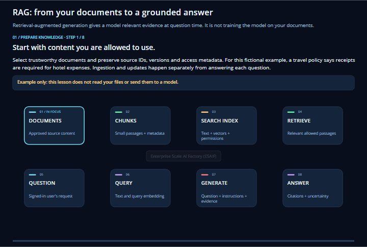

# Enterprise Scale AI Factory Agent

<p align="center">
  
</p>

A versioned Microsoft Foundry prompt agent with Azure AI Search grounding,
backend-enforced scope/authorization, existing Factory API/CLI adapters, and a
private web frontend. Selecting Platform or Project changes explanations, not
permissions. Configuration persistence, agent deployment and Azure provisioning
are distinct operations.

You can also [ask about Azure dashboards and current project costs](#ask-about-azure-dashboards-and-current-project-costs):
the chatbot can retrieve Azure Cost Management analysis for the selected project's
resource group, rather than guessing spend from documentation or resource names.

## Boundaries

- Use existing Foundry, Search, project data storage and internal Container Apps
  resources. No separate Factory API host is required to deploy this solution.
- The existing Factory HTTP API is required **only** for Factory operations that
  use it. Its clients are real `AzureFactoryClient` / `azurefactory` integrations,
  not another provisioning engine. An unavailable endpoint is reported as a
  blocker, never mocked into success.
- The initial deployment enables one explicit DEV scope. No subscription-wide
  write, arbitrary shell or audience-based elevation. Factory actions stay
  disabled until their dedicated grants and reviewed server-side targets exist.
- The application managed identity has no Azure Contributor or Owner grant.
  Search read and Foundry inference use their supported service-level roles.
  Dedicated agent-endpoint invocation uses **Foundry Agent Consumer** on only
  the configured agent. The OpenAI inference role alone cannot invoke a
  Foundry agent. No Foundry User/Owner or agent/model management grant is
  needed for this endpoint;
  application scope filters and user grants remain mandatory.
- The private network and existing service tiers are not changed. The shared
  Container Apps environment references a common-group subnet; this deployment
  does not modify it or its DNS.
- A dedicated Entra registration or an approved existing one is needed for web
  sign-in. Unconfigured sign-in fails closed. Operator CLI questions use the
  actual signed-in user's object ID and the same configured authorization.
- Live voice (Azure Voice Live) is optional and off by default. It adds speech in
  and out only: authorization, scope, retrieval, tools and citations still come
  from the same governed backend (see [Live voice](#live-voice-optional)).

## Prerequisites

Use **Python 3.12**, PowerShell and Azure CLI for this application. Its deployment
bundle targets Python 3.12/Linux wheels; it has a separate dependency lock from
the parent Agent Factory operator, which uses Python 3.13. Do not share their
virtual environments or install the parent `requirements.txt` here.
If these tools are missing, use the
[installation links in the parent guide](../readme.md#prerequisites), selecting
Python **3.12** for this application. The optional infrastructure deployment
also needs Azure CLI's Bicep support and an existing internal Container Apps
environment; neither is needed just to display CLI help.

Before a live run, have an existing Foundry project with compatible chat and
embedding deployments, Azure AI Search with the configured semantic/vector
capabilities, project data Blob Storage, and private DNS/network access to those
services. Connect the approved VPN when running from a workstation. Your
operator needs the relevant agent-management and ingestion data-plane
permissions; the runtime identity has the narrower roles described above.
No command below creates a whole AI Factory.

Use a full purple checkout for the local repository corpus and
`environment_setup\azurefactory-cli` adapter. In a consumer copy, point
`knowledge.repository_root` and `workloads.repository_root` at the actual
approved purple checkout/submodule and adjust the CLI install path below.
Do not assume the consumer repository has the same source layout.
Package installation requires access to your approved package feed.
Node.js/npm is not required to run the checked-in, vendored browser assets.

For operator questions, `auth.grants` must contain your actual Entra object ID
and allowed scope/permissions. Web use additionally requires configured Entra
browser sign-in and an exact approved redirect URI; a running HTTP server is
not an authentication setup. The Factory API is optional for documentation-only
questions, but required for tools that call it. Keep Factory writes disabled
until their separate grants, profiles and approvals are ready.

## How to set up the Python environment

All Azure identifiers, endpoints, model deployment, Search/storage choices,
Factory API URL, project scopes, users and corpus paths live in configuration,
not application code. `config.example.json` contains the initial target and no
credentials. It contains example resource IDs and user grants, **not a portable
configuration for your tenant**. Copy it to `config.local.json`, which is ignored
by Git, only if that file does not already exist.

```powershell
Set-Location "C:\code\code_py_25\003_aifactory_sub\azure-enterprise-scale-ml\usecase_code\40-agent-factory\40-aifactory-agent"
py -3.12 --version
py -3.12 -m venv .venv
.\.venv\Scripts\python.exe -m pip install -r requirements.lock.txt
.\.venv\Scripts\python.exe -m pip install -e ..\..\..\environment_setup\azurefactory-cli
if (-not (Test-Path .\config.local.json)) {
    Copy-Item .\config.example.json .\config.local.json
}
.\.venv\Scripts\python.exe -m aifactory_agent --help
```

Change the checkout path for your machine. Create the environment once; reuse
the explicit interpreter in later terminals without activation or global Python
changes. If `.venv` already uses a different Python, use a new environment name
and adjust the examples rather than replacing existing work.

Use `credential: "cli"` only for operator deployment. Cached Azure sign-in must
belong to the configured tenant. Production configuration is generated with
`managed_identity`, never user token caches or CLI passwords. No automatic
interactive login, subscription switching, secret fallback or device-code login.

For another tenant/subscription, replace configuration values and supply existing
private service resources. Paths resolve relative to the configuration file.
The packaged cloud snapshot uses a Linux-native repository path automatically.

## How to run the code

All commands here run from **this `40-aifactory-agent` folder**, not its parent.
Use this folder's `.venv` and `config.local.json`; the parent's
`agent_factory --config` schema and `--apply` convention do not apply.

1. Edit `config.local.json` for your existing services, repository paths, scope
   keys and user grants. Keep `azure.credential` set to `cli` for operator work.
   Use cached Azure CLI sign-in; only if missing, run
   `az login --tenant "<your-configured-tenant-id>"` with browser sign-in.
2. On a **new** target, review and authorize the two writes below: `deploy-agent`
   creates/reuses the owned Foundry agent version; `ingest` creates/reconciles
   the owned retrieval resources, embeds documents and updates the manifest.
   These commands act immediately; there is **no `--apply` flag**. Skip them
   when simply returning to an already prepared deployment.

```powershell
.\.venv\Scripts\python.exe -m aifactory_agent --config config.local.json deploy-agent
.\.venv\Scripts\python.exe -m aifactory_agent --config config.local.json ingest
```

3. Read the knowledge status, then ask an operator question. Replace
   `project001-dev` with a scope key you are granted in your configuration.
   `ask` makes billed model/retrieval calls; it is not an offline demo.

```powershell
.\.venv\Scripts\python.exe -m aifactory_agent --config config.local.json knowledge-status
.\.venv\Scripts\python.exe -m aifactory_agent --config config.local.json ask `
  --scope project001-dev --audience project `
  --question "How can a project team start using Foundry agents in an existing AI Factory?"
```

Expect JSON command results and an evidence-grounded answer with citations.
A corpus without a verified complete committed snapshot, a missing grant or an
unreachable endpoint is a setup blocker, not permission to disable authentication
or enable public networking. A failed or stale refresh can use the last verified
successful snapshot with an explicit dated freshness warning.
Changing `--audience` adjusts explanations, not authorization.

4. For a local development server process, start the command below. `serve`
   listens on **all interfaces** (`0.0.0.0`); use an approved development
   host/firewall, do not expose it publicly, and stop it with Ctrl+C.
   `http://localhost:8080/health/live` can check process liveness. Authenticated
   browser use needs a separately approved origin/redirect; the provided
   browser-registration helper accepts only an HTTPS root URL on port 443,
   not this HTTP development address. Follow
   [Private application deployment](#private-application-deployment) for the
   private Azure web application.

```powershell
.\.venv\Scripts\python.exe -m aifactory_agent --config config.local.json serve --port 8080
```

`/health/live` confirms the process is alive. `/health/ready` also checks
prerequisites; neither is a substitute for successful sign-in and a grounded
question. Return visits normally need only the same environment/configuration
and `ask` or `serve`, not another agent or infrastructure deployment.

## Model and agent

The initial Azure catalog advertised `gpt-6.1-sol`, version `2026-09-29`, with
Agents v2 and Responses support in Sweden Central. The initial deployment is
`aifactory-agent-gpt-6-1-sol`, EU `DataZoneStandard`, capacity 10. Verify catalog,
quota, capabilities and project compatibility again for a different target.
Do not replace an unavailable requested model without approval.

```powershell
.\.venv\Scripts\python.exe -m aifactory_agent --config config.local.json deploy-agent
```

For a normal project pipeline, set `enableFactoryChatAgent: "true"` in ADO
`variables.yaml` or `ENABLE_FACTORY_CHAT_AGENT="true"` in the GHA environment
template. The late Foundry phase discovers the selected project's existing
AIServices account, project endpoint and succeeded `modelGPTXName` deployment,
then creates or versions the owned `enterprise-scale-ai-factory` prompt Agent.
The flag defaults to false, never deletes an Agent, and refuses to overwrite an
Agent with the same name that is not owned by this implementation. This step
creates the Foundry Agent resource; hosting the private browser/MAUI chat backend
and its knowledge refresh remains a separate application deployment.

The name is ownership-checked. A changed definition creates a new agent version;
an identical definition reuses the existing version. Set `agent_version` to pin
invocations or roll back. Foundry instructions and function definitions are in
`aifactory_agent\foundry.py`. The backend executes client-side functions; creating
an agent alone does not host those functions in the Foundry portal.

For consumption-only application hosting, set
`agent_invocation: "agent_endpoint"` in the local deployment configuration.
The injected gateway uses the SDK's dedicated endpoint for `agent_name` and
does not send a second agent reference or request agent-definition reads.
This SDK surface requires explicit preview opt-in; no credentials, endpoint,
or model are substituted if it fails. The existing endpoint's version selector
controls routing and is never changed by an invocation.

`project_reference` remains the default for compatibility with operator
workflows. It supports `agent_version` in the Responses reference.
`agent_endpoint` rejects an `agent_version` override instead of silently
ignoring it; configure endpoint routing separately through an approved
operator change when pinning is required.

Changing invocation mode does not remove old Azure role assignments in an
incremental deployment. Review and explicitly remove only superseded owned
assignments. The configured agent endpoint uses a single-agent Consumer
assignment, not a project-wide management role; client-side tool grants and
signed operation approvals are still independently enforced.

## Grounding, refresh and citations

```powershell
.\.venv\Scripts\python.exe -m aifactory_agent --config config.local.json ingest
.\.venv\Scripts\python.exe -m aifactory_agent --config config.local.json knowledge-status
```

The initial corpus includes the setup/ITSM guides, Foundry examples, substantive
ML documentation, API/CLI references and **all** `RELEASE_*.md` files, including
future files. The original `30-machine-learning` directory has only an empty
README; that is a source coverage gap, not machine-learning evidence.

Inclusion/exclusion rules are configurable. Credentials/environment files,
dependencies, generated output, tests/evaluations and unrelated formats are
excluded. Fenced commands, heading context and source lines are retained.
Chunks carry source path/type, headings, content hash, version/release metadata,
scope access and citations. Release notes remain historical information.

Changed refreshes build a complete isolated Search generation named
`<configured-index-prefix>-g-<snapshot-id>` without mutating the serving index.
Upload acknowledgments are not immediate search visibility: refresh waits up to
60 seconds under the renewing manifest lease for count, document fingerprints,
schema, ownership and scope checks to pass. Only then does an atomic Blob
manifest update promote the generation. Each answer pins its retrieval and
knowledge-status tools to that same snapshot.

Blocked, failed, in-progress or stale refreshes leave the last complete successful
snapshot available for text and voice, with its committed timestamp and an
explicit freshness warning. Status reports `availability: last_successful`
separately from `refresh_status`; this is not a claim of fresh or live deployed
evidence. Missing, corrupt, foreign-owned or unreconciled snapshots remain
unavailable. A complete legacy index can serve fallback after verification, but
an old pending in-place mutation cannot. The ingestion CLI exits nonzero when
refresh does not finish ready even if fallback remains available.

Creating generations requires separately approved index-definition write
permission for the refresh operator/identity (for example, Search Service
Contributor scoped to the configured Search service), in addition to document
write permission. The application stays read-only. No permission is granted
automatically. Unchanged verified refreshes reuse their index without creation.
Generations, including failed stages, are retained; refresh never automatically
deletes indexes or changes service capacity. Operators must separately approve
capacity/retention maintenance, preserve the serving and still-pinned
generations, and verify ownership before any cleanup. Quota exhaustion fails
refresh explicitly without disabling the verified last-successful snapshot.
`deleted_count` describes sources omitted from the new generation, not deletion
from retained indexes.

Refreshing an immutable cloud source snapshot does not fetch newer repository
content: package/deploy an updated approved snapshot first, then refresh it.

Hybrid text/vector retrieval uses configured semantic reranking. The initial
Search service has free semantic ranking; its quota is shared. Errors are
surfaced, not silently downgraded. Approve a service change separately if a larger
semantic quota or Search tier is needed.

Documentation is intended behavior. Authenticated SDK/API observations are live
state. Installed factory version is explicitly unknown until authoritative
environment evidence establishes it; repository HEAD or newest release notes are
not installation evidence.

### Optional dual-graph grounding

Search providers keep the existing `KnowledgePort` contract. The separate,
optional `DualGraphPort` is injected through `AgentDependencies.dual_graph_factory`
and `AgentServices.dual_graph()`. Chat's scoped `GraphQueryService` and MCP's local
authorization adapter use the same `DualGraphStore` query core. Neither starts
Graphify or contacts an embedding/model service for graph queries.
Existing three-argument custom conversation factories remain compatible; new
`graph_conversation_factory` factories receive the graph port as a fourth argument.

Opt in explicitly in the deployment configuration (paths are relative to that
configuration file):

```json
"dual_graph": {
  "snapshot_root": "../../../meta/graphify",
  "expected_snapshot_id": "<reviewed 64-character lowercase SHA-256 snapshot ID>",
  "allowed_scopes": ["project001-dev"],
  "allow_source_access": false
}
```

Omit `expected_snapshot_id` only for local, unpinned exploration. `dual_graph` is
absent by default; examples do **not** grant graph access. Add `graph.read` to a
reviewed caller's exact-scope grant separately. Neither `factory.read` nor
`knowledge.read` implies it. Authorization and the configured scope allowlist are
checked before opening snapshot files. Source-checkout access is separately
opt-in; false means only the snapshot is read, never the workstation checkout.

Substantive code, architecture, pipeline and dependency questions request both
structural and architecture context **before** model inference, while preserving
Search documents. Greetings, health commands and unrelated questions perform no
additional graph query. Missing, unauthorized, stale or unverified graph context
is explicitly degraded; existing authorized Search and Factory operations remain
available. Graph output, notes and frontmatter are untrusted evidence, not policy.
Read-only `graph_query` supports bounded traversal and architecture lookup, not
generation, arbitrary paths, shell commands, approval or writes.

Search citations retain `[S1]` IDs; structural `[G1]` and architecture `[A1]` IDs
are separate and tied to the snapshot. The UI displays snapshot provenance and
warnings. A snapshot ID, source revision/dirty state and live Azure observations
are different facts: none establishes the current deployed version.

Packaging requires `expected_snapshot_id`. A moving `meta/graphify` root must
pass complete integrity **and** source-freshness checks. An explicitly pinned
`snapshots/<id>` directory is a known immutable input and does not require a
checkout. Only captured, verified manifest/graph/note bytes enter the bundle;
cloud configuration points to the immutable Linux snapshot directory and
disables checkout access. No moving branch is cloned or generated at startup.
Graph snapshots and developer test/evaluation material are hard-excluded from
Search ingestion and corpus packaging even under broad documentation includes.

## Operator questions

```powershell
.\.venv\Scripts\python.exe -m aifactory_agent --config config.local.json ask `
  --scope project001-dev --audience platform `
  --question "Does saving configuration deploy resources, and how does Full bootstrap differ?"

.\.venv\Scripts\python.exe -m aifactory_agent --config config.local.json ask `
  --scope project001-dev --audience project `
  --question "How can a project team start using Foundry agents in an existing AI Factory?"
```

Both commands use the persisted Foundry agent and real Search retrieval. Model
answers must cite supplied evidence. Tool calls are bounded, errors propagate,
and inference/writes are not blindly retried.

## Ask about Azure dashboards and current project costs

Use the AI Factory chatbot to ask about the information behind Azure dashboards,
including **Cost Analysis for the currently selected project's resource group**.
For example, select the authorized `project001-dev` scope in the chat application
and ask:

> What is the current Azure running cost for the currently selected project001 in the current AI Factory?

For this question, "current running cost" means **actual month-to-date (MTD)
charges**, alongside Azure's separate **full-month forecast**. It is not an
instantaneous hourly burn rate or an idle-cost estimate. A successful cost-tool
response supplies the selected subscription/resource group, billing period,
actual totals and breakdown by Azure service, forecast, currency and observation
time for the agent to explain. No example monetary amounts are invented here.

The scope selected in **chat** is authoritative: confirm its factory, project
and environment before asking. `project001` alone is not a globally unique
resource-group name, and naming another project in the question does not change
scope or grant access. The operator CLI uses the same scoped conversation:

```powershell
.\.venv\Scripts\python.exe -m aifactory_agent --config config.local.json ask `
  --scope project001-dev --audience project `
  --question "What is the current Azure running cost for the currently selected project001 in the current AI Factory?"
```

Chat summarizes the returned cost analysis; it does **not** scrape, embed or
automatically open the Azure Portal Cost Analysis blade. For a direct structured
report without model tool selection, use
`/get-monthly-forecasted-project-estimated-azure-cost` in the authenticated
**Factory actions and cost monitoring** panel and supply the exact project
resource-group name. The original `monthtly` spelling remains supported.

### How the agent knows: scope, tools and live Azure calls

1. **Authenticate and resolve the selection.** `POST /api/chat` carries the
   question, `scope_key` and audience. The backend validates the caller and
   `knowledge.read`, checks knowledge readiness and retrieves documentation.
   `Conversation.answer()` supplies the server-configured `active_scope` to the
   Foundry agent, including the factory/project/environment, subscription and
   resource group. Search and optional dual-graph evidence explain the Factory;
   neither contains authoritative current billing.
2. **Request the read-only cost tool.** The Foundry agent can issue
   `cost_monthly_project_forecast` with
   `{"resource_group": "<resource-group-from-active_scope>"}`.
   `FactoryTools.descriptors()` exposes cost tools only for callers with both
   `factory.read` and `cost.read`. The conversation intersects canonical tools
   with those descriptors, validates arguments, rechecks authorization and
   dispatches through `FactoryTools.execute()` to `CostSkills.execute()`.
3. **Enforce the target and obtain an ARM token.** `CostSkills` checks the same
   exact-scope grants and rejects a project resource group different from the
   configured selection. The subscription is server-selected, not a model
   argument. The backend uses `ManagedIdentityCredential` in the hosted app
   (or configured `AzureCliCredential` for operator use) to request
   `https://management.azure.com/.default`. The browser/model does not receive
   that token.
4. **Read Azure Cost Management now.** `CostSkills._execute()` calls
   `_billing()` twice: once for actual MTD charges and once for Azure's
   full-month forecast, using the resource-group-scoped endpoints below.
   These are read-only analytics requests even though the HTTP method is POST.
   This path calls ARM directly; it does not require a separate Factory HTTP
   API, scrape dashboard tiles, run arbitrary shell commands or refresh Search.
5. **Explain the returned evidence.** The backend returns `actual_mtd` and
   `azure_forecast_full_month` as a `function_call_output` to the Foundry agent.
   The agent then composes the chat answer. Tool calls are bounded and audited;
   the chat response records their names in `tool_activity`. Documentation
   citations support the explanation, not the live monetary amounts: those
   come from the Azure tool response and its reported scope/time/currency.

The two Azure requests are:

```http
POST https://management.azure.com/subscriptions/{subscriptionId}/resourceGroups/{resourceGroup}/providers/Microsoft.CostManagement/query?api-version=2025-03-01
POST https://management.azure.com/subscriptions/{subscriptionId}/resourceGroups/{resourceGroup}/providers/Microsoft.CostManagement/forecast?api-version=2025-03-01
```

Both send `type: "ActualCost"`, `timeframe: "Custom"`, daily granularity and
`Sum(Cost)`. The actual query covers the UTC calendar-month start through the
observation time and groups by `ServiceName`. The forecast covers the whole UTC
calendar month with `includeActualCost: true` and
`includeFreshPartialCost: false`. Its total already includes its actual-cost
component: **do not add the independent MTD total again**. Amounts are retained
as decimal strings per returned billing currency, with no currency conversion.

The panel is an alternative entry point into the same cost adapter:
`POST /api/skills/get-monthly-forecasted-project-estimated-azure-cost/run` with
`{"scope_key": "project001-dev", "arguments": {"resource_group": "<selected-project-rg>"}}`.
It returns the structured report directly, without the Foundry answer loop.

### What "real time" means, and what it does not

**The Azure API is queried on demand; Azure billing is not instantaneous.**
`observed_at` records when the backend made the observation, not when every
resource last incurred a charge. Open-period charges can arrive late. The
forecast report includes `actual_cutoff_by_currency` and
`actual_data_lag_days_by_currency`, based on Azure's posted `CostStatus` rows.
Forecast rows after that cutoff can therefore include dates before the query
time. The agent does not extrapolate its own forecast or treat missing data as
zero spend.

Compare with Portal Cost Analysis using the same resource group, **Actual cost**
basis, period and currency; a differently filtered dashboard need not match.
This is the selected resource group's cost, not the whole factory or all shared
dependencies. Other cost questions use distinct tools:

| Question | Backend tool | Evidence and boundary |
| --- | --- | --- |
| Current project spend and monthly outlook | `cost_monthly_project_forecast` | Azure actual MTD and Azure full-month forecast for the exact selected project RG. |
| Default project's idle baseline | `cost_default_project_idle` | Pinned canonical default `variables.json` plus Azure Retail Prices, separately compared with actual MTD; not the project's applied settings or measured inactivity. |
| Common/shared RG idle baseline and spend | `cost_common_idle` | ARM resource inventory and Azure Retail Prices, separately compared with actual MTD; requires an explicit `costs.common_resource_groups` allowlist entry for this scope. |

The execution identity needs appropriate Azure Cost Management read access
(for example, **Cost Management Reader** at the approved scope); resource
inventory reads also need resource Reader access. These Azure permissions do
not replace the application's per-user scope grants. Selecting Platform view,
having a dashboard link or enabling the chatbot does not grant billing access.
Azure denials, insufficient billing/forecast history, invalid responses and
incomplete pagination are surfaced as unavailable, never replaced with invented
totals. The current monthly tool requires both actual and forecast data to
produce its combined report.

Questions about other dashboard measures, such as token usage, latency or
resource health, require corresponding authorized live tools; these cost tools
do not read every dashboard tile. A deployed agent definition and backend that
include the tools, valid sign-in/grants, service connectivity and normal chat
knowledge readiness are prerequisites. This documentation describes source
behavior, not proof that a particular deployed app has those prerequisites.

Implementation: [canonical tool definitions](../agent_factory/factory_chat_agent.py),
[conversation and tool loop](aifactory_agent/foundry.py),
[authorized tool dispatch](aifactory_agent/tools.py),
[Azure cost adapter](aifactory_agent/costs.py), and
[HTTP entry points](aifactory_agent/web.py). The
[cost contract tests](tests/test_costs.py) cover scope enforcement, billing lag,
currency separation, forecast double-counting and unavailable data.

## Private application deployment

The web interface follows the palettes in the MAUI Config Wizard's
`ThemePaletteCatalog`. A **Color theme** selector below **Sign in** chooses
**Gray and Blue** (the default; its dark values are the app's `GrayAndBlue`
palette) or **Purple** (purple primary actions, lavender selected surfaces).
Both palettes keep the same semantic status colors and work in light and dark
mode. The system mode is respected unless `?scoutTheme=light` or
`?scoutTheme=dark` explicitly selects one. The color theme comes from the
page's own choice (kept in the URL fragment as `palette=`, and carried through
sign-in in the OAuth state, never in browser storage), then the embedding app's
`?scoutPalette=gray-blue|purple`, then Gray and Blue. The embedded app can
change it live with the `esaif.agentChat.theme` message's optional `palette`
field; unknown values are ignored. Error red is reserved for actual errors,
not normal action buttons.

Answers render Markdown headings, emphasis, nested lists, tables, blockquotes
and code, with evidence markers linked to the corresponding source entries.
The renderer uses constructor-injected parsing and DOM dependencies and builds
allowed DOM nodes, never model-supplied HTML. Unsafe links are nonclickable;
images are alt text only, so answers cannot trigger remote image requests.
Action popups, typed deletion phrases and backend authorization are unchanged.

The Markdown browser parser is pinned in `package-lock.json` and vendored
with its MIT license and SHA-256 metadata under `static\vendor`. Runtime
requests load only same-origin assets; no CDN or startup package install is
needed. When upgrading the parser, verify the lockfile archive integrity and
update the vendored build/metadata together before packaging.

Infrastructure definitions are `infra\identity.bicep` and
`infra\application.bicep`. The latter creates a new application in the existing
internal environment. It does not configure public networking or a new registry.

The digest-pinned Microsoft Azure CLI image downloads an integrity-pinned code
bundle from the task-owned private Blob container using its managed identity.
Dependencies are installed **offline** from locked Linux wheels. No code is
downloaded from GitHub or dependencies from package feeds during startup.
This source-bundle approach avoids creating a public registry or changing a
shared private registry/network. Treat the bundle as executable deployment
content and protect its container and deployment permissions.

```powershell
.\.venv\Scripts\python.exe -m pip download --dest .build\wheels `
  --platform manylinux2014_x86_64 --platform manylinux_2_28_x86_64 `
  --python-version 312 --implementation cp --abi cp312 --only-binary ":all:" `
  -r requirements.lock.txt pip==25.3

# Read-only deployment plan:
.\.venv\Scripts\python.exe deploy.py --config config.local.json `
  --environment aif-mcp-project001-dev-env

# Only after approval of the printed scope and grants:
.\.venv\Scripts\python.exe deploy.py --config config.local.json `
  --environment aif-mcp-project001-dev-env --apply
```

Application resources are tagged `managed-by: enterprise-scale-ai-factory-agent`.
The bootstrap needs Blob-role propagation and private DNS. The startup probe
allows bounded initialization time. `/health/live` means process alive;
`/health/ready` includes prerequisites and must not be interpreted as operational
readiness while sign-in or knowledge is blocked.

## Live voice (optional)

Talk to the agent like a voice assistant. The page shows a voice card with a
pulsing circular orb that reflects what the agent is doing: *connecting*,
*listening*, *thinking*, *speaking* or *error*. With reduced-motion preferences
the orb stays still and the state is still announced as text. Typing keeps
working when voice is disabled, unavailable or blocked.

Enable it with `"voice": {"enabled": true}` in the configuration. The project
pipeline sets this when `enableAIFactoryAgentLiveVoice` is `true` next to
`enableFactoryChatAgent`, which creates the Foundry Agent (see
[47-aifactory-agent-live-voice](../47-aifactory-agent-live-voice/readme.md)). That step
only creates apps it created itself (a read-only baseline configuration); for an app you
deployed by hand, add the `voice` block to your own `config.local.json` and run `deploy.py`
(the operator flow). The user guide is
[chapter 21](../../../documentation/v2/10-19/21-agent-factory-chat.md).

**Which voice technology does it use?**

Both modes use the **Azure Voice Live API** (`wss://<foundry-account>.services.ai.azure.com/voice-live/realtime`,
`api-version` `2026-04-10`) on the project Foundry account. No separate Azure Speech resource or Speech SDK
pipeline (speech to text, then chat, then text to speech) is used. The mode decides who writes the answer and
whose voice speaks it:

| `voice.mode` | Speech in | Who writes the answer | Voice out |
|---|---|---|---|
| `speech_shell` (default; the pipeline baseline) | Voice Live transcription and turn detection | The same `Conversation.answer()` as typed chat (grounded, cited) | An Azure neural voice through Voice Live (`voice_type: "azure-standard"`, default `en-US-Ava:DragonHDLatestNeural`) |
| `realtime` (opt-in, e.g. Spider project001 Dev) | The GPT realtime model hears the audio itself (`gpt-realtime-mini`, `gpt-realtime` or `gpt-realtime-datazone`) | The realtime model, with the evidence, read tools and citation checks from `Conversation.prepare` | The realtime model's own voice (`voice_type: "openai"`, for example `coral`) |

Choose the mode in your configuration (or in the customer overlay named by `aifactoryAgentConfigFile`), for
example `"voice": {"mode": "realtime", "model": "gpt-realtime-mini", "voice_type": "openai", "voice_name": "coral"}`.
`speech_shell` keeps typed and spoken answers identical; `realtime` answers faster and sounds more natural, with
the verification trade-off described below.

**How it works**

- The compatibility default, `voice.mode: "speech_shell"`, uses Azure **Voice Live**
  (`api-version` `2026-04-10`) as a *speech shell*: speech to
  text, turn detection, noise suppression, echo cancellation and text to speech.
  It never writes the answer (`create_response` is off).
- Every final transcript is answered by the same governed `Conversation.answer()`
  as a typed question: same sign-in, exact scope grant, readiness checks,
  retrieval, tools, citations and audit. The full answer and its citations appear
  in the normal answer card; a short spoken rendition (no citation markers,
  markdown, URLs or code, long tables summarised as "...is on screen") is spoken.
- Opt-in `voice.mode: "realtime"` uses `gpt-realtime-mini`, `gpt-realtime` or `gpt-realtime-datazone` on the
  same Voice Live connection. The native model receives audio and streams its own
  reply; it never invokes the external full-text `Conversation.answer` model or
  sends an answer as `pre_generated_assistant_message`. Transcription is used only
  as a scoped retrieval query. `Conversation.prepare` supplies the same readiness,
  evidence, approved read-tool intersection, argument checks, authorization, audit
  and final citation validation as text. VAD automatic response creation remains
  off so evidence readiness is checked **before** native `response.create`.
- Native audio and live transcripts are **provisional**. Only completed, citation-
  checked responses populate the authoritative answer card. An unsupported
  (invented) citation ID stops the turn and flushes queued audio, but audio already
  heard cannot be recalled. A speech model rarely says `[S1]` aloud, so a spoken
  reply that omits the markers is published with the retrieved sources attached
  and `citation_validation: "sources_attached"` (`"passed"` when it cites them).
  Citation checks do not prove semantic entailment. This latency/verification
  trade-off is explicit, not equivalent to validating all speech before playback.
  As in typed chat, a failed read tool (`ok: false`) goes back to the model as
  data and is logged as `voice_tool_failed` with its error code only; a denied
  tool and bounded-round exhaustion stop the turn. The model can never approve or
  execute writes. A native tool call starts as soon as its arguments are complete
  (`response.output_item.done`), while the model may still be speaking, and
  independent calls in one response run concurrently. Each call is still authorized
  and audited, runs exactly once and stays inside the round limit. Its output reaches
  the model only after `response.done` has listed the whole response.
- The browser never receives Foundry credentials. It opens
  `WS /api/voice/ws` on the application; the backend connects to
  `wss://<foundry-account>.services.ai.azure.com/voice-live/realtime` with its
  managed identity (token scope `https://ai.azure.com/.default`).
- The first frame carries the caller's Entra access token, scope and audience
  (never a URL or cookie). The server validates the token and the exact-scope
  `knowledge.read` grant, checks the `Origin`, caps pre-authentication sockets,
  rate-limits audio, ends idle or over-long sessions (never later than the expiry of
  the token that opened them) and replaces a user's older session with the newer one. The browser cannot choose the model, voice,
  instructions or tools. It can select only an operator-configured language profile.
- Speaking while the agent answers (barge-in) cancels the pending answer and the
  speech. Speech is generated faster than real time, so the browser can still be
  playing an answer that has finished generating. The relay estimates playback from
  the audio it relayed (PCM16 bytes / 48,000 per second, plus a 0.5 s margin) and
  flushes the browser's queue whenever the user starts speaking before that
  estimate runs out. The server never interrupts or answers on its own
  (`interrupt_response` and `create_response` stay off). The next grounded turn
  deletes the interrupted answer from the Voice Live conversation before it creates
  a new response, so the model never builds on speech the user did not hear.
  Tokens and transcripts are never logged; errors shown to the browser
  carry no internal detail.
- Voice failures (including a status 401 or voice-only authentication error) never
  clear or renew the text token. **Use typed chat** focuses the existing form,
  optionally copies the last utterance without submitting, and releases voice.
  **Check voice again** rechecks capabilities; **Start talking** retries a failed
  voice session. Language changes close/reopen voice only, with the same Chat sign-in.
  Native service rejection or a failed native response ends voice and directs the
  user to typing; it never silently switches to the shell, another model, or
  ungrounded generation, and never asks for service secrets or new consent.
- The `Permissions-Policy` header allows the microphone only for the application
  itself when voice is enabled and denies it otherwise. The routes
  `/api/voice/status` and `/api/voice/ws` do not exist when voice is disabled.

**Embedded MAUI compatibility.** `host=esaif-maui` is text-only unless the
compatible desktop host explicitly opens `voice=on` and the authenticated
capability response declares `mode: realtime`, `protocol: 1` and
`embedded_voice_version: 1`. Older/speech-shell deployments and `voice=off`
remain microphone-denied. A compatible host must independently pin the HTTPS
origin and document and permit only user-initiated microphone access; a query
parameter is not a desktop permission grant. Voice status and language changes
reuse the current text session rather than acquiring a separate token.

**Configuration** (`voice` block; all optional except `enabled`)

| Field | Default | Meaning |
|---|---|---|
| `enabled` | `false` | Registers the voice routes and shows the voice card. |
| `mode` | `speech_shell` | Set `realtime` with a supported native model to remove the external answer-model/TTS chain. |
| `endpoint` | derived | `https://<foundry-account>.services.ai.azure.com` from `azure.foundry_account`; only Foundry/Cognitive Services hosts are accepted. |
| `model` | `gpt-4.1-nano` | Shell billing tier; native mode requires `gpt-realtime-mini`, `gpt-realtime` or `gpt-realtime-datazone`. Approve regional availability and processing scope separately. |
| `voice_name` | `en-US-Ava:DragonHDLatestNeural` | Fixed for the whole session. |
| `voice_type` | `azure-standard` | `openai` with an approved native voice (for example `coral`) produces model-native audio. `azure-standard` selects Azure synthesis within Voice Live instead. |
| `input_languages` | `["en-US"]` | Explicit BCP-47 speech languages (1-10). Realtime mode allows exactly one unless `multilingual` is on; then they are hints and the first one is the fallback. |
| `multilingual` | `false` | Realtime only. Understands any spoken language and replies in the user's language (see below). |
| `turn_detection` | `azure_semantic_vad` | Also `azure_semantic_vad_multilingual`, `server_vad`; `silence_duration_ms` 500. |
| `max_session_seconds` / `idle_timeout_seconds` | `900` / `120` | Session bounds. |
| `max_concurrent_sessions` | `4` | Per application replica. |
| `max_spoken_characters` / `answer_timeout_seconds` | `1200` / `120` | Shell speech length; native responses are capped at 4096 output tokens (model-native audio counts toward the cap; an answer cut by it keeps playing and is published with `spoken_truncated: true`). Deadline covers native preparation, tools and response. |
| `greeting` | "Factory Agent online. How can I help?" | Shell speaks it; native displays it without a separate synthesis request. `null` disables it. |
| `default_language` / `language_profiles` | `en-US` / `{}` | Optional server-owned BCP-47 locale profiles; each specifies `voice_name`, optional `voice_type`, optional `greeting`. The default must be a configured profile. |
| `allowed_origins` | `[]` | Extra browser origins; same-origin is always allowed. |

**Identity and network.** With voice enabled, `deploy.py` adds two roles to the
application identity on the project Foundry account: *Cognitive Services User* and
*Azure AI User* (never removed when voice is turned off). *Cognitive Services User*
can also list keys while local authentication is enabled on the account; prefer keeping
local authentication disabled. Whether *Azure AI User* alone is enough for the Voice Live
data plane is not verified here: check it in a test environment, then drop the
broader role in `infra/identity.bicep`. The application must resolve and reach the
Foundry `services.ai.azure.com` private endpoint. The ingress transport (`http`, HTTP/1.1)
already supports WebSockets.

**Native operator configuration with English/Swedish examples** (merge into your existing config,
do not replace auth, grants, ownership, endpoints or scope settings):

```json
"voice": {
  "enabled": true,
  "mode": "realtime",
  "api_version": "2026-04-10",
  "model": "gpt-realtime-mini",
  "token_scope": "https://ai.azure.com/.default",
  "voice_type": "openai",
  "voice_name": "coral",
  "input_languages": ["en-US"],
  "default_language": "en-US",
  "language_profiles": {
    "en-US": {"voice_type": "openai", "voice_name": "coral", "greeting": "How can I help?"},
    "sv-SE": {"voice_type": "openai", "voice_name": "coral", "greeting": "Hej! Hur kan jag hjälpa dig?"}
  },
  "turn_detection": "server_vad",
  "silence_duration_ms": 350,
  "noise_suppression": true,
  "echo_cancellation": true,
  "max_session_seconds": 900,
  "idle_timeout_seconds": 120,
  "max_concurrent_sessions": 4,
  "answer_timeout_seconds": 60,
  "greeting": null,
  "allowed_origins": []
}
```

Profiles are not restricted to two languages: add supported locales such as
`de-DE`, `fr-FR` or `ja-JP` to `language_profiles` using the same profile shape. The browser
lists every configured profile. Verify the selected model's input language and
voice's output support first: Voice Live's broad Azure Speech locale coverage is
not a claim that every native model supports every locale.

**Processing approval.** Microsoft lists Sweden Central `gpt-realtime-mini` and
`gpt-realtime` as **Global** inference. `gpt-realtime-datazone` is **Data zone**,
not Sweden-only processing; that does not establish the separate transcription
or synthesis processing scope. Approve the exact model and component scopes
before rollout. The native-input table lists 57 languages for `gpt-realtime` and
`gpt-realtime-mini`, not the 150+ Azure TTS locales; it does not separately
enumerate data-zone model language support.
See [regional processing scopes](https://learn.microsoft.com/en-us/azure/ai-services/speech-service/regions?tabs=voice-live#llm-availability-and-processing-scope)
and [native input languages](https://learn.microsoft.com/en-us/azure/ai-services/speech-service/voice-live-language-support?tabs=speechinput#gpt-realtime-and-gpt-realtime-mini-supported-languages).

The backend uses `gpt-4o-mini-transcribe` with the locale's ISO language code for native
retrieval transcription, and `server_vad` for these profiles (English semantic
VAD is not used for Swedish). The reply language is server-selected instructions;
the browser cannot send arbitrary instructions or a voice name. Voice is fixed
after the first speech, so the selector starts a fresh voice session.

**Multilingual realtime (opt-in).** By default a realtime session listens and
replies in one language. Set `"multilingual": true` to let users speak any language
the native model supports without picking one first:

- Transcription omits the language, so `gpt-4o-mini-transcribe` detects it per
  utterance (it is still only the retrieval query).
- The model is told to reply in the language of the user's latest utterance.
  `input_languages` (several allowed, for example `["sv-SE", "en-US"]`) are listed
  as expected languages, and the first one is used when the language is unclear.
- Turn detection is `azure_semantic_vad_multilingual`, which Voice Live supports
  with all models, including `gpt-realtime` and `gpt-realtime-mini`. Set
  `"turn_detection": "server_vad"` to keep the volume-based fallback.
- With `language_profiles`, the selected profile still chooses the voice and
  greeting and is the fallback language, but it no longer limits what the user
  may speak. `GET /api/voice/status` reports `voice.multilingual`, and the voice
  card says that any language works.
- Use a voice that can speak every language you expect: the native `openai`
  voices (for example `coral`) or Azure Multilingual/HD voices.

Without `multilingual`, behaviour is unchanged: one language per session,
`server_vad`, and transcription pinned to that language.

If you prefer a specifically Swedish Azure synthesis voice, configure the Swedish
profile as `{"voice_type":"azure-standard","voice_name":"sv-SE-SofieNeural"}`.
This is Azure TTS **within Voice Live**, not native model audio; there is still no
application-side full-answer/TTS chain. Verify the voice and model availability
in the resource region. In legacy shell mode, Swedish is not in the automatic multilingual list: set
`input_languages` to, for example, `["sv-SE", "en-US"]` and a Swedish voice such as
`sv-SE-SofieNeural`. Voice quality and language coverage differ per region and voice.

**Cost.** Voice Live is billed per use by the tier of the configured `model`, even
though the shell model writes no answer, in addition to the shell's external model
and Search usage. Native mode eliminates that external answer inference, not
retrieval/embedding costs. HD voices are regional. Sessions are bounded by
`max_session_seconds`. Verify current rates for your agreement; none are invented here.

**Limits and measurement.** Utterances are standalone questions, as in typed chat.
Native turns isolate conversation history because their citation identifiers are
question-local. Each prepared turn pins retrieval and knowledge-status tools to
the same complete committed snapshot, including explicitly warned last-successful
fallback. No browser playback-clock acknowledgement is available; barge-in uses the
relay's playback estimate described above. Canceled read-only worker calls
may finish in their thread, but their results cannot resume a canceled turn.
The native first-audio histogram `aifactory.voice.first_audio.duration` and safe
`voice_first_audio` log measure end-of-speech to the first relayed audio frame;
they do not measure browser speaker playback. Grounding runs before any native
speech, by design. Its cost is logged as `voice_grounding_ready ... latency_ms=` and
recorded in `aifactory.voice.grounding.duration`. Compare warmed English/Swedish
median/p95 and interrupted turns on the approved private network after deployment.
Initial transcription, readiness, Search, optional embeddings/graph queries, tools,
network and cold-start latency remain; no sub-second claim is made from fake tests.
The compatibility
agent does not speak filler while it thinks; session caps are per replica; and the
live handshake through the private endpoint was not exercised against Azure in this
repository's tests, which use fakes and a real browser.

Protocol authority: [Voice Live overview](https://learn.microsoft.com/en-us/azure/ai-services/speech-service/voice-live),
[configuration/transcription](https://learn.microsoft.com/en-us/azure/ai-services/speech-service/voice-live-how-to),
and [Voice Live 2026-04-10 events](https://learn.microsoft.com/en-us/azure/ai-services/speech-service/voice-live-api-reference-2026-04-10).
Passing offline tests is not proof that the operator-owned live revision has changed.

## Authentication, tools and approvals

### OOAD and dependency injection

`aifactory_agent\ports.py` defines structural interfaces for knowledge,
model sessions, Factory API/tools, cost reporting, audit and operation storage.
`AgentServices` is the per-agent composition root. `AgentDependencies` supplies
constructor-injected factories and authentication; HTTP handlers and operator
CLI use these services rather than constructing cloud clients themselves.
`AgentServiceFactory` is an abstract factory interface, with `AgentFactory`
creating independent compositions from explicit configuration profiles.

```python
from aifactory_agent.config import load_settings
from aifactory_agent.services import AgentFactory
from aifactory_agent.web import create_app

factory = AgentFactory({
    "platform": load_settings("platform.config.json"),
    "reviewer": load_settings("reviewer.config.json"),
})
platform = factory.create("platform")
reviewer = factory.create("reviewer")
platform_app = create_app(platform.settings, services=platform)
reviewer_app = create_app(reviewer.settings, services=reviewer)
```

Each configuration specifies its own agent name/model, scopes, grants and
knowledge ownership. Use separate owned indexes/containers where corpus policies
differ. Knowledge and approval services have a per-agent lazy lifetime; caller
and scope-bound tool/cost adapters are created per request. There is no global
singleton that stores a principal, credential-bearing API session, approval or
conversation history. Operation records are isolated in an agent namespace,
and that namespace is covered by the plan hash and record signature. Old
unnamespaced approvals are not migrated or replayed automatically; prepare anew.

New capabilities are developed with failing interface tests first, then real
adapters and green tests. Fakes implement the same interfaces without cloud
construction or monkeypatching production authorization. Use Factory/Strategy
for selecting implementations, Adapter for SDK boundaries, and Command/State
for persisted operations. Do not add every pattern speculatively.

This follows the [Azure Well-Architected Framework](https://learn.microsoft.com/en-us/azure/well-architected/)
and [cloud design patterns](https://learn.microsoft.com/en-us/azure/architecture/patterns/):
least privilege and signed approvals (security), explicit uncertain outcomes and
bounded retries (reliability), async job observations (performance), sourced
cost coverage (cost optimization), and immutable bundles/tests/audit
(operational excellence). This is design alignment, not a claim of a completed
Well-Architected production assessment.

Configure `auth.client_id`, `auth.audience`, `required_scope` and exact object-ID
grants before web use. Entra tokens are checked for the configured tenant,
issuer, audience, validity and delegated scope. No browser-provided user ID,
audience toggle, model argument or managed identity establishes user authority.
Tokens stay in browser memory; the frontend uses authorization-code PKCE.

The operator can plan and configure a **dedicated** single-tenant browser identity:

```powershell
.\.venv\Scripts\python.exe -m aifactory_agent.browser_auth `
  --config config.example.json `
  --redirect-uri "https://<private-agent-host>/" `
  --user-object-id "<existing-granted-user-object-id>"

# Only after the separately approved tenant identity plan:
.\.venv\Scripts\python.exe -m aifactory_agent.browser_auth `
  --config config.example.json `
  --redirect-uri "https://<private-agent-host>/" `
  --user-object-id "<existing-granted-user-object-id>" --apply
```

This creates an owned application and service principal with only the Agent's
`access_as_user` delegated scope, an exact SPA redirect, v2 tokens and that
user's app assignment. No client secret, Microsoft Graph permission, Azure
resource role, MAUI registration edit or Factory write enablement is included.
Registration drift is a blocker, not silently reset. Settings are saved to ignored
`config.local.json`; use it for the next approved `deploy.py --apply`.

The standalone browser may reuse the Microsoft sign-in session already on the
machine. It never borrows ARM or other Azure CLI tokens: those target different
APIs. The embedded MAUI host below requests a separate Azure CLI token for this
Agent API's own audience only, after the explicit pre-authorization it describes.
For v2 access tokens the backend `auth.audience` is the API's client-ID UUID;
the requested scope remains `api://<client-id>/access_as_user`. Your tenant may
require an administrator to approve consent to this Agent-specific permission.

Factory adapter inputs are closed typed schemas and server-side selected IDs.
`factory_cli_health` uses an allowlisted argument array and never model-generated
shell text. Prefer direct API tools for capabilities supported by both.
Unavoidable API keys use a configured Key Vault secret URL or an explicitly
supplied process secret; they never appear in command arguments or receipts.

Factory writes are disabled in the example until the actual endpoint, exact
catalog identifiers and supported contract have been confirmed. Supported
configuration changes require a persisted, caller/scope/revision-bound plan,
expiry, explicit approval of the exact plan hash, and a one-use execution state.
The model cannot approve. Drift or uncertain execution stops the workflow;
lost replies are not permission to replay a non-idempotent write.

### Embedded in the AI Factory app (ESAIF Agent Chat)

The MAUI app's **ESAIF Agent Chat** menu opens this UX inside WebView2 with
`?host=esaif-maui` and reuses the app's **Login to Azure** (the shared Azure CLI
session). Host mode starts only when that query value and `window.chrome.webview`
are both present; ordinary browsers keep authorization-code PKCE unchanged.

- The page posts `esaif.agentChat.tokenRequest` (`version` 1, random `requestId`,
  `reason` `connect`/`renew`/`rejected`). The app answers only when the sender and
  the current top-level document are this exact origin, with a token for its
  locally pinned `api://<client-id>` audience (`esaif.agentChat.token`) or an
  actionable `esaif.agentChat.tokenError`. Tokens stay in memory; no redirect,
  browser storage, URL or log carries them. The page reports what the server
  confirmed with `esaif.agentChat.status` (`connected` after a complete
  `/api/context`, `rejected` with the token's opaque `issuanceId` after a 401,
  `disconnected` whenever a confirmed session is cleared); the app never treats
  an issued token as a session, and quarantines exactly the rejected issuance so
  it is never presented again. A 401 for an older token that was already renewed
  is reported as `esaif.agentChat.tokenRejected` (that issuance only) and keeps
  the renewed session.
- Renewal happens through the app before expiry. The server-confirmed
  `/api/context` principal must be unchanged; otherwise the session is cleared.
  A 401 (with or without a JSON body) clears the session and the next
  **Connect** asks for a fresh token; network, 5xx or malformed renewal
  responses keep the still-valid session.
- In-app navigation is limited to this origin. Citations and links open in the
  system browser; Microsoft sign-in pages, frames, downloads, permission prompts
  and popups are blocked. Confirmations and server-side approvals are unchanged.

Prerequisites are explicit and reviewed:

```json
"auth": { "additional_client_ids": ["04b07795-8ddb-461a-bbee-02f9e1bf7b46"] }
```

`additional_client_ids` accepts only reviewed public clients (currently
Microsoft Azure CLI). Every token must carry an authorized-client (`azp`) claim
from the primary registration or that list, plus this tenant, issuer and
audience, the `access_as_user` scope and an existing grant. The client ID is
recorded in tool audit events, operation transitions and approvals.
`browser_auth` derives the pre-authorizations from the same configuration and,
before any directory call, refuses to run when `config.local.json` targets
another tenant, another registration or different clients. It binds an existing
`auth.client_id` (from either file) to that exact application, looked up by its
immutable `appId` (never adopted or recreated by name), requires the operator
to be its only directory owner, re-reads the application immediately before the
`api` PATCH (preserving the scope) and confirms the result afterwards; any
other pre-authorization is drift.
Redeploy with `deploy.py` so the running app accepts the client. Accepting Azure
CLI lets any process using that user's Azure CLI session call this API with the
user's own grants; app assignment and per-user grants still apply. To remove it,
remove both the configuration entry and the Entra pre-authorization.

### Factory skills

The authenticated **Factory actions and cost monitoring** panel exposes eleven
named skills. These are agent capabilities, not shell aliases or automatic
permissions:

Example-question tiles fill and focus the question box; they never send a
question automatically. The **Explanation view** selects the tiles: eight for
the platform team (core team responsibilities, onboarding, setting up and
updating a Factory, dashboards and FinOps, AI gateways, tools and walkthrough
videos, docs, dual knowledge graphs and the Factory MCP) and eight for project
teams (responsibilities, ML and Agent Factory use case templates, idle costs,
template walkthrough videos, DataOps/MLOps/GenAIOps, Dev to Production CI/CD
and dashboards). The view changes explanations, never permissions. Action shortcuts select the existing scoped form,
not an execution endpoint. An accessible **Are you sure?** dialog, with Cancel
as the default, is required before preparing a plan, approving its hash,
executing, continuing or cancelling. The dialog shows the exact target,
effects, saved plan and request endpoint. Switching scope, signing out or a
material plan/observation change invalidates the confirmation. Harmless status
timestamps do not. Popups supplement, never replace, backend grants, deletion
phrases, expiry checks and one-use signed approvals.

| Command | Behavior |
| --- | --- |
| `/create-private-aifactory-full-bootstrap-private-with-own-hub-vpn-and-default-proj` | Prepare Full bootstrap from an approved server-side private hub/VPN/default-project profile. |
| `/delete-aifactory` | Prepare whole-factory deletion against an explicitly authorized resource manifest; preserve Entra security groups. |
| `/add-project-to-aifactory` | Prepare a new project in the configured factory and scale set. Configuration persistence and Azure deployment are reported separately. |
| `/get-default-project-estimated-azure-idle-running-cost` | Estimate provisioned project baseline from the canonical default `variables.json`, including enabled services and selected SKUs, and compare with Azure Cost Analysis. |
| `/get-aifactory-common-estimated-azure-idle-running-cost` | Analyze a supplied common resource group only when it is explicitly authorized for the active scope. |
| `/get-monthtly-forecasted-project-estimated-azure-cost` | Read actual and forecast monthly project costs for the active project's resource group. The correctly spelled `monthly` alias is also accepted. |
| `/get-aifactory-health` | Read the existing Factory API health without changing configuration. |
| `/get-aifactory-settings` | Read only the exact server-selected factory/project/environment settings. |
| `/get-aifactory-operation-status` | Observe an operation owned by the requesting user in the active scope; never accept an arbitrary backend job or folder. |
| `/create-agent-oftype-for-project` | Select an immediate agent-template folder and the exact approved Foundry project resource ID; prepare one version without changing routing. |
| `/create-ml-model-oftype-for-project` | Select an immediate ML template folder, `batch`/`online`/`streaming` mode, and the exact approved workspace or project resource group ID; prepare asynchronous training without implicit registration or serving promotion. |

Action permissions are distinct: `factory.create`, `factory.delete` and
`project.add`, `agent.create` and `model.create`. Department `config.write`
does **not** grant any of them.
Monitoring requires `cost.read` and `factory.read`. All grants are checked
against the requesting caller and exact active scope; selecting the Platform
view grants nothing.

`GET /api/skills?scope_key=...` returns closed argument schemas and setup
blockers. Read-only reports use `POST /api/skills/{name}/run`. Actions use
`POST /api/skills/{name}/propose` to create a pending signed Blob record, then
the existing separate hash approval and one-use execution endpoints. There is
no raw-plan execution endpoint and no action preparation from model chat.
Deletion additionally requires the exact backend-provided confirmation phrase.
Unknown, running and paused jobs are never presented as completed. Status
observation does not retry, re-confirm or automatically continue a write.
An interrupted approved Full bootstrap can be explicitly continued through
`POST /api/operations/{id}/continue` with the original `plan_hash` and the
current paused-stage `observation_hash`. The store claims that observation once
with Blob CAS. Continuation preserves the initial approval and job binding,
validates the original whole-workflow authorization and expiry, and refuses
changed scope, recovery, stale observations and uncertain write replay.

Configure `actions.enabled_skills` explicitly, keyed
`actions.bootstrap_profiles` for creation, and
`actions.deletion_resource_groups` for whole-factory deletion. A bootstrap
profile must pin the backend program, source assets and normalized workflow
input hash, identify every approved resource group/deployment identity, and
specify the private hub, nonoverlapping VPN pool and provider repository bounds.
An existing project grant is not permission to create or delete an entire factory.
`factory.operation_signing_secret_url` must identify a dedicated Key Vault
HMAC secret, separate from the Factory API credential. Deployment profiles are
server configuration, never model-supplied JSON.

`costs.common_resource_groups` is an explicit resource-group name allowlist
keyed by authorized scope. `costs.currency` defaults to USD; estimates never
convert or combine currencies. The checked-in default template is
`environment_setup\aifactory\variables.json`, pinned by SHA-256 and included
in the offline application bundle. A template override additionally requires
`costs.default_variables_sha256`; a changed/unpinned template fails closed.
Grant the execution identity resource Reader and the appropriate Azure Cost
Management read access only on approved billing targets. The skills do not
grant roles or elevate the caller.

### Skill result presentation

The web panel presents cost figures as separate per-currency actual and forecast
cards, with service/component tables, billing periods, posted-data cutoffs and
explicit partial-estimate coverage. Amounts retain the server's decimal strings;
the browser does not sum costs, round them or convert currencies. Unknown idle
totals remain unknown. Diagnostic/template results and saved operation evidence
use labeled fields and lists. Raw responses and full pricing evidence remain
available in collapsed disclosures. This presentation does not change signed
plans, approval controls, operation states or provisioning behavior.

### Project-template workload strategies

`GET /api/templates?scope_key=...` discovers actual immediate source-folder types,
with exact configured targets and explicit blockers. Agent templates come from
`usecase_code\40-agent-factory`; shared helpers, generated folders and empty
placeholders are not deployable agent types. ML templates come from
`usecase_code\50-ml-model-factory\usecase-type\batch`, `online` and `streaming`. The same
type name can appear in more than one mode, so `serving_mode` is required.

```json
{
  "scope_key": "project001-dev",
  "arguments": {
    "type": "41-single-agent",
    "project_resource_id": "/subscriptions/<subscription>/resourceGroups/<project-rg>/providers/Microsoft.CognitiveServices/accounts/<account>/projects/<project>"
  }
}
```

```json
{
  "scope_key": "project001-dev",
  "arguments": {
    "type": "regression",
    "serving_mode": "batch",
    "project_resource_id": "/subscriptions/<subscription>/resourceGroups/<project-rg>/providers/Microsoft.MachineLearningServices/workspaces/<workspace>"
  }
}
```

Send these to the corresponding `/api/skills/{name}/propose` endpoint, not
directly to execution. Every selection requires a server-approved
`workloads.profiles[scope_key]` entry and `workloads.enabled_skills`.
Profiles specify `profile_id`, `kind`, `type`, `family`,
`project_resource_id`, and a credential-free repository-relative `config_path`.
Agent profiles select one `catalog_selection` and `agent_prefix`; hosted
profiles also select explicit runtime/source and output bounds. Model profiles
select `serving_mode`, canonical `scenario_path`, `training_mode` and
`output_directory`. Neither caller text nor folder names select an arbitrary
module, command, repository path, compute or deployment identity.

`TemplateCatalog` is an interface and `WorkloadAdapter` an abstract Strategy
with typed plans/results. Constructor-injected `WorkloadRegistry` instances
select real prompt/hosted/AML adapters; they reuse the purple factories rather
than introduce another provisioning engine. Source/config manifests and exact
project IDs are hash-bound to the signed approval and revalidated before use.
Creation uses the purple SDK directly and does not require a Factory API key.

The thin cloud bundle includes only approved-profile source types and their
required code/configuration; it does not copy datasets, private/generated
files or the entire checkout. Unconfigured types are discoverable only when
the full approved source tree is separately available. Missing SDKs, profiles,
source/configuration or permissions are blockers, never placeholder success.
Agent version creation is not endpoint routing. Training submission is not a
completed/registered model or an online deployment; these phases remain explicit.

Idle running cost means the provisioned baseline with no workload traffic; it
does not assert measured inactivity. Retail/template estimates, Cost Analysis
actual charges and Azure forecasts remain separate, with currency, period,
source, assumptions and missing-price/data coverage surfaced explicitly.
An unpriced enabled resource or unavailable billing data is **unknown**, not
zero cost. Do not infer a price from a similar SKU or mix currencies.

Operation history/audit data lives in the owned private Blob container. Record
the requester, scope, operation, correlation ID, timestamps and observed outcome,
not secret values or entire conversations. Pending plans can be cancelled;
underlying jobs can be cancelled only if the Factory interface supports it.
Closing a progress feed does not cancel a job.

## Operations, updates, rollback and teardown

- Refresh the approved corpus after documentation/release changes. Rebuild the
  immutable bundle after application or dependency changes.
- Keep the previous agent version, bundle hash and Container Apps revision.
  Revert `agent_version` and shift traffic to the known-good revision for an
  application rollback. This does not roll back a Factory operation.
- Application Insights integration can be configured using
  `azure.application_insights_connection_string`. Capture health, retrieval/tool
  errors, latency and model token usage without prompt bodies or credentials.
  Container Apps startup/application logs remain available in Azure.
- For access failures, inspect the exact requesting user grant, token audience,
  service-role propagation, private DNS and the active scope. Do not enable
  public access or grant Contributor as a shortcut.
- Teardown requires a separately approved exact manifest: this application's
  revisions, its managed identity/role assignments, task-owned index/container
  contents, owned agent versions and owned model deployment if no other workload
  uses it. Preserve Foundry, Search, storage, Cosmos, Key Vault, Container Apps
  environment, networking, Entra groups and all unrelated resources. Deleting
  the resource group is never an appropriate teardown command.

## Costs and service tiers

Pricing assumptions: USD retail, Sweden Central, 730 hours/month, before free
grants, discounts and taxes. Azure Retail Prices API observed active Container
Apps rates of $0.000024/vCPU-second and $0.000003/GiB-second. One continuously
active 0.5-vCPU/1-GiB app is approximately **$39.42/month** for compute alone.
Replica counts are configurable; scale-to-zero reduces compute but introduces
cold starts. Private access still requires the factory's private connectivity.

Existing Basic Search is reused unchanged. A separate Basic unit was priced at
$0.101/hour ($73.73/month); three S1 units at $0.336/unit-hour would be
$735.84/month, **not** a change authorized or performed by this implementation.
Production availability/isolation may require separately approved replicas,
partitions or dedicated services.

Model/embedding usage, storage, monitoring, requests and existing environment
charges are additional. GPT 6.1 prices were not present in the queried retail
records; the public pricing page exposed placeholders. No total model price is
invented. Use your verified agreement/calculator rates and actual usage.

Optional live voice adds Azure Voice Live usage (see [Live voice](#live-voice-optional)),
billed by speech tier and audio duration; it is off by default.

## Automated tests and evaluations

Use the repository's existing pytest runner; live evaluations are separate from
mocked unit tests. `evaluations.json` covers both audiences, release/current/live
distinctions, unsupported instructions, injection, unauthorized scope, unapproved
writes, arbitrary shell and live state. Tests cover schema/authorization, approval
replay/concurrency, corpus changes/deletions, failure-safe manifests and portability.

```powershell
.\.venv\Scripts\python.exe -m pytest -q tests
```

See `deployment-status.json` for observed deployment/evaluation evidence and the
explicit separation between demonstrated, unexercised and blocked capabilities.
