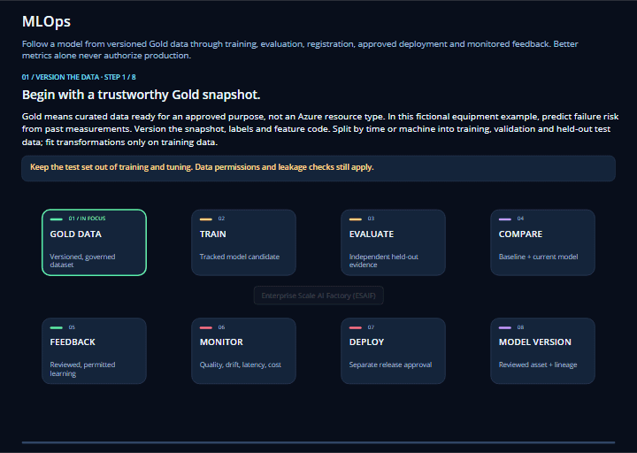

# 49 Agent training: ML churn prediction

<p align="center">
  
</p>

**Purpose:** a Foundry agent that creates, trains, retrains and batch-scores Azure ML use cases
through the ESML v2 SDK (`azure_esml`) and the canonical model-factory engines. It has two entry
points with the same plan-bound tools: a CLI prompt agent (`main.py ask`) and a Foundry hosted agent
that works in the Foundry Playground (see [Foundry Playground](#foundry-playground-hosted-agent)).
**Status:** Local tests and an offline from-scratch reproduction run without Azure. Every Azure write
needs an approved plan plus explicit flags (CLI) or the user's own approval message (Playground).
Passing tests is not evidence of a live run; see [Evidence](#evidence).

The agent supports exactly two use cases:

| Use case | Model | What the agent does |
| --- | --- | --- |
| `49-agent-training-ml-churn-prediction` | `M49` | Creates a telco-churn use case from scratch, copied from the model factory's `batch/classification/azureml-pipeline` churn custom-pipeline template. It always uses **synthetic data**, publishes it to the AI Factory shared lake, trains it, registers it and runs batch scoring. |
| `air-passengers` | `M05` | Retrains the existing model with its reviewed binding and data, then compares the result with the champion. A kept champion is a valid outcome, and scoring then uses the champion. |

The churn data comes from `ml_model_factory.synthetic` (generator `telco-churn`, seed 49, 7,043 rows,
hash-pinned provenance). The factory's Kaggle churn dataset remains license-gated and is never used.

## How it works

```text
main.py ask --demo uc1|uc2
  Foundry prompt agent (existing chat deployment)  ->  function calls
  local, plan-bound MLRuntime (this process, over the private network)
    create_usecase_from_template  scenario + rollout binding + generated notebook + synthetic data
                                  -> esml-v2 lake-seed staging -> create-only shared-lake publication
    start_training / start_retraining   AzureMLRollout: prepare -> register definitions -> train
                                        (resumes the recorded job; never resubmits) -> gated registration
    run_batch_inference                 GOLD_INFERENCE plan -> create-only unlabeled gold input
                                        -> one pipeline job -> lake predictions
```

The Foundry Playground cannot execute these client-side functions of the prompt agent. For the
Playground, deploy the hosted agent: it runs the same `MLRuntime` inside Foundry with its own identity.

**Naming.** The model number sets `naming_style=model-prefix`, which gives these names:

- Data assets, experiments and display names: `M49_<use case>_...`
- Model: `M49_49_agent_training_ml_churn_prediction`
- Components and endpoints: lowercase `m49_` / `m49-`, because Azure requires lowercase names
- Job IDs: unchanged `esml-<sha>` values, which act as idempotency keys

**Lake paths.** All paths are on the `esml_shared_lake` datastore, below `mlops/v1/`:

- Master: `master/environments/<env>/datasets/<use case>/versions/<data version>`
- Project input: `projects/project<NNN>/environments/<env>/datasets/<use case>/versions/<data version>/in`
- Use case: `projects/project<NNN>/environments/<env>/usecases/<use case>/...`

The use-case folder has the same name as this example folder.

**Consumer copy.** The orange ML factory receives these files:

- The scenario `user-config/model/scenarios/49-agent-training-ml-churn-prediction.json`.
- A generated notebook in `usecase-type/batch/classification/azureml-pipeline/`.
- A local `user-config/esml-rollout.local.json` binding. It contains the reviewed
  `"model_numbers": {"49-agent-training-ml-churn-prediction": 49}`.

The notebook and the agent share the same AzureMLRollout receipt folder, so neither path can submit
a job twice.

## Prerequisites

- An orange repository with the canonical ML model factory layout, refreshed with
  `python -m ml_model_factory instantiate`.
- The reviewed `esml-rollout.local.json` that contains the custom `air-passengers` binding.
- The champion run's `training-completion.json`.
- Existing Azure ML computes, environment and datastore. This example never creates them.
- Data-plane access for the signed-in operator. This example never assigns roles.
- Private connectivity (VPN) to the Azure ML workspace, the shared lake and the Foundry project.

## Setup

```powershell
cd usecase_code\40-agent-factory\49-agent-training-ml-churn-prediction   # or the orange copy
python -m venv .venv
.\.venv\Scripts\python.exe -m pip install -r requirements.txt "..\..\..\esml-v2[train,storage,dev]"
.\.venv\Scripts\python.exe -m unittest discover -s tests
```

In an orange repository, install the ESML SDK from `<orange>\azure-enterprise-scale-ml\esml-v2`.
The ESML build has no editable mode, so reinstall the SDK after you change `esml-v2` or the
model-factory engines.

## Reproduce from scratch

All generated configuration, data, receipts and transcripts stay outside this template.

```powershell
$py = ".\.venv\Scripts\python.exe"
# 1. Consumer configuration (offline).
& $py main.py init-config --factory-config <orange>\aifactory\agent-factory\config.json `
  --target <target> --orange-root <orange> --reviewed-rollout <reviewed esml-rollout.local.json> `
  --champion-receipts <champion run folder> --project-endpoint <Foundry project endpoint> `
  --model-deployment <existing chat deployment> --state-root <orange>\aifactory\agent-factory\49-agent-training-ml-churn-prediction\.agent-factory `
  --output <orange>\aifactory\agent-factory\49-agent-training-ml-churn-prediction\config.json
# 2. Offline reproduction: synthesize, prepare, train, evaluate and score locally.
& $py main.py offline --config <config> --work <new empty folder>
# 3. Project copy and local lake staging (no Azure writes).
& $py main.py prepare-local --config <config>
# 4. Read-only private-connectivity and prerequisite checks.
& $py main.py preflight --config <config>
# 5. Plan every name, path, run and write. Approve the printed SHA-256 before running anything live.
& $py main.py plan --config <config> [--fresh]
```

**Live commands.** Run these only after the plan is approved. Each one needs
`--approved-plan <plan.json> --plan-sha256 <hex> --apply --allow-paid`:

```powershell
& $py main.py deploy --config <config> <approval flags>
& $py main.py ask --config <config> --demo uc1 <approval flags>   # create, train and score M49
& $py main.py ask --config <config> --demo uc2 <approval flags>   # retrain and score M05
```

`create-usecase`, `train`, `retrain` and `infer` run the same operations without the model, using
`--usecase`. Rerunning any of them resumes from receipts and does not repeat a recorded job.

If an inference job fails, the next `infer` starts a fresh attempt (`-a2` to `-a5`). Each attempt has
its own receipts and its own create-only lake paths, so a recorded job is never resubmitted.

- `--fresh` plans the next immutable data version (`aif49-synth-v<n>`). Published versions are never
  overwritten or deleted.
- The commands keep the workstation awake during bounded Azure waits. After a sleep or VPN drop,
  rerun the same command with the same approved plan.

## Run this use case with an AI assistant

Copy a prompt, replace the `<...>` placeholders, and paste it into the assistant. Every assistant has a **demo data** prompt and a **your own data** prompt. [How these prompts work](../readme.md#run-the-use-cases-with-an-ai-assistant) explains where to paste them and what each assistant can and cannot do.

> **Own data:** the agent's tools accept exactly two use cases (M49 churn, generated synthetically, and M05 air-passengers). To train on your own dataset, use a scenario in the [ML model factory](../../50-ml-model-factory/readme.md); the **your own data** prompts below follow that route.

### AI Factory Agent Chat

Paste into the [AI Factory Agent Chat](../40-aifactory-agent/readme.md) with the **Project** explanation view and your scope selected. It answers from the indexed documentation with citations; the Factory actions panel only prepares a reviewable plan, which a person approves.

<details>
<summary><b>Demo data</b></summary>

```text
Explain the agent-driven ML use case in usecase_code/40-agent-factory/49-agent-training-ml-churn-prediction for my scope <project001-dev>: how the agent creates the M49 churn use case from the batch/classification/azureml-pipeline template with synthetic data, trains it, retrains M05 air-passengers against its champion, and runs batch scoring through ESML v2; how plans are approved (plan SHA-256, "approve <code>"); and what the agent will never do. Cite the documentation.

Then, in the Factory actions panel (it prepares a reviewable plan; a person approves it):
/create-agent-oftype-for-project
  type: 49-agent-training-ml-churn-prediction
  project_resource_id: </subscriptions/<sub>/resourceGroups/<project-rg>/providers/Microsoft.CognitiveServices/accounts/<account>/projects/<project>>
(This works only if the platform team has approved a workload profile for this type; otherwise the chat reports the blocker.)
```

</details>

<details>
<summary><b>Your own data</b></summary>

```text
I want to train and batch-score a churn-style model on our own customer data: <describe the dataset, target column and features>. Explain, with citations, why 49 accepts only its two fixed use cases, and how to define my own scenario in usecase_code/50-ml-model-factory/user-config/model/scenarios (task, target, features, split and quality gates) and run it through batch/classification/azureml-pipeline.

Then, in the Factory actions panel (it prepares a reviewable plan; a person approves it):
/create-ml-model-oftype-for-project
  type: classification
  serving_mode: batch
  project_resource_id: </subscriptions/<sub>/resourceGroups/<project-rg>/providers/Microsoft.MachineLearningServices/workspaces/<workspace>>
(This works only if the platform team has approved a workload profile for this type; otherwise the chat reports the blocker.)
```

</details>

### GitHub Copilot and Claude Code (one prompt for both)

The same prompt works in **GitHub Copilot** (VS Code Chat in *Agent* mode) and **Claude Code** (run `claude` in the repository root). Use a machine that is signed in to Azure CLI and connected to the AI Factory private network. Both assistants read this repository's `AGENTS.md`.

<details>
<summary><b>Demo data</b></summary>

```text
Run the agent-training use case in usecase_code/40-agent-factory/49-agent-training-ml-churn-prediction: offline first, then, after my approval of the exact plan, demo uc1 (create, train and score M49 churn on synthetic data).

First read AGENTS.md, then usecase_code/40-agent-factory/49-agent-training-ml-churn-prediction/readme.md.

1. Check prerequisites and report anything missing: Python 3.13, Azure CLI with a cached sign-in to my tenant (only if missing, ask me to run `az login --tenant <tenant-id>`), and the AI Factory VPN/private DNS.
2. In that folder, create its own `.venv`, install `requirements.txt` with ESML v2 exactly as the README shows, and run the offline unit tests.
3. Run `main.py init-config` with my factory config <path>, target <project001-dev>, orange root <path>, reviewed rollout <path>, champion receipts <path>, Foundry project endpoint <url> and model deployment <name>. Show me the config.
4. Run `offline` into a new empty work folder, then `prepare-local`, `preflight` (read-only) and `plan`. Show me the plan and its SHA-256.
5. Only after I approve that exact plan, run `deploy`, then `ask --demo uc1` with --approved-plan, --plan-sha256, --apply and --allow-paid, and summarize who is predicted to churn.
6. Optionally, after another approval, run `ask --demo uc2` (retrain M05 and compare with the champion).
7. Never resubmit a recorded job; resume from receipts instead.

Rules:
- Follow AGENTS.md. Use only commands and flags documented in the READMEs above; do not invent new ones.
- Run offline and read-only steps first. Before any command that writes to Azure (`--apply`, `--execute`, or a script the README says writes directly) or makes a billed model call, show me the exact command and its target and wait for my "yes".
- Never enable public network access, change networking or RBAC, approve all pending private links at once, edit integrity hashes, or print or store tokens, keys or SAS.
- Never overwrite an existing configuration file, and never commit configuration, journals, .venv folders or data.
- If a prerequisite is missing (private network, role, quota, upstream step), stop and tell me the blocker instead of working around it.
```

</details>

<details>
<summary><b>Your own data</b></summary>

```text
Train and batch-score a classification model on my own data with usecase_code/50-ml-model-factory (49 accepts only its two fixed use cases).

First read AGENTS.md, then usecase_code/50-ml-model-factory/readme.md, usecase_code/50-ml-model-factory/user-config/readme.md, usecase_code/40-agent-factory/49-agent-training-ml-churn-prediction/readme.md.

1. Check prerequisites and report anything missing: Python 3.10-3.13, Azure CLI with a cached sign-in to my tenant (only if missing, ask me to run `az login --tenant <tenant-id>`), and the AI Factory VPN/private DNS.
2. Install the model factory in its root `.venv` as the README shows.
3. My data: <local path to CSV or Parquet>, target column <target>, features <list or "all other columns">, categorical <list>, sensitive <list>. Copy it into data\in\<my-scenario>.
4. Create user-config\model\scenarios\<my-scenario>.json modelled on churn.json, with a distinct name and quality gates no lower than churn.json, and run `validate`.
5. Run `prepare`, `train` and `evaluate` locally into a fresh folder under ml-environment\outputs\<my-scenario> and show me the metrics and quality gate.
6. Run `sample-requests` and `score` locally to produce batch predictions, and summarize the predicted churners.
7. Stop before any Azure ML step; I will approve cloud training separately (commands with --execute).

Rules:
- Follow AGENTS.md. Use only commands and flags documented in the READMEs above; do not invent new ones.
- Run offline and read-only steps first. Before any command that writes to Azure (`--apply`, `--execute`, or a script the README says writes directly) or makes a billed model call, show me the exact command and its target and wait for my "yes".
- Never enable public network access, change networking or RBAC, approve all pending private links at once, edit integrity hashes, or print or store tokens, keys or SAS.
- Never overwrite an existing configuration file, and never commit configuration, journals, .venv folders or data.
- If a prerequisite is missing (private network, role, quota, upstream step), stop and tell me the blocker instead of working around it.
```

</details>

### Lovable

Lovable builds a hosted web front end. It cannot run this Python, sign in to your tenant or reach private AI Factory endpoints, so these prompts build a **prototype** with demo data or data you paste in. Paste only data you are allowed to share with an external service, and connect the prototype to the real result only through an API your platform team approves, never by enabling public access. Paste the **your own data** prompt as a follow-up message in the same Lovable project, after the demo prompt.

<details>
<summary><b>Demo data</b></summary>

```text
Build a "Churn prediction results" dashboard prototype.
- KPI cards: customers scored (50), predicted churners, average churn probability, model version (M49).
- A table of 50 mock telco customers (customer_id, tenure_months, contract, monthly_charges, churn_probability, prediction), sortable, with the highest risk on top.
- A "Champion vs challenger" card for the air-passengers forecasting model M05 (metric before and after retraining, and whether the champion was replaced), plus a 12-month forecast line chart.
- An "Agent activity" timeline: plan -> approved -> create use case -> train -> register -> batch score.

Constraints: front end only, no API keys or secrets in the code, and all data is mock or pasted sample data. Put every backend call behind one clearly named function in a single file, returning mock data for now, so it can later call an API my platform team approves.
```

</details>

<details>
<summary><b>Your own data</b></summary>

```text
Build the same "Churn prediction results" dashboard from my own scored output.
Here is a CSV with columns <id column>, <feature columns>, <probability column>, <prediction column>: <paste up to 500 rows>.
Show KPI cards, a sortable risk table, the probability distribution, and churn rate by <segment column>.

Constraints: front end only, no API keys or secrets in the code, and all data is mock or pasted sample data. Put every backend call behind one clearly named function in a single file, returning mock data for now, so it can later call an API my platform team approves.
```

</details>

## Video walkthrough tutorial - TBA

A video walkthrough tutorial, recorded by a person, will be published here soon. It shows how to run this code, step by step, to achieve the result described in this README.

## Foundry Playground (hosted agent)

The hosted agent `<owner>-<version>-ml-churn-hosted` (for example
`aif49-project001-dev-v1-ml-churn-hosted`) is a code-based Foundry hosted agent. It uses the
Responses protocol, Python 3.13, 1 vCPU and 2 GiB, and a remote dependency build from
`hosted-requirements.txt`.

```text
Foundry Playground  ->  hosted agent sandbox (agent identity, network-injected subnet)
  hosted_main.py (main.py in the package)  ->  ml_agent.hosted.HostedAgent
    model + function calls in the sandbox  ->  the same plan-bound MLRuntime and AzureMLRollout receipts
    plans, approvals and receipts  <->  <shared lake>/.../usecases/49-agent-training-ml-churn-prediction/agent-state/
```

**Package.** `hosted-package` writes a reproducible ZIP from an explicit allowlist:

- `hosted_main.py`, which becomes `main.py` in the package.
- `ml_agent`.
- The `azure_esml` and `ml_model_factory` sources of the installed ESML v2 SDK.
- A bundle of the consumer configuration without workstation paths, the reviewed rollout, the
  champion receipt, the scenarios and the selection policy.

The package contains no credentials and no generated data. The sandbox does not render notebooks; the
orange checkout keeps the generated notebook.

**Approval in chat.** The `plan_run` tool proposes a plan for exactly the use cases the user asked for
and returns an approval code. Tools for a use case outside the active plan are refused. The plan becomes
active only when the same platform user (the hashed `x-agent-user-id` that Foundry injects) replies with
exactly `approve <approval code>` within 30 minutes. The host checks that message itself; model output
and tool results can never approve a plan. Writes are allowed for 12 hours and only for the user who
approved the plan; anyone else can read its status. On every turn the host tells the model whether this
user's plan is active, so the model does not ask for approval again. Plans bind to the configuration
regardless of where the sandbox places its home folder.

**Long jobs.** Each Azure ML wait is bounded to about 20 seconds per tool call. A tool reports `running`
with the job name. Ask again later; the next call resumes the same recorded job from the shared
receipts and never submits a duplicate. `get_usecase_status` also reads the live Azure ML status of an
unfinished job and returns the next action. Receipts are uploaded to the lake before every Azure ML or
lake write and wait, and after every tool call. Uploads are conditional on the ETag that the session
read, so a stale session cannot overwrite newer receipts. A renewed blob lease serializes turns across
Playground conversations.

**Identity and roles.** Foundry creates a dedicated agent identity for the hosted agent. This example
never assigns roles. An administrator grants that identity the following roles, and nothing broader:

- `AzureML Data Scientist` on the Azure ML workspace.
- `Storage Blob Data Contributor` on the shared-lake container. Use an ABAC condition that limits
  writes and deletes to the M49 dataset paths, the two use-case roots and the publication blueprint
  prefix.
- `Storage Blob Data Contributor` on the workspace default blob container, with an ABAC condition that
  limits writes and deletes to `LocalUpload/`, when that datastore uses identity-based access. Azure ML
  code uploads then use the caller's identity.

The sandbox must also reach Azure ML, the lake and the Foundry project over the network-injected
subnet.

```powershell
& $py main.py hosted-package --config <config>                       # offline, reproducible ZIP
& $py main.py hosted-seed --config <config> --apply                    # create-only: continue the published data versions
& $py main.py hosted-deploy --config <config> --apply --allow-paid     # create/reuse, wait until active, route
```

`hosted-deploy` writes the version and the agent identity's principal ID to `hosted-agent.json` in the
consumer state folder. Then open the agent in the Foundry Playground, for example:

1. "What is the status of both use cases?"
2. "Recreate the churn use case from scratch, train it and score new customers. Also retrain
   air-passengers and score it." The agent proposes a plan for both use cases.
3. "approve <code>". The agent publishes the synthetic data and starts both trainings.
4. "Are the trainings done? Then score both use cases." Repeat until the predictions summaries appear.

## Test retraining of ML via Agent

Use this to check, from the Foundry Playground, that the hosted agent can retrain and score a model end
to end.

**Open the agent.** In the [Foundry portal](https://ai.azure.com), open your Foundry project, then
**Agents**, then the hosted agent (for example `aif49-project001-dev-v1-ml-churn-hosted`), and open it
in the Playground. A direct link has this shape:

```text
https://ai.azure.com/resource/agentsList?wsid=/subscriptions/<subscription-id>/resourceGroups/<resource-group>/providers/Microsoft.CognitiveServices/accounts/<foundry-account>/projects/<foundry-project>&tid=<tenant-id>
```

**Pick a prompt.** Each prompt names a use case from the table above and ends with "Plan it first", so
the agent proposes a plan and an approval code before it writes anything.

- Retrain `air-passengers` (`M05`) and compare it with the champion:

  ```text
  Retrain air-passengers (M05) with its reviewed binding and data, compare the result with the champion, then run batch scoring with whichever model wins. Plan it first.
  ```

- Recreate and train `49-agent-training-ml-churn-prediction` (`M49`) on fresh synthetic data:

  ```text
  Recreate 49-agent-training-ml-churn-prediction (M49) from the churn template with fresh synthetic data, publish it to the shared lake, train and register the model, then run batch scoring. Plan it first.
  ```

- Both use cases in one plan:

  ```text
  Recreate 49-agent-training-ml-churn-prediction with fresh synthetic data, train, register and score it; also retrain air-passengers, compare it with the champion and score it. Plan it first.
  ```

**Follow-up turns** (the same for every prompt):

1. The agent replies with the plan and a 12-character approval code. Within 30 minutes, send exactly
   `approve <code>` from the same Playground sign-in.
2. After about 10–15 minutes (training, including compute scale-up): "Are the trainings done? Then
   score." The agent registers or compares the model and starts batch scoring.
3. After about 5 more minutes: "Summarize the predictions."

**What to expect.**

- `M49`: a new synthetic data version is published, a new model version is registered, and 50
  synthetic customers are scored with the number predicted to churn.
- `M05`: the retrained candidate is compared with the champion. "Champion kept" is a valid outcome;
  scoring then uses the champion and returns 12 monthly forecasts.
- While a job runs, the agent answers `running` with the Azure ML job name. Asking again resumes the
  same job; it never submits a duplicate.

**Good to know.**

- Approvals belong to the platform user who approved them. Approve in the Playground itself; an
  approval given through the SDK or CLI with another identity does not allow writes from the
  Playground.
- An approved plan allows writes for 12 hours. After that, ask again for a new plan and code.
- A conversation stays on the hosted agent version it started on. After `hosted-deploy` routes a new
  version, start a new conversation to use it.

## Safety boundaries

**Writes that need approval:**

- Create-only lake publication.
- Azure ML data assets and pipeline components.
- Training and inference jobs.
- Gated model registration.
- One owned agent version (prompt agent and, separately, the hosted agent).
- Paid model responses.
- The hosted agent's receipt mirror and lease blob below the M49 use case's `agent-state` folder.

**What it never does:**

- Create, resize or delete compute.
- Create endpoints.
- Change roles, networking, private endpoints, DNS, Search, SKUs or model deployments.
- Delete models, data or lake files.

The tools accept only enumerated use cases. They expose no shell, free paths or delete operations.
Tool results are redacted before they reach the model.

## Evidence

Local unit tests and `offline` show that the code paths and synthetic data work. They do not prove any
of the following:

- A shared-lake publication.
- A completed Azure ML job.
- A registered model.
- A deployed agent.

Live evidence is stored as redacted receipts and transcripts in the consumer state folder, and the
Azure ML receipts are stored in the ML factory's `ml-environment\outputs`. Retraining an unchanged
seasonal-naive model on unchanged data normally keeps the champion.

[Agent Factory](../readme.md) | [ML model factory](../../50-ml-model-factory/readme.md) | [ESML v2](../../../esml-v2)
