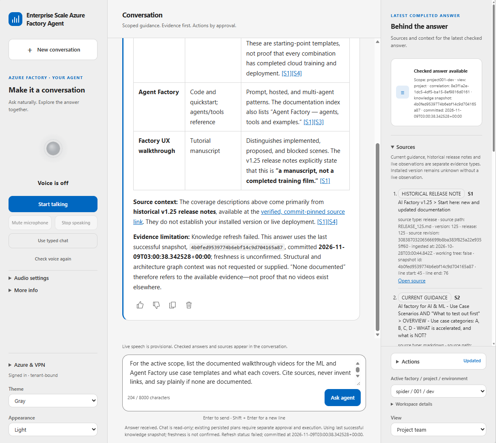
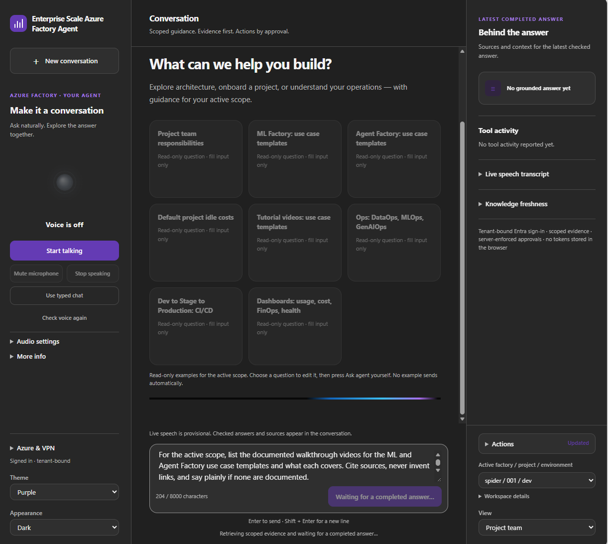
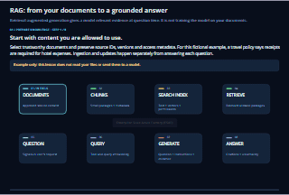
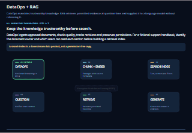
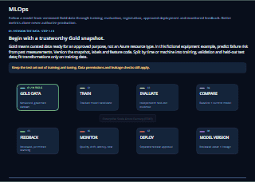
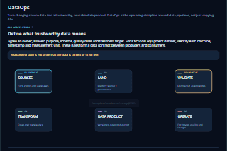
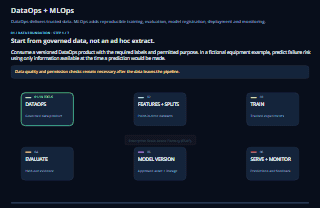

# Welcome to the use case code templates

Choose from **147 non-legacy implementation templates** for DataOps, MLOps and GenAIOps on the AI Factory infrastructure. Browse agents, machine-learning patterns and full stack examples, then follow the selected template's own prerequisites and setup instructions.<br>
- See <a href="https://jostrm.github.io/azure-enterprise-scale-ml/code-templates/" target="_blank"><b>Code Template Library</b></a> - where you can <b>filter and search</b> template by type<br>
- See <a href="https://jostrm.github.io/azure-enterprise-scale-ml/code-templates/" target="_blank"><b>Resources Library</b></a> - to see what Azure Resources you can use plug-and-play<br>
- See <a href="https://jostrm.github.io/azure-enterprise-scale-ml/architectures/" target="_blank"><b>Architecture library</b></a> to see which Azure Resources, that can talk with <b>Teams, Copilot, Fabric, Sharepoint</b> and which <b>Code template</b> to use.

| Category | Non-legacy templates | What is counted |
| --- | ---: | --- |
| [Agent factory](40-agent-factory/readme.md) | **19** | Agent/framework choices and dedicated data, MCP, chat and voice integration templates across 12 implemented use-case folders. |
| [ML factory](50-ml-model-factory/readme.md) | **124** | Notebook-bearing implementation leaves across batch, online and streaming; these contain **192 scenario notebooks**. |
| [Full stack](#full-stack-templates) | **4** | Two Azure Function applications and two standalone Foundry examples outside the factory folders. |
| **Total** | **147** | **19 + 124 + 4**, excluding legacy examples, placeholders and shared support assets. |

There are also **3 archived full stack examples**: including those gives **150 existing templates** (19 agent factory + 124 ML factory + 7 full stack). The headline uses the non-legacy count, not the archive-inclusive count.

> **Availability is not deployment certification.** These counts describe checked-in template implementations, not unique business problems or successful Azure runs. The ML factory's [recorded Azure matrix](50-ml-model-factory/readme.md#azure-test-status) reports only 8 of 105 implementation slots as “Tested and works”; prerequisites and limitations still apply.

## Use case template example

### Live Voice Agent Chat

Meet your AI colleague: the [Enterprise Scale AI Factory Agent](40-agent-factory/40-aifactory-agent/readme.md#use-case-template-example) runs as a full-stack application in your **ESAF project in Azure**, combining **Azure Container Apps**, **Microsoft Foundry**, **Azure AI Search**, and optional **Azure Voice Live** with private networking and firewall controls. Use it in a **web browser** to type or talk about your project and explore grounded answers.

For **double-encryption** requirements or extending the agent into **Microsoft Teams** through an authenticated **reverse proxy**, including the additional integration needed to join and speak in meetings, see the [template's security and Teams caveats](40-agent-factory/40-aifactory-agent/readme.md#use-case-template-example). These are not enabled automatically by deploying the browser template.

<table>
<tr>
<td align="center" valign="top" width="50%">
<a href="../documentation/v2/20-29/images/26-esaf-agent-chat-voice-light.png"></a><br>
<sub><b>Light appearance:</b> grounded answers, source citations and the active project scope.</sub>
</td>
<td align="center" valign="top" width="50%">
<a href="../documentation/v2/20-29/images/26-esaf-agent-chat-voice-purple.png"></a><br>
<sub><b>Purple theme, dark appearance:</b> voice controls and suggested conversation starters.</sub>
</td>
</tr>
</table>

*Illustrative companion UI screenshots; appearance and enabled features depend on the deployed version and configuration. Select an image to view it at full size.*

## Explore six illustrated starting points

The first row features three Agent Factory use cases. The second reproduces all three illustrated ML Factory entries: **usecase type**, **data**, and **ml environment**. Data and ML environment are supporting areas, not additional model templates in the totals.

<table>
<tr>
<td align="center" valign="top" width="33%">
<a href="40-agent-factory/40-aifactory-agent/readme.md"></a><br>
<a href="40-agent-factory/40-aifactory-agent/readme.md"><b>Enterprise Scale AI Factory Agent</b></a><br>
<sub>Versioned Foundry prompt agent grounded in Azure AI Search, with a private web frontend.</sub><br>
<sub><code>Agent</code> <code>RAG</code> <code>Web app</code></sub>
</td>
<td align="center" valign="top" width="33%">
<a href="40-agent-factory/45-rag-agent/readme.md"></a><br>
<a href="40-agent-factory/45-rag-agent/readme.md"><b>RAG from the AI Factory shared lake or project storage</b></a><br>
<sub>Runnable text RAG over the shared lake or project storage, one agent per source.</sub><br>
<sub><code>RAG</code> <code>Azure AI Search</code> <code>Foundry IQ</code></sub>
</td>
<td align="center" valign="top" width="33%">
<a href="40-agent-factory/48-rag-with-splitted-tables-acl-adlsgen2/readme.md"></a><br>
<a href="40-agent-factory/48-rag-with-splitted-tables-acl-adlsgen2/readme.md"><b>Split tables: native ADLS permissions, multi-index RAG and exact sales</b></a><br>
<sub>Multi-index RAG over split tables, with native ADLS Gen2 permissions and exact sales totals.</sub><br>
<sub><code>RAG</code> <code>ADLS Gen2 ACL</code> <code>Multi-index</code></sub>
</td>
</tr>
<tr>
<td align="center" valign="top" width="33%">
<a href="50-ml-model-factory/usecase-type/readme.md"></a><br>
<a href="50-ml-model-factory/usecase-type/readme.md"><b>usecase type</b></a><br>
<sub>Pick a serving pattern, model task and tech stack across 192 generated notebooks.</sub><br>
<sub><code>MLOps</code> <code>Batch</code> <code>Online</code> <code>Streaming</code></sub>
</td>
<td align="center" valign="top" width="33%">
<a href="50-ml-model-factory/data/readme.md"></a><br>
<a href="50-ml-model-factory/data/readme.md"><b>data</b></a><br>
<sub>Local raw input and processed datasets; not the Azure storage account.</sub><br>
<sub><code>DataOps</code> <code>Data</code> <code>Local</code></sub>
</td>
<td align="center" valign="top" width="33%">
<a href="50-ml-model-factory/ml-environment/readme.md"></a><br>
<a href="50-ml-model-factory/ml-environment/readme.md"><b>ml environment</b></a><br>
<sub>Generated models, reports, MLflow tracking and package metadata.</sub><br>
<sub><code>MLOps</code> <code>Generated</code> <code>MLflow</code></sub>
</td>
</tr>
</table>

## Template inventory and counting rules

Inventory checked against the tracked source tree on **2026-11-02**. A template means a selectable implementation route, not every Python file, agent role, dataset, CLI command or generated artifact. Framework/runtime variants are separate choices; multiple scenario notebooks within the same ML leaf are not.

### Agent factory templates

| Use-case folder | Templates | Implementation choices |
| --- | ---: | --- |
| [40-aifactory-agent](40-agent-factory/40-aifactory-agent/readme.md) | 1 | Documentation-grounded agent and private web application. |
| [41-single-agent](40-agent-factory/41-single-agent/readme.md) | 7 | **1 prompt-agent route + 6 hosted frameworks**: Agent Framework, LangGraph, OpenAI Agents SDK, GitHub Copilot SDK, custom, and Anthropic agents. |
| [42-multi-agent](40-agent-factory/42-multi-agent/readme.md) | 1 | Hosted knowledge/reviewer/synthesis team; participants are not extra templates. |
| [42-multi-agent-fabric-iq](40-agent-factory/42-multi-agent-fabric-iq/readme.md) | 1 | Retail supervisor with Foundry IQ and Fabric IQ. |
| [43-data](40-agent-factory/43-data/readme.md) | 1 | Helpdesk data ingestion and retrieval preparation. |
| [44-azure-mcp](40-agent-factory/44-azure-mcp/readme.md) | 1 | Private Azure inventory MCP integration. |
| [45-aifactory-mcp-gateway](40-agent-factory/45-aifactory-mcp-gateway/readme.md) | 1 | Governed MCP and AI Gateway pipeline integration. |
| [45-rag-agent](40-agent-factory/45-rag-agent/readme.md) | 1 | Source-bound RAG; common/project storage settings are not separate implementations. |
| [46-factory-chat-agent](40-agent-factory/46-factory-chat-agent/deploy.py) | 1 | Dedicated opt-in Foundry chat-agent pipeline deployment entry point. |
| [47-aifactory-agent-live-voice](40-agent-factory/47-aifactory-agent-live-voice/readme.md) | 1 | Private chat/web application with live-voice pipeline integration. |
| [48-rag-with-splitted-tables-acl-adlsgen2](40-agent-factory/48-rag-with-splitted-tables-acl-adlsgen2/readme.md) | 1 | Split-table, native-ACL, multi-index RAG example; experiments and test scenarios stay within this template. |
| [49-agent-training-ml-churn-prediction](40-agent-factory/49-agent-training-ml-churn-prediction/readme.md) | 2 | CLI prompt agent (`main.py`) and Foundry hosted agent (`hosted_main.py`); churn/air-passengers are scenario choices, not extra implementations. |
| **Total: 12 implemented folders** | **19** | Deployment integrations count as selectable templates even where they reuse a shared runtime. |

`41-single-agent/prompt-agent` is one implementation route even though the shared catalog supplies knowledge, reviewer and documentation roles. Excluded: the README-only `40-aifactory-agent-v2` placeholder, the shared `agent_factory` library, tests, images and configuration/support files.

### ML factory templates

| Serving pattern | Broad use cases | Catalog leaves | Leaves with notebook templates | Scenario notebooks |
| --- | ---: | ---: | ---: | ---: |
| [Batch](50-ml-model-factory/usecase-type/batch/readme.md) | 4 | 42 | **42** | 66 |
| [Online](50-ml-model-factory/usecase-type/online/readme.md) | 4 | 42 | **42** | 66 |
| [Streaming](50-ml-model-factory/usecase-type/streaming/readme.md) | 4 | 42 | **40** | 60 |
| **Total** | **12** | **126** | **124** | **192** |

- The four broad problem families are classification, regression, time-series forecasting and computer vision. Computer vision expands into multi-class, multi-label, object detection and instance segmentation: **21 expanded pattern/task groups** across the three serving patterns.
- Five technology stacks give **105 implementation slots**. Splitting AutoML into its notebook and pipeline-step variants gives **126 catalog leaves**.
- Both streaming forecasting AutoML leaves are unsupported README-only placeholders. Excluding them leaves **124 template-bearing routes**. The **192 notebooks** specialize those routes for datasets/scenarios; counting them again would double-count implementations.
- Source of truth: the [catalog](50-ml-model-factory/accelerator/src/ml_model_factory/usecases.py), [example generator](50-ml-model-factory/accelerator/src/ml_model_factory/examples.py), and checked-in [use-case tree](50-ml-model-factory/usecase-type/readme.md). Shared engines, data, user configuration and generated ML environment artifacts are not extra use cases.

### Full stack templates

“Full stack” is the catch-all category for examples outside `40-agent-factory` and `50-ml-model-factory`; it does not imply every sample has a frontend.

| Folder / example | Non-legacy templates | Archived templates | Scope |
| --- | ---: | ---: | --- |
| [10-azure-function/11_func_read_from_storage](10-azure-function/11_func_read_from_storage/README.md) | 1 | 0 | Azure Function reading from storage. |
| [10-azure-function/12_func_aifactory_lifecycle](10-azure-function/12_func_aifactory_lifecycle/README.md) | 1 | 0 | Factory lifecycle application; its operation scenarios/backends are not separate application templates. |
| [20-agent-foundry/agent_04_prompt_rag_responses_api.py](20-agent-foundry/agent_04_prompt_rag_responses_api.py) | 1 | 0 | Prompt-agent RAG using the Responses API. |
| [20-agent-foundry/agent_05_fabric_data_agent.py](20-agent-foundry/agent_05_fabric_data_agent.py) | 1 | 0 | Foundry prompt agent with a Fabric data-agent tool. |
| [20-agent-foundry/_legacy](20-agent-foundry/_legacy/README.md) | 0 | 3 | Archived RAG, multi-agent and prompt/Responses API scripts. The four `multi-agent/` role modules support the legacy example, not four extra end-to-end templates. |
| [30-machine-learning](30-machine-learning/README.md) | 0 | 0 | Empty README only; use ML Factory instead. |
| **Total** | **4** | **3** | **7 including archived examples.** |

`00-install-prereqs`, shared `data`, environment files, dependency manifests, deployment helpers and tests are supporting assets, not additional templates. Legacy presence is not a claim of compatibility or runnability.

## How to setup & Run code samples

The walkthrough below is specifically for the two standalone `20-agent-foundry` examples. Agent Factory and ML Factory have separate environments and commands: use their linked READMEs above rather than applying this setup to every template.

## Prerequisites

- Python 3.10+
- Azure CLI installed (`az login`)
- An AI Factory with AI Foundry and AI Search enabled
  (see [documentation/v2/20-29/24-end-2-end-setup.md](../documentation/v2/20-29/24-end-2-end-setup.md))

## Step 1 – Configure environment variables

1. Copy `.env.template` to `.env` (in this folder)
2. Fill in the `<TODO>` placeholders:
   - `SUBSCRIPTION_ID`, `TENANT_ID`, `RESOURCE_GROUP`
   - `FOUNDRY_ACCOUNT_ENDPOINT`, `FOUNDRY_PROJECT_ENDPOINT`
   - `AI_SEARCH_NAME`, `AI_SEARCH_INDEX_NAME`
   - `CHAT_MODEL`, `EMBEDDING_MODEL`
   - `AGENT_NAME`, `AGENT_INSTRUCTIONS`, etc.

## Step 2 – Create a Python virtual environment

From this folder (`usecase_code/`):

**Bash / macOS / Linux:**

```bash
cd 20-agent-foundry
python -m venv .venv
source .venv/bin/activate
pip install -r requirements.txt
```

**Windows (PowerShell):**

```powershell
cd 20-agent-foundry
python -m venv .venv
.venv\Scripts\Activate.ps1          # run directly – do NOT prefix with 'python'
pip install -r requirements.txt
```

**Windows (cmd):**

```cmd
cd 20-agent-foundry
python -m venv .venv
.venv\Scripts\activate.bat
pip install -r requirements.txt
```

> **Tip:** In PowerShell, chain commands with `;` not `&&`:
> `cd 20-agent-foundry; python -m venv .venv; .venv\Scripts\Activate.ps1; pip install -r requirements.txt`

## Step 3 – Sign in to Azure

```bash
az login
```

Make sure your account has RBAC access to the AI Foundry account/project, AI Search, and the resource group.

## Step 4 – Run the code samples

**Single prompt agent RAG example (Responses API):**

```bash
python agent_04_prompt_rag_responses_api.py --reindex
```

**Foundry Prompt agent with Microsoft Fabric data agent tool (Responses API):**

```bash
python agent_05_fabric_data_agent.py
```

> Requires the `FABRIC_*` variables in `.env` (`FABRIC_WORKSPACE_ID`, `FABRIC_ARTIFACT_ID`,
> and optionally `FABRIC_TOOL_CONNECTION` / `FABRIC_TOOL_QUESTION_ARRAY`).

## Notes

- On start you are prompted to create new agents or reuse existing ones.
- On exit you are prompted to keep or delete agents and indexes.
- Omit `--reindex` to reuse an existing AI Search index.
